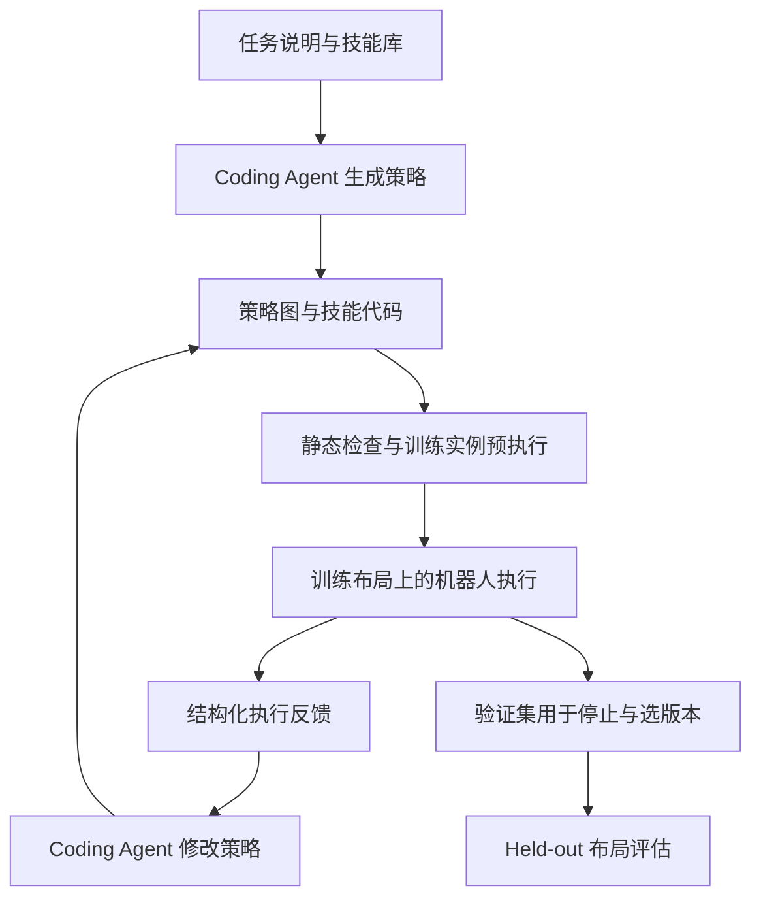
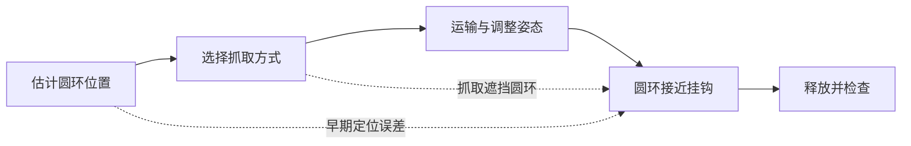

# Agentic Robotics 受控研究：模型怎样从执行失败中改进机器人策略

论文：**A Controlled Study of Models, Skills, Feedback, and Curriculum in Agentic Robotics**。Kaiyuan Chen 等，UC Berkeley、Bosch、NVIDIA，arXiv:2611.09030v1，2026-11-06。

[论文](https://arxiv.org/abs/2611.09030) · [全文与附录](https://arxiv.org/html/2611.09030v1) · [项目主页](https://graph-robots.github.io/agentic-self-learning/) · [代码](https://github.com/graph-robots/agentic-self-learning) · [Agent 执行记录](https://huggingface.co/datasets/keplerccc/agentic-robotics-coding-traces)

这篇论文研究一个具体问题：**Coding Agent 写出机器人策略之后，能否根据真实的执行结果，改出一个在新布局上更可靠的版本？** 作者把这个过程拆成模型、技能、反馈和课程四个因素，逐项观察它们怎样影响策略改进。

最值得记住的是三个能力层次：记录失败、解释失败、修复策略。一次操作失败可能已经被日志完整记录，Agent 也能用语言说明“碰撞了”，但下一次修改仍可能只是把高度增加几厘米。这种修改有时能救回当前布局，却未必形成可迁移的碰撞处理方法。

研究提供了较强证据，说明在这套仿真任务和工具条件下，瓶颈经常出现在**把物理证据转成有效的程序修改**这一环节。它的结果主要覆盖同一任务类别内的布局泛化。

## 1. 这里的 self-learning 到底学习了什么？

### 1.1 被更新的是策略程序

常见的策略学习会更新神经网络参数。这里的外层循环更新的是可执行程序：策略图的节点、分支、调用顺序，以及技能的 Python 实现。

设任务说明为 \(\mathcal T\)，可用技能集合为 \(\mathcal S\)，Coding Agent 为 \(A\)，则初始策略可以写成：

\[
\pi_0=A(\mathcal T,\mathcal S).
\]

第 \(k\) 轮先执行策略，得到轨迹，再生成反馈：

\[
\tau_k=\operatorname{Rollout}(\pi_k,\mathcal E),\qquad
f_k=F(\tau_k).
\]

然后根据当前代码、执行反馈和修改历史生成下一版：

\[
\pi_{k+1}=A(\pi_k,f_k,\mathcal H_k).
\]

这个过程可以理解为有执行反馈的程序搜索。论文没有在这些实验中训练底层大模型权重，也没有通过 PPO 或 GRPO 对 Coding Agent 做参数更新。

### 1.2 Coding Agent、策略图和仿真器分工不同

| 组件 | 负责什么 | 产生什么 |
|---|---|---|
| Coding Agent | 阅读任务和反馈，编辑策略 | 新的图结构与技能代码 |
| Graph-as-Policy | 根据当前观察调度感知、规划和控制 | 一次机器人任务执行 |
| 技能库 | 提供定位、抓取、运动规划等能力 | 可调用函数及部分可读实现 |
| 仿真器与评估器 | 执行动作，记录状态并判定结果 | 轨迹、接触、成功指标 |
| 实验 harness | 管理检查、数据划分、回退和策略选择 | 可比较的迭代结果 |



图展示论文主实验的角色分工；实际执行中还有修改退化后的回退。Held-out 数据用于衡量性能，不作为 Agent 的修复提示。

策略图本身可以闭环执行，例如重新拍图、检测物体是否移动、失败后重抓。外层 Coding Agent 修改策略是另一层循环。两者要区分，否则容易把“程序里的 retry”与“跨执行轮次的策略改进”混为一谈。

相关基础见 [GaP 笔记](GaP.md)。

## 2. 实验范围和计分方式

### 2.1 九项任务分属两个实验套件

| 套件 | 任务 | 主要考察点 |
|---|---|---|
| VABAR | Tool Hanging | 抓取和接近方式是否允许扳手圆环挂入挂钩 |
| VABAR | Syringe Packing | 长物体运输、姿态调整和狭窄开口插入 |
| VABAR | Gear Meshing | 齿轮定位、啮合以及后续驱动验证 |
| VABAR | USB-C Insertion | 严格的位姿与接触约束 |
| VABAR | Cable Routing | 双臂协作、柔性物体形状与接触变化 |
| MimicGen | Kitchen、Coffee、Threading、Mug Cleanup | 课程实验中的多阶段操作与视觉迁移 |

模型、反馈等主实验集中在五项 VABAR 任务；课程实验使用四项 MimicGen 和三项 VABAR。九项任务并没有全部参加每一种消融。

机器人和传感器配置固定，物体与场景变化范围有界。Held-out 测试主要检查程序在同类任务的新布局上是否有效。论文未研究跨机器人迁移或真实机器人上的 self-learning。

### 2.2 训练、验证、测试各有用途

论文主循环通常使用：

- **4 个训练布局**：产生 Agent 能读取的执行反馈。
- **5 个验证布局**：用于停止和选择策略版本。
- **10 个 held-out 布局**：用于报告性能。

模型比较通常观察初始生成及两轮反馈修改；反馈与技能库实验最多包含六个迭代点，即初始策略加五次修改。

这里有两个需要保留的协议细节。首先，Table 1 是迭代曲线，其他一些实验报告的是验证集选出的版本。其次，附录 C.2 说明，Opus 5 xhigh 的两个早期实验在 Tool Hanging 和 Gear Meshing 上重复使用一个训练实例，且没有验证集。因此，“全部实验严格共享 4/5/10 划分”并不准确。[实验调度说明](https://arxiv.org/html/2611.09030v1#A3)

### 2.3 Per-object success 不等于整条任务成功

主要 VABAR 表格使用 **held-out per-object success**。例如一条任务要求放入两支注射器，成功放入一支可以获得部分物体得分，但整条任务仍未完成。Cable Routing 也有分阶段或子目标计分。

因此，读到某个模型整体分数为 74%，应理解为该表规定的任务汇总指标，不能改写成“74% 的长任务全部成功”。对长时程操作研究，建议同时保留完整 episode success 和中间阶段完成度。

### 2.4 28K 是机器人 rollout 的数量级

附件里的“约 28,000 次仿真 rollout”和“约 2,500 个 Coding Agent session”需要分开。附录 Table 20 列出 27,620 次 policy episode 与 2,459 个 Agent session；后者包含初始生成、反馈修改和预执行修复。

表内 631 runs 还包括 superseded passes 与 dropped arms。不能把它理解为 631 个完全独立、都进入最终结果表的超参数组合，更不能据此认为论文做了四个因素的全因子实验。

## 3. 一轮策略改进是怎样执行的？

可以把论文主实验的一轮理解成以下过程。

1. **生成或修改代码。** Agent 写出 workflow 和所需技能实现，遵守可调用工具与文件访问规则。
2. **检查可执行性。** 静态检查和训练实例上的预执行发现图格式、接口、代码运行等问题。需要时启动修复会话。
3. **执行训练布局。** 由仿真器运行策略，评估器判断物理结果。
4. **生成反馈。** 汇总状态变化、技能返回值、接触和失败等信息，按实验条件组织成报告。
5. **处理退化与历史。** harness 根据预定规则决定是否保留修改，提供历史摘要和代码差异。
6. **验证与继续。** 验证分数参与停止和选版本；未停止时，再启动一次 Agent 修改。

这里存在三个不同的“成功”：程序能加载、技能函数返回完成、物理任务满足目标。它们必须由不同证据判断。例如 `place()` 返回正常，只说明函数跑完，不说明物体稳定留在容器里。

论文主循环每次修改启动新 Agent session。它通过当前文件、反馈中的历史摘要以及精确 diff 获取过去信息。这是一种通过外部文件保存经验的设计。

**最终结果必须以环境评估器为准。** Agent 自己说“已经修好了”，或者新程序没有报错，都不能替代下一次物理执行。

## 4. Finding 1：初始策略能力与修复能力要分别测

下面整理附件提供、并与论文 Table 1 核对的结果。数值为五项 VABAR 任务汇总的 held-out per-object success；增益单位为百分点。

| 模型设置 | 初始 @0 | 两轮后 @2 | 累计增益 |
|---|---:|---:|---:|
| Opus 5 high | 41% | 81% | +40 |
| Opus 5.5 | 67% | 77% | +10 |
| Opus 5 xhigh | 45% | 74% | +29 |
| Opus 5 low | 57% | 74% | +17 |
| Fable 5.1 | 44% | 64% | +20 |
| GPT-6 Sol | 33% | 53% | +20 |
| GPT-6 Astra | 43% | 48% | +5 |
| Sonnet 5 | 45% | 46% | +1 |
| Kimi K3 | 39% | 46% | +7 |
| DeepSeek V4 | 38% | 44% | +6 |

来源：[论文 Table 1](https://arxiv.org/html/2611.09030v1#S5.T1)。这是论文实验时的具体模型与调用设置，不是当前所有机器人应用的通用模型排名。

Opus 5 xhigh、Fable 5.1、GPT-6 Astra、Sonnet 5 的初始分数接近，都在 43%–45%。经过反馈后，它们却分别达到 74%、64%、48%、46%。因此，只看第一版代码能不能执行，会漏掉模型之间很重要的能力差异。

可以把一个机器人 Coding Agent 的表现分成：

\[
\text{初始质量},\quad
\text{反馈后的增益},\quad
\text{达到该增益的成本}.
\]

这三项可以独立变化。起点高的模型可能很适合一次性部署；起点相似的模型可能具有完全不同的修复能力；同样的成功率也可能对应不同的仿真和推理开销。

### 不能从这些行推出“思考越少越好”

附件引用的相关系数为：修复增益与 thinking tokens 的 Spearman 相关约 0.09，与代码修改量约 0.69。这些只是少量模型设置之间的相关关系。更大的修改量可能反映模型能够重构策略，也可能只是强模型的伴随特征，不能当作“多改几行就能提升”的因果证据。

模型调用条件也不完全等价：CLI、上下文、默认采样和推理控制方式不同。尤其附录 G.3 明确提醒，Opus 5 的三个标签应视为同一模型的不同实验样本，不能视为干净的推理强度扫描。设置的单请求预算没有直接变成整次会话的可比思考量。

## 5. Finding 2：技能库提供基础，真正的难点是如何适配

论文把技能分成四类：

\[
\mathcal S=\mathcal S_0\cup\mathcal S_g\cup\mathcal S_\tau\cup\mathcal S_A.
\]

| 集合 | 含义 | 例子 |
|---|---|---|
| \(\mathcal S_0\) | 基础机器人与传感器接口 | 拍图、移动、夹爪控制 |
| \(\mathcal S_g\) | 通用技能 | 物体定位、通用抓取、运动规划 |
| \(\mathcal S_\tau\) | 人提供的任务专属技能 | 为挂扳手设计的抓取与对齐逻辑 |
| \(\mathcal S_A\) | Agent 自行生成的任务技能 | 新的避障、重定位或接近逻辑 |

例如，通用抓取技能可能成功拿起扳手，却把夹爪放在圆环附近。抓取本身成功，但后续挂钩无法穿过圆环。有效的修改需要从最终任务约束反推抓取位置，而不能只提高 `grasp()` 的成功率。

作者按代码来源分析初始策略：Opus 5 xhigh、Opus 5.5、Fable 5.1 的新代码比例约为 24%、18%、12%，部分修复增益较小的模型约为 4%–7%。这个观察支持一种解释：已有技能对强模型是可改造的起点，对另一些模型则可能限制其搜索范围。

但“新代码”在这里主要根据规范化后的代码行与库代码是否匹配来归因。它不是对算法创新程度的测量，参数调整和实现重写也可能影响统计。

还要区分三种成果：修改当前任务的参数、为当前任务实现新技能、把技能验证后加入长期共享库。论文重点验证前两种。要证明第三种，需要让新技能在后续新任务上带来收益，并检查旧技能退化与库规模增长问题。

**读表时的重要区别：** 模型对比使用通用技能与专家任务技能；反馈研究的参考配置不含同样的专家任务脚本。反馈实验初始分数只有约 3%，不应拿它与模型表约 40% 的起点直接比较。[技能可用性表](https://arxiv.org/html/2611.09030v1#A2)

## 6. Finding 3：反馈要对应可修改的决策

### 6.1 失败出现的位置可能晚于错误决策

挂扳手的流程可以简化为：



机器人最后没有挂上，日志可能停在接近或释放阶段。但根因可能是最初估错了圆环中心，或者抓取方式使后续插入不可能完成。

如果 Agent 只修改最后失败的函数，它很容易反复调偏移和速度，而早期决策一直没有改变。

### 6.2 三种反馈粒度

| 反馈 | 告诉 Agent 什么 | 可能遗漏什么 |
|---|---|---|
| Per-episode | 整次执行的起止状态、结果 | 中间错误是在哪个决策引入的 |
| Per-motion | 每次推进仿真的运动调用结果 | 感知、选择和规划等不产生运动的节点 |
| Per-skill | 语义节点的返回值与状态变化 | 节点内部仍可能有更细的错误 |

附件和论文 Table 2 的结果如下。各条件共享初始策略，经过最多五次修改，以验证集选择报告版本。

| 反馈方式 | 五任务整体 | Tool Hanging | Syringe Packing |
|---|---:|---:|---:|
| 初始策略 | 3% | 0% | 0% |
| Per-episode | 25% | 7% | 90% |
| Per-motion | 36% | 45% | 55% |
| Per-skill | 52% | 90% | 50% |

来源：[论文 Table 2](https://arxiv.org/html/2611.09030v1#S5.T2)。

Tool Hanging 的差异符合前面的归因问题：语义反馈暴露了更早的圆环定位结果，Agent 才有机会改对模块。逐运动报告虽然更密，却可能完全不记录那个感知节点。

Syringe Packing 给出相反例子：注射器横着停在容器口，最终状态已经能暴露姿态问题，Per-episode 达到 90%，高于另外两种。

因此，最有依据的结论是：**反馈应覆盖决定行为的关键步骤，并让证据对应到可编辑的模块。** “采样更频繁”或“日志更长”都不是独立的优化目标。

这组实验也包含信息覆盖差异。Per-skill 既改变组织单位，又包含部分 Per-motion 缺失的非运动结果，所以不能把全部增益归因于纯粹的文本排版。

## 7. Finding 4：坐标齐全，不代表能推导出操作关系

### 7.1 为什么相对坐标更有用？

假设报告给出物体 A 和 B 在世界坐标系中的位姿：

\[
{}^WT_A,\qquad {}^WT_B.
\]

若要判断 A 相对于 B 的位置和方向，需要计算：

\[
{}^BT_A=({}^WT_B)^{-1}{}^WT_A.
\]

对于接触任务，还要继续关联功能部件：圆环中心相对钩轴的位置、插头轴相对插孔轴的夹角，以及进入开口所需的间隙。

对机器人几何算法，这些是明确的变换和约束；对读取长报告的语言模型，它们可能成为多步推导错误的来源。直接提供相对关系，相当于把一部分确定性的几何计算交给更适合的工具。

### 7.2 空间表示的对照结果

| 反馈表示 | 五任务整体 | Tool Hanging |
|---|---:|---:|
| Outcome only | 19% | 15% |
| 世界坐标状态与关系 | 30% | 25% |
| 物体坐标与相对关系 | 40% | 63% |
| 再加入功能部件标注 | 52% | 90% |

来源：[论文 Table 3](https://arxiv.org/html/2611.09030v1#S5.T3)。

世界坐标和物体坐标可以描述相同底层状态，但它们对 Agent 的推导负担不同。功能部件标注则进一步提供 ring、shank 等与任务相关的几何语义。

这里要保留两层解释：相对坐标的收益支持“信息组织影响可用性”；功能部件的收益还包含新增语义先验。后者不能全部归入“同样的信息换一种格式”。

对灵巧操作，这给出一个值得检验的方向：输入除了整体物体 pose，还可以包含接触点、接触法向、可抓区域、支撑关系和允许的间隙。但这些结构的估计误差也会影响策略，需要连同错误标注一起评测。

## 8. Finding 5：指出碰撞以后，还需要构造可执行计划

Syringe Packing 的例子很直观：约 150 mm 长的注射器要穿过约 55 mm 的开口。单独检查机械臂路径是否避障是不够的，因为抓取后注射器也属于随机器人运动的几何体。

用一个示意性的约束表达：

\[
\mathcal B(q)=\mathcal B_{robot}(q)\cup\mathcal B_{held}(q),
\qquad
\mathcal B(q)\cap\mathcal O=\varnothing.
\]

\(q\) 是机器人构型，\(\mathcal O\) 是障碍集合。实际规划还要考虑沿整条路径的扫掠体、接触容差和允许碰撞；只验证起点与终点安全不能保证中间旋转安全。

合理策略需要联合决定：在哪里抓、抓住后的物体变换、在哪里有足够空间旋转、以什么姿态穿过开口，以及下降时保持哪些约束。

论文案例中的人类程序显式建立碰撞场景、注册被抓物体，并设置符合几何约束的中间位姿。Agent 常能识别“横着放不进去”，然后改成“抬高、旋转、竖直下降”，但更倾向于用固定高度、偏移和重试表达修复。

这种启发式并非没有价值，它可以改善特定任务；问题在于新的障碍布局和物体长度变化是否仍被正确处理。研究下一步应检查**修复是否改变了约束建模能力**，而不仅检查这一次是否成功。

## 9. Finding 6：先用精确状态学习，为什么有时更差？

### 9.1 两种课程使用不同的信息顺序

Privileged → Perception 先让 Agent 使用仿真器精确状态，学习一版策略，再转换为视觉感知并继续修改。Perception only 从第一轮起就面对感知误差。

两者在同套件内控制总迭代预算。MimicGen 使用 8 轮 privileged 加 8 轮 perception；VABAR 使用 5+5 轮。不同套件使用的 Agent 和具体设置有区别，不能把它们当作完全统一的一组实验。

| 任务 | 有课程 | 直接使用感知 | 课程差值 |
|---|---:|---:|---:|
| Tool Hanging | 16% | 63% | −47 个百分点 |
| Gear Meshing | 33% | 40% | −7 个百分点 |
| USB-C Insertion | 31% | 16% | +15 个百分点 |
| Kitchen | 33% | 62% | −29 个百分点 |
| Coffee | 76% | 64% | +12 个百分点 |
| Threading | 86% | 2% | +84 个百分点 |
| Mug Cleanup | 93% | 77% | +16 个百分点 |
| 整体 | 52% | 46% | +6 个百分点 |

来源：[论文 Table 4](https://arxiv.org/html/2611.09030v1#S5.T4)。该表是三个重复运行、最后三轮的平均 held-out success，统计方式不同于前面的验证集选优表。

整体平均略高，但任务间差异很大。课程帮助 Threading，却显著损害 Tool Hanging 与 Kitchen。论文支持的是课程效果依赖任务和所学策略，不是课程普遍无效。

### 9.2 精确感知可能让策略依赖过窄的容差

Kitchen 的案例中，早期策略选择了锅柄上很窄的抓取部位。精确几何让这个选择看起来可靠，换成视觉估计后，定位误差就足以使抓取失败。

这时只把 `ExactPose` 替换成 `EstimatedPose`，仍然保留同一个脆弱抓取方式。更鲁棒的策略可能需要重新选择接触部位、主动换视角、验证抓取，甚至重新分解任务。

用流程表示，两种改动的范围不同：

```text
局部接口替换：精确定位 → 精细抓取 → 搬运
                    ↓
              视觉定位 → 精细抓取 → 搬运

结构性调整：视觉定位 → 选择容差更大的抓取 → 验证
                                      ↓ 失败
                                  重观察或重抓
```

论文观察到，privileged 阶段结束时策略平均约 12.0 个节点，转成视觉并继续学习后约 12.7 个；直接从感知开始的最终策略平均约 16.1 个。这与“继承既有结构、主要打补丁”的解释一致，但节点数量本身不能证明策略优劣。

这也是程序层面的路径依赖：早期成功会让后续搜索围绕既有分解展开。它不是神经网络权重灾难性遗忘的直接证据。

### 9.3 课程实验另有采样协议

附录 J 中，MimicGen 每轮使用 10 个新采样训练布局，并允许最多两次额外的、不计分的 probe；VABAR 使用固定四个训练布局，不允许这些 probe。两套件的探索机会不同，复现时需要分别记录。[课程实验协议](https://arxiv.org/html/2611.09030v1#A10)

## 10. 怎样判断这些结论的证据强度？

这篇论文的优势是把完整自改进系统拆开，并提供中间代码和执行证据。它让研究者可以检查“到底修了哪里”，而不仅仅看到最后一个分数。

但几个边界会直接影响读者的判断。

| 观察结果 | 可以支持什么 | 仍需额外验证什么 |
|---|---|---|
| 相近起点在反馈后分化 | 初始生成与修复表现应分别评估 | 完全等成本、等 CLI 条件下的模型因果比较 |
| Per-skill 平均更好 | 语义步骤反馈在这些任务上更有效 | 等信息覆盖下，纯组织格式的独立贡献 |
| 相对坐标和部件标注有收益 | 几何信息的可用性很重要 | 噪声感知产生同类表示时是否仍有收益 |
| 新代码较多的模型改善更大 | 技能适配行为与修复有关 | 强制扩大修改量能否带来因果增益 |
| 新布局上成绩提高 | 任务内程序泛化有所改善 | 新任务、新物体类别和新机器人上的迁移 |
| 课程在不同任务上正负效果并存 | 早期策略结构可能影响后续学习 | 哪种课程与重构机制能稳定避免负迁移 |

五项 VABAR 任务各自的 held-out 布局数量有限。总 rollout 多包含重复执行、验证和不同条件，不能把 28K 视为 28K 个独立的新测试环境。

另一个值得保留的区别是“状态可访问”与“答案泄露”。论文主动设计了 privileged 条件和丰富的反馈条件，这些属于明确的实验变量。若要用于自己的 benchmark，应逐项规定哪些信息允许进入策略、哪些只进入训练反馈、哪些只留给评估器。不能仅凭接口能返回位姿就判断发生泄露，也不能因为某个辅助信息在本文允许，就自动认为它在其他 benchmark 中合规。

## 11. 计算成本的数字应怎样读？

附件给出的规模值得保留，但计费口径需要细化。

| 统计项 | 论文报告 | 含义 |
|---|---:|---|
| Table 20 policy episodes | 27,620 | 该表范围内的仿真执行 |
| Table 20 agent sessions | 2,459 | 生成、编辑及预执行修复会话 |
| Table 20 simulator hours | 17,910 | 各 episode 墙钟耗时之和 |
| Table 20 LLM cost | 约 7,557 美元 | 按论文费率重新计价的会话 token 成本 |
| Table 22 总 LLM spend | 约 36,456 美元 | 再纳入 pilot 和课程研究等统计 |

这些来自附录 H。**17,910 小时应称为累计仿真 episode 墙钟时间，不能直接当成等效满负载 GPU-hours。** Table 20 的总量与 Table 22 的总支出也不属于同一覆盖范围；后者不能直接除以前者的 episode 数作为统一单次成本。论文还说明部分计费统计不包括策略内部感知工具的 API 调用。[成本附录](https://arxiv.org/html/2611.09030v1#A8)

如果要评估自己的系统，更有意义的指标是：获得一个经独立布局验证的改进策略，总共消耗多少编辑会话、仿真 episode、API 费用和实际时间。预执行失败和被回退的版本也应记入成本。

## 12. 开源代码怎样与论文对应？

公开的 [agentic-self-learning 仓库](https://github.com/graph-robots/agentic-self-learning) 提供策略生成、仿真执行、反馈生成和代码修改循环。README 展示了三个反馈配置轴：

```yaml
feedback:
  form: [state, relations]
  spatial: parts
  granularity: semantic
```

`form` 控制是否显示状态、关系或视觉信息；`spatial` 控制世界位置、物体坐标与部件；`granularity` 控制整次执行、运动调用或语义节点。它们适合用来做固定轨迹上的反馈重渲染与受控比较。

**当前 README 描述的可运行循环，与论文主实验协议存在差别：**

| 项目 | 论文主实验附录 C | 当前仓库 README |
|---|---|---|
| 编辑会话 | 新 session 读取摘要与 diff | 延续同一 session |
| 策略选择 | 验证分数参与选择 | 按训练分数选择 |
| 停止条件 | 论文预定验证与迭代规则 | 迭代上限、连续满分训练批次或成本上限 |

因此，复现应该先固定代码版本，核对数据划分、会话生命周期和策略选择规则，再比较分数。上述差异是文档核对结果；本笔记没有安装依赖或运行 GPU 实验。

现成的 [Coding Traces 数据集](https://huggingface.co/datasets/keplerccc/agentic-robotics-coding-traces) 更适合先做行为分析：把每次反馈、代码 diff 和后续执行结果关联起来，判断一次修改究竟修复了根因、只改变了失败位置，还是没有改变行为。

## 13. 对 RUA 与 Self-Evolving Skills 可以怎样进一步研究？

下面是基于论文提出的实验方向，不是作者已完成的结果。

### 13.1 把失败归因与策略修复分别评估

可以通过受控故障注入构造可验证案例，例如给定位结果加偏移、使抓取遮挡功能部件，或漏掉被抓物体的碰撞注册。

让 Agent 先给出有执行证据支持的根因假设，再修改策略。分别记录：

- 根因定位是否正确，证据是否对应到实际轨迹。
- 修改是否作用于相关决策，而不是只修改最后报错位置。
- 修改后原故障是否消失，是否引入另一种故障。
- 新布局的完整任务成功率和局部阶段得分如何变化。

评估用的真值根因应留在评估侧。提供给 Agent 的反馈仍由允许的观察生成，才能区分它自己推断根因的能力与直接使用答案的能力。

### 13.2 测量新技能的迁移收益

对某任务学到的新技能，可以冻结其实现，在新任务或新物体上比较“允许复用”与“不提供该技能”。训练预算、检索方式和下游调整次数保持一致。

这能区分三种情况：只对原布局有效的补丁、在同任务中可复用的技能、跨任务仍有用的技能。长期库还应评估旧任务是否退化，以及检索错误是否随库规模增加。

### 13.3 将几何表示和工具能力拆开消融

一个可操作的实验矩阵是固定同一物理轨迹，分别提供原始世界状态、物体相对状态、功能部件关系和显式约束；再分别控制是否允许调用坐标变换器、碰撞检查器和运动规划器。

这样可以回答：增益究竟来自更容易读懂的输入，还是来自更强的计算工具？如果部件组有额外标注，应单列成新增信息条件。

### 13.4 给策略重构明确的评估预算

针对课程负迁移，可以比较继续局部修改、保留知识但重写策略图、从感知条件重新生成三种方案。比较时把新生成成本计入总预算，并用独立验证集选版本。

关键指标不是图变大了多少，而是：策略是否减少对精确状态的依赖，是否增加必要的验证与恢复，以及能否在未参与编辑的新布局上保持收益。

这篇工作的研究价值，最终落在一个可验证的问题上：**怎样让 Robot Coding Agent 把跨时间的物理证据转成可靠的技能与策略重构，并证明这种改进能超出当前失败案例？**
