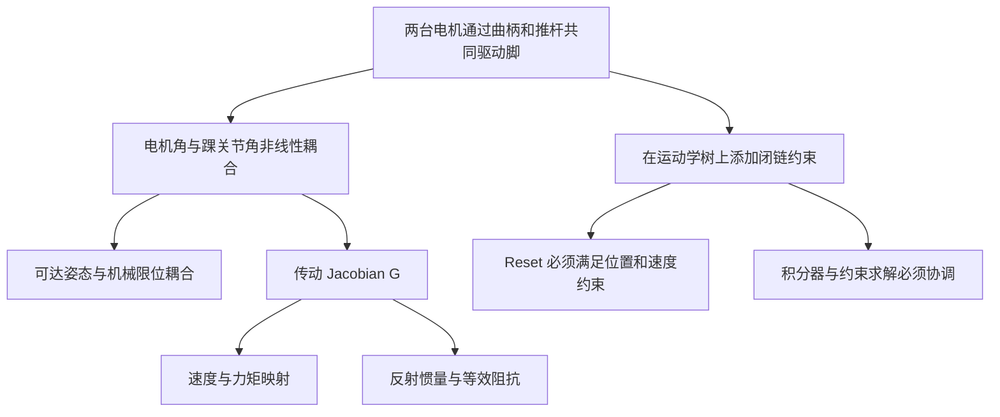

# Closing the Loop：G1 踝关节闭链建模、控制与数值仿真精读

原文链接：[Closing the Loop](https://kzakka.com/closing-the-loop/)。作者： Kevin Zakka、Qiayuan Liao，日期为 2026-11-16。

这篇文章的主题是：**真实机械传动决定了机器人能怎样动、能输出多大力矩，以及同一个控制器实际有多硬。仿真只有关节数量和外观正确，还不足以复现这些性质。**

标题里的 loop 首先指封闭的机械运动链。它与反馈控制中的闭环是不同概念：前者是连杆在空间中首尾相连，后者是根据测量误差修正控制输入。G1 踝关节同时涉及这两种“闭环”，还需要数值求解器维持机械约束。

## 1. 全文的逻辑关系



读这篇文章时应把三个问题分开：

| 层次 | 关键问题 | 错误的典型表现 |
|---|---|---|
| 几何 | 这个姿态是否存在合法装配？ | 重定向动作在真机上不可达 |
| 动力学与控制 | 电机怎样产生输出力矩和阻抗？ | 仿真与硬件响应不同 |
| 数值计算 | 离散时间中能否稳定维持约束？ | 推杆被拉长、Reset 冲击、仿真发散 |

这三类错误需要不同修正。降低学习率不能修好不可达姿态；增加模型细节也不能自动消除积分误差。

## 2. 两个输出自由度，为什么需要四个坐标？

定义踝关节输出坐标和电机坐标：

\[
x=\begin{bmatrix}\theta_p\\\theta_r\end{bmatrix},\qquad
u=\begin{bmatrix}u_A\\u_B\end{bmatrix}.
\]

\(\theta_p\) 是 pitch，\(\theta_r\) 是 roll。这里的 \(u\) 指所建模的曲柄驱动轴角度；若还有齿轮减速，应先明确该角度属于转子轴还是减速器输出轴。

串联简化模型直接对 pitch、roll 各放一个执行器。真实推杆机构则由两台电机分别带动曲柄，两根定长推杆共同连接脚部。通常两台电机都参与两个输出方向的运动。

若用：

\[
q=(u_A,u_B,\theta_p,\theta_r)
\]

描述机构，两根定长杆提供两个独立标量约束。在正常非奇异配置下，物理自由度为：

\[
4-2=2.
\]

额外坐标用于描述传动，不代表脚多了两个可独立控制的方向。这种“增加坐标，再用约束消去多余自由度”的方式，正是闭链模型的常见实现。

## 3. 可达范围为什么不是矩形？

独立 joint limit 默认允许：

\[
\mathcal X_{serial}=[p_{min},p_{max}]\times[r_{min},r_{max}].
\]

它意味着任意合法 pitch 都能搭配任意合法 roll。但推杆机构在大幅俯仰后，一侧曲柄可能接近极限，留给侧倾的运动空间随之缩小。

需要区分三种条件：

1. **几何闭合**：存在电机角，使两根杆长度正确。
2. **装配分支与干涉**：这个解属于真实机构可连续到达的分支，杆件没有穿过其他结构。
3. **机械与执行器限位**：即使几何能闭合，实体挡块和电机行程也允许。

因此仅有 \(\exists u:F(u,x)=0\) 还不是完整硬件可行性判定。实际可用集合是上述条件的交集。

附件描述的测量方法是：将 G1 仰放，释放或阻尼控制踝关节，用手扫过活动范围，记录 pitch/roll 轨迹。它提供真实硬件边界的样本，但手动采样并不保证遍历所有边界，拟合多边形也可能存在偏差。

### 3.1 用线性半空间近似机械限位

在二维角度空间中，可将限位写成：

\[
c_{i,p}\theta_p+c_{i,r}\theta_r\le b_i.
\]

多条不等式交集形成多边形。附件给出一组系数：

\[
0.2618\theta_p\pm0.2618\theta_r\le0.13708.
\]

两式合并近似为：

\[
\theta_p+|\theta_r|\le0.5236\ \text{rad}.
\]

所以，在这组近似约束下，pitch 为 25° 时，roll 只剩约 ±5°；pitch 达到 30° 时，roll 接近零。若另有 ±15° 的 roll 限位，还要取交集。这里验证的是给定系数的数学含义，系数是否完整描述 G1 左右脚则仍需原模型确认。

### 3.2 为什么使用 fixed tendon？

Fixed tendon 可以定义关节坐标的线性组合，而不是必须表示真实绳索。以下是附件形式的示意，依赖模型已有同名关节：

```xml
<tendon>
  <fixed name="ankle_face"
         limited="true" range="-100 0.13708">
    <joint joint="ankle_pitch_joint" coef="0.2618"/>
    <joint joint="ankle_roll_joint" coef="0.2618"/>
  </fixed>
</tendon>
```

下限 −100 被放得很远，主要让上限生效。其余多边形边界需要分别定义。

**物理引擎知道 tendon limit，不等于 RL 框架也知道。** 若 reset、动作裁剪或 soft-limit reward 只读取普通 joint range，仍可能产生多边形外的目标。

一个工程扩展是显式计算：

\[
v_i(x)=\max(0,c_i^Tx-b_i),
\]

或将参考投影到可行域：

\[
x^*=\arg\min_{z\in\mathcal X}\|z-x_{ref}\|^2.
\]

投影会改变参考动作，也可能使时序导数不平滑。使用动作跟踪奖励时，应同步处理参考速度与加速度。

## 4. 从杆长约束推导闭式逆运动学

对第 \(i\) 根杆，定义曲柄末端 \(p_i(u_i)\)、脚部连接点 \(a_i(x)\) 和杆长 \(L_i\)。在同一坐标系中：

\[
F_i(u_i,x)=\frac12\big(\|p_i(u_i)-a_i(x)\|^2-L_i^2\big)=0.
\]

这是一条位置级完整约束。两根杆的方程共同定义 \(u=h(x)\)，但该映射通常只在选定装配分支、远离奇异点时局部良好。

### 4.1 圆与球的交点

曲柄末端随电机旋转沿圆运动；杆长要求它同时处于以脚部连接点为球心、杆长为半径的球面上。

- 两个交点：存在两个候选曲柄角。
- 相切：候选解合并。
- 无交点：目标姿态无法闭合。

两个杆各有候选解，但不能任意组合。实际装配、角度限位和碰撞还会进一步排除解。

### 4.2 展开得到三角方程

将曲柄末端写成：

\[
p(u)=c+\rho(e_1\cos u+e_2\sin u),
\]

其中 \(c\) 是圆心，\(\rho\) 是半径，\(e_1,e_2\) 是圆平面的正交单位基。令 \(g=c-a(x)\)，展开杆长约束：

\[
\|g\|^2+\rho^2+2\rho g^Te_1\cos u
+2\rho g^Te_2\sin u=L^2.
\]

定义：

\[
\alpha=2\rho g^Te_1,\quad
\beta=2\rho g^Te_2,\quad
\gamma=L^2-\|g\|^2-\rho^2.
\]

则：

\[
\alpha\cos u+\beta\sin u=\gamma.
\]

取 \(R=\sqrt{\alpha^2+\beta^2}\)、\(\phi=\operatorname{atan2}(\beta,\alpha)\)，得到：

\[
\boxed{u=\phi\pm\arccos(\gamma/R)}.
\]

这个公式的实现条件容易被忽略：

- \(R>0\) 时，需检查 \(|\gamma|\le R\)。
- \(R\approx0\) 是退化情形，不能直接除法。
- 只对浮点舍入造成的微小越界做 `clip`；明显不可达不能伪装成边界解。
- 分支选择要考虑角度的周期距离、历史连续性和真实装配。
- 正确角度零点与旋转方向应由模型定义，不能照抄另一只脚的符号。

“选择离当前角度最近的解”仅在当前状态靠近正确分支时可靠。

## 5. 传动 Jacobian 怎样推导？

定义：

\[
G(x)=\frac{\partial h}{\partial x},\qquad
\boxed{\dot u=G(x)\dot x}.
\]

其两行对应两台电机，两列对应 pitch 和 roll。第一列告诉我们纯 pitch 运动需要两台电机分别以多大速度运动。

无需对复杂反三角函数逐项求导，也可以隐式微分：

\[
F_u\dot u+F_x\dot x=0,
\qquad G=-F_u^{-1}F_x.
\]

对独立曲柄连接的两根杆，\(F_u\) 为对角结构。令 \(d_i=p_i-a_i\)，则：

\[
\frac{\partial F_i}{\partial u_i}=d_i^TJ_{p_i},\qquad
\frac{\partial F_i}{\partial x}=-d_i^TJ_{a_i},
\]

从而：

\[
\boxed{G_{i,:}=\frac{d_i^TJ_{a_i}}{d_i^TJ_{p_i}}}.
\]

这里假设在小腿坐标系表达几何，\(p_i\) 只依赖自身曲柄角。若在世界坐标系计算完整速度，还需计入小腿和浮动基座运动。

### 5.1 奇异性不是单一现象

若分母 \(d_i^TJ_{p_i}\) 趋近零，曲柄瞬时切向速度几乎不能沿杆方向改变端点距离，隐式函数可能失效。

另一个需要检查的量是 \(G\) 的秩。如果它不可逆，就无法从任意输出扭矩唯一求出两台电机扭矩。评估时应同时看奇异值、最小奇异值和条件数：

\[
\kappa(G)=\sigma_{max}/\sigma_{min}.
\]

条件数描述方向间的不均衡，不描述绝对传动倍率。例如 \(100I\) 的条件数仍为 1，但其速度倍率很大。

## 6. 速度与力矩为什么分别使用 G 和 G 的转置？

在理想、无损的瞬时传动关系下，虚功守恒：

\[
\tau_u^T\delta u=\tau_x^T\delta x.
\]

代入 \(\delta u=G\delta x\)，得到：

\[
\boxed{\tau_x=G^T\tau_u}.
\]

若 \(G\) 可逆，给定输出力矩可求：

\[
\boxed{\tau_u=G^{-T}\tau_x}.
\]

转置来自力与位移的功共轭关系。它不是任意约定，也不能误写成 \(\tau_x=G\tau_u\)。存在摩擦、柔性或效率损失时，还要加入相应模型。

### 6.1 力矩上限映射成姿态相关区域

若两个电机各有独立限幅：

\[
|\tau_{u,A}|\le T_A,\quad |\tau_{u,B}|\le T_B,
\]

其电机空间集合是矩形。映射后：

\[
\mathcal T_x(x)=\{G(x)^T\tau_u:|\tau_{u,i}|\le T_i\}.
\]

非奇异时通常为平行四边形，且随姿态变化。pitch、roll 的最大输出不能一般地同时达到。

一个自构例子：

\[
G=\begin{bmatrix}2&1\\2&-1\end{bmatrix},\qquad
\tau_x=\begin{bmatrix}2(\tau_A+\tau_B)\\\tau_A-\tau_B\end{bmatrix}.
\]

若每台限幅 25 N·m，纯 pitch 可到 100 N·m，纯 roll 可到 50 N·m；但二者不能同时取最大值。这个例子仅解释映射，不代表 G1 实际参数。

先计算期望 \(\tau_x\)，再求电机力矩并限幅后，实际输出是：

\[
\tau_x^{actual}=G^T\operatorname{clip}(G^{-T}\tau_x).
\]

限幅可能改变输出力矩方向，而不只是统一缩小幅值。更精细的控制可以将电机约束放入小型优化问题。

## 7. 反射惯量为什么是 GᵀIᵤG？

设电机坐标下惯量为 \(I_u\)。电机动能：

\[
T_u=\frac12\dot u^TI_u\dot u
=\frac12\dot x^TG^TI_uG\dot x.
\]

所以该部分在踝关节坐标下的等效质量矩阵为：

\[
\boxed{I_x(x)=G(x)^TI_uG(x)}.
\]

即使 \(I_u\) 对角，\(I_x\) 也可能有非对角耦合项，并且随姿态变化。完整踝关节动力学还要加上脚、曲柄和其他杆件的惯量贡献。

因为 \(G\) 变化，\(\ddot u=G\ddot x+\dot G\dot x\)。因此只给输出关节设置一个固定 armature，并不能完整表达这部分构型相关动力学。

另外，应避免重复计算：如果转子惯量已经通过减速比反射到曲柄轴，再添加 rotor body 或其他等效 armature 时，要确认没有重复加入同一动能。

## 8. PD 增益怎样转换？

希望输出端具有：

\[
\tau_x=K_x(x_d-x)+D_x(\dot x_d-\dot x).
\]

若改成两台电机各自独立 PD：

\[
\tau_u=K_u(u_d-u)+D_u(\dot u_d-\dot u),
\]

在同一平衡姿态附近，误差近似满足 \(\delta u\approx G\delta x\)，于是：

\[
K_x\approx G^TK_uG,\qquad D_x\approx G^TD_uG.
\]

反过来：

\[
\boxed{K_u=G^{-T}K_xG^{-1}},\qquad
\boxed{D_u=G^{-T}D_xG^{-1}}.
\]

一般得到完整矩阵，包含跨电机误差反馈。两个固定的独立电机增益，通常不能在所有姿态下维持同一输出阻抗。

### 8.1 这个推导的适用条件

它是局部线性化。较大误差时 \(u_d-u\) 不再等于 \(G(x)(x_d-x)\)。存在负载预应力时，\(G\) 的位置导数还会产生额外几何刚度项。

因此更直接的控制路线是每周期先算输出力矩，再解线性系统：

\[
G(x)^T\tau_u=\tau_x^*.
\]

工程上用线性求解而非显式求逆，并监测条件数与饱和。若机器人固件已经实现输出空间映射，外层就不能再重复映射。

附件提供的实际增益和失败率集中见第 13 节；这里的核心不是某组增益最好，而是**比较控制器时，必须在同一物理坐标空间比较阻抗**。

## 9. 在 MuJoCo 中怎样闭合机械回路？

刚体父子关系构成运动学树，不能直接让一个杆件拥有两个父节点。做法是保留树结构，再通过额外约束闭合回路。

### 9.1 Spatial tendon 加 equality

```xml
<tendon>
  <spatial name="rod_A">
    <site site="crank_tip_A"/>
    <site site="foot_anchor_A"/>
  </spatial>
</tendon>
<equality>
  <tendon tendon1="rod_A"
          solref="0.01 1"
          solimp="0.95 0.99 0.0001"/>
</equality>
```

两个 site 间的 spatial tendon 长度是欧氏距离。Equality 将它保持为常量，从而表达无质量刚性杆的轴向约束。它与前面的 fixed tendon 是两种不同用途。

没有指定第二条 tendon、且常数多项式偏移为零时，目标是初始参考构型的长度。若参考几何错误，就固定了错误杆长；不能认为引擎会自动识别硬件杆长。[MuJoCo equality/tendon](https://mujoco.readthedocs.io/en/latest/XMLreference.html#equality-tendon)

这种模型可以传递轴向拉压约束力，但没有推杆自身的质量、碰撞与端部摩擦。它也不同于只能拉不能推的松弛绳索。

### 9.2 显式杆体加 connect

另一种方案把杆建成刚体，通过两个摆动 hinge 连接曲柄，并用 connect 把杆末端与脚部连接点放在同一位置。

两个摆动坐标描述杆轴方向；省略绕杆轴自转是一种建模取舍。若轴向旋转、非对称惯量或端部扭转摩擦很重要，不能默认它永远可忽略。

Connect 对三维位置差加约束，不要求两端姿态完全相等，因而不会像 weld 一样额外锁死相对转动。

| 模型 | 每脚新增坐标 | 每脚新增标量约束 | 额外描述 |
|---|---:|---:|---|
| 串联基线 | 0 | 0 | 直接输出轴 |
| Tendon 闭链 | 2 | 2 | 电机与输出的几何传动 |
| 显式杆体闭链 | 6 | 6 | 再加入两根杆各两个摆动坐标与杆体动力学 |

这些计数以附件的结构为前提，并假设约束独立。三者输出自由度仍为 2。

有 capsule 几何不自动意味着杆件会与全部相邻机构碰撞；还要检查碰撞 mask 和排除规则。模型是否真的模拟摩擦，也取决于关节和接触参数。

### 9.3 软约束参数与 diagexact

附件的 `solref="0.01 1"` 可按正值格式理解为恢复时间尺度与阻尼比；`solimp` 控制误差相关阻抗。不要将其简单等同于物理弹簧刚度或杆件材料参数。Equality 的数值残差也不会因此严格恒为零。

约束空间响应矩阵为：

\[
A=JM^{-1}J^T.
\]

`diagexact` 计算更准确的对角项，以替代默认近似，改善复杂耦合下的阻抗计算。它不改变机构几何，也不是将全部约束求解变成无误差。[MuJoCo diagexact](https://mujoco.readthedocs.io/en/latest/XMLreference.html#option-flag-diagexact)

```xml
<option>
  <flag diagexact="enable"/>
</option>
```

以上 XML 都是机制示意，不是完整可运行 G1 模型。

## 10. Reset 为什么必须同时投影位置和速度？

若只写入参考 pitch/roll 而不调整电机，杆长约束可能被破坏。下一步仿真会产生恢复力，形成原本动作里没有的瞬态。让模拟器自行“拉回来”也会改变期望起始状态。

合法状态至少满足：

\[
\boxed{F(q)=0,\qquad J(q)v=0}.
\]

第一式保证装配位置闭合；第二式保证速度沿约束流形的切空间运动。

### 10.1 固定参考关节，只修正依赖坐标

把坐标分成 held 与 free。令约束残差为 \(r(q)\)，只允许 free 部分更新：

\[
J_f\Delta q_f\approx-r,\qquad
\Delta q_f=-J_f^\dagger r.
\]

每次更新后重算几何和 Jacobian，直到残差达标。这里“free”指允许优化的变量，不是 floating-base free joint。

位置完成后再解：

\[
J_fv_f=-J_hv_h,\qquad v_f=-J_f^\dagger J_hv_h.
\]

伪逆给出一个最小范数解。如果还希望尽量保留原速度，可优化速度增量，或在零空间加入其他目标。

### 10.2 MuJoCo 实现最容易出错的地方

- `qpos` 索引与 `qvel` 自由度索引不同，浮动基座四元数尤其如此。
- Jacobian 的列对应速度自由度。位置更新应通过 `mj_integratePos` 处理流形，而非对整个 qpos 直接相加。
- 只投影目标 equality 行，不把接触、限位等全部混为闭链残差。
- `efc_J` 可能采用稀疏存储，不能未经检查就当成普通二维数组。
- 每轮投影后必须刷新位置相关量；最终重新检查位置和速度残差。
- 投影不保证目标本身可达，也不保证保持正确装配分支。

### 10.3 解析 reset 和电机速度

对该机构可以先用第 4 节闭式解求电机角，再由 \(\dot u=G\dot x\) 求速度。

若使用世界坐标站点 Jacobian，设电机轴为 \(n\)，轴上的圆心为 \(c\)：

\[
\dot p=\dot p_{other}+\dot u\,[n\times(p-c)].
\]

杆长速度约束给出：

\[
\boxed{\dot u=-\frac{(p-a)^T(\dot p_{other}-\dot a)}
{(p-a)^T[n\times(p-c)]}}.
\]

这里有一个重要实现条件：计算 `other` 贡献时，必须移除当前待求电机速度的贡献，或先将其置零。否则把完整 `qvel` 算出的速度直接代入，再将结果当成新速度赋值，可能重复计算该电机项。

分母过小应触发奇异处理。若有显式杆体，还需初始化杆的摆动坐标与速度，不能只设置两个电机角。

## 11. 为什么加入正确机构后，仿真反而可能不稳定？

位置和速度初始化正确，仅保证起点合法。数值推进仍可能逐渐破坏约束。

用局部线性系统说明这一问题。设平滑力含正阻尼和刚度：

\[
f(q,v)=b-Kq-Dv.
\]

采取后向形式：

\[
v_{n+1}=v_n+ha,\qquad q_{n+1}=q_n+hv_{n+1}.
\]

把新位置、新速度代入力，整理得：

\[
\underbrace{(M+hD+h^2K)}_{\widehat M}a
=f(q_n,v_n)-hKv_n+J^T\lambda.
\]

这解释了有效惯量 \(\widehat M\) 的来源。这里 \(D,K\) 使用正阻尼、正刚度约定；其他文档若直接定义力的导数，符号可能相反。

### 11.1 约束求解与更新的度量是否一致

如果约束力按 \(M\) 计算，但之后积分器又按含隐式阻尼的 \(\widehat M\) 修正速度，约束力的预期效果和实际更新可能不一致。在刚性、强阻尼和复杂耦合下，这个差异可能变得明显。

当前 MuJoCo 官方文档确认，`discrete` 将约束求解与隐式更新合并，使用 \(M+hD+h^2K\) 的有效度量。实际保留的导数项受正定性要求限制，不是任意控制器完整非线性 Jacobian 都直接纳入。[MuJoCo 数值积分](https://mujoco.readthedocs.io/en/latest/computation/index.html#numerical-integration)

### 11.2 为什么执行器位置也重要？

附件讨论的配置把电机惯量放在电机轴，而把位置伺服放在 pitch/roll 输出轴。输出端的有效惯性需要通过闭链约束传递。对局部惯量很小的输出轴施加强阻尼，更容易放大求解与积分之间的差异。

因此，比较积分器时必须同时固定：执行器位置、增益、步长、约束软硬程度、杆体惯量和求解器容差。

“更高阶”不自动等于“对这个刚性约束系统更稳定”；“不发散”也不等于精度足够。需要做步长收敛检查，观察任务轨迹、闭链误差和能量是否随着步长缩小而趋于一致。

## 12. 电机扭矩是否经常成为实际瓶颈？

附件描述了基于 LAFAN1 重定向轨迹的逆动力学分析。给定 \(q,v,\dot v\)，全身方程为：

\[
M(q)\dot v+c(q,v)+g(q)=S^T\tau+J_c^Tf_c.
\]

浮动基座没有直接驱动力，需由接触力平衡。单凭参考运动通常不能唯一确定各接触点受力，因此还需解一个带约束的接触力拟合问题。

典型摩擦约束：

\[
f_n\ge0,\qquad \|f_t\|\le\mu f_n.
\]

得到输出踝力矩后，用 \(G^{-T}\) 映射为电机需求，再检查饱和。

这个分析链条有三层不确定性：轨迹微分误差、接触点和接触力分配近似、动力学参数误差。因此“估计电机超限很少”只说明这套假设下的动作需求，多数不触及设定上限，不能替代电机实测，也不能说明反射惯量和阻抗不重要。

## 13. 附件实验数字与证据边界

以下均为**附件报告，待原网页、图表或代码复核**。

| 项目 | 附件给出的数字 | 应怎样解读 |
|---|---|---|
| 实测 roll | 中间 pitch 附近约 ±16°–18° | 手动范围测量，不代表所有 pitch 均可达到 |
| 限位拟合误差 | 部分测量超出拟合边界约 2° | 多边形是近似范围 |
| 重定向越界 | 1.5% planted-foot poses 超出拟合限位超过 1° | 分母是支撑脚姿态，不是全部帧 |
| 增益映射 | 输出增益 28.5；电机各 14.25 N·m/rad 时，标称姿态等效 pitch/roll 约 62/19 | 说明两台电机增益不能简单相加 |
| 控制器比较 | 单个 6 秒舞蹈片段，256 次配对 rollout；失败率约 16% 对 20% | 绝对差约 4 个百分点；不能凭汇总率判断配对显著性 |
| 逆动力学超限 | 有效承重样本中低于 0.1% 超过单电机 ±25 N·m | 依赖接触拟合、可达性筛选与限幅假设 |
| 接触筛选 | 摩擦系数 0.6；承重阈值为体重的 10% | 分析配置，不是硬件测量结论 |
| 数值失稳演示 | 输出轴驱动，implicitfast，4 ms 步长，闭链误差快速增长 | 特定模型配置下的案例 |
| 模型版本 | 附件称模型需 MuJoCo ≥3.16，实验用 4.0.1 | 尚未下载模型核对，不作为安装要求 |

附件还报告不同积分器与驱动位置的稳定性扫描。官方文档能核对 `discrete` 的机制，但不能代替原文 Figure S1 验证哪些具体配置稳定。它们是不同层级的证据。

文章是否改善真机迁移，需要“不同模型训练的策略在真实 G1 上对照执行”才能直接回答。硬件活动范围测量、仿真控制对比与离线力矩估计各有价值，但不能合并成已经证明真机成功率提高。

## 14. 实际研究中怎样选择模型？

| 研究目标 | 优先考虑 | 仍需检查 |
|---|---|---|
| 重定向是否产生不可达动作 | 串联模型加耦合限位 | 分支可达性、时序连续性、参考导数 |
| 电机限幅、速度与阻抗 | Tendon 闭链 | 电机坐标定义、惯量与控制接口 |
| 推杆惯量、碰撞、端部效应 | 显式杆体 | 碰撞配置、摩擦参数、额外数值开销 |
| 大规模 RL 训练 | 能保留关键物理量的最低必要复杂度 | 后端支持、吞吐量、稳定步长 |

修正限位是修改可行域；恢复传动是修改输入—输出动力学；调整求解器是改善离散数值行为。实验消融应分别改变这三部分，避免一起更换后无法归因。

一个建议的实验顺序是：串联矩形限位 → 串联耦合限位 → tendon 闭链 → 同一闭链下比较输出空间映射与独立电机 PD → 显式杆体。每一步记录完整任务成功率、跟踪误差、闭链残差、力矩饱和和真实计算成本。

## 15. 可以直接用于模型检查的数学自检

这些是根据推导提出的验证方法，不是本次已完成的仿真实验。

1. **闭式解残差：** 将 \(u=h(x)\) 代回两根杆长方程，检查各自误差。
2. **分支连续性：** 在可行姿态路径上缓慢扫描，确认电机角展开后不突然跳变。
3. **Jacobian 有限差分：** 用同一装配分支的 \(h(x\pm\epsilon e_j)\) 核对 \(G\) 各列，避开边界和角度 wrap。
4. **虚功一致性：** 随机取 \(\delta x,\tau_u\)，检查 \(\tau_u^TG\delta x=(G^T\tau_u)^T\delta x\)。
5. **动能一致性：** 检查电机侧动能与反射惯量表达一致。
6. **Reset 一致性：** 同时验证 \(F(q)\) 与 \(Jv\)，并检查第一步是否出现异常约束力。
7. **数值收敛：** 缩小步长、收紧容差，观察轨迹与残差是否收敛，而非只检查是否报错。
8. **控制坐标一致性：** 确认关节命令、驱动轴、减速比、力矩限幅与板载控制器处于一致坐标定义下。

全文最关键的三个关系是：

\[
\boxed{\|p_i(u_i)-a_i(x)\|=L_i},
\]

\[
\boxed{\dot u=G\dot x,\quad\tau_x=G^T\tau_u},
\]

\[
\boxed{I_x=G^TI_uG,\quad K_x\approx G^TK_uG}.
\]

它们把机械几何、执行器能力和控制响应连在一起。对机器人学习而言，仿真模型最重要的不是外观是否复杂，而是是否正确保留了策略会利用、硬件却无法绕过的这些关系。
