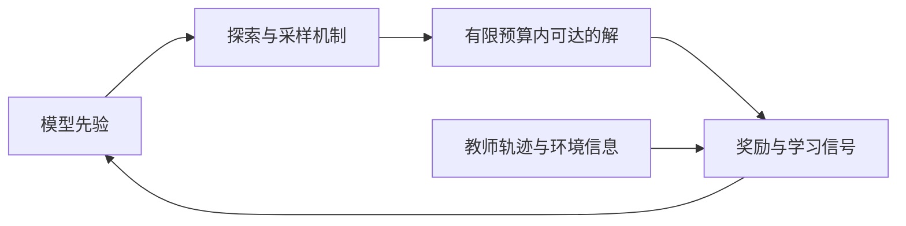

# 论文阅读笔记：机器人数据引擎、推理探索与自我改进

整理日期：2026-10-22。共 11 篇独立论文笔记，每篇一个 Markdown 文件；本页提供阅读索引和跨论文分析。

本组笔记根据来稿整理，补充原始论文、作者项目页与模型卡链接，恢复公式、表格和图示。核心论文详细展开，背景论文分别成篇。末尾的“下一个”等粘贴占位内容未保留。Z Tech 专访未提供可核验的原文附件或链接，因此这里按来稿中的论文名单组织，不逐字转述访谈。

## 一、文件索引

| 编号 | 论文笔记 | 核心问题 |
| --- | --- | --- |
| 01 | [NVIDIA FLORA](FLORA.md) | 如何规模化生成机器人视频的动作与奖励标签 |
| 02 | [Limit of RLVR](Limit-of-RLVR.md) | 单次成功率提高是否意味着可解题集合扩大 |
| 03 | [Beyond the 80/20 Rule](High-Entropy-Minority-Tokens.md) | 哪些 token 位置最值得接收策略梯度 |
| 04 | [The Flexibility Trap / JustGRPO](The-Flexibility-Trap.md) | 生成顺序如何改变推理探索 |
| 05 | [Video Generation as World Model](Video-Generation-as-World-Model.md) | 视频生成模型是否能外推物理规律 |
| 06 | [AlphaEvolve](AlphaEvolve.md) | 怎样通过程序修改、执行评价和档案积累持续搜索 |
| 07 | [DAPO](DAPO.md) | 怎样组织有效的大规模推理 RL 训练 |
| 08 | [LLaDA](LLaDA.md) | 掩码扩散如何实现大规模语言建模 |
| 09 | [DenseNet](DenseNet.md) | 密集连接如何促进特征复用 |
| 10 | [ProRL](ProRL.md) | 长时间 RL 与探索控制能否扩大可解覆盖 |
| 11 | [Curriculum RL](Curriculum-RL.md) | 能力边界定位与教师指导如何协同 |

推荐先读 01，再按 02 → 03 → 04 理解推理研究主线，用 10、11 对照能力边界结论；05—09 提供相关研究背景。

JustGRPO 是《The Flexibility Trap》提出的方法，包含在同一篇笔记中。

## 二、三篇核心推理论文的关系

三篇论文共同研究：模型已有知识，如何通过训练和采样转化为实际可达的解。

**Limit of RLVR 研究最终覆盖了哪些问题。** 它用大 k 的 pass@k、可解题集合和轨迹似然，区分单次采样效率与能力覆盖。在研究的部分设置中，前者提高而后者没有同步扩大。[来源：论文](https://arxiv.org/abs/2504.13837)

**Beyond the 80/20 Rule 研究关键选择发生在哪里。** 它发现少数高熵位置与推理分叉相关，并通过温度干预和训练掩码检验这些位置的作用。[来源：论文](https://arxiv.org/abs/2506.01939)

**The Flexibility Trap 研究顺序怎样改变这些选择。** 置信度优先解码可能先固定后文，使关键位置的开放性减少；JustGRPO 通过训练时采用 AR 顺序，建立更明确的策略与更新方式。[来源：论文](https://arxiv.org/abs/2601.15165)

三者把能力分析从问题集合推进到 token 决策，再推进到生成机制。

## 三、怎样理解不同论文之间的争论

“RL 能不能产生新能力”需要落实到训练条件和评价预算。

| 工作 | 重点改变或检查的因素 | 可支持的结论 |
| --- | --- | --- |
| Limit of RLVR | 现有自身 rollout + 结果奖励设置；大 k 覆盖分析 | 采样效率提高与覆盖扩大可以分离 |
| ProRL | 长时间训练、KL 控制、参考策略重置、多样任务 | 在其设置下，RL 可以改善较大采样预算下的覆盖 |
| Curriculum RL | 边界定位、教师指导、RL 巩固 | 新信息与课程组织的组合可以扩大经验覆盖 |

对照时，应统一基础模型、训练数据、rollout 预算、生成长度和解码方式，并明确是否引入教师信息。不同设置下的证据共同指向一个更精确的问题：**什么探索机制、训练预算与反馈信息，能够让模型达到此前在有限预算内无法达到的能力范围？**[来源：ProRL](https://arxiv.org/abs/2505.24864)、[Curriculum RL](https://arxiv.org/abs/2606.22317)

## 四、FLORA 如何接入这条研究线

FLORA 提供语言标签与过程评价；推理研究则帮助辨别，系统使用这些反馈后究竟改善了什么。

例如，机器人 Agent 在 FLORA 指出异常后修改恢复技能。需要观察的既有“原本可完成的布局是否更稳定”，也有“此前不可完成的布局是否进入可解集合”。FLORA 的回顾式标签能够支持离线诊断，而执行时的恢复触发还需单独评价因果输入条件下的表现。[来源：FLORA 论文](https://research.nvidia.com/labs/gear/flora/assets/paper/flora.pdf?v=2026-10-19c)

这是一种跨论文的研究推论，尚不能视为上述论文已经共同验证的机器人改进闭环。

## 五、对 RoboDojo 与具身自我改进的具体启发

### 1. 区分可靠性提高与新增可解实例

假设 Agent 在 100 个固定测试布局上，经过多次尝试能解决其中 60 个。改进后，如果它在这 60 个布局上成功得更稳定，收益主要表现为可靠性提高；如果在相同预算下开始解决此前始终失败的新布局，则获得了能力覆盖扩大的证据。

评价时还应报告丢失的可解布局。新增与丢失可能同时发生，单个平均分不够解释这种变化。

### 2. 机器人环境提供了额外的信息通道

机器人可以通过交互获得新的物理信息，也可以修改技能库、控制代码和恢复策略。这些机制超出了纯文本自身 rollout 的设置。因此，迁移 RLVR 的结论时，需要明确评价对象是底层模型还是包含记忆、代码和执行器的整个系统。

### 3. 动作熵不自动等于策略分叉价值

高动作熵可能来自接触噪声或感知不确定性。更值得检查的是候选动作的状态动作价值差异、对未来成功率的影响，以及失败后有效恢复分支的数量。

### 4. 建议一起报告的指标

| 指标 | 回答的问题 |
| --- | --- |
| Success@1 | 一次独立执行有多可靠 |
| Success@k 与累计预算 | 多次尝试能覆盖多少实例，花费多少资源 |
| 新增、保留与丢失的可解布局 | 能力变化发生在哪些具体实例 |
| 有效策略多样性 | 是否保留多种真正有效的行为路径 |
| 跨布局与跨任务迁移 | 改进能否作用于未参与改进的实例 |
| 恢复检测召回、误报与延迟 | 反馈是否能支持实际恢复决策 |

这里的 k 表示独立 episode 尝试。单次 episode 内的工具交互、代码修改、恢复次数和物理时间应另行记录。Success@k 是至少一次成功的覆盖指标；如果任务还需要挑选最终方案，还要报告实际选择机制及其成本。

本组论文共同提供了一种研究方法：先定义经验能力边界，再定位改变边界的机制，最后通过受控实验区分可靠性提升、采样优化与新增能力。

## 六、本次整理保留的关键口径

- **FLORA 的成本比值：** 附录使用未舍入值报告 122.49 倍，约为 122.5 倍；展示值 $88.49 / 0.72$ 对应约 122.9 倍，论文概括为约 125 倍。动作标注成本与整个奖励系统的成本需分别理解。
- **FLORA 的时间粒度：** 过程标签每 0.5 秒输出，DenseRewardBench 在 1 Hz 上评价；回顾式标签允许使用后续视觉证据。
- **高熵 token 论文的 Acc@16：** 每题采样 16 次后的平均准确率，不是 pass@16。
- **JustGRPO 的主表：** 每步生成一个 token；并行解码能力由另外的实验评价。
- **日期与版本：** FLORA 项目介绍日期与模型卡发布日期分别列明；Flexibility Trap 的会议标题与早期 arXiv 标题同时保留。
- **图示与研究建议：** 解释用数据和跨论文应用推论明确标识，避免混同论文实测结果。
