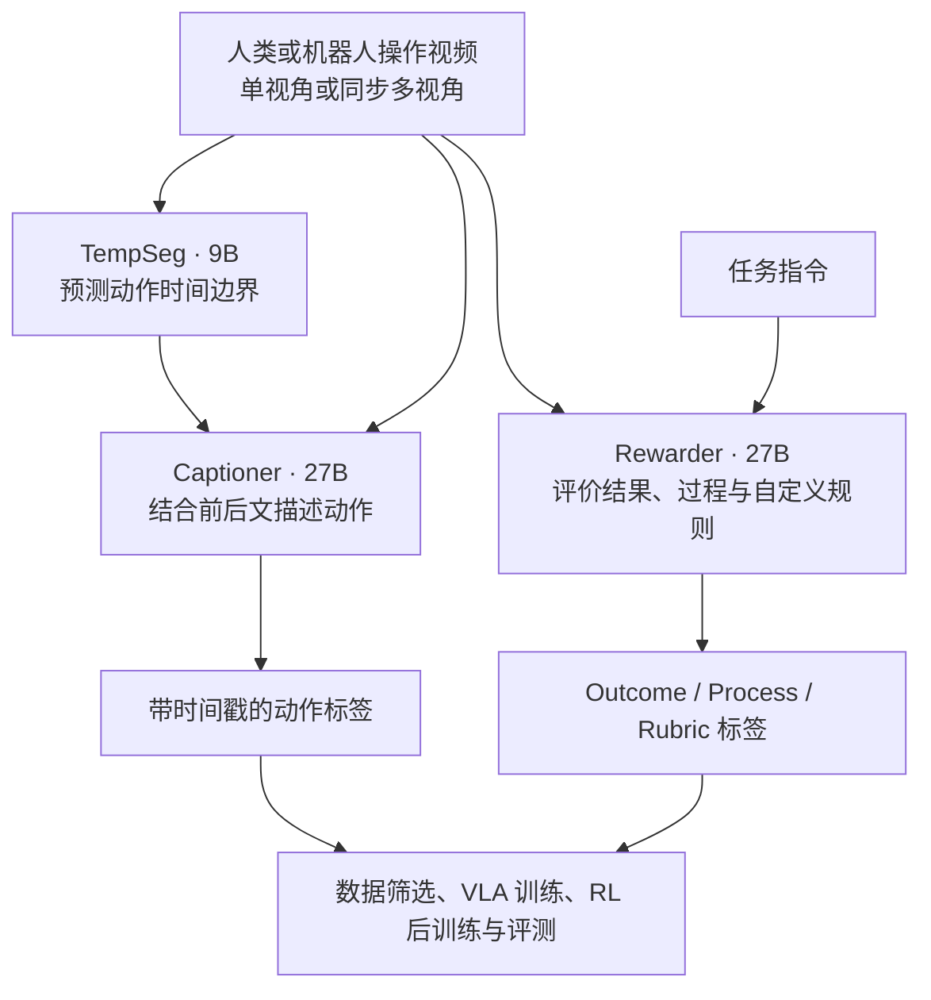

# NVIDIA FLORA 论文解读：为机器人数据生成语言与奖励监督

**论文：** FLORA: An Open Model Suite for Scaling Robotics Data Engines  
**团队：** NVIDIA GEAR，Sicong Leng、Yunze Man、Zhiqi Li、Yuke Zhu、Johan Bjorck、Linxi “Jim” Fan 等  
**日期：** 2026 年 10 月；来稿记录的项目介绍日期为 10 月 20 日，Hugging Face 模型卡标注的模型发布日期为 10 月 15 日  
**资源：** [项目主页](https://research.nvidia.com/labs/gear/flora/) · [论文 PDF](https://research.nvidia.com/labs/gear/flora/assets/paper/flora.pdf?v=2026-10-19c) · [模型集合](https://huggingface.co/collections/nvidia/flora)

**一句话概括：FLORA 是一套机器人视频数据引擎，通过动作时间切分、上下文动作描述和执行质量评价，把原始视频转化为可用于数据筛选、策略训练和评测的结构化监督。**

它的核心贡献是让几种原本相对独立的标注能力形成可规模化部署的系统：给动作定位时间、为动作生成语言描述、评价整段任务的完成程度，以及找出执行过程中的异常。控制策略负责产生动作；FLORA 则为已经发生的操作提供标签和反馈。

NVIDIA 报告，该系统已用于 GR00T 数据引擎，并在 512 张 GB300 GPU 上达到每天标注 20 万小时视频的处理规模。这个数字是作者报告的生产部署规模，需要与后文基于特定假设计算的成本和吞吐估算分别理解。[来源：项目主页](https://research.nvidia.com/labs/gear/flora/)

## 一、系统结构：三个分工明确的 VLM



示意图根据论文 Figure 7 及方法部分整理。三个组件分别从 Qwen3.5-9B、Qwen3.5-27B 和 Qwen3.5-27B 初始化，拥有独立权重，可以分别调用。

| 组件 | 基础模型 | 输出 | 训练方式 |
| --- | --- | --- | --- |
| TempSeg | Qwen3.5-9B | 时间边界、跨窗口延续标志 | SFT + GRPO |
| Captioner | Qwen3.5-27B | 区间对应的动作语言描述 | SFT + GRPO |
| Rewarder | Qwen3.5-27B | 结果分数、过程标签、规则分项评分 | 联合 SFT；发布版本使用 SFT |

### 1. Temporal Segmentation：先确定动作发生在什么时候

TempSeg 将视频划分为动作区间。为了处理长视频，标准配置使用 16 秒重叠窗口，以 4 FPS 采样；窗口中间 12 秒用于输出，前后各 2 秒提供上下文。模型预测窗口内的动作区间与 continuation flags，再通过区间重叠和延续标志拼接完整事件，也能保留同时发生的动作。

下面是最终“切分 + 描述”结果的示意，时间和文本均为解释用例：

```text
[0.0, 3.5]    Reach for the cup
[3.5, 6.0]    Grasp the cup
[6.0, 10.2]   Lift the cup
[10.2, 15.0]  Place the cup on the tray
```

其中，动作文本由后续 Captioner 产生。TempSeg 本身负责时间结构。

### 2. Contextual Captioning：用前后状态理解局部动作

Captioner 在描述某个区间时，同时观察目标片段及其前后视觉上下文：

$$
c_i = g_{\phi}(X_i^{-}, X_i, X_i^{+}, q_{\mathrm{cap}}).
$$

这里，$X_i$ 是目标区间，$X_i^{-}$ 和 $X_i^{+}$ 分别是前后文，$q_{\mathrm{cap}}$ 是描述任务的提示。

这解决了局部画面难以消除意图歧义的问题。例如，手移到杯子附近，可能是抓取，也可能是调整位置；动作前后的物体状态能帮助模型作出区分。模型生成自包含的动作指令，交代动作、物体、操作手和空间关系。对于失败尝试，描述可以保留预期目标，但不应暗示动作已经成功。

两个标注组件都采用 SFT 后接 GRPO。TempSeg 的奖励结合时间切分 F1、precision 和边界准确性；Captioner 的奖励关注动作、物体、操作手及空间关系是否正确。[来源：论文第 4 节及附录 F](https://research.nvidia.com/labs/gear/flora/assets/paper/flora.pdf?v=2026-10-19c)

## 二、Rewarder：同一模型产生三种粒度的反馈

### 1. Outcome Reward：任务完成了多少

Outcome Reward 对完整 episode 给出 1—5 分：1 表示完全失败，5 表示完全成功。如果需要连续值，可以读取五个分数 token 的概率，对期望分数进行归一化：

$$
r_{\mathrm{out}}(X,\ell)
= \frac{\sum_{k=1}^{5} k\,p_{\psi}(s=k\mid X,\ell)-1}{4}.
$$

其中 $X$ 是轨迹视频，$\ell$ 是任务指令。公式将期望分数映射到 $[0,1]$。

### 2. Process Reward：哪里发生了低效或错误操作

Process Reward 每 0.5 秒输出一个执行质量标签，并为连续异常区间提供文字原因：

| 标签 | 含义 |
| --- | --- |
| 1：Failure | 重大任务失败、不安全或破坏性事件，或任务失去可完成性 |
| 2：Suboptimal | 犹豫、低效、不精确或局部错误，但任务仍可恢复 |
| 3：Normal | 在可见情境下，动作合理、安全且较有效率 |

这套标签关注动作执行质量，不能直接等同于“距离目标还有多远”。一次抓取失败后又成功恢复，后续恢复也不会把早先的失败标签改成正常。

模型采用 **retrospective labeling，即回顾式标注**：允许根据后续视频识别之前的问题。过程奖励使用 16 秒窗口、10 秒步长，并丢弃非末尾窗口的最后 4 秒标签，让保留部分具有后续视觉证据。因此，它原生适合离线标注、轨迹分析和数据筛选；若用于执行时的恢复触发，需要另行建立只观察过去和当前画面的评测协议。[来源：论文第 4.2 节及附录 G.2](https://research.nvidia.com/labs/gear/flora/assets/paper/flora.pdf?v=2026-10-19c)

### 3. Rubric Reward：按照用户定义的规则分项打分

Rubric Reward 允许用户在测试时指定评分规则。例如，放置杯子的任务可以对抓取、移动和最终摆放分别计分，再合并成总分。这样既能衡量最终结果，也能保留中间步骤的信息。

三类任务共用一个 Rewarder，通过不同提示选择输出形式。

## 三、实验结果：优势集中在哪些能力上

### 1. 动作标注：时间切分与语义描述需要分别看

| 数据集与指标 | FLORA | GPT-6 Astra |
| --- | ---: | ---: |
| WGO-Bench：Segmentation F1@0.75 | 50.3% | 46.0% |
| WGO-Bench：Gold-window Caption Accuracy | 64.7% | 77.4% |
| WGO-Bench：Joint Semantic F1@0.75 | 34.5% | 39.0% |
| DenseCaptionBench Human100：Joint Point F1@0.5 | 37.4% | 29.7% |
| DenseCaptionBench Robot200：Joint Point F1@0.5 | 51.0% | 57.9% |

WGO-Bench 的结果显示，FLORA 在动作边界定位上有优势；给定正确区间后的描述准确率，以及切分与描述的联合表现，则呈现不同排序。内部 Human100 和 Robot200 的排序也不同。因此，论文最有依据的主张是：专用标注系统在若干关键维度达到很强的质量，并具有大规模部署价值。比较时应保留具体数据集和指标名称。[来源：官方结果表](https://research.nvidia.com/labs/gear/flora/)

### 2. DenseRewardBench：值得关注的是失败定位

| 模型 | Failure Recall |
| --- | ---: |
| FLORA | 53.3% |
| Gemini 3.8 Flash | 11.7% |
| GPT-6 Astra | 0.0% |

DenseRewardBench 包含 40 个保留的双臂操作 episode，在 4,861 个时间步上评价，其中有 3,942 个 Normal、619 个 Suboptimal 和 300 个 Failure。**模型每 0.5 秒产生标签，基准在 1 Hz 上比较标签**，二者时间尺度不同。

这组结果对 Failure Recovery 研究很有价值：通用 VLM 即使在文字解释中描述了物体掉落或抓取失败，也可能将其归为 Suboptimal，未必输出 Failure。

同时，FLORA 将约 11% 的正常时间步标为 Failure。53.3% 的失败召回率需要与正常时间步上的误报共同评价，尤其是在误报会触发额外恢复操作的系统中。[来源：论文第 2.2 节、Table 5 与附录 C](https://research.nvidia.com/labs/gear/flora/assets/paper/flora.pdf?v=2026-10-19c)

### 3. 整段奖励预测与轨迹排序

| 指标 | FLORA | GPT-6 Astra | 方向 |
| --- | ---: | ---: | --- |
| RoboRewardBench MAE | 0.400 | 0.554 | 越低越好 |
| Robometer OOD Kendall's $\tau$ | 0.720 | 0.823 | 越高越好 |

此处已将原论文表格乘以 100 的展示值还原。分数误差、轨迹排序与局部失败检测衡量不同能力，不应合并成一个笼统的“奖励模型准确率”。[来源：论文 Table 1、Table 4](https://research.nvidia.com/labs/gear/flora/assets/paper/flora.pdf?v=2026-10-19c)

## 四、“约 125 倍成本优势”应该怎样理解

成本实验使用 50 个 episode，比较动作切分与预测区间描述的标注费用：

| 系统 | 每小时原始视频的标注成本 | 计算口径 |
| --- | ---: | --- |
| FLORA | 约 0.72 美元 | 8 张 GB300，假设每 GPU 小时 10 美元，结合吞吐模型估算 |
| GPT-6 Astra，最大推理设置 | 约 88.49 美元 | 根据已返回的 API usage 计价 |

附录给出未舍入值 0.7224 美元和 88.4922 美元，并报告成本比值为 122.49，概括为约 125 倍。直接用表格展示值 $88.49 / 0.72$ 则得到约 122.9 倍；两种计算的差异来自舍入。

这项实验支持 FLORA 的规模化成本潜力，但有明确的核算范围：FLORA 端是基于部署假设的估算，排除了存储、计费粒度和部署开销；吞吐比较也没有完整建模解码、网络等系统开销。API 端仍有未返回 usage 的尝试，因此属于已知 usage 的费用小计。**该比较针对动作标注流程，不能直接推广为三种奖励任务的完整生产成本。**[来源：论文附录 D](https://research.nvidia.com/labs/gear/flora/assets/paper/flora.pdf?v=2026-10-19c)

## 五、阅读结果时需要保留的边界

**下游策略收益需要独立验证。** 论文主要评价标注质量、奖励预测和成本。系统已经用于 GR00T 数据引擎，但论文没有通过充分的下游策略消融，分别量化这些标签能提高多少 VLA 成功率或 RL 样本效率。

**部分比较采用不同推理预算。** RubricBench 中，FLORA 对每个 episode 生成 9 个样本并选择 medoid，即与其他样本总 L1 距离最小的样本；多数 baseline 使用单样本。视觉帧预算也不同：FLORA 使用 2 FPS、最多 166 帧，baseline 使用 1 FPS、最多 83 帧。DenseCaptionBench 的描述质量由 GPT-6 Astra 作为 judge，当它同时参与被评测时，需要考虑潜在的自偏好。上述设置应作为结果的一部分一起报告。[来源：论文附录 B、C](https://research.nvidia.com/labs/gear/flora/assets/paper/flora.pdf?v=2026-10-19c)

**失败标签依赖任务与人工准则。** Failure 和 Suboptimal 的区别包含任务可恢复性判断。长程任务中，同一个局部错误的严重程度可能随最终目标而变化，跨任务使用时需要校准。

**公开权重的使用范围有明确限制。** 三个模型采用 NVIDIA OneWay Noncommercial License。模型卡将用途限定为非商业机器人研究与开发，并说明输出用于标注，不用于直接控制机器人或充当物理系统的唯一安全监控器。[来源：TempSeg 模型卡](https://huggingface.co/nvidia/Flora-TempSeg)、[Captioner 模型卡](https://huggingface.co/nvidia/Flora-Captioner)、[Rewarder 模型卡](https://huggingface.co/nvidia/Flora-Rewarder)

## 六、对 Failure Recovery、RoboDojo 与自我改进 Agent 的价值

以下是结合具身智能研究作出的应用推论，不是论文已经验证的下游结果。

**Failure Recovery：构建带时间定位的恢复数据。** 先标出异常发生区间，再结合文字说明提出原因假设，形成可人工复核的 recovery 数据集。若目标是在执行时决定何时恢复，还需要单独测量因果输入条件下的检测延迟、召回与误报。

**RoboDojo：补充轨迹诊断。** FLORA 可以帮助区分“最终成功且过程顺畅”与“最终成功但中途出现明显错误”。最终任务成功率仍以仿真器状态和可复现 verifier 为依据，VLM 标签作为过程诊断信息保留。

**Self-Improving Agent：把评价接入技能改进闭环。** 值得检验的具体问题是：在相同探索预算和固定测试布局下，加入 FLORA 反馈后，Agent 是否比只使用 episode-level reward 的系统学到更有效、可迁移的恢复策略？实验需要分别控制反馈信息、尝试次数、代码修改预算和测试布局，才能定位收益来源。

FLORA 最突出的价值，是让机器人视频拥有可规模化、带时间定位的语言与执行质量监督。围绕这些监督建立可验证的策略改进闭环，是它为后续研究提供的直接机会。
