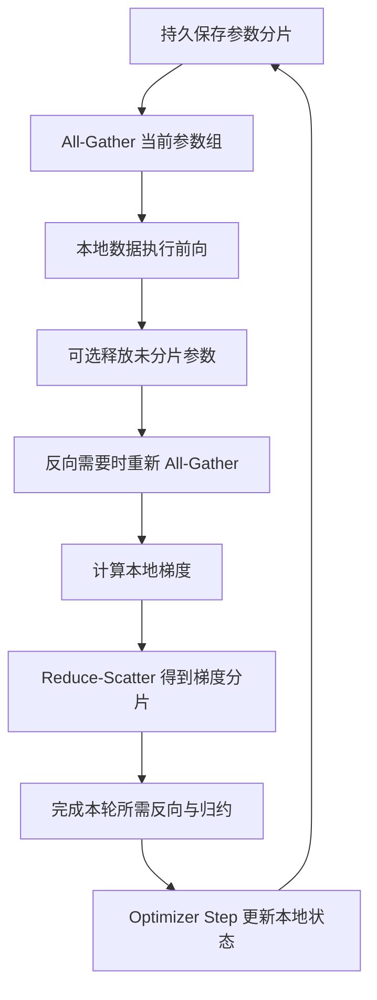

# FSDP 如何通过分片降低分布式训练的显存占用

**FSDP，Fully Sharded Data Parallel，完全分片数据并行，将参数、梯度和优化器状态分散到多个数据并行 rank 上；计算时临时收集当前参数组需要的权重。** 它主要解决训练模型状态无法完整放入单卡的问题。

只使用 FSDP 时，各 rank 仍处理不同数据，并执行所负责模型的完整算子。与 TP、PP 组合后，FSDP 管理的是每个模型并行分区在数据并行维度上的分片。

## 1. DDP 为什么会重复占用大量显存

DDP，即 Distributed Data Parallel，让多个进程处理不同训练样本，再同步梯度。

在典型的“一进程一卡、普通 AdamW”配置中，每张卡都有完整参数、梯度和优化器状态。增加 GPU 数量可以增加数据并行吞吐，却不会自动把这几类状态的单卡占用除以卡数。

FSDP 则让各 rank 只持久保存其中一部分：

| 对象 | 普通 DDP | 完全分片 FSDP |
|---|---|---|
| 参数 | 每个 rank 一整份 | 持久分片，计算时按组收集 |
| 梯度 | 每个 rank 获得完整归约结果 | 归约后保留本地分片 |
| Adam 一阶与二阶状态 | 每个 rank 一整份 | 与本地参数分片对应 |
| 激活 | 由本地样本计算产生 | 不会因为状态分片而自动再除以卡数 |

“模型状态”与“运行时所有显存”必须分开。FSDP 直接分片的是前几项，实际训练还需要激活、通信缓冲和算子工作空间。

## 2. 7B 模型的 112 GB 与 14 GB 怎样算

采用以下明确的预算假设：全部参数参与训练，参数和归约后梯度以 FP32 保存，Adam 的两个动量也以 FP32 保存，不使用 CPU offload。

| 状态 | 每参数字节数 |
|---|---:|
| FP32 参数 | 4 |
| FP32 梯度 | 4 |
| Adam 一阶动量 | 4 |
| Adam 二阶动量 | 4 |
| 合计 | 16 |

对恰好 \(7\times10^9\) 个参数：

\[
M_{\mathrm{state}}=7\times10^9\times16
=112\times10^9\ \mathrm{bytes}=112\ \mathrm{GB}.
\]

若在八个 rank 中理想均匀分片：

\[
M_{\mathrm{state,rank}}\approx112/8=14\ \mathrm{GB}.
\]

这里使用十进制 GB；换成二进制 GiB，分别约为 104.3 GiB 和 13.0 GiB。

### 2.1 这与混合精度有什么关系

混合精度不意味着所有状态都变成 BF16。可以保存 FP32 参数分片，在计算时收集 BF16 参数，使用 FP32 归约梯度，再由 FP32 状态执行优化器更新。

但 16 bytes/parameter 也不是所有混合精度训练的固定常数。是否额外持有低精度副本、梯度怎样保存、优化器状态采用什么精度、是否训练全部参数，都会影响预算。

### 2.2 为什么实际峰值会高于 14 GB

可以用一个记账式近似理解：

\[
M_{\mathrm{peak}}
\approx M_{\mathrm{sharded\ state}}
+M_{\mathrm{live\ unsharded\ params}}
+M_{\mathrm{activations}}
+M_{\mathrm{temporary}}.
\]

这不是精确的分配器公式，而是检查显存来源的分类。

- 当前计算需要临时存在未分片参数。
- 预取可能让下一组参数提前驻留。
- 反向传播需要保存或重算中间激活。
- 通信、优化器和算子可能使用临时缓冲。
- 分配器保留显存与活跃张量占用也不完全相同。

因此，不能从“模型状态理论上约 14 GB”推出“16 GB GPU 一定能训练这个模型”。此外，Adam 状态通常在首次更新时才分配；模型加载成功也不代表第一轮训练一定能完成。

## 3. 一组参数如何经历完整的训练过程

先考虑一个纯 FSDP 数据并行组，暂不加入 TP、PP。用四个 rank 保存一个参数张量的四份分片：

\[
W=\operatorname{concat}(W_0,W_1,W_2,W_3).
\]

这里用拼接表示逻辑分片，实际布局由实现和分片规则决定。

### 3.1 前向之前 All-Gather 参数

四个 rank 参与通信，每个 rank 都得到当前参数组的完整权重。随后各自用不同数据计算：

\[
h_r=f(x_r;W).
\]

每个 rank 都拥有当前计算所需的完整 \(W\)，但 \(x_r\) 不同。这仍是数据并行语义。

### 3.2 前向之后按配置释放完整参数

如果设置 `reshard_after_forward=True`，就释放临时未分片参数，只保留持久分片。之后进入下一参数组。

这里的 reshard 通常不意味着再把完整参数逐一发送回各卡。各 rank 本来就持有自己的分片，前向后可以释放临时收集的存储。

### 3.3 反向时再收集参数

若前向后已经释放完整参数，反向计算需要再次 All-Gather。各 rank 随后计算本地数据对应的梯度。

若前向后保留完整参数，则可以省去这次收集，以更高显存换取更少通信。

### 3.4 Reduce-Scatter 归约梯度并保留本地部分

假设两个 rank 分别得到完整的本地梯度 \(g^{(0)},g^{(1)}\)，且本地损失对应等权数据：

\[
\overline g=\frac{g^{(0)}+g^{(1)}}2.
\]

DDP 通常通过 All-Reduce，让两边都持有完整归约梯度。FSDP 则在归约后，让每个 rank 只保留其参数分片对应的梯度。

例如：

```text
rank 0 本地梯度：[2, 4, 6, 8]
rank 1 本地梯度：[4, 6, 8, 10]

平均梯度：       [3, 5, 7, 9]

归约并分片后：
rank 0 保存：    [3, 5]
rank 1 保存：          [7, 9]
```

严格说，Reduce-Scatter 通信原语执行指定归约；“平均”还涉及除数处理，不能把平均当成所有 Reduce-Scatter 调用的固有行为。对于不等长序列或不同有效 token 数，训练代码还要采用匹配目标的 loss 归一化。

### 3.5 优化器更新本地分片

通常在各 Block 完成反向传播和必要的梯度归约后，训练循环统一调用 `optimizer.step()`。每个 rank 用本地梯度和优化器状态更新本地参数分片。

下一轮再收集时，各 rank 将各自已经更新的分片组成新的完整参数。无需在每次 Adam 更新后立即让所有 rank 永久保存完整权重。



这是常规同步更新路径的逻辑示意；实际通信可以与计算重叠。[PyTorch FSDP2 教程](https://docs.pytorch.org/tutorials/intermediate/FSDP_tutorial.html)

## 4. All-Gather 的粒度不是自动固定为一层

FSDP 管理的是配置出来的**参数组**。Transformer Block 是常用划分单位，但不是数学上强制的粒度。

对 FSDP2，常见写法是自底向上配置：

```python
from torch.distributed.fsdp import fully_shard

# 示意：model.layers 中每一项是一个 Transformer Block
for block in model.layers:
    fully_shard(block)
fully_shard(model)
```

子模块已管理的参数不会在根模块中再作为剩余参数重复管理；根模块还会处理未被子组覆盖的 embedding、输出层等参数。

如果只在最外层调用一次 `fully_shard(model)`，可能让所有参数进入一个大通信组。这样虽然计算之外仍然分片，但计算时可能一次收集整个模型，失去按 Block 降低峰值的优势。

粒度也不是越小越好：太小会产生很多通信启动和调度开销；太大则增加临时参数占用，并减少调度灵活性。常见起点是 Block 粒度，再根据性能分析调整。

### 4.1 root 的默认行为需要单独看

本次核对的 PyTorch 2.15 API 中，`reshard_after_forward=None` 对非 root 模块采用 `True`，对 root 采用 `False`。所以“所有模块默认前向后都释放”并不准确。

这不意味着所有 Block 参数都会被 root 留住：root 与各子模块管理的参数组不同。需要区分根参数组和子 Block 参数组。[fully_shard API](https://docs.pytorch.org/docs/2.15/distributed.fsdp.fully_shard.html)

## 5. FSDP、TP 和 PP 分别拆什么

| 方式 | 主要拆分对象 | 同组 rank 的数据与计算关系 |
|---|---|---|
| DDP | 训练数据 | 各自处理不同样本，复制模型状态 |
| FSDP | 数据并行维度上的模型状态 | 各自处理不同样本，按需收集计算参数 |
| TP | 层内张量与算子计算 | 协作完成同一层的计算 |
| PP | 模型的层或阶段 | 同一 microbatch 依次经过各阶段 |

### 5.1 TP 把矩阵乘法本身拆开

例如沿输出维度拆权重：

\[
W=[W_1,W_2],\qquad Y_1=XW_1,\quad Y_2=XW_2.
\]

逻辑上 \(Y=[Y_1,Y_2]\)。实际 TP 网络不一定立即拼接，后续算子可能继续消费分片结果，以减少通信。

纯 FSDP 则在计算该层前先获得完整所需权重，各 rank 用各自的输入计算。

### 5.2 PP 把不同层放到不同阶段

例如 GPU 组 A 负责前半层，组 B 负责后半层。一份数据先经过 A，再经过 B；通过多个 microbatch 交错执行，提高设备利用率。

流水线需要管理前后向调度、激活传递和空闲时段。它与 FSDP 的状态分片解决不同问题。

### 5.3 三者可以组合，但要按通信组理解

例如配置：

\[
N_{\mathrm{TP}}=4,\quad N_{\mathrm{PP}}=2,\quad
N_{\mathrm{FSDP}}=8,
\]

总设备数为：

\[
4\times2\times8=64.
\]

对某张卡来说，PP 决定它负责哪一段层，TP 决定它计算这段层里的哪部分张量，FSDP 再将这个模型分区的状态沿数据并行维度分片。

所以组合之后，**FSDP All-Gather 不会把整个模型的所有 TP、PP 分区都恢复到每张卡上**。它恢复的是本 rank 对应模型分区在 FSDP 维度上需要的参数。

这也解释了“FSDP 不拆计算”这句话的适用范围：它描述 FSDP 自身的机制，并不排除系统同时通过 TP、PP 拆分计算。

## 6. FSDP 与 ZeRO 的关系

DeepSpeed ZeRO 逐步消除数据并行中的状态冗余：

| 阶段 | 优化器状态 | 梯度 | 模型参数 |
|---|---|---|---|
| ZeRO-1 | 分片 | 复制 | 复制 |
| ZeRO-2 | 分片 | 分片 | 复制 |
| ZeRO-3 | 分片 | 分片 | 分片 |

完全分片 FSDP 与 ZeRO-3 属于同一类核心思想：参数、梯度、优化器状态都分片，参数按需收集。

具体实现的通信调度、offload、checkpoint、参数组织和生态接口不同，因此适合说“思想对应”，不宜说“两个 API 完全等价”。[DeepSpeed ZeRO 官方教程](https://www.deepspeed.ai/tutorials/zero/)

## 7. FSDP1 与 FSDP2

FSDP1 使用模块包装，典型入口是：

```python
from torch.distributed.fsdp import FullyShardedDataParallel as FSDP

model = FSDP(model)
```

FSDP2 使用组合式 `fully_shard`，通过 DTensor 表达逐参数的分片布局；FSDP1 则围绕 FlatParameter 管理参数。当前官方教程已将 FSDP1 标为 deprecated，新项目可以优先研究 FSDP2，已有项目迁移仍要检查后端和 checkpoint 兼容性。[PyTorch 官方教程](https://docs.pytorch.org/tutorials/intermediate/FSDP_tutorial.html)

### 7.1 一个配置片段

下面展示分片和混合精度配置。假设已经初始化分布式进程组、选择当前进程的 GPU，并准备好模型及分布式数据加载；它不是独立可运行脚本。

```python
import torch
from torch.distributed.fsdp import fully_shard, MixedPrecisionPolicy

# 假设原始参数是 FP32；计算参数使用 BF16，梯度归约显式指定 FP32。
mp_policy = MixedPrecisionPolicy(
    param_dtype=torch.bfloat16,
    reduce_dtype=torch.float32,
)

for block in model.layers:
    fully_shard(
        block,
        mp_policy=mp_policy,
        reshard_after_forward=True,
    )

fully_shard(model, mp_policy=mp_policy)

# 在 fully_shard 后创建优化器，使用分片后的参数。
optimizer = torch.optim.AdamW(model.parameters(), lr=1e-5)

for batch in dataloader:
    optimizer.zero_grad(set_to_none=True)
    loss = compute_loss(model, batch)  # 任务侧实现，并采用正确归一化
    loss.backward()
    optimizer.step()
```

`param_dtype` 控制计算时未分片参数的精度，不代表优化器持久参数自动变成该精度。显式指定 `reduce_dtype` 可以避免依赖版本相关默认值。[MixedPrecisionPolicy API](https://docs.pytorch.org/docs/2.15/distributed.fsdp.fully_shard.html#torch.distributed.fsdp.MixedPrecisionPolicy)

### 7.2 初始化也可能成为瓶颈

如果模型很大，先把完整模型搬到每张 GPU，再调用分片，可能已经在分片之前 OOM。需要使用适当的初始化和加载流程，例如 meta 初始化配合分片后物化。具体代码应跟随所用训练框架的官方路径。

FSDP 本身也不替你分割训练数据。数据加载仍要保证各数据并行 rank 获得预期样本；否则可能重复处理相同数据。

## 8. 省显存与提速的关系

FSDP 用额外的参数通信换取状态显存节省。是否更快取决于硬件、模型、batch 和通信重叠，不能由卡数直接判断。

### 8.1 减少峰值的方法可能增加通信

前向后释放参数可以降低显存，但反向需要重新收集；保留参数则减少一次收集，却占用更多显存。

预取让后续参数组的通信与当前计算重叠，也可能增加同时驻留的完整参数数量。吞吐和峰值往往需要一起观察。

### 8.2 FSDP 与激活重计算是互补的

FSDP 主要压缩模型状态；activation checkpointing 通过重算部分前向来减少保存的激活。

如果长上下文或视频 token 导致激活成为瓶颈，仅增加 FSDP 分片数，未必能有效降低峰值。此时还要考虑 microbatch、序列长度、重计算，以及适用的其他并行方法。

### 8.3 两类 checkpoint 不要混淆

- **Activation checkpointing**：在一次训练计算中节省中间激活。
- **训练 checkpoint 保存**：持久保存参数、优化器状态等，用于恢复训练。

分片训练需要匹配的保存和恢复流程。把完整权重一次聚合到单卡，可能在保存时触发显存问题；只导出权重也不足以精确恢复 optimizer 和训练进度。

### 8.4 哪些场景更值得使用

如果模型状态是显存瓶颈，FSDP 的价值直接。如果模型本来轻松放得下，而通信成为主瓶颈，DDP 可能更简单也更快。

如果单个参数组收集后仍然放不下，就要调整粒度或结合 TP 等方法。若主要瓶颈是激活，优先分析激活来源，而不是只看参数数量。

## 9. FSDP 在 veRL、Miles 和 VLA 训练中的位置

前面的 [Miles、veRL、slime 与 SLAM 笔记](Miles-veRL-slime与SLAM.md) 讨论的是完整训练系统；FSDP 是其中可选择的训练侧基础设施。


其中 FSDP 管理分布式模型状态与相应通信；PPO/GRPO 损失、奖励、Agent 工具调用和环境重置由其他组件负责。

训练器的分片布局与推理引擎的 TP 布局可能不同，所以“FSDP 更新完成”之后，还需要把权重转换并传到 rollout 引擎。两端使用不同精度和内核时，也要继续检查概率一致性。

对 VLA，FSDP 可以帮助容纳较大的视觉与动作模型，但不改变动作建模本身。连续动作、diffusion / flow matching 目标，以及环境如何闭环采样，仍由模型和算法决定。

**理解 FSDP 时，始终分清三个状态：计算之外持久保存什么，某个时刻临时收集什么，优化器最后更新什么。** 只使用 FSDP 时，数据分给不同 rank，模型状态分片保存，计算所需参数按组恢复；这就是它保持数据并行语义而节省显存的方式。
