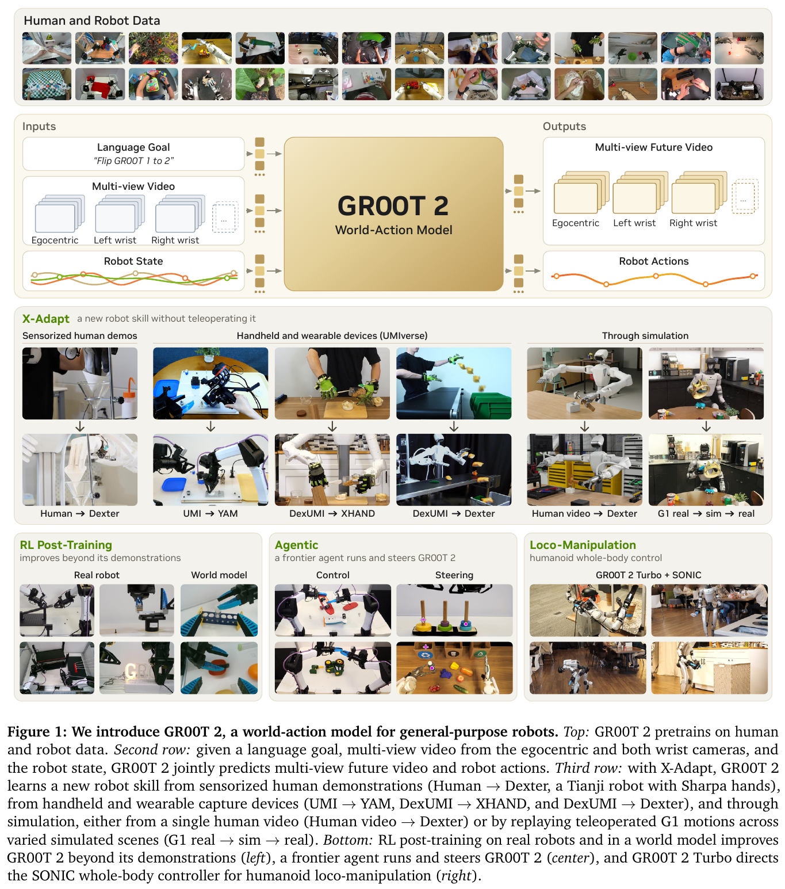
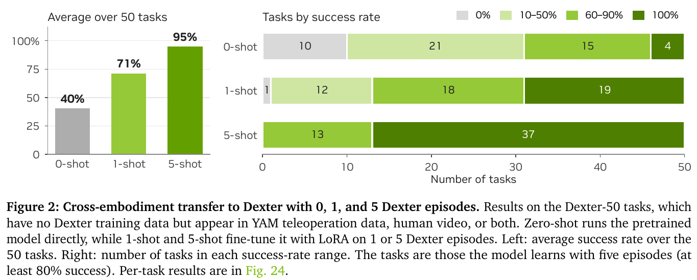
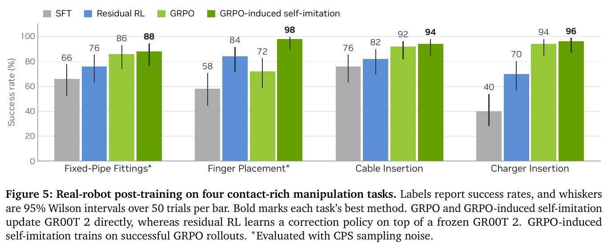
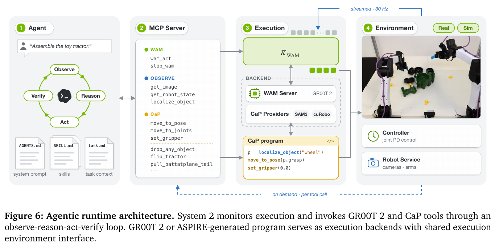
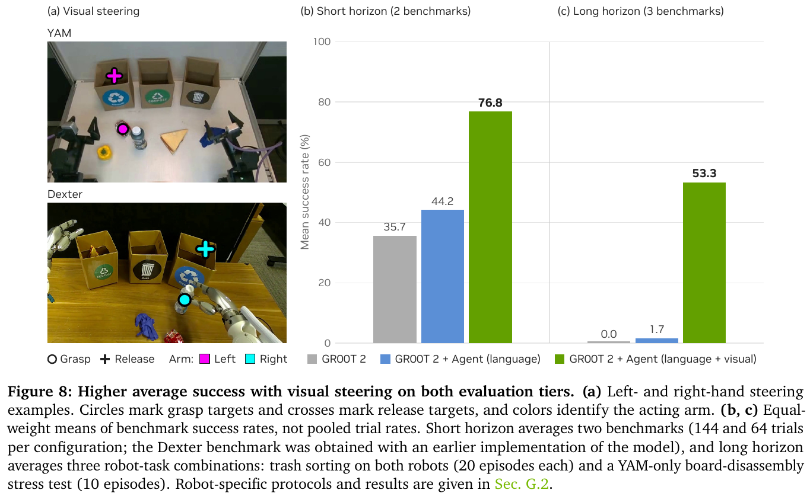
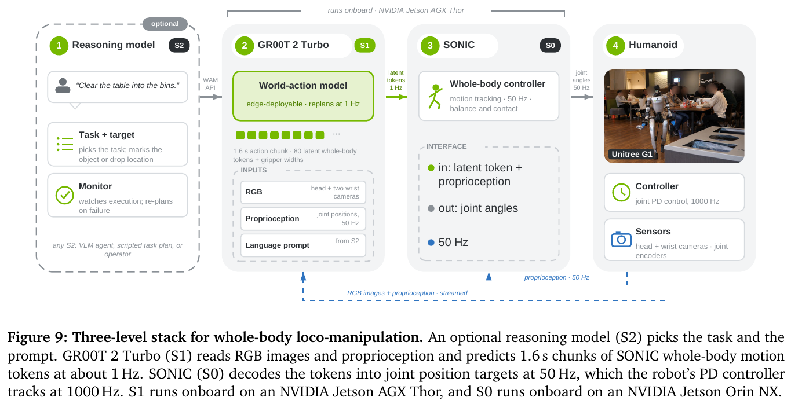

# GR00T 2：把未来视频、机器人动作和 Agent 执行连起来

论文：**GR00T 2: Scaling Robot Foundation Models for Generalization, Dexterity, and Adaptation**，NVIDIA，2026 年 11 月。

资料：[官方项目页](https://research.nvidia.com/labs/gear/gr00t-2/) · [官方白皮书](https://research.nvidia.com/labs/gear/gr00t-2/assets/gr00t2_whitepaper.pdf) · [本地白皮书备份](media/assets/GR00T-2/gr00t2_whitepaper.pdf)。

**GR00T 2 的核心设计，是在一个模型里联合预测未来画面和机器人动作，再把这个动作模型交给高层 Agent 调用、引导和纠错。**

它把几个问题连在一起：人类视频怎样成为机器人学习的数据；换一个机器人本体后，已有技能怎样迁移；少量示范和真实执行怎样改善精度；基础策略出错后，Agent 怎样接手处理。

下面的六张图均来自白皮书，已保存到笔记旁的 `assets/GR00T-2/`，不依赖临时文件或网络图片。图下保留原图编号和页码，方便回到原文查证。本文中的解释性公式和研究建议另行标明。

## 1. 先看总图：GR00T 2 实际上包含几条路线

*图 1，白皮书第 4 页。上面是数据，中间是输入输出，下面是迁移、后训练、Agent 和人形机器人应用。*

图中间最重要。模型输入语言目标、多视角历史视频和机器人状态，输出多视角未来视频与机器人动作。它不仅要学“手接下来怎么动”，还要预测这些动作对应的场景变化。

下面几块需要分别读：

| 路线 | 解决的问题 | 改进主要发生在哪里 |
| --- | --- | --- |
| X-Adapt | 目标任务没有目标机器人的遥操作示范，怎样迁移 | 跨本体数据与共同表示 |
| Few-shot adaptation | 已有任务理解，具体执行还不够准 | 少量示范下的参数适配 |
| RL post-training | 示范之后仍有接触、精度和可靠性问题 | 动作探索与策略更新 |
| Agentic control | 长任务需要记忆、验证和失败恢复 | 执行流程与工具调用 |
| Turbo + SONIC | 人形机器人需要低延迟与高频全身控制 | 视频表示压缩与分层控制 |

这些路线可以互相配合，但实验中的高分往往来自特定组合。理解结果之前，先问清楚用了哪一层。

## 2. 从 VLA 到 WAM：增加了哪个学习目标？

普通动作策略可以抽象为：

$$
p_\theta(A^+\mid O^-,q,c),
$$

其中 $O^-$ 是历史观测，$q$ 是本体状态，$c$ 是指令，$A^+$ 是未来动作块。

GR00T 2 增加未来视频变量 $V^+$：

$$
p_\theta(V^+,A^+\mid O^-,q,c).
$$

这是概念性分布表示。视频和动作可以采用不同采样频率，不应把两者的序列长度当成相同。

例如让机器人翻转玩具卡车，模型同时预测卡车和手接下来的视觉变化，以及机器人应该执行的动作。未来画面为动作提供了与物体交互相关的建模目标。

这里有两个容易混淆的地方。

第一，GR00T 2 采用联合生成。它并不是必须先完整生成一段视频，再调用另一个独立模型把视频转换为动作。

第二，生成未来也不自动等于显式规划。项目的主体方法不是“采样很多未来、逐条评分、搜索最佳动作”的 MPC 流程。它主要通过共享模型和联合去噪，让动作生成使用所预测的视觉动态。是否带来额外的推理时规划收益，需要专门消融。

这也解释了为什么人类视频有用：即使没有目标机器人的动作标签，未来画面仍然可以成为监督。但从视频监督到可执行动作之间，还需要机器人数据建立联系。

## 3. 架构具体怎样搭？

依据白皮书第 2 节，GR00T 2 从 **Cosmos-Predict2.5-2B** 初始化，联合视频与动作的 Transformer 约为 **2B 参数**。这个数字指主体 Transformer，不应直接当作所有冻结编码器加在一起的系统总参数量。

### 3.1 输入是短历史、多视角和本体状态

模型接收约 0.8 秒历史，以 5 fps 组织 224 × 320 图像，最多四个相机视角，常见的是头部和两个腕部相机。另有机器人状态与自然语言指令。

短历史能够提供局部运动信息，但不足以记住长任务全过程。论文把显式任务记忆更多交给高层 Agent。这一点会影响 benchmark：需要记住此前发生的事情时，不能只比较当前画面的动作能力。

### 3.2 视频先进入冻结 VAE

主版使用冻结的 Wan 2.1 Video VAE：时间压缩 4 倍，空间宽高分别压缩 8 倍。压缩后的 latent 再形成 token，并添加 camera-view embedding，区分不同相机。

以给定分辨率计算，VAE 的空间网格约为：

$$
\frac{224}{8}\times\frac{320}{8}=28\times40.
$$

白皮书报告进一步分块后，每个 latent 帧、每个相机对应 280 个视频 token。VAE 网格数量和 Transformer token 数不是同一个量。

这一步让模型不必直接在完整像素阵列上计算注意力。不过，多相机和未来帧仍然带来大量视觉 token，后面的 Turbo 正是针对这部分成本做压缩。

### 3.3 语言通过 cross-attention 提供条件

冻结的 Cosmos-Reason1 编码指令，Transformer 通过 cross-attention 读取语言特征。语言负责告诉模型该执行哪个任务，视觉和本体状态则描述当前处境。

### 3.4 本体专用模块连接共享 Transformer

不同机器人使用小型 state/action MLP，把自身状态和带噪动作映射到统一维度，再由相应解码模块转回动作空间。

共享的部分学习交互和任务规律，本体模块处理动作维度及表示差异。这使跨本体训练更容易组织，但不意味着新机器人无需数据或标定即可接入。相机配置、动作表示和控制器仍然需要适配。

### 3.5 动作可以关注正在生成的未来视频

视频 token 能跨时间和相机交互；动作 token 可以关注全部视频 token，包括未来视频 latent。这样，动作预测使用的不只是已观察到的图像，也包括模型当前对未来的预测。

这是 WAM 的核心连接。但图像预测与动作在真实物理系统中的一致性仍然需要验证：模型可能生成“看起来会成功”的视频，同时输出实际无法完成的动作。

## 4. 联合 Flow Matching 怎样训练？

为了说明原理，设干净视频 latent 为 $z^v$、动作表示为 $z^a$。对任一模态 $m$，用如下常见插值约定：

$$
x^m_\tau=(1-\tau)z^m+\tau\epsilon^m,
\quad \epsilon^m\sim\mathcal N(0,I),
\quad u^{m,*}=\epsilon^m-z^m.
$$

这里 $\tau=0$ 是数据、$\tau=1$ 是噪声；生成时沿相反方向从噪声走向数据。也有实现使用相反时间约定，不能只看正负号判断对错。

示意性的双目标为：

$$
L=\lambda_v\mathbb E\|u^v_\theta-u^{v,*}\|^2
+\lambda_a\mathbb E\left[m_a\|u^a_\theta-u^{a,*}\|^2\right],
$$

$m_a$ 表示该样本是否具有有效动作监督。这个表达帮助理解视频与动作共同训练，不是对原文所有噪声调度和损失权重的逐项复写。

重要的是：没有有效动作标签的视频样本，仍能贡献视频预测损失；有机器人动作或有效人手轨迹监督的样本，还能参与动作学习。两部分更新共享模型，从而建立视觉动态与动作之间的联系。

部署时，论文采用视频 1–2 步、动作 2–4 步的少步去噪配置。不同模态的步数可以不同，不能将一次动作规划理解成几十步完整视频生成。

## 5. 人类数据为什么能够迁移到机器人？

### 5.1 三类数据分别补什么

| 数据来源 | 报告时长 | 主要作用 |
| --- | ---: | --- |
| Human-1M 人类第一视角数据 | 402,730 小时 | 交互种类、物体、任务和场景覆盖 |
| UMI 手持夹爪示范 | 10,184 小时 | 更接近机器人操作方式的任务轨迹 |
| 机器人遥操作 | 23,500 小时 | 具体本体的观测与可执行动作对应 |

来源：白皮书第 4.2 节及数据附录。原始数据时长不等于训练采样比例；也不能把所有人类数据都当成完全没有动作信息的普通互联网视频。论文在具备条件的数据上使用跟踪的人手姿态作为动作监督。

人类视频最直接提供的是“这个操作通常怎样改变物体”。机器人数据补上“当前这双手如何实现这种变化”。UMI 则处在两者之间：由人采集，但设备约束和动作表示更接近机器人。

### 5.2 三阶段训练的目的

**阶段一：单视角视频预训练。** 在人类第一视角数据和机器人视频上学习未来视频预测，先适应具身交互场景。

**阶段二：多视角视频与动作联合训练。** 加入本体专用 state/action 模块，有多视角的数据使用多视角；在有效动作标签存在时应用动作损失。

**阶段三：提高机器人数据权重。** 继续联合训练，更强调机器人执行分布，同时保留人类和其他来源的数据。

训练顺序体现了一个取舍：人类经验提供广度，但最终输出必须落在机器人能执行的动作分布里。机器人数据占比太低，可能学会丰富的视觉变化却无法精确控制；过早只关注目标机器人，则可能损失广泛经验的价值。

### 5.3 “不用目标任务遥操作”到底是什么意思？

论文展示了三种很有代表性的迁移方式：

| 路线 | 源数据与映射 | 报告的任务例子 |
| --- | --- | --- |
| Human → Dexter | 传感手套记录腕部与手指运动，几何重定向到机械臂和 Sharpa 手 | 滤纸安装 65%，滴管操作 30% |
| UMI → YAM | 人使用手持夹爪采集目标任务，结合目标机器人的其他任务数据 | 玩具卡车装配 60%，NIST 板拆卸 50% |
| DexUMI → 灵巧手 | 可穿戴设备提供更接近目标手的动作及交互记录 | 香蕉酸奶 60%，舀麦片 80%，划火柴点灯 75% |

以上来自白皮书第 3.2 节及附录 B，不同任务和设备的实验设置不同。UMI 分拣中的 86% 是完成比例，不能与完整任务成功率混成同一种指标。

最重要的边界是：**目标机器人没做过这个任务，不代表模型没有目标机器人数据。** task-agnostic play data 可以帮助模型理解目标机器人的外观和动作空间，再将其他本体上的任务经验迁移过来。

因此，更准确的表述是“减少或免除目标任务的目标本体遥操作”，而不是“看一段普通视频就能让任意机器人零样本完成任意任务”。

## 6. 五条示范到 95%：强在哪里，筛选条件又在哪里？

*图 2，白皮书第 6 页。左边是平均成功率，右边是不同成功率区间中的任务数量。*

Dexter-50 包含 50 个没有出现在目标 Dexter 训练数据中的任务，但这些任务在其他机器人或人类数据中出现过。结果为：

| 目标机器人示范数 | 平均成功率 | 是否更新模型 |
| --- | ---: | --- |
| 0 | 40% | 直接运行预训练模型 |
| 1 | 71% | 每个任务做 LoRA 微调 |
| 5 | 95% | 每个任务做 LoRA 微调 |

“40/50 个任务至少成功过一次”和“零样本平均成功率 40%”是两个不同统计量，不能混淆。前者说明能力覆盖，后者反映执行可靠性。

附录 A.3 给出的适配方式是 rank-32 LoRA：冻结原始权重、视频 VAE、文本编码器和 state/action heads，训练 Transformer 线性层上的适配器。每条示范切成 100 个训练窗口，并按冻结模型在窗口上的损失进行采样，让更新更多关注难点。每个任务约在单张 RTX 5090 上训练 30 分钟。

因此，这里的 few-shot 是少数据参数微调，不是只把五条示范塞进上下文、模型参数完全不变的 in-context learning。

**任务筛选条件必须和 95% 一起读：这 50 个任务选自五条示范后能达到至少 80% 成功率的任务。** 这说明模型在这一类可快速适配的任务上表现很好，但不能用它估计任意新任务的五样本成功率。

更完整的评测应当预先固定任务集，再报告失败任务和成功任务的全部分布。否则最难适配的任务已经在筛选阶段被排除。

## 7. RL 后训练：补的是接触和精度

*图 5，白皮书第 10 页。每根柱对应 50 次测试，误差条为 95% Wilson 区间。带星号的两项使用 CPS 采样噪声评测。*

| 任务 | SFT | Residual RL | GRPO | GRPO 后成功轨迹自模仿 |
| --- | ---: | ---: | ---: | ---: |
| 固定管件装配 | 66% | 76% | 86% | 88% |
| 手指精确放置 | 58% | 84% | 72% | 98% |
| 网线插入 | 76% | 82% | 92% | 94% |
| 充电器插入 | 40% | 70% | 94% | 96% |

这张图说明，预训练和示范带来的任务知识之外，实际接触还需要进一步适配。尤其是充电器插入，较小的位姿误差就可能使策略反复失败。

三类方法修改的对象不同：

- **Residual RL**：冻结 WAM，训练一个修正策略，调整基础动作。
- **GRPO**：直接优化 GR00T 2 的生成策略。
- **GRPO-induced self-imitation**：把 GRPO 探索出的成功轨迹用于监督微调。

不能把最后一列简单叫成“GRPO 成绩”，因为它已经多了一步成功经验学习。手指放置上 GRPO 为 72%、自模仿为 98%，也说明探索得到的经验与最终部署策略之间存在重要差别。

### Flow policy 怎样获得随机探索？

原本较确定性的 flow 去噪，不直接提供 PPO/GRPO 所需的常规随机策略形式。论文采用 Coefficients-Preserving Sampling（CPS），在动作去噪中加入随机性，视频去噪保持确定性，再组织策略优化。

它的作用是为动作探索及概率比优化提供可用的采样过程，不应简单理解成“在最终关节目标上随便加噪声”。具体概率计算需要按论文附录 F 的去噪过程处理。

### 为什么还要记住历史回报？

标准组内相对优势在所有 rollout 同时成功或同时失败时，可能失去区分信号。论文采用包含历史回报信息的 baseline，缓解这个问题。

但历史 baseline 能提供不同参照，不意味着全失败时就知道正确动作是什么。探索是否能发现成功、失败反馈是否可靠，仍然决定学习效果。

AutoRL 用约 35 天的仿真实验迭代探索这一训练配方。这里 Agent 改进的是学习算法和实验配置，不应与真实机器人上的 35 天自主学习混为一谈。

## 8. Agentic GR00T 2：把 WAM 作为可调用的执行工具

*图 6，白皮书第 10 页。Agent 在左，工具接口在中间，WAM 与 CaP 共同连接执行环境。*

这张图最值得看的不是某个 API 名称，而是控制权怎样交接。

1. Agent 调用 `wam_act`，让 WAM 执行擅长的操作。
2. 通过图像和机器人状态检查进度。
3. 如果零件掉落或任务停滞，暂停 WAM。
4. 调用定位、移动、抓取或特定恢复技能，修复当前状态。
5. 把控制权交回 WAM，继续原任务。

例如，装配玩具飞机时，WAM 负责对接、翻转和拧紧。零件掉到桌边后，Agent 可以用 CaP 定位并重新抓取，让场景回到基础策略能继续处理的状态。

共享执行器需要协调两种控制来源，避免 WAM 和程序化动作同时向机器人发送冲突命令。

### 高成功率属于哪个系统？

真实装配评测每次把零件随机倒在桌上，三项任务各 100 次，人工帮助计为失败。SFT + DAgger 的成功次数分别为：飞机 84、拖拉机 71、Hot Wheels 汽车 78；再加入 Agent 后变成 98、97、97。来源：白皮书第 3.4 节、图 7。

这里的 97%–98% 属于 **纠正数据训练后的 WAM + Agent + CaP 恢复技能**。它有力支持组合系统的可靠性，但不等于预训练基础模型单独执行的成功率。

在相同 Agent 框架内，换成 RL 后训练的插入策略，还把连续插五根网线的成功次数从 12/20 提高到 19/20，把连续插五个充电器从 2/20 提高到 20/20。这说明更好的低层技能和更好的高层组织可以互补。

### 仿真评测中，还包括预先开发的程序

附录 G.1 说明，ASPIRE 在开发 seeds 上发现任务程序，再选择每个任务默认使用程序还是 WAM，随后由 S2 监控并在需要时恢复。因此，这部分 Agentic 成绩也包含开发阶段的技能与程序积累。

具体做法是先用 15 个开发 seeds 生成程序，再用 30 个开发 seeds（包含前面的 15 个）比较程序与 WAM，平局选程序；测试另用独立 seeds。在论文报告的 SFT 执行器选择中，RoboDojo 的 54 个配置只有 12 个默认使用 WAM，其余默认使用程序。因此，不能把整套系统描述成“所有任务都由 WAM 执行，Agent 只偶尔恢复”。

RoboDojo 中报告的 75.8% 使用 **layout bank 0**，不是三个官方 layout banks 的完整平均。与其他系统比较时，需要同时对齐任务配置、layout 范围、开发预算和测试 seeds。

恢复也有边界：附录记录的失败包括需要过高精度的恢复动作，以及物体掉落或剩余时间不足等不可恢复状态。能发现失败，不代表已有工具能把它修好。

## 9. Visual Steering：把“哪个物体、放哪里”直接画出来

*图 8，白皮书第 12 页。圆点表示抓取目标，十字表示释放目标，颜色区分左右臂。*

语言指令可能说对了，但策略依然抓错对象、放错容器。Visual steering 给高层一个更直接的空间接口：在当前相机画面标出抓取点和释放点，同时指定动作手臂。

Agent 决定对象和目标位置，WAM 补齐抓取姿态、接近、搬运和释放过程。这个接口比输出全部关节动作简单，也比单纯的自然语言更明确。

### 模型需要学会理解标记

这些标记不能直接画到一个从未见过标记的策略输入上，就假设它会遵循。论文需要进行 point-conditioned mid-training。监督通过已有示范中的抓取、释放事件和标定信息自动生成，不需要新的人工作点标注，但仍然需要额外训练。

附录 G.2 中，高层使用 GPT-6 Astra，每个 episode 一个对话；harness 在释放事件、完成检查或超时条件触发后再次询问 Agent。也就是说，“什么时候看下一次”和“看完后怎么办”分别由执行框架与模型共同完成。

这部分与上一节的 CaP 恢复还有一个区别：visual steering 中的物理动作仍由 WAM 执行，高层改变其条件；CaP recovery 则可以把控制权切换到程序化技能。

### 平均数如何计算？

图 8 的短时程结果为 35.7% → 44.2% → 76.8%，对应原策略、语言引导、语言加视觉引导。长时程为 0% → 1.7% → 53.3%。

**这些是 benchmark 等权平均，不是把所有试次混在一起计算的成功比例。** 附录表 22 的细分结果更能说明能力差异：

| 评测 | 原策略 | 语言引导 | 语言 + 视觉引导 |
| --- | ---: | ---: | ---: |
| YAM 短指令，144 次 | 60/144 | 80/144 | 120/144 |
| Dexter 短指令，64 次 | 19/64 | 21/64 | 45/64 |
| YAM 垃圾分类，20 次 | 0/20 | 0/20 | 17/20 |
| YAM 装配板拆卸，10 次 | 0/10 | 0/10 | 3/10 |
| Dexter 垃圾分类，20 次 | 0/20 | 1/20 | 9/20 |

Dexter 短指令结果使用较早版本实现，论文已有注明。本文优先采用白皮书表 22；项目页对 Dexter 长任务的文字概述与这一表格并不完全一致，不混用它们得出额外结论。

视觉标记主要改善对象与目的地的对应关系。它没有完整表达物体最终朝向、施力方式、倾倒角度或擦拭路径，这些仍依赖语言和已有技能。

还要保留三个实验边界：真机部分没有检验对新场景、新物体的泛化；接口每步只移动一只手，没有覆盖同时双臂协调；YAM 长任务的不同配置涉及不同工位和操作人员，并非完全配对的实验。视觉条件模型也经过专门的中间训练，对照使用语言条件模型，不能将差异全部归因于运行时多画了几个点。来源：附录 G.2，第 104–107 页。

### 接口还要付出延迟成本

附录表 24 中，视觉引导垃圾分类每个 episode 中位数为 9 次 Agent 调用。机器人等待 Agent 的时间占比为 YAM 38%、Dexter 32%。这说明高层加入后，应当一起报告成功率和任务耗时。

对控制系统而言，问题不仅是“Agent 推理得够不够好”，还有“应当在哪些时刻停下来问它”。释放事件、低成本状态检查和需要深度推理的异常，可以采用不同触发方式。

## 10. Turbo 与 SONIC：慢一点决定，快一点执行

*图 9，白皮书第 13 页。高层选任务，Turbo 生成运动 latent，SONIC 输出关节目标，底层控制器跟踪。*

### 10.1 Turbo 压缩了什么？

白皮书第 2 节明确写到：**Turbo 保留 2B Transformer**，把 Wan 2.1 VAE 换成 Wan 2.2 VAE，空间每维压缩从 8 倍提高到 16 倍，因此空间 latent 网格变为四分之一。输入输出投影相应适配，动作预测时域不变。

项目页曾使用“更小的 2B Transformer”的表述，但白皮书同时将主版和 Turbo 都定义为 2B。本文采用白皮书口径，不能据此编出主版更大的参数量。

Turbo 仍然联合预测视频和动作，主要减少视觉 token 成本。空间网格减少四倍，也不代表整个系统必然加速四倍：还有编码器、动作 token、去噪步数、数据传输和控制器成本。

### 10.2 三种频率分别属于哪一层？

| 层次 | 职责 | 论文中的频率或时域 |
| --- | --- | --- |
| S2 | 选择任务和子目标 | 按需调用 |
| S1：GR00T 2 Turbo | 根据视觉和本体状态预测运动 latent | 约 1 Hz 规划，输出 1.6 秒动作块 |
| S0：SONIC | 将运动 latent 转为全身关节位置目标 | 50 Hz |
| 机器人 PD | 跟踪关节目标 | 1000 Hz |

Turbo 在 Jetson Thor 上单次预测约 124 ms。**124 ms 是预测延迟，50 Hz 是 SONIC 的控制频率。** 两者不能合并成“整个 WAM 每 20 ms 重新看图并规划”。

低层控制器承担更快的运动跟踪与身体协调，高层保留更大的感知和动作规划模型。这样的分工也意味着，需要单独检查低层控制器是否足以处理上层预测间隔内的扰动。

### 10.3 效率与细节之间存在取舍

白皮书表 1 的七个 Dexter 后训练任务中，主版平均成功率 68.6%，Turbo 为 34.3%。在六个 YAM 后训练任务中则是 71.7% 对 65.0%，而且 Turbo 在其中两项任务上更好。

这支持“不同任务对预测细节的需求不同”的判断，但不能仅凭这个对比证明全部差距都由空间压缩造成。VAE、表示和训练变化需要进一步隔离。

表 1 还有一个场景差异：Truck Assembly 中两个 GR00T 2 版本使用了调整后更容易的起始场景，主版在表中为 65%；原场景下主版是 7/20，即 35%。因此，这张表中的跨模型对比还需要结合具体任务协议阅读，不能默认所有模型的起始条件完全相同。

G1 爆米花服务任务中，Turbo 完成 48/48 次，每次需要两杯。这个结果应保留任务与次数边界；48 次全成功不等于长期部署真实成功概率为 100%。

## 11. 三个最值得继续研究的问题

以下是基于论文的研究判断，而非作者已经验证的全部结论。

### 11.1 视频预测的收益发生在训练时，还是推理时？

联合视频监督提供更多学习信号，推理时生成未来 latent 又可能帮助动作选择。两种收益容易被混在一起。

可以在匹配数据与计算预算的条件下，对比纯动作模型、只在训练时使用视频辅助目标的模型，以及推理时仍联合预测视频动作的模型。需要为每个设置设计可训练的结构，不能简单删除已训练模型的视频分支就把下降归因于“规划能力”。

还应控制视觉细节：背景纹理、物体轮廓、接触点和相对运动，究竟哪些最值得预测？对于操作，花大量算力预测背景未必比准确预测一个接触事件有用。

### 11.2 触觉怎样加入，才真正帮助控制？

论文指出当前 GR00T 2 不以触觉作为输入。一些 DexUMI 配置可以输出用于柔顺性控制的关节力矩，但输出力矩与读取触觉形成闭环是两件事。

可以研究联合预测未来视频、触觉 latent 和动作：

$$
p_\theta(V^+,F^+,A^+\mid O^-,F^-,q,c).
$$

这只是研究设想。需要处理传感器频率差异、接触事件的时间对齐，以及视频和触觉损失的尺度。最终应检验滑移检测、卡滞恢复和插入成功率，而不只看触觉预测误差。

更进一步，接触事件是否应该触发一次高层重规划？如果视觉变化很小但指尖力突然变化，等待下一次常规相机更新可能太迟。

### 11.3 Agent 的进步来自决策，还是更丰富的执行工具？

拥有 `flip_tractor` 这类特定恢复技能，与只有通用移动和夹爪接口，任务难度不同。研究 Agent-native 能力时，需要明确技能来自预先编写、开发集搜索，还是当前交互生成。

可以固定 WAM，分别测试无恢复、固定恢复库、可修改恢复程序和可跨任务保存程序的系统。记录失败类型、工具调用、交互预算和复用收益，才能判断 Agent 是否在积累新能力。

对于一个失败，至少要区分：检测到了但工具不够、选错了恢复方式、恢复执行失败，以及已经不可恢复。这比只报告最终成功率更能指明下一步该提升模型还是补工具。

## 12. 和 Gemini Robotics 2.5、CEL、WAM 笔记怎样联系？

| 工作 | 主要可借鉴的机制 | 需要保留的边界 |
| --- | --- | --- |
| GR00T 2 | 联合视频动作预训练、跨本体迁移、可引导的 WAM 接口 | 基础模型、适配、RL 和 Agent 成绩分开 |
| Gemini Robotics 2.5 | ER 与动作模型分工，Argon 帮助数据生成和研发 | 发布材料未完整披露训练配方 |
| CEL / FERT | 从群体真实失败中选择相关成功经验训练 | 参数学习与当前任务的在线恢复分开 |
| VPP2 训练思路 | 视频交互知识向动作迁移，重视指令跟随 | 视频泛化与可执行动作泛化分别验证 |

相关笔记：[Gemini Robotics 2.5](Gemini-Robotics-2.5.md)、[CEL](CEL.md)、[WAM 训练参考：VPP2](WAM训练参考VPP2.md)、[Metatron](Metatron.md)、[Recova](Recova.md)。

我更愿意把 GR00T 2 的贡献理解为一套可以拆开研究的学习与执行体系：大规模数据提供任务广度，少量示范修正本体差异，RL 提高接触精度，Agent 补记忆、验证和恢复。每一层都有自己的成本，也有自己的失败方式。

如果做一个最小研究项目，我会先固定 WAM，研究高层如何通过语言、空间目标和接触反馈更可靠地调用它。再检查失败经验能否沉淀成可复用的恢复程序或新的动作训练样本。这样可以把一次执行中的纠错，与多次执行后的学习连起来。

## 13. 阅读与复现时保留这些口径

- 2B 是联合 Transformer 的参数量；白皮书主版与 Turbo 都是这个量级。
- 没有目标任务的机器人遥操作，不等于没有目标机器人数据，也不等于人类示范完全没有动作追踪。
- 95% 是筛选后的 Dexter-50 五样本微调结果。
- 97%–98% 是加入纠正数据、Agent 与恢复技能后的真实装配系统结果。
- Visual steering 的汇总数是 benchmark 等权平均，还涉及额外的标记条件训练。
- RoboDojo 75.8% 的结果只覆盖 layout bank 0，不能作为三组 layout 的完整平均。
- Turbo 的预测延迟、WAM 规划频率、SONIC 控制频率与 PD 频率分别计算。

截至本次核对，官方项目页仍标注代码将在 12 月提供。论文已足够讨论机制和实验，但完整复现还需要对应代码、权重、数据与训练配置。后续应以实际发布内容为准。
