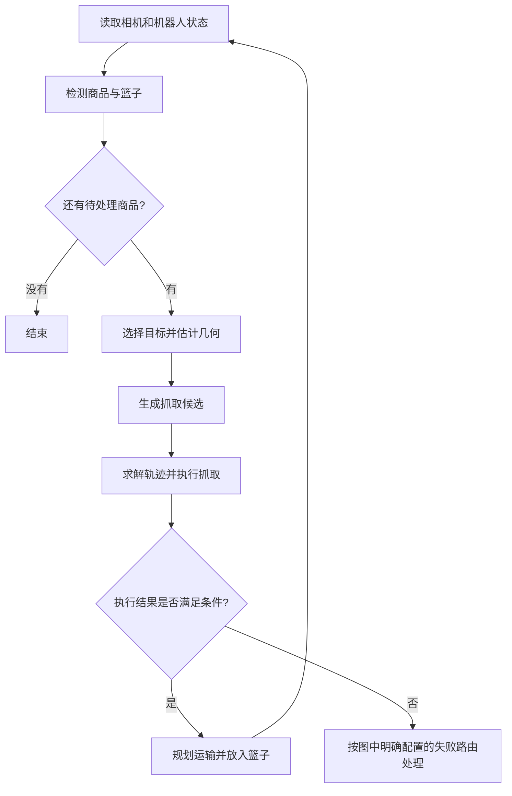
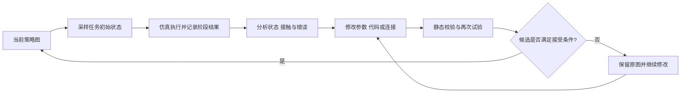

# GaP：让 Coding Agent 编写、验证和改进机器人策略

论文：**GaP: A Graph-as-Policy Multi-Agent Self-Learning Harness For Variational Automation (VA) Tasks**。UC Berkeley、NVIDIA 与 Bosch，CoRL 2026 Spotlight。

[项目主页](https://graph-robots.github.io/gap/) · [论文 v3](https://arxiv.org/html/2607.05369v3) · [代码](https://github.com/graph-robots/graph-as-policy) · [技能库](https://github.com/graph-robots/open-robot-skills) · [文档](https://graph-robots.github.io/graph-as-policy/)

GaP 研究的是如何自动开发机器人策略。给定任务、机器人配置、工作空间和一套已有技能，Coding Agent 先写出可执行程序，再在仿真中测试，根据执行反馈修改程序。最终部署的是修改后的策略图。

这里最值得关注的变化，是把 Agent 的能力用于**开发一个能够反复执行的策略**。它可以花时间检查接口、试验抓取方式、修改放置偏移，随后把改进应用到这一类任务的后续实例中。

要理解全文，先记住三个角色：Coding Agent 负责写和改程序；策略图负责调度感知、规划与控制；仿真器负责提供试验环境和执行证据。图中的节点仍然可以包含神经网络模型，甚至调用 VLA，因此这一框架与学习型策略可以组合使用。

## 1. 它面对的是哪一类机器人问题？

作者把目标场景称为 **Variational Automation，VA**。可以理解为：工作站和任务类型相对固定，但每次来的物体及其位置有所变化。

例如商品装箱。机器人、相机和桌面已经安装好，可能出现的商品属于一个已知集合。下一次执行时，罐头可能转了一个角度，篮子可能移到另一边，还可能多出几件商品。系统需要根据当前观察重新决定抓哪里、怎样运动和什么时候结束。

| 场景 | 已知条件与变化 | 主要难点 |
|---|---|---|
| 固定自动化 | 工件、位置、流程变化很小 | 把重复动作做到稳定、高效 |
| VA | 工作站已知，物体几何和位姿在给定范围内变化 | 对每次变化重新感知与规划，同时保持可靠性 |
| 开放环境中的通用机器人 | 可能遇到新场景、新物体、新任务 | 识别任务、建立环境理解并迁移能力 |

GaP 利用了比较充分的工程条件：机器人模型、关节限制、夹爪、相机标定以及对象几何和初始位姿范围等。这些条件使系统能够调用几何规划工具，也能从给定资产构建仿真任务。[项目对 VA 的定义](https://graph-robots.github.io/gap/)

**已知几何模型和已知当前位姿是两回事。** 系统可以预先知道罐头的形状，但仍然需要从摄像机观察中确定这次罐头在哪里。GaP 的适应性部分来自这种“观察当前实例，再重新计算”的流程。

这个问题设定也决定了结果的适用范围。论文考察的是有边界的重复任务。要把它迁移到陌生家庭，还需要解决资产缺失、标定变化、物体动力学未知等问题。论文中的仿真建立在给定模型和范围上，不能据此认为系统已经完成从任意真实场景自动重建可用仿真的全过程。

## 2. Graph-as-Policy：图怎样成为策略？

通常讨论 VLA 时，我们把策略写成：

\[
\pi_\theta(a_t\mid o_t,l)
\]

模型根据观察 \(o_t\) 和指令 \(l\) 输出动作。GaP 则使用执行图：

\[
\mathcal G=(V,E)
\]

节点 \(V\) 完成计算或动作，边 \(E\) 描述数据依赖和执行顺序。例如检测节点产生目标区域，几何节点据此计算点云或包围盒，抓取节点生成候选位姿，运动规划节点求解轨迹，执行节点驱动机器人。

图还有内部状态：当前正在执行哪个阶段，哪些物品已经处理，哪些中间结果可以复用。这让它能够表达条件分支和循环。一个包装策略可以一直执行“找物品—抓取—放置”，直到完成条件成立。因此，这里的图不能简单理解为只有前向边的 DAG。

下面是为说明机制构造的简化示意，并非论文原始 `workflow.json` 的逐节点复现：



失败路由是否重试、重新感知或直接退出，取决于生成的具体程序。**能够表达恢复分支，不代表每个生成图都已经具备有效恢复策略。** 项目展示的包装图中，失败路由会汇入 abort；不能把说明性的恢复示意当作已经验证的在线恢复能力。[项目中的实际包装图](https://graph-robots.github.io/gap/)

从执行语义看，可以用下面的式子帮助理解：

\[
\pi_{\mathcal G}(a_t\mid o_t,z_t)
\]

其中 \(z_t\) 是图的运行状态。这个式子是解释性的抽象：GaP 没有因此训练一个“输入图、输出动作”的图神经网络。它的 Graph 是机器人程序，也不是用于表示物体空间关系的 Scene Graph。

## 3. 为什么它能适应物体位置变化？

以抓罐头为例，固定轨迹只能到一个预先写好的位置闭合夹爪。图策略则可以先定位罐头，再根据当前位姿计算抓取目标和无碰撞轨迹。

这里有三种不同来源的能力：

1. **感知模型的泛化。** 检测、分割模型能否从当前图像中识别目标。
2. **几何与控制算法的适应性。** 规划器根据新的目标位姿重新求解，控制器根据反馈执行。
3. **Agent 对程序的组织能力。** 能否选对工具、提供正确参数，把各阶段连接起来。

因此，一个 GaP 系统的成功不能全部归因于 LLM。假如机器人能够绕开障碍，具体轨迹可能是运动规划器求出来的；Agent 的贡献是正确调用规划器、提供目标并处理返回结果。

这也是理解 GaP 与 VLA 关系的关键。图既可以把任务拆成几何模块，也可以把某个阶段交给 VLA。模块化设计允许它在合适的位置使用不同策略，而整个任务的表现仍取决于各个组件的质量和接口是否一致。

## 4. MORSL：Agent 并非从空白开始写机器人系统

MORSL 是 **Modular Open Robot Skill Library**。论文中的初始库包含 51 个技能，覆盖感知、抓取、运动、视觉工具以及验证和控制。它整合了已有视觉模型、抓取模型、规划器和机器人接口。[官方技能库](https://github.com/graph-robots/open-robot-skills)

可以从三个概念层次理解这些资产：

| 层次 | 示例 | 在生成程序时提供什么 |
|---|---|---|
| 原子工具 | 获取观察、分割、计算位姿、求解 IK、执行运动 | 可调用的接口与确定的数据格式 |
| 子任务技能 | 感知目标后抓取、规划并运输物体 | 若干工具的组合方式、约束与输入输出 |
| 任务工作流 | 按订单取货、装箱、操作锅和炉灶 | 阶段顺序、循环、条件分支与结束条件 |

这是便于阅读的分层。实际代码中的 primitive、atomic、composite 等技能类别需要按具体版本理解，不能只凭名称认定它们对应完全隔离的实现层。

技能说明文件的重要性在于，它把“抓取”这种宽泛意图转成受约束的实现任务。Agent 能够知道允许调用什么、参数应是什么类型、需要什么前置条件、返回什么结果。这会减少凭空编造接口的机会。

**类型化接口解决的是程序组合问题。** 例如点云不能直接当成末端位姿使用。中间需要几何计算或抓取生成。类似 `Image`、`Mask`、`PointCloud`、`Se3Pose`、`Trajectory`、`JointState` 的类型，可以帮助检查连接是否合理。

但接口匹配只证明数据能按照约定传递。一个格式正确的抓取位姿仍可能指向锅的错误位置；一个可执行的运动仍可能抓空。静态校验、仿真实验和真实执行分别回答不同问题。

## 5. Multi-Agent Harness 怎样生成程序？

这里的多 Agent 指多个负责代码生成的角色。它们围绕同一个机器人任务分工。

首先，编排 Agent 识别任务阶段及其依赖关系。例如操作爆米花锅，需要处理旋钮、锅柄定位、抓取、运输和放置等阶段。这个角色还要明确各阶段之间传递什么数据。

随后，技能 Agent 根据局部规范生成子图。负责抓取的角色需要实现目标感知、抓取计算和执行，但不必同时管理整个任务的循环与完成条件。

最后，系统将子图连接起来，检查节点引用、接口、数据流和路由。如果出现结构错误，继续修复。产物通常包含 `workflow.json` 和相关脚本，还可能包含用于评估的 checkpoint 文件。[公开实现与文档](https://github.com/graph-robots/graph-as-policy)

这样的分工缩小了每次代码生成所要处理的问题范围。它还让错误更容易定位：接口不兼容、节点缺失和实际抓空，可以分别在不同阶段处理。

需要区分三种并行性：多个角色分工编写子图、多个仿真实例并行测试，以及执行图中独立分支并行运行。三者属于不同层面，不能根据“multi-agent”就断言所有子图必然同时生成。

部署后，图执行器按照已经生成的程序运行，不再需要编写策略的 Coding Agent 每步重新规划。**运行中的感知节点仍可能调用 VLM。** 所以“无需 Coding Agent 在线参与”不等于每次执行都没有大模型推理成本或网络延迟。

## 6. 它到底怎么 train？主要优化的是程序

GaP 的 Self-Learning 可以理解为带物理反馈的程序搜索。被修改的对象是策略图及其代码和参数。

令 \(\mathcal B\) 表示任务实例的初始状态分布，优化目标可以写成：

\[
\mathcal G^*=\arg\max_{\mathcal G}
\mathbb E_{x\sim\mathcal B}
\left[J(\pi_{\mathcal G};x)\right].
\]

Agent 希望找到一个在不同实例上都有效的图，而非只解决某个固定初始状态。目标兼顾成功与吞吐，可以用成功项和吞吐项的加权形式表达。吞吐需要考虑成功操作数和耗时，不能仅通过缩短失败轨迹来提高。

这里没有要求图可微，也没有通过整段机器人轨迹反向传播来更新 LLM 权重。作为节点使用的感知或抓取模型可以已经经过训练；GaP 外层主要通过修改程序来改善整个系统。



修改可以发生在几个位置：将感知提示从整个物体改为关键部位；调整几何偏移；替换抓取方案；修复输入输出连接；重写局部计算代码；复用已有感知结果，减少重复调用。

这类优化的优点是可以直接利用不可微工具和经典控制模块。难点是，Agent 必须从执行反馈中提出有效修改。拿到更多状态信息，不自动意味着它知道该改哪个节点。

## 7. 物理反馈为什么重要？

最终成功与失败只提供一个粗粒度结果。假设锅没有放到炉灶上，原因可能发生在识别、抓取、运动或放置阶段。单个失败标签无法区分这些情况。

仿真可以提供执行前后的机器人状态、物体位置、接触和几何关系。下面是说明性例子，不是原始日志：

```text
阶段：抓锅并抬起
观测证据：夹爪已闭合；未建立目标接触；锅的高度没有增加
待检验解释：抓取目标或抓取位姿可能有误
候选修改：检查锅柄定位，再调整抓取位姿
验证：在多个锅的初始位姿上重新执行
```

注意“未接触、未抬起”属于观测证据，“抓取位姿错误”属于解释。闭合时机错误、目标选择错误等也可能产生相近现象。Agent 对失败原因的文字判断仍需要后续试验检验。

还要把两种机制分开：

- **评估 checkpoint** 判断某个阶段是否达到预期，可能读取仿真器中的精确位置或接触状态。
- **策略中的条件分支** 决定机器人此刻是继续、重新感知、重试还是退出。

评估得到“抓取失败”，不会自动给执行图增加重试能力。使用仿真真值的检查器，也不能直接当作真机上的状态估计器。具体系统是否在部署时访问特权状态，需要沿实际输入和调用路径检查。[论文附录与执行机制](https://arxiv.org/html/2607.05369v3)

对失败恢复研究而言，还可以区分两个时间尺度。Runtime Recovery 在当前执行中纠正错误；Policy Repair 修改程序，使之后的多个实例都能受益。GaP 的自学习主要展示了后者。

## 8. Make Popcorn：看清自学习修改了什么

这个任务包含旋钮操作、抓锅、放到炉灶等多个阶段。初始程序已经能完成部分步骤，但抓取和放置不稳定。用户材料与原文给出的结果是：初始仿真成功率 33%，10 轮优化后为 94%，真机 18/20。[案例与结果](https://graph-robots.github.io/gap/)

优化过程可以按问题理解：

| 发现的问题 | 程序修改 | 为什么影响后续执行 |
|---|---|---|
| 抓取候选难以建立稳定接触 | 结合 GraspGen 与基于 OBB 的几何抓取方案 | 改变实际接近和闭合的位置 |
| 感知目标过于宽泛 | 明确定位锅柄 | 下游几何计算转向真正可抓的部位 |
| 更改抓取后放置仍不准确 | 调整相对于炉灶的放置偏移 | 适应新的物体与夹爪相对关系 |

第三点尤其有意思：抓取变化会改变物体相对于夹爪的变换。如果放置时仍沿用旧的几何关系，即使末端到了指定位置，锅也可能偏离炉灶。

用坐标变换可以解释这个依赖。假设抓稳后物体相对末端的变换为 \(T_{EO}\)，希望物体达到世界坐标中的 \(T_{WO}^{*}\)，那么末端目标应满足：

\[
T_{WE}^{*}=T_{WO}^{*}(T_{EO})^{-1}.
\]

这是用于解释抓取与放置耦合的几何关系，不是声称论文所有节点都显式实现了这个公式。抓取换了，\(T_{EO}\) 可能随之变化，放置计算也需要对应调整。

这使案例超出了“再尝试一次”的范畴：程序修改涉及上下游依赖。真机仍有两次失败，原文将其归因于运动中的 IK 问题以及累积运动学误差导致的抓取问题。仿真优化减少了错误，但没有消除执行误差。

## 9. 成功率之外，它也优化执行效率

程序式策略中，一部分耗时来自重复感知、模型调用、规划和不必要的等待。Agent 可以检查这些环节，再修改节点或连接。

例如，篮子没有移动时，能否复用已经计算的篮子位置？某一步是否真的需要高成本视觉模型？机械臂是否在已经稳定后仍等待过久？这些都可以通过程序修改进行验证。

不过缓存也有失效条件。若物体已经移动，继续复用旧位姿可能提高速度却损害成功率。因此，效率优化必须同时检查行为质量。

论文的吞吐优化实验对候选修改使用新采样的 100 个实例进行验证，并拒绝导致成功率或执行时间恶化的修改。这是该实验的接受机制，不能直接推断为所有部署场景都有同样保证。反复参与候选选择的数据，也不同于完全不参与开发的最终测试集。

用户材料提到爆米花任务最多约 150 分钟的自学习过程。理解成本时，应分别记录程序生成、仿真优化和最终执行的费用与时间。前两者可以被长期重复执行摊薄，但比较方法时仍需计入，不能只报告部署后的单次延迟。[自学习与效率实验](https://arxiv.org/html/2607.05369v3)

## 10. 实验怎样读？

论文共有 8 项 VA benchmark，即 4 项仿真、4 项真机。取货、包装、爆米花各有仿真和真机版本，再加真机 USB-C 插拔及仿真双臂箱体清洗。

### 10.1 位置变化下的 VLA 对比

论文在 LIBERO 衍生场景中引入物体位置变化、篮子位置交换和商品排列变化。部分 VLA 在原始分布表现很好，但面对这些扰动时下降明显。

用户材料中两组有代表性的结果是：Packing varied 中，\(\pi_{0.5}\) 从 18% 提高到加入 GaP 前置调整后的 66%；MolmoAct2 从 18% 提高到 59%。Fulfillment mixed_all 中，MolmoAct2 从 20% 提高到 66%。

前置调整把机械臂及腕部相机带到目标附近，然后再由 VLA 执行。这个实验说明，改变开始执行时的观察与机器人状态，能够改善部分策略的表现。因为视角和机器人状态同时变化，不能仅据此认定全部收益来自视觉分布对齐。

还需要保留两个比较条件：VLA checkpoint 在 LIBERO 数据上微调，并没有专门用这些新 VA 扰动重新训练；GaP 使用了对象模型、模块化工具和几何规划。因此，结果说明了这些系统在给定配置中的鲁棒性差异，并没有构成“相同先验、相同训练预算下，所有图策略都优于 VLA”的证明。

Packing 的部分指标按**单个物品成功放置**统计，不能当作整段多物品任务全部完成的概率。[位置扰动与 staging 实验](https://arxiv.org/html/2607.05369v3)

### 10.2 Franka 真机结果

| 任务 | GaP | TipTop | 读取结果时需要注意 |
|---|---:|---:|---|
| Grocery Fulfillment | 25/25 | 8/25 | 真机测试次数有限 |
| Grocery Packing | 28/30 | 10/30 | 保留原文物品操作的统计口径 |
| Make Popcorn | 18/20 | 0/20 | 包含多阶段操作，但仍是限定任务 |

材料报告单次抓取放置平均耗时约为 GaP 67 秒、TipTop 95 秒。这能说明当前系统之间的效率差异。20—30 次试验则不足以证明长期运行中的故障率已经达到工业要求。即使观察到 25/25，也只是这批样本没有失败。

### 10.3 USB-C：单次插入与完整任务的差别

USB-C 任务使用 UR5、腕部相机和力反馈。系统调用已有 ROS 模块完成对齐、接触、插入和拔出，并在局部候选区域搜索插入位置。这里已经有接触控制能力作为基础，GaP 的任务主要是将这些模块组织成符合端口和顺序要求的程序。

总计为 121/130，约 93.1%。更有解释力的是分开看单次操作和完整序列：

| 条件 | 单次插入 | 完整序列 |
|---|---:|---:|
| Ascending Order | 32/35 | 2/5 |
| Descending Order | 32/35 | 4/5 |
| Odd-index Ports | 20/20 | 5/5 |

单次成功很多，完整任务仍可能频繁失败。即使假设每一步相互独立，连续 \(n\) 步都成功的概率也只是 \(p^n\)。例如 \(0.93^7\approx0.60\)。这个计算仅说明累积效应，真实错误可能相关，不能把它当作论文实验的拟合模型。

原文不同条件的流程也不完全一样，部分带标记试验不包括拔出。因此总计 121/130 不能解释为所有条件下完整插拔循环的统一可靠性。对 Dex-RUA，更应该同时记录插入、拔出、完整序列和恢复后的成功率。

### 10.4 双臂箱体任务

GaP 在仿真中成功 143/150，人工专家控制图为 148/150。额外三小时连续实验的成功吞吐分别约为 18.33 和 19.33 次/小时。

这说明自动生成程序能够在这个限定场景接近人工设计。该项是仿真实验，不应写成已完成真实工业清洗线的连续部署。[USB-C 与箱体实验](https://arxiv.org/html/2607.05369v3)

## 11. 消融究竟证明了什么？

第一，技能库的质量很重要。用户材料报告，把 TipTop 的部分感知和抓取模块替换为 MORSL 后，取货成功率从 0.24 提高到 0.53，包装从 0.34 提高到 0.60。这说明系统差异有一部分来自基础组件。

第二，论文所测试的直接生成 Python 和单 Agent 生成配置出现零成功率，但失败包含接口、语法和结构校验问题。这个结果支持作者采用的受约束生成流程更可靠，却不足以证明单 Agent 在所有配置下都不可行。

若要单独测量多 Agent 分工的收益，需要对齐模型、技能说明、schema、校验器、反馈、工具调用与 token 预算。否则多个因素一起变化，很难知道优势究竟来自角色数量，还是更完整的工程支持。

第三，静态生成失败和物理控制失败应分开统计。前者表示程序尚不能进入有效执行；后者表示程序能运行，但感知或控制没有完成任务。对机器人 Agent benchmark，两者都重要，但需要分别报告。[论文消融](https://arxiv.org/html/2607.05369v3)

## 12. 与 RUA 和 Self-Evolving Skills 的关系

以下是根据论文机制提出的研究延伸，不属于 GaP 已经验证的结论。

**首先，分开评估运行策略和开发策略的能力。** 一个 Agent 可以在当前 episode 中直接调用动作，也可以先写程序，用若干试验进行优化，再冻结程序执行新实例。两者使用信息和计算预算的方式不同。

如果 RUA 要包含后者，开发阶段可以允许读取执行日志、修改程序和测试候选；最终评估阶段则冻结程序、工具版本与可见信息，在未参与开发的实例上执行。同时记录训练期试验数、失败次数、LLM 成本和真机交互量。这样才能判断改善是否来自更有效的开发过程。

**其次，把反馈边界写进协议。** 对 GaP 类系统，至少有三类信息需要区分：已知对象模型和标定等任务先验；开发期仿真器提供的精确状态；部署时传感器可获得的观察。某种信息可以在训练期合法使用，并不意味着测试期策略可以直接读取它。

一个有价值的对照实验是逐步增加反馈：最终二值结果、阶段结果、物体状态和接触、带噪声的真实估计，以及完整仿真真值。除了最终成功率，还测量错误归因、无效修改比例、修复次数和未见布局上的表现。这样能够研究“什么反馈最有助于 Agent 修复策略”。

**第三，任务图改进与技能库增长需要分别证明。** GaP 的明确结果主要是：

\[
\mathcal G_0\rightarrow\mathcal G_1\rightarrow\mathcal G^*.
\]

一个更通用的自进化系统还要证明，改进能够形成跨任务资产：

\[
\mathcal S_{k+1}=\mathcal S_k\cup\{s_{\mathrm{new}}\}.
\]

例如在一种插入任务中写出的接触搜索程序，必须说明输入、前置条件和适用范围，并在其他对象、布局和初始误差上验证。加入技能库后，还要检查旧任务是否退化，后续任务是否减少试验成本。仅生成一段任务专用代码，还不能证明能力已经实现持续积累。

对接触密集的操作，关键还包括观测能否区分位姿偏差、物体滑动、卡住和控制错误。错误归因不可靠时，自动修改可能把一个局部失败变成系统性退化。这里的研究重点可以落在反馈质量与修改质量之间的关系，而不仅是换更强的 Coding Agent。

## 13. 代码值得怎样读？

先看一个已有 `workflow.json`，沿一次具体任务检查：输入从哪里来，坐标系如何传递，哪个节点调用模型，哪个节点执行动作，失败路由到哪里。随后看技能说明与实际接口，再读生成器和修改循环。

阅读顺序可以是：

1. [主仓库](https://github.com/graph-robots/graph-as-policy)：执行图、运行器、连接器与日志。
2. [Open Robot Skills](https://github.com/graph-robots/open-robot-skills)：已有能力及其接口约束。
3. [工作流 schema](https://graph-robots.github.io/graph-as-policy/reference/workflow-schema.html)：检查哪些结构约束可以静态验证。
4. [Agentic Self-Learning 仓库](https://github.com/graph-robots/agentic-self-learning)：进一步阅读自学习循环；其中对应的后续研究结果应与原始 GaP 实验分开。

本笔记核对了资料，没有安装模型、运行仿真或复现实验。开源入口可访问、程序能安装和论文结果可复现，是三个不同的验证阶段。

GaP 对当前研究最有用的启发，是把机器人程序本身作为可学习、可验证和可复用的对象。已有模型和控制器提供基础能力，Agent 负责组织与修改，物理执行负责检验。接下来真正值得追问的是：这些修改能否在更少的试验中完成，能否依靠真机可获得的信息，以及能否稳定转移到后续任务。
