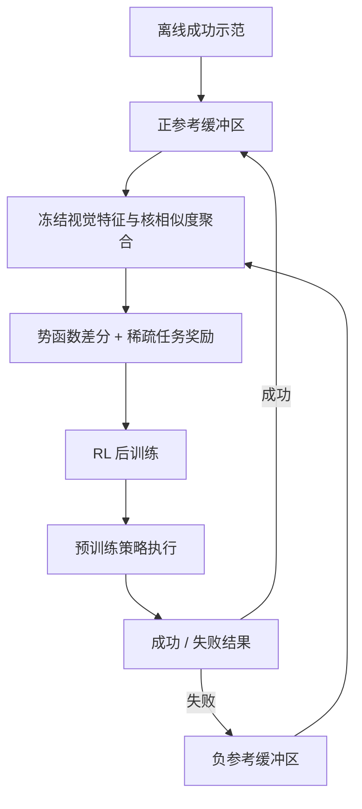

# HiRE：用真实成功与失败，修正机器人强化学习的视觉奖励

机器人把瓶子弄掉了，机械臂却继续移动到目标盘子旁边。从画面布局看，它越来越像成功示范的最后一帧；从任务结果看，它已经没有把瓶子运过去。

这就是 HiRE 要解决的问题：**视觉上接近目标，不一定意味着控制上取得进展。** 它使用冻结视觉编码器，再用执行中积累的成功与失败经验，在线修正奖励。策略仍然学习原任务，改变的是中间反馈。

论文：**HiRE: Hindsight Reward Editing for Policy Finetuning**，Haoyi Niu、Zhengtao Han、Yufeng Ji、Zhongyu Li、Koushil Sreenath，UC Berkeley 与香港中文大学，CoRL 2026。[论文](https://arxiv.org/html/2609.27068v1)｜[项目主页](https://hire-project.github.io/)

## 1. 先区分 HiRE、HER 和 LfH

这几种方法都使用 hindsight，但改变的对象不同。

| 方法 | 原目标怎么处理 | 回看执行后改变什么 |
| --- | --- | --- |
| HER / LfH | 为经验增加实际达成的辅助目标 | 目标标签与相应奖励 |
| HiRE | 保持原任务目标 | 利用成功与失败修正奖励势函数 |
| VaM | 保持任务目标 | 将历史价值预测作为策略输入 |

假设机器人抓错了物体。LfH 可以给它增加“抓起另一个物体”的学习目标；HiRE 则仍然关心原任务是否完成，用结果辨别哪些视觉相近的状态会误导奖励。

因此，HiRE 更接近**经验驱动的奖励校正**，不是给失败换一个目标后当作成功。相关概念见 [Hindsight 笔记](Hindsight.md) 和 [VaM 笔记](VaM.md)。

## 2. 为什么奖励会限制已有策略的后训练？

预训练策略已经具备一些抓取、移动或装配能力，RL 后训练希望在目标环境中提高可靠性。但如果奖励不合适，优化器可能强化错误行为。

### 2.1 稀疏奖励：正确但反馈少

\[
r_t^{\mathrm{sparse}}=\mathbb I[\text{该转移成功完成任务}].
\]

它保留了明确的目标，却可能无法区分多种失败：完全没有接近物体、已经抓稳但放置失败、对齐后最后一步卡住。对于弱初始策略，获得成功反馈可能很慢。

### 2.2 人工稠密奖励：信息多，但需要任务知识

距离、姿态误差、接触力都可以成为奖励。难点在于怎样组合，何时切换阶段，以及会不会奖励投机行为。

例如，奖励夹爪接近目标区域，可能让机器人不管是否抓住物体就直接移动过去。奖励接触力增大，也可能鼓励不必要的挤压。

### 2.3 视觉奖励：语义相似不等于执行有效

冻结视觉编码器能提供很强的外观与语义表示，但它未必学过目标机器人的失败模式。尤其当小物体丢失、接触松动或装配失败不明显时，整体画面相似度可能仍然很高。

HiRE 的做法是保留基础视觉表示，用任务中的真实结果补充判断依据。它不是让编码器突然获得精确物理模型，而是改变这些特征被用于奖励的方式。

## 3. 数据结构：成功参考与失败参考

记成功参考为 \(\mathcal B^+\)，失败参考为 \(\mathcal B^-\)。

离线成功示范提供任务沿途的正参考；在线经验提供当前策略实际遇到的成功与失败状态。缓冲区随着执行更新，奖励也随之变化。

### 3.1 为什么不把失败轨迹全部标成负样本？

一次执行可能先正确抓取、运输，最后才放置失败。如果整条轨迹都作为负例，就会让正确抓取状态也受到惩罚。

同理，在线成功轨迹里也可能包含无效探索和冗余动作。最终成功不意味着中间所有行为都值得强化。

这就是参考帧选择很重要的原因：终止结果能提供明确标签，但不能自动完成时间信用分配。

### 3.2 仿真和真机的实现不同

| 配置 | 正参考 | 负参考 |
| --- | --- | --- |
| 仿真主要实现 | 离线示范按帧间隔采样；在线成功终止帧，在线 FIFO 容量 128 | 在线失败终止帧，FIFO 容量 128 |
| 真机实现 | 附录给出正缓冲区大小 4096，并加入在线成功轨迹 | 负缓冲区大小 320，加入失败轨迹末尾 16 帧 |

所以“只保留终止帧”适用于论文的仿真主要配置，不应推广到全部实验。真机也由人工给出 episode 成功或失败标签；不需要人工稠密进度标注，不等于完全没有人工反馈。[附录 A.2—A.3](https://arxiv.org/html/2609.27068v1)

## 4. 冻结视觉特征怎样产生可更新的奖励？

设视觉编码器为 \(\phi\)，余弦相似度为：

\[
\operatorname{sim}_\phi(s,g)
=\frac{\phi(s)^\top\phi(g)}{\|\phi(s)\|\|\phi(g)\|}.
\]

这里用状态 \(s\) 简写其视觉观测，\(g\) 表示参考状态或参考图像，不是 LfH 中重新生成的自然语言目标。

主要实现使用冻结 DINOv2，按 patch 计算相似度，并对两个相机视角聚合。因而“看起来相似”具体取决于特征、图像布局与多视角信息，而不是直接计算物体间真实距离。

### 4.1 从分类器的最优解理解密度比

假设有成功状态分布 \(p_+\) 与失败状态分布 \(p_-\)，等权二分类目标的理想分类器为：

\[
D^*(s)=\frac{p_+(s)}{p_+(s)+p_-(s)}.
\]

其 log-odds 为：

\[
\log\frac{D^*(s)}{1-D^*(s)}
=\log p_+(s)-\log p_-(s).
\]

这解释了成功密度与失败密度对比的来源。它本身是区分两类数据的统计量，不应直接理解为对任意机器人任务唯一正确的真实奖励。

HiRE 用这个关系启发奖励设计，但不实际训练一个新的分类器，而是在冻结特征空间中估计密度。[方法第 4 节](https://arxiv.org/html/2609.27068v1#S4)

### 4.2 为什么使用 vMF 核？

归一化特征位于单位球面，vMF 核适合表达方向相似度：

\[
K_\kappa(s,g)=C(\kappa)\exp\big(\kappa\operatorname{sim}_\phi(s,g)\big).
\]

\(\kappa\) 越大，对高相似参考的关注越集中。对缓冲区中的参考取平均，可以得到非参数密度估计。

“非参数”在这里意味着不额外优化一个神经奖励网络，仍然需要保存数据、计算特征和相似度，并选择超参数。

## 5. 核心公式：成功项减去失败项

定义平滑聚合算子：

\[
\mathbb L^\kappa_{\mathcal B}(X)
=\frac1\kappa\log\mathbb E_{\mathcal B}[e^{\kappa X}].
\]

HiRE 势函数为：

\[
\Phi(s)=
\mathbb L^{\kappa^+}_{\mathcal B^+}
\big(\operatorname{sim}_\phi(s,g^+)\big)
-\lambda\mathbb L^{\kappa^-}_{\mathcal B^-}
\big(\operatorname{sim}_\phi(s,g^-)\big),
\qquad\lambda=\frac{\kappa^-}{\kappa^+}.
\]

等价地，展开两项后，它们的对数前都带 \(1/\kappa^+\)。提供的材料使用了这种展开形式；如果改写成两个各自除以 \(\kappa\) 的算子，不能漏掉负项前的 \(\lambda\)。

### 5.1 可以怎样理解这个聚合？

\(\kappa\) 较大时，聚合更接近最相似参考；\(\kappa\) 较小时，更多参考共同贡献。它在平均相似度与偏向最相似样本的聚合之间调整。

论文使用较集中的正项和较宽的负项：成功可能要求精确对齐，失败则可能有很多种相近表现。这是一种建模选择，不是所有任务都必须满足的普遍几何规律。

### 5.2 什么是 trap state？

它是视觉奖励看起来不错、实际却导致失败的状态。例如空夹爪已经到达目标位置，但物体早已掉在途中。

当这种状态被收入负缓冲区后，后续相似状态会受到失败项抑制。这就是 hindsight reward editing：执行结果改变了下一次训练如何评价类似状态。

不过，某次失败终点不一定在物理上永久不可恢复，也可能只是超时或当前策略能力不足。因此，负缓冲区表达的是所收集失败经验，不是严格的不可恢复状态集合。

### 5.3 两个状态如果特征完全一样，会怎样？

如果 \(\phi(o_1)=\phi(o_2)\)，那么对同一缓冲区，它们对每个参考的相似度都相同，HiRE 也无法区别它们。

正负经验可以改变特征的使用方式，却无法恢复编码器已经丢掉的细微接触信息。这是将方法扩展到滑移、力控制和精密插入时的重要限制。

## 6. 为什么用势函数差分，而不直接奖励高分状态？

HiRE 将势函数融入原来的稀疏奖励：

\[
r_t'=r_t^{\mathrm{sparse}}
+w\big(\gamma\Phi(s_{t+1})-\Phi(s_t)\big).
\]

假设 \(\gamma=1\)，势函数从 0.3 上升到 0.6，就有 \(0.3w\) 的附加奖励。若下降则得到负的附加项。这里的数值只是示意。

直接每步奖励 \(\Phi(s_t)\)，可能鼓励机器人停留在看起来像成功的状态。势函数差分则把反馈关联到转移。

### 6.1 策略不变性的推导

固定势函数和权重，在长度为 \(T\) 的轨迹上：

\[
\begin{aligned}
\sum_{t=0}^{T-1}\gamma^t
w\big(\gamma\Phi(s_{t+1})-\Phi(s_t)\big)
&=-w\Phi(s_0)+w\gamma^T\Phi(s_T).
\end{aligned}
\]

中间项消去。若初始条件固定、终止势能妥善处理，例如置零，附加回报不会改变不同策略的排序。无限时域、折扣小于 1 且势函数有界时，尾项也可消失。

这就是 potential-based reward shaping 的关键逻辑。

### 6.2 HiRE 的在线更新为什么需要额外小心？

实际缓冲区不断更新，\(\Phi\) 会变化；实现还可以动态调整权重。经典固定势函数的证明不能自动覆盖任意非平稳更新。

工程上至少应保证同一转移的前后状态使用同一势函数版本评分，并明确终止、超时和 replay 中旧奖励的处理方式。若同一条轨迹内各步使用不同势函数，前述简单消去一般不再成立。

另外，\(\gamma<1\) 时，即使两状态势函数相同，也有：

\[
\gamma\Phi(s)-\Phi(s)=(\gamma-1)\Phi(s).
\]

所以“势函数在某区域平坦”并不等于该区域的 shaping 数值逐步严格为零；需要结合终止处理和轨迹总回报判断。

## 7. 实际训练流程与 Training-free 的准确含义

Training-free 指奖励编辑本身不额外训练视觉编码器或奖励网络。RL 中用于动作改进的网络仍然需要训练，计算相似度也有开销。

主要实验使用同一个 DICE-RL 后训练骨干。其预训练生成策略作为冻结动作提议模型，训练残差 Actor 和 Critic。不能因此把 HiRE 写成“直接对整个 VLA 全参数微调”，也不能把 DICE-RL 的动作更新机制归为 HiRE 的独立贡献。

### 7.1 附录中的两个实现细节

仿真实现将 shaping 按动作块长度归一化，并根据最近成功率衰减稠密项权重：

\[
w_{\mathrm{dense}}=1-\mathrm{SR}_{\mathrm{recent}}.
\]

策略越可靠，越减少额外势函数的影响。回放的专家示范保留稀疏环境奖励，不使用在线对比奖励重新标注。

这说明实验中的稳定性不仅来自成功减失败的公式，也与奖励幅度、数据混合和权重调度有关。[实现细节](https://arxiv.org/html/2609.27068v1)

## 8. 实验结果怎样读？

### 8.1 仿真：固定后训练骨干比较奖励

| 任务 | HiRE | 稀疏奖励对照 | 结果性质 |
| --- | --- | --- | --- |
| Stack Three | 约 50% | 约 30% | 曲线中的近似最终成功率 |
| Three Piece Assembly | 超过 80% | 约 70% | 曲线近似结果 |
| Tool Hang | 约 95% | 后训练基本无法改善 | 正文对曲线的近似总结 |
| Threading | 用更少交互达到可比表现 | 达到相近表现更慢 | 主要体现样本效率 |

这些数字说明任务之间的收益幅度不同，不能概括为所有任务统一提升某个倍数。项目还比较了 RoboMeter、TOPReward 和 GCR。[实验概览](https://hire-project.github.io/)

同一 DICE-RL 骨干使比较更聚焦奖励配方，但不同奖励基线仍有编码器、历史输入、更新方式和缩放等差异。不能把它当作仅改变一个密度比公式、其余所有因素完全相同的机制消融。

### 8.2 真机：成功率的分母很重要

| 任务 | 初始策略 | HiRE 报告表现 | 评估口径 |
| --- | --- | --- | --- |
| Bottle Pick-and-Place | 20.0%，6/30 | 66.7%，20/30 | 六个初始位置，每位置五次 |
| Towers of Hanoi | 约 20% | 峰值 73.3% | 每 checkpoint 15 次评估 |

Bottle 的 66.7% 在附录对应 60、70 个在线 episode 的 checkpoint；Hanoi 的 73.3% 是峰值，不应写成所有 checkpoint 的平均表现。

Hanoi 任务是把指定圆盘从一根柱移动到另一根柱，并非完整多盘汉诺塔求解。底座未固定带来的位移增加了操作难度，但不等于已经验证了高层组合规划。

真机依赖已有示范初始化：Bottle 使用 117 条、Hanoi 使用 50 条。所谓在线少量数据收益，是在这些初始能力之上得到的。[真机设置与结果](https://arxiv.org/html/2609.27068v1)

## 9. 这篇工作最需要保留的边界

**成功与失败经验存在采样偏差。** 负样本来自当前策略会犯的错误，不代表完整失败空间。策略升级后，FIFO 缓冲区会转向新的错误，也可能遗忘旧错误。

**视觉密度不等于因果判断。** 背景、视角和动作位置可能与失败相关，但未必是失败原因。奖励可能学到捷径，需要跨背景、跨视角和同外观不同接触状态的评测。

**终止帧不能完整解释失败过程。** 真正造成失误的可能是更早的一次碰撞、夹持力不足或错误动作选择。只记终点容易遗漏时序信用分配。

**有限缓冲区不会自动提供长期探索。** 如果任务中关键阶段从未出现在成功参考里，当前相似度未必能指引机器人发现它。已有示范覆盖和初始策略能力仍然重要。

**非平稳奖励可能影响 Critic 稳定性。** 新失败加入后，相同状态的分数会变化。训练应检查 reward scale、TD error、版本一致性和历史数据处理，而不只是最终成功率。

## 10. 与 CHyLL、World Model 和灵巧操作的联系

HiRE 主要回答“这一步值得不值得”；CHyLL 系列研究“接触切换之后，状态怎样演化”。二者分别处理奖励与动力学表示，不能互相替代。参见 [CHyLL 系列笔记](CHyLL.md)。

一种可能的扩展，是用视觉、触觉、力和动作历史构造参考特征，让奖励区分外观接近但接触不同的状态。另一种是由失败事件检测器提取关键片段，而不只记终止帧。

但这两种扩展都需要控制信息来源：真实可观测的接触反馈与仿真器特权状态不同。用于公开 benchmark 时，应遵循其允许输入，额外 oracle 信息只作为清楚标注的诊断对照。

可以优先设计三类消融：固定特征比较终止帧与事件片段；固定参考比较视觉与视觉触觉融合；固定奖励协议比较静态与在线更新缓冲区。它们分别检查时序信息、感知信息和适应性的贡献。

## 11. Discussion

HiRE 的贡献是把执行结果引入奖励解释，让冻结视觉特征能够通过不断更新的参考经验，更贴近当前任务中的实际成败。它不需要每轮训练一个新的奖励网络，接口也较容易接入已有后训练系统。

其可靠性仍然受视觉表示、结果标签、参考覆盖和奖励调度限制。尤其“控制感知”在这里来自与真实结果对齐的经验校正，不等于模型已经掌握接触动力学。

对 Robot-Use Agent，更有价值的延伸是记录哪些失败经验改变了后续决策，以及这种改变能否在独立执行中得到验证。当前 HiRE 展示的是奖励辅助下的策略改进，还没有直接验证高层 Agent 的技能程序演化。
