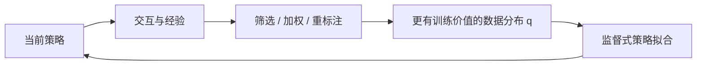
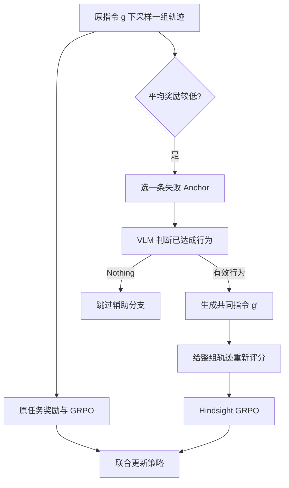
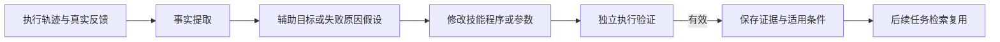

# Hindsight：怎样从已经发生的结果里，提取新的学习信号？

Hindsight 最值得关注的地方，是它允许学习系统在看到结果后，重新判断一段经验可以教会模型什么。

例如，让机器人“把绿色容器放进碗里”，机器人却把胶带放进了碗里。原任务确实失败，但这段经验仍然展示了一种有用行为：把某个物体放入碗中。如果给这段行为配上符合事实的新目标，就得到了一份额外监督。

**环境交互没有重做，原任务成绩没有改变，改变的是这段经验对应的训练问题。**

这篇笔记根据提供的材料整理，重点展开两篇资料：

- BAIR，2020 年 10 月 13 日：[Reinforcement Learning is Supervised Learning on Optimized Data](https://bair.berkeley.edu/blog/2020/10/13/supervised-rl/)，Ben Eysenbach、Aviral Kumar、Abhishek Gupta。
- MIT / MIT-IBM Watson AI Lab：[Learning from Hindsight for VLA Reinforcement Learning](https://arxiv.org/html/2607.09042v2)，Iris Xu 等，本文以 2026 年 10 月 5 日的 v2 为准。提供的材料也使用了早期标题 Learning More from Less: Reinforcement Learning from Hindsight。

下面先解释 Hindsight 的概念，再推导 BAIR 的数据优化视角，最后讲 LfH 的算法、实验和研究边界。研究建议与作者已验证的结论会分开写。

## 1. 为什么同一次失败，还能提供新的监督？

### 1.1 成败总是相对于一个目标

假设目标为 \(g\)，执行轨迹为 \(\tau\)，奖励为：

\[
R(\tau,g)=\mathbb I[\tau\text{ 完成目标 }g].
\]

同一条轨迹换一个目标，奖励可能不同：

\[
R(\tau,g)=0,\qquad R(\tau,g')=1.
\]

例子如下：

| 实际行为 | 原目标 | 原任务结果 | 可以额外学习的目标 |
| --- | --- | --- | --- |
| 把胶带放进碗里 | 把绿色容器放进碗里 | 失败 | 把胶带放进碗里 |
| 把方块推到左侧 | 把方块放进右侧盒子 | 失败 | 把方块推到左侧 |
| 打开抽屉但没放入物体 | 打开抽屉并放入物体 | 失败 | 打开抽屉 |

训练记录可以同时保留：

\[
(\tau,g,0),\qquad(\tau,g',1).
\]

因此，Hindsight 不应该修改原任务评测标准。它新增了一个训练视角，而不是给失败重新命名后宣称成功率提高。

### 1.2 失败数据本来就有价值，Hindsight 增加的是另一种价值

“失败轨迹原来完全没有价值”说得过头了。失败可以训练价值函数、动力学模型、失败检测器，也可以用于偏好学习和安全约束。

Hindsight Relabeling 的特点是：它从失败轨迹里恢复出**对另一个明确目标的正向监督**。

这对稀疏奖励下的策略学习尤其有用。如果当前方法只根据整条轨迹是否成功构造优势，而大多数轨迹都是零奖励，原本已经发生的抓取、移动或局部完成行为就很难被充分利用。

### 1.3 为什么不能给任何行为都造一个成功目标？

理论上可以把“夹爪移动了两厘米”也写成任务，但它不一定值得学习。更极端地，把碰撞后偶然滚落的物体说成“成功移动物体”，甚至会奖励不希望发生的行为。

所以至少要分开三个问题：

1. 这件事是否真的发生了？
2. 它是否构成一个有意义、可重复的目标？
3. 学会它是否有助于真正关心的任务？

第一个问题是事实判断，第二个是技能有效性，第三个是迁移价值。生成一条语言标签，最多只是这个流程的开始。

## 2. Hindsight 不是一个统一算法：先分清三种用法

| 用法 | 回看什么 | 产生什么 | 改变什么 |
| --- | --- | --- | --- |
| Goal / instruction relabeling | 实际达到的结果 | 新目标、新奖励或监督样本 | 训练数据及策略参数 |
| Reflection | 执行过程与反馈 | 原因假设、下一次修改建议 | 当前上下文、计划或程序 |
| Experience memory | 多次执行积累的事实与经验 | 可检索的事件、规则与适用条件 | 后续决策可读取的外部记忆 |

比如，“机器人其实打开了抽屉”是重标注；“抓取失败可能因为接近角度过大”是事后分析；“这个把手从上方接近容易碰撞”是一条待验证的经验。

它们可以连接起来，但不能互相替代。写了反思不代表更新了策略权重，存了一条经验也不代表未来能够正确检索和执行。

还要把工程上的 hindsight 与心理学上的 hindsight bias 分开：看到结果之后，人容易把结果解释为“早就可以预见”。Agent 也可能编出顺畅但没有证据的因果故事。可靠的回溯需要同时保留观测事实和推测，避免把解释当成验证。

## 3. HER：最经典的目标重标注怎么做？

[Hindsight Experience Replay（HER，2017）](https://arxiv.org/abs/1707.01495) 将目标条件策略与经验回放结合。它的经典机器人实验包括推物体、滑动物体与抓取放置。

### 3.1 原始经验

对于目标条件策略：

\[
\pi_\theta(a_t\mid s_t,g),
\]

一条转移记录包含：

\[
(s_t,a_t,s_{t+1},g,r_t).
\]

假设物体目标位置为 \(g=(1,0,0)\)，但实际只到达 \((0.7,0,0)\)。原目标奖励可以仍为失败。

### 3.2 从真实到达的状态中选择新目标

从轨迹中某个后续状态提取已达成目标：

\[
g'=\operatorname{achievedGoal}(s_j),\qquad j>t.
\]

重新计算对应转移的奖励：

\[
r_t'=r(s_t,a_t,s_{t+1},g').
\]

将重标注转移加入回放数据，与原经验一起用于 off-policy 学习。

重要细节是：最终到达 \(g'\)，不代表每个更早转移都立即获得成功奖励。奖励仍应逐转移按目标条件重算；若终止规则依赖目标，也需要与新目标保持一致。

### 3.3 HER 与“把新标签拿去做 BC”不是同一件事

HER 是经验重标注与回放方法，可以配合 off-policy RL 算法使用。它不要求把整条轨迹直接当作最优示范进行行为克隆。

Goal-conditioned imitation 则可以直接模仿达到某个结果的行为。两类方法共享目标重标注思想，但优化机制不同。

### 3.4 适用条件

重标注后，原始状态转移应仍然是新任务中的有效转移。通常需要目标主要改变奖励或成功判据，而不是改变世界动力学。

如果换目标意味着换工具、换初始环境，原轨迹未必仍适用。随机环境中，按事后结果选择目标还可能带来选择偏差，不能把“使用 off-policy 算法”理解为所有重标注偏差都自动消失。

## 4. BAIR 的观点：RL 也可以拆成“找好数据”和“学好数据”

行为克隆有专家提供动作标签：

\[
\mathcal L_{\mathrm{BC}}(\theta)
=-\mathbb E_{(s,a)\sim\mathcal D}\log\pi_\theta(a\mid s).
\]

RL 通常只给出回报，需要通过交互发现哪些行为值得学习。

BAIR 提供的视角是：同时优化一个经验分布 \(q\) 和一个策略 \(\pi_\theta\)。前者让学习数据更有价值，后者让模型更容易产生这些行为。

这是一种理解和构造算法的框架，不意味着任意 PPO 或 Q-learning 实现都能直接用 SFT 替换。[BAIR 原文](https://bair.berkeley.edu/blog/2020/10/13/supervised-rl/)

## 5. 数学推导：数据分布为什么可以成为优化变量？

### 5.1 从期望回报开始

令 \(p_\theta(\tau)\) 为策略与环境共同决定的轨迹概率，目标为：

\[
J(\theta)=\mathbb E_{\tau\sim p_\theta}[R(\tau)].
\]

为使用下面的对数形式，假设 \(R(\tau)\geq0\)、\(J(\theta)>0\)，并满足相应支持集条件。若 \(q\) 给零回报轨迹分配正质量，下面含 \(\log R\) 的下界可能为负无穷。

不能把这套公式不加处理地用于任意带负回报的问题。平移奖励是否保持目标不变，也需要考虑时域和终止方式。

### 5.2 引入辅助分布并使用 Jensen 不等式

\[
\begin{aligned}
\log J(\theta)
&=\log\mathbb E_{\tau\sim q}
\left[\frac{p_\theta(\tau)R(\tau)}{q(\tau)}\right]\\
&\geq\mathbb E_q
\left[\log R(\tau)+\log p_\theta(\tau)-\log q(\tau)\right]\\
&=:F(\theta,q).
\end{aligned}
\]

于是：

\[
F(\theta,q)
=\mathbb E_q[\log R(\tau)]
-D_{\mathrm{KL}}(q\|p_\theta).
\]

第一项偏好回报较好的轨迹，第二项约束辅助分布与当前策略轨迹分布的差异。

### 5.3 固定策略，理想数据分布是什么？

在允许自由优化 \(q\) 的理想情况下：

\[
q_\theta^*(\tau)=\frac{p_\theta(\tau)R(\tau)}{J(\theta)}.
\]

如果三条轨迹原概率相同、回报分别为 1、5、10，优化后的相对权重为 1:5:10。

注意这里是乘以 \(R\)，不是乘以 \(\exp(R/\alpha)\)。指数形式可以来自其他 KL 正则目标，但不是当前这个 \(\mathbb E_q\log R\) 目标的解。

还能写出精确关系：

\[
\log J(\theta)-F(\theta,q)
=D_{\mathrm{KL}}(q\|q_\theta^*).
\]

因此，当 \(q=q_\theta^*\) 时，下界取等。实际经验池有限，往往只能近似构造这个分布。

### 5.4 固定数据分布，策略更新变成最大似然

固定 \(q\) 后，与 \(\theta\) 有关的部分是：

\[
\max_\theta\mathbb E_q[\log p_\theta(\tau)].
\]

轨迹概率分解为：

\[
p_\theta(\tau)
=p(s_0)\prod_t\pi_\theta(a_t\mid s_t)
P(s_{t+1}\mid s_t,a_t).
\]

环境动力学和初始分布不依赖 \(\theta\) 时，策略更新等价于：

\[
\max_\theta\mathbb E_{\tau\sim q}
\left[\sum_t\log\pi_\theta(a_t\mid s_t)\right].
\]

也就是模仿 \(q\) 中的行为。这解释了“在优化后的数据上做监督学习”的含义。

### 5.5 难点并没有消失

理想的 \(q^*\) 需要当前策略概率与回报，实际还要受限于探索覆盖、数据量和策略表示能力。

如果固定任务的所有已采集轨迹回报都为零，有限经验池中根本无法归一化出上述正回报加权分布。反复训练同一份全零数据不能创造缺失的成功信息。

这正是 Hindsight 可以介入的位置：它不仅重新加权轨迹，还重新确定这些轨迹对应哪些任务。

## 6. 从优化 q(轨迹)，走向优化 q(轨迹，目标)

原目标下失败的轨迹：

\[
(\tau,g,R=0)
\]

经过目标重标注，得到额外数据：

\[
(\tau,g',R'=1).
\]

这可以概念化为对轨迹与任务联合分布 \(q(\tau,g)\) 的组织，而不只是选择“原任务中回报最高的轨迹”。

为什么可能帮助原任务？因为目标之间共享动作、对象、空间关系和模型参数。学习“把胶带放进碗里”，可能加强抓取和放置；学习“移动绿色容器”，可能加强对目标物体的控制。

但这种迁移需要实验验证。一个与原目标毫无关系的已达成任务，也可以有高奖励，却未必改善原任务。

因此，BAIR 与 LfH 的共同点是**提高经验所包含的监督价值**。LfH 实际优化的是 GRPO 式目标，不是直接求解上面的变分下界；两者不能说成数学上完全相同的算法。

## 7. LfH 针对的具体问题：GRPO 全零组

给同一条指令 \(g\) 采样 \(K\) 条轨迹，奖励为 \(R_1,\ldots,R_K\)。组内优势为：

\[
\hat A_i=\frac{R_i-\mu_R}{\sigma_R+\delta}.
\]

如果所有奖励都是零，所有 \(\hat A_i\) 也是零。与优势相乘的策略改进项没有梯度。其他 KL、熵或辅助项可能仍有梯度，所以准确说法是“缺少这组任务奖励提供的策略改进信号”，而不是整个训练绝对没有任何梯度。

所有奖励均为 1 时也存在组内优势全零，但弱策略冷启动时更常见的是全失败组。

### 一个重标注后的组

假设四条轨迹都未把绿色容器放进碗里。VLM 从其中一条发现新目标“把胶带放进碗里”，再给四条轨迹重新打分：

\[
\tilde R=[1,0,0,0].
\]

以总体标准差计算、忽略小常数时：

\[
\tilde A\approx[1.732,-0.577,-0.577,-0.577].
\]

这组数据重新具有相对质量差异：在新目标条件下，强化完成任务的行为，抑制相对不成功的行为。

这里的负优势只针对新目标下的比较，不表示其他轨迹在所有任务上都无用。如果新目标下仍然全部成功或全部失败，重标注也不会产生组内优势差异。

## 8. LfH 完整流程：一个 Anchor，一个共同目标，整组重新评分

### 8.1 选择低奖励组

默认选取原始平均奖励低于 0.8 的组。它不只处理全失败组，也处理有少数成功、但仍有大量失败的组。

对已经很好地完成原任务的组，额外重标注可能只是增加计算和噪声。

### 8.2 从失败轨迹中选一个 Anchor

在组选定后，从失败轨迹中采样一个 anchor。VLM 读取这条轨迹的视频与场景物体列表，判断是否存在有意义的交互。

若没有，可以返回 Nothing。若存在，生成描述实际已达成行为的新指令 \(g'\)。

这一步问的是“已经做成了什么”，而不是“下次怎样才能成功”。后者属于规划或反思。

### 8.3 用同一个 g′ 给整组评分

对每一条轨迹：

\[
\tilde R_i=\mathcal M_{\mathrm{reward}}(\tau_i,g')\in\{0,0.5,1\}.
\]

三种值对应失败、不确定和成功。不确定的 0.5 是训练规则赋予的中间分值，不是模型已校准的“50% 成功概率”。

使用共同目标十分关键。如果第一条按“打开抽屉”评分，第二条按“拿起杯子”评分，再直接放在一起计算相对优势，就失去了同一条件下的行为比较意义。

### 8.4 保留原始目标训练

原始 \((\tau_i,g,R_i)\) 继续参与原任务分支，重标注 \((\tau_i,g',\tilde R_i)\) 参与辅助分支。

这个组级流程来自 [LfH v2 方法部分](https://arxiv.org/html/2607.09042v2#S4)。它不是为每条失败独立生成不同目标，再直接混成一个 GRPO 组。

## 9. 为什么改了指令，就出现 Off-policy 问题？

### 9.1 行为是按原指令采样的

真实行为分布是：

\[
\tau\sim p_{\theta_{\mathrm{old}}}(\tau\mid g).
\]

辅助目标却想优化：

\[
p_\theta(\tau\mid g').
\]

机器人可能是在试图拿绿色容器时误抓了胶带，而不是原本就打算拿胶带。这两种条件下，早期动作和访问到的状态分布可能不同。

因此，只改文字标签，不能让数据自动变成新目标下的 on-policy rollout。

### 9.2 普通 GRPO 的概率比率

\[
r_{i,t}(\theta)=
\frac{\pi_\theta(a_{i,t}\mid o_{i,t},g)}
{\pi_{\theta_{\mathrm{old}}}(a_{i,t}\mid o_{i,t},g)}.
\]

新旧参数相同时，理论上这个比率为 1，因为分子分母使用同一个条件。

### 9.3 LfH 的局部跨指令比率

\[
\tilde r_{i,t}(\theta)=
\frac{\pi_\theta(a_{i,t}\mid o_{i,t},g')}
{\pi_{\theta_{\mathrm{old}}}(a_{i,t}\mid o_{i,t},g)}.
\]

分母仍使用实际采样时的原指令。即使 \(\theta=\theta_{\mathrm{old}}\)，该比率也不一定为 1，因为条件已经改变。

如果把分母也换成旧策略在 \(g'\) 下的概率，就忽略了真实行为来自 \(g\) 的事实。

### 9.4 为什么不做完整历史校正？

更完整的跨目标校正需要考虑前面动作导致的状态访问变化，会涉及类似以下累计乘积：

\[
W_t=\prod_{s=0}^{t}
\frac{\pi(a_s\mid o_s,g')}{\pi(a_s\mid o_s,g)}.
\]

长轨迹中，每步略小于 1 的比率相乘就可能很小；少数大比率又可能主导更新。论文报告累计比率中位数约 \(1.9\times10^{-12}\)，部分权重数值下溢；局部比率中位数约为 0.94。

LfH 保留当前步校正，省略历史分布变化，采用的是**有偏但方差较低的估计**。它并没有彻底解决 off-policy。

比率中位数接近 1，也不能单独证明偏差很小：还需关心尾部、历史访问分布，以及 \(g\) 与 \(g'\) 的实际差异。[跨指令校正与诊断](https://arxiv.org/html/2607.09042v2#S4.SS2)

## 10. 联合训练目标怎么写？

先按新奖励计算 \(\tilde A_i\)，再构造：

\[
J_{\mathrm H}=\mathbb E\left[
\frac1K\sum_i\sum_t
\min\left(
\tilde r_{i,t}\tilde A_i,
\operatorname{clip}(\tilde r_{i,t},1-\epsilon,1+\epsilon)\tilde A_i
\right)-\text{相应 KL 惩罚}
\right].
\]

KL 项使用新指令条件。这里省略了按位置聚合的实现细节，强调的是比率与优势都换成重标注版本。

论文使用以下**最大化**目标：

\[
J_{\mathrm{LfH}}=J_{\mathrm{GRPO}}+\lambda\min(J_{\mathrm H},c).
\]

原任务分支保持不变；\(\lambda\) 控制辅助分支权重；\(c\) 限制辅助目标的上端贡献。若代码用最小化 loss，符号必须一致转换。

这里有两种不同 clipping：一处截断概率比率，另一处给辅助目标加上限。后者不是绝对值裁剪，也不保证所有异常梯度或错误标签都被消除。

保留原任务目标能减少训练方向完全偏向辅助任务的风险，但也不能从数学上保证辅助训练永远无害。任务不相关、标签错误或权重过大仍可能造成负迁移。

## 11. Flow Matching 策略的概率从哪里来？

离散动作模型可以直接从分类分布中读取 token log-probability。连续 Flow Matching 模型通常通过求解速度场生成动作，其最终动作边缘概率不是一次普通分类前向就能得到的。

LfH 所用框架对 flow 策略采用 flow-to-SDE 处理，把内部生成过程建模为高斯转移：

\[
p_\theta(x_{k-1}\mid x_k,o,g)
=\mathcal N(\mu_\theta(x_k,k,o,g),\sigma_k^2 I).
\]

对保存的内部生成路径求和：

\[
\log p_\theta(x_{0:N}\mid o,g)
=\log p(x_N)+\sum_k\log p_\theta(x_{k-1}\mid x_k,o,g).
\]

然后在同一条路径上换成 \(g'\) 重新评分，构造跨指令比率。

需要明确：这是扩展生成路径上的似然，不能直接声称它等于已经积分掉所有内部变量后的最终动作边缘似然。具体策略梯度怎样利用这个扩展过程，需要与训练框架保持一致。

论文附录将其 OpenVLA-OFT 实验接口描述为离散动作 token 概率求和。这是该实验设置的说明，不宜仅凭模型名称就断言所有同名配置都采用相同动作头。[Policy likelihoods](https://arxiv.org/html/2607.09042v2#A2.SS1)

## 12. VLM 能判断结果，为什么还需要约束和验证？

论文主要使用 Qwen3-VL-235B-A22B-Thinking-FP8 做指令和奖励重标注。输入包括执行视频与场景物体列表，而不是直接提供所有仿真内部状态。

它使用三个重要约束：

- 物体列表约束描述对象，减少不存在对象和名称混乱。
- Nothing 允许拒绝无意义或没有明确交互的轨迹。
- Unsure 允许对结果含糊的轨迹给出中间评分。

这些措施能减少噪声，但不是事实正确性的形式化保证。尤其同一 VLM 负责提出任务和评价结果，错误可能相关：它先误以为“插入完成”，后一次查询可能继续强化这个判断。

也不能把 unsure 当成完全弃权。0.5 仍参与组内优势计算，仍可能改变策略梯度。

对接触任务，RGB 常常不足以确认稳定抓取、插入深度、接触力和滑移。可以用允许采集的力觉、位姿或结果验证器补充，但需要明确训练和部署的信息条件。

## 13. 实验：5 倍到底指什么？

### 13.1 LIBERO-PRO 的任务设定

主要实验使用 Spatial、Goal、Object、Long 四个 suite，每类 10 个任务。Task perturbation 保留场景与动力学等因素，改变指令中的对象、目标状态或动作要求。

因此，这里的 OOD 主要是任务要求变化，不能直接扩大解释为所有物体、场景和动力学都未见过。

各方法从相同初始化开始，训练 40 步；前三类每步 64 条 rollout，Long 每步 512 条。报告四个随机种子的均值与标准误。

### 13.2 约 5 倍交互样本效率

论文报告，LfH 大约 6 个训练步达到标准 GRPO 约 30 步时的平台表现。在对应方法每步采集数量相同的条件下，达到这个性能阈值所需环境交互约减少至五分之一。

这不表示最终成功率提高 5 倍，也不表示训练时间必然缩短 5 倍。主汇总指标还采用相对初始成功率的归一化增益，不能把图中增益数值直接当成原始成功率。[实验协议与主结果](https://arxiv.org/html/2607.09042v2#S5.SS2)

### 13.3 数据组利用率

材料与论文报告的曲线显示，标准方法可用于更新的组约为 20%—40%，加入 LfH 后约为 70%—80%。这些是训练曲线区间描述，不是所有任务上的固定常数。

有效组更多，与稀疏奖励下恢复学习信号的动机一致。但组利用率高本身不是最终目标：随机奖励也可能制造非零优势，却让学习方向更差。

### 13.4 真机结果

Franka FR3 实验先用 9 类任务、每类 20 条示范进行 SFT，再对未包含在这些示范任务中的“把绿色容器放入碗里”做 RL。

| 指标 | GRPO | GRPO + LfH |
| --- | --- | --- |
| 初始目标任务成功率 | 0% | 0% |
| 训练 rollout 数 | 160 | 160 |
| 训练后目标任务成功率 | 22% | 56% |

这里的差值是 34 个百分点。原任务奖励由人类给出；真实实验每种方法使用一个训练种子，目标任务数量有限，因此还不足以推断广泛真实操作中的稳定收益。[真机实验](https://arxiv.org/html/2607.09042v2#A2.SS2)

### 13.5 额外计算成本

VLM 重标注与奖励评价使用独立的 8 张 H100 节点，报告每训练步约 155 秒。这是该配置的开销，不是普遍时延。

因此 LfH 更准确的资源交换是：用额外推理、模型先验和标签处理，换取更高的真实交互利用率。评价总效率时，应同时计入环境、人工、模型推理和训练成本。

## 14. 消融实验支持什么机制？

### 14.1 不只是语言改写

Rephrase-only 只改原指令措辞，仍然使用原奖励。它不能像完整 LfH 一样，将实际完成的其他目标变成新的监督。

### 14.2 不只是重新评分

Reward-only 保持原目标，由模型重新评分。它增加原目标下的反馈信息，却没有利用“轨迹对另一目标有价值”这一结构。

### 14.3 不只是制造奖励方差

Random-reward 可以让组内优势非零，但奖励与真实行为不匹配。完整 LfH 更好，支持语义一致的监督对学习方向有作用。

### 14.4 指令与行为配对很重要

v2 还报告，打乱不同组之间的 hindsight 指令，同时保留轨迹、奖励与优势，微波炉任务成功率从 94% 降到 0%。这说明正确的条件—行为对应关系很重要。

但这种破坏性实验没有单独证明模型内部形成了可组合、独立存储的技能模块，也不能证明每个辅助目标都对原任务有正迁移。[机制分析](https://arxiv.org/html/2607.09042v2#A1.SS3)

## 15. Hindsight、Dense Reward、VaM 各改变哪一层？

| 方法 | 原目标是否改变 | 新增信息 | 主要作用位置 |
| --- | --- | --- | --- |
| Dense reward / shaping | 通常保留原目标 | 更细的阶段或进展评分 | 奖励与价值学习 |
| Hindsight relabeling | 增加辅助目标，保留原任务评测 | 轨迹在其他任务下的监督 | 数据构造与策略训练 |
| VaM | 通常保留任务目标 | 历史价值预测 | 动作策略输入与后训练 |
| Reflection | 通常保留原目标 | 原因假设和修改建议 | 上下文、计划或程序 |

如果机器人抓错了物体，但把它放进了碗里，原任务的 dense reward 可能低，新目标下却可能是成功。

如果机器人反复抓同一块布，VaM 的价值历史可能帮助判断停滞；Hindsight 则可能在任务结束后识别其中完成了哪些辅助行为。

这些机制可以组合，但组合后需要拆开收益来源。LfH 优于某个 RoboMETER 基线，不等于所有 dense reward 都不如 Hindsight；VaM 改善恢复，也不等于已经实现任务重标注。参见 [VaM 笔记](VaM.md)。

## 16. 对 Contact-rich 操作，什么样的回溯更有价值？

插入失败可以包含多个不同事件：接近、触碰边缘、稳定接触、轴线对齐、部分插入、卡住。

如果只生成“移动零件”这个标签，虽然容易判断，却可能遗漏对最终成功最关键的接触结构。

一个值得研究的方向是把辅助目标绑定到可验证事件：

| 候选目标 | 需要的证据示例 | 不足以单独证明的现象 |
| --- | --- | --- |
| 建立稳定接触 | 接触持续、力或相对位姿满足条件 | 图像中两物体靠得很近 |
| 完成轴向对齐 | 相对姿态误差、后续试探响应 | 单一视角下看起来重叠 |
| 达到部分插入 | 可验证插入深度或几何状态变化 | 手向下移动了一段距离 |
| 稳定抓持 | 提起后物体随动且没有滑脱 | 夹爪已经关闭 |

这些是研究设计建议，不是 LfH 已完成的触觉实验。

还需要定位有用片段。一段 30 秒轨迹可能只有 2 秒真正完成了辅助任务。给整段行为相同终端监督，可能同时强化无效靠近和重复动作。

可以将回溯结果组织为：

\[
e'=(g',t_{\mathrm{start}},t_{\mathrm{end}},\text{证据},\text{置信与适用条件}).
\]

但片段剪裁也改变了初始状态和采样分布，不能裁掉失败部分就自动当作原任务从初始状态出发的成功示范。

## 17. Hindsight 怎样进入 Robot-Use Agent 的 Skill Evolution？

如果底层策略冻结、高层 Agent 通过工具或程序控制机器人，回溯可以更新程序、技能参数和记忆，而不更新神经网络权重。

一个合理流程是：

其中最容易被省略的是验证。Agent 能写出“下次降低接近速度”，不代表这一改动真的提高了成功率；如果只是重新解释同一次执行，也没有产生新的验证证据。

适合保存的经验应包括：适用对象和环境、观察到的失败现象、修改了什么、验证了几次，以及哪些条件下仍然失败。

这类系统可以具有持续改进，但 Hindsight 本身不自动等于 Self-Evolution，更不能直接称为递归自我改进。要看改变是否保留、是否影响未来行为，以及是否能迁移到独立场景。

## 18. 怎样设计实验，避免只证明“反思写得好”？

### 18.1 三个独立指标

**Hindsight accuracy**：识别的目标、事件和结果是否真实。需要参考标注或独立验证器。

**Transfer utility**：加入该经验后，原目标或相关新任务是否改善。不能只测重标注任务本身。

**Persistent improvement**：离开当前对话或轨迹后，改进是否能通过更新后的策略、程序或记忆保留下来。

### 18.2 有用的对照组

| 对照 | 回答的问题 |
| --- | --- |
| 相同 rollout、更多优化 epoch | 是新监督有效，还是训练次数更多 |
| 相同额外计算、继续原任务采样 | 把算力用于回溯是否划算 |
| 正确辅助标签与打乱标签 | 语义配对是否必要 |
| VLM 标签与人工验证标签 | 错误主要来自标签质量还是学习机制 |
| 整轨迹监督与相关片段监督 | 时间信用分配是否限制收益 |
| 只保存反思与执行验证后保存 | 经验验证是否影响后续表现 |

预算应同时固定或报告交互次数、模型调用、训练步数、人工投入与墙钟时间。

### 18.3 防止把测试结果变成不受控训练信息

事后学习可以使用训练轨迹的未来结果作为监督，这是目标重标注的一部分。但在当前决策时，不能把尚未发生的结果当作可见输入。

若研究的是测试时适应，应明确允许在什么时间更新、能使用什么反馈，以及后续在哪些独立任务上评价。对于有固定协议的 benchmark，还需要遵守其任务集与信息可见性规则。

这关系到评测含义：学习后重试成功、跨任务迁移成功和原始零样本成功，是不同成绩。

## 19. 几个最容易夸大的判断

| 说法 | 更准确的理解 |
| --- | --- |
| 所有失败都能转成好数据 | 需要存在真实、有意义且可验证的行为 |
| 全零奖励意味着任何 RL 都不能学 | 对特定组内优势目标，奖励项无信号；其他学习目标仍可能利用失败 |
| 换标签后就是 on-policy | 原行为仍来自旧目标下的采样分布 |
| 局部概率校正解决了 off-policy | 它是舍弃历史校正的有偏折中 |
| 5 倍样本效率就是 5 倍总效率 | 还需计算 VLM、人工和训练开销 |
| 已达成一个任务就发现了新技能 | 需要验证可重复执行与泛化 |
| 辅助任务成功会自动提高原任务 | 需要相关结构和有效迁移，也可能负迁移 |
| Agent 写出原因就找到了因果机制 | 可能只是符合表象的事后解释 |
| 存进记忆就完成持续学习 | 还要验证检索、使用、保持与迁移 |
| RL 就是 SFT | BAIR 提供的是特定变分框架下的数据与策略联合优化视角 |

## 20. Discussion：为什么这个方向有吸引力？

Hindsight 把研究问题从“这次有没有成功”，扩展成“这次执行还提供了哪些真实、可学习的信息”。当机器人交互昂贵、成功又稀少时，这种经验利用方式尤其重要。

HER 展示了如何用实际达到的状态重标注目标；BAIR 给出优化经验分布与拟合策略的统一视角；LfH 展示了如何利用 VLM，把这种思想扩展到语言条件的 VLA 在线训练。

三者连接的是同一条研究主线，但不是同一个算法。特别是 LfH 的成功还依赖标签质量、辅助任务迁移、概率校正和额外推理预算。

对机器人 Agent，更值得推进的方向，是让回溯结果带上证据、时间范围和适用条件，再通过独立执行验证其价值。这样才能区分“把经历描述得更清楚”和“真正让未来行为更可靠”。

## 21. 资料索引

| 资料 | 建议关注 |
| --- | --- |
| [HER 原论文](https://arxiv.org/abs/1707.01495) | 目标条件策略、经验重标注、off-policy 回放 |
| [BAIR：RL is Supervised Learning on Optimized Data](https://bair.berkeley.edu/blog/2020/10/13/supervised-rl/) | 数据分布与策略的联合优化视角 |
| [LfH v2](https://arxiv.org/html/2607.09042v2) | 共同指令重标注、局部跨指令比率、实验与成本 |
| [VaM 笔记](VaM.md) | 价值历史作为策略输入，与事后目标重标注的区别 |
| [多模态生成详解](Multimodal-Generation.md) | Flow Matching、生成路径和条件接口基础 |
