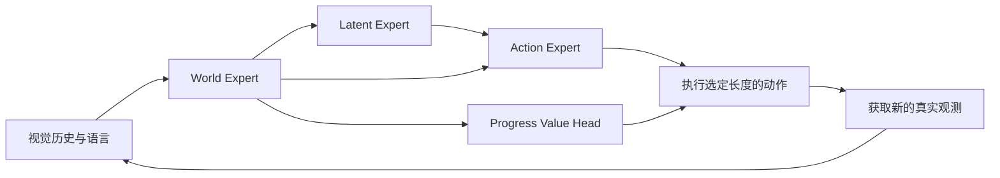

# LaST0.5：在世界预测和机器人动作之间，加一层交互表征

LaST0.5 关注一个很具体的问题：**视频模型能预测场景怎样变化，但动作控制最需要的信息，往往集中在机器人与物体接触的局部。怎样把这部分信息提取出来，再决定预测动作应该执行多长？**

它给出两项设计：Interaction-Centric Latent Reasoning（ICLR）用专门的 Latent Expert 提取交互表征；Adaptive World-to-Action Transfer（AWAT）根据预测进度选择动作执行长度，必要时重新采样未来。

论文：*LaST0.5: A Generalist World Action Model with Interaction-Centric Latent Reasoning*，Xuheng Zhang、Yiming Zhang 等，北京大学、香港中文大学、Simplexity Robotics，2026 年 11 月 10 日提交。

资料：[论文摘要](https://arxiv.org/abs/2611.14048) · [全文及附录](https://arxiv.org/html/2611.14048v1)。研究建议与论文方法分别说明。

## 1. 为什么全局世界表征还不够

以拿起杯子为例，视频预测需要表现杯子上移、机械臂运动和画面连续性。控制则需要决定夹爪从哪里接近、什么时候闭合，以及怎样保持物体不滑落。

两者共享很多信息，但优化目标并不相同。整幅画面中，背景和大尺度运动占据大量视觉内容；决定抓取成败的接触区域却可能只有很少像素。

LaST0.5 的假设是：与其让 Action Expert 自己从全局视频特征里寻找这些信息，可以先训练一个面向交互的中间表征，把注意力集中到操作对象和末端运动。

这里的“物理表征”应结合监督来源理解。论文用视觉线索引导学习，没有直接监督接触力、摩擦系数或滑移状态。因此更稳妥的理解是：**它学习了交互相关的视觉动态表征，而其是否完整刻画接触物理，还需要额外验证。**

## 2. 三个 Expert，分别负责什么

模型采用 Mixture-of-Transformers（MoT）：三个 Transformer 模块有独立权重，在统一注意力结构中交换信息。这里的 Expert 是按功能划分的模块，不是稀疏 MoE 中由 router 为每个 token 选出的专家。

| 模块 | 初始化或训练方式 | 职责 |
| --- | --- | --- |
| World Expert | Cosmos-Predict2.5-2B | 预测未来场景，提供视频动态表征 |
| Latent Expert | 从 Janus 初始化，接入可学习 query | 提取紧凑的交互 latent |
| Action Expert | 与 Latent Expert 使用同类语言主干初始化，参数独立 | 通过 Flow Matching 生成动作块 |
| Progress Value Head | 基础模型训练完成后另训 | 估计各未来片段的任务进度 |

可以用概率分解表示：

$$
p(a,Z,\hat V\mid c_t)
=p(\hat V\mid c_t)\,
 p(Z\mid\hat V,c_t)\,
 p(a\mid Z,\hat V,c_t),
$$

其中 $c_t=(I_t,l)$ 是视觉与语言条件，$\hat V$ 是预测未来，$Z$ 是交互 latent，$a$ 是动作序列。

图中保留 World→Action 的直接连接，是为了避免一个误解：**Action Expert 同时使用全局 World Tokens 与局部 Latent Tokens，交互 latent 并不是唯一通道。**

因此，这个结构更像给动作生成增加一个经过专门监督的交互摘要，而非强制把全部世界信息压进三个 token。

## 3. Latent 的监督究竟从哪里来

这部分是论文最值得复用的设计。作者使用训练时能够得到的真实未来图像与示范轨迹，构造面向交互的目标特征。

### 第一步：给真实未来帧叠加两种视觉线索

默认未来长度为 12 步，每 4 步组成一个片段，共 $M=3$ 个片段。每段取最后一张未来帧，用两种标记强调交互：

| 线索 | 构造方式 | 提供的信息 |
| --- | --- | --- |
| Motion Cue | 将示范中的三维末端轨迹投影到图像，画成二维曲线 | 末端沿什么路线运动 |
| Affordance Cue | Grounding DINO 给出候选物体框，再结合夹爪开闭事件处的 TCP 位置选择目标 | 哪个物体参与这次交互 |

TCP 是工具中心点。将它与开闭事件结合，可以比只依赖任务文字更具体地判断机器人当时操作了谁。

这里的 affordance cue 主要是目标对象定位框。它没有直接给出抓取接触面、受力方向或可执行动作集合，不能把名称里的 affordance 理解成已经标注了完整物体功能。

### 第二步：把标注图变成目标 latent

带有曲线和物体框的未来图像经过冻结的 SigLIP 视觉编码器，再通过可训练 MLP 聚合、投影和归一化：

$$
z_i^{\mathrm{target}}
=\operatorname{Norm}\left(
\operatorname{Proj}\left(
\operatorname{MLP}(\operatorname{SigLIP}(I_i^{\mathrm{prompted}}))
\right)\right).
$$

这是流程的概括表示。每段得到一个目标 token，三个片段共得到三个。

它的目的不是重建所有像素，而是让目标特征强调运动曲线与交互对象。目标仍然是视觉特征，不是具有显式单位、可直接读取的接触状态向量。

### 第三步：让 Latent Expert 学会预测这些特征

Latent Expert 读取 World Expert 的未来表征，使用三个可学习 query，一次前向并行生成 $\hat z_1,\hat z_2,\hat z_3$。训练采用余弦相似度损失：

$$
\mathcal L_{\mathrm{lat}}
=1-\frac1M\sum_{i=1}^M
\cos(\hat z_i,z_i^{\mathrm{target}}).
$$

这使模型预测的交互摘要接近带有额外视觉提示的真实未来特征。可以把它理解成一种训练期的表征监督或蒸馏：目标侧使用完整示范信息，部署侧依靠当前观测与预测未来。

**推理时不需要真实未来、不需要现场画轨迹线，也不需要运行这套离线 Grounding DINO 标注流程。** 否则机器人执行前就必须知道未来，会造成不可用的接口。[方法：Interaction-Centric Latent Reasoning](https://arxiv.org/html/2611.14048v1)

## 4. “Latent Reasoning”在这里意味着什么

三个 latent 是并行生成的连续特征，没有逐句输出“先抓取、再抬起”的文字推理过程。它们通过监督学习承担交互抽象的作用。

因此，论文中的 reasoning 更接近“在中间表征空间中进行交互信息转换”。单凭这种命名，不能推出模型具有可解释的因果推理链。

模型生成的 latent 还会影响动作，不能只看 latent 与目标的相似度。一个有用的中间表征应同时做到：

- 在输入变化时保留正确的交互对象和运动关系。
- 对动作选择提供额外信息，而非重复视频特征。
- 预测有误时，不让动作模块完全依赖理想化特征。

特别是第三点，关系到训练与部署是否一致。训练若总给动作模块完美的目标 latent，部署时换成预测 latent，就可能出现误差放大。使用模型自己的预测作为动作条件，有助于让控制器面对其实际会遇到的表征误差。

## 5. 梯度怎样走：World Expert 并没有完全冻结

基础模型的总目标为：

$$
\mathcal L=lambda_1\mathcal L_{\mathrm{world}}
+\lambda_2\mathcal L_{\mathrm{lat}}
+\lambda_3\mathcal L_{\mathrm{act}}.
$$

World Expert 保留原视频生成目标；Latent Expert 接受交互目标监督；Action Expert 使用 Flow Matching 训练动作生成。

论文把传给下游的 World Expert Key/Value **detach**：Latent Loss 与 Action Loss 无法沿这些连接反向更新 World Expert。World Expert 仍可通过自己的视频目标学习。

这与 [SWAM](SWAM.md) 中的单向注意力值得对照：

- 注意力方向限制某个模块能读取哪些输入。
- Detach 限制下游损失能否沿特定连接更新上游参数。
- 冻结模块则进一步停止该模块的参数更新。

三者不能混为一谈。LaST0.5 在基础训练阶段采用的是对跨专家连接的梯度隔离；训练进度头时才冻结已训练的基础模型。

这种隔离有明确取舍：能减少动作目标直接改变世界表征，也可能限制世界表征针对控制目标调整。收益需要与不隔离、部分隔离等配置比较，不能仅凭结构断言它一定最优。

## 6. AWAT：未来生成出来了，动作要执行到哪里

固定长度 action chunk 有一个问题：前半段预测合理，后半段可能已经偏离任务。若仍一次执行完整块，后半段错误就会进入真实环境。

AWAT 将 12 步划成三个 4 步动作段，并为对应的未来世界片段预测进度。它试图回答：**哪一段未来仍在向任务目标推进？**

### Value 是归一化进度

基础模型训练完成后，冻结它，对 World Expert 每个片段的 DiT 特征做池化，再用 MLP 输出：

$$
\hat v_i=g_\phi(\operatorname{Pool}(H_i)).
$$

监督为示范中的归一化时间位置：

$$
v_i^{\mathrm{GT}}=\frac{t_i}{T},
$$

其中 $T$ 是整条示范长度，$t_i$ 是该片段所对应帧的中间时间位置。注意，latent 监督选的是分段末帧，而进度标签采用分段的时间位置，两种目标不要混淆。

它不是通过 Bellman 方程训练的累计回报，也不天然等于“从这个状态继续执行的成功概率”。更准确的称呼是监督训练的任务进度估计。

作者用反转帧序和重复帧进行增强，并相应调整标签，让进度头见到下降和停滞。这能补充成功示范中较少出现的非单调时间模式，但不等于覆盖了真实机器人所有失败方式。

### 按进度增长保留动作前缀

论文使用相邻进度增长条件：

$$
\hat v_i>\hat v_{i-1}.
$$

以下是解释规则的假设例子，首段已通过跨轮检查：

| 预测进度 | 本轮动作前缀 | 原因 |
| --- | --- | --- |
| 0.20 → 0.30 → 0.40 | 可执行 12 步 | 三段持续增长 |
| 0.20 → 0.30 → 0.25 | 保留前 8 步 | 第三段退步 |
| 0.20 → 0.20 → 0.40 | 按严格增长规则不跨过第二段停滞 | 后续变高不挽救中间不增长 |

截断后重新获取真实相机观测，再推理。它调整的是本轮开环执行长度，不是等待全部动作执行完再宣布失败。

另一个分支是：如果本轮首段预测进度已低于上一轮进度，系统重新采样多个未来候选，按 value 选择候选，再将其 World KV 交给下游生成动作。

重采样候选数、同分处理、阈值容忍和耗时预算会影响实际部署。原文高层描述不能替代这些实现细节；复现时应核对具体配置。[方法：Adaptive World-to-Action Transfer](https://arxiv.org/html/2611.14048v1)

## 7. 为什么还需要时间分段 Attention Mask

如果前四步动作直接读取第十二步的错误预测，即便最终只执行前四步，也可能已经受错误未来影响。

因此，第 $i$ 段动作只直接读取第 $i$ 段及此前的 World、Latent 和 Action 信息：

$$
A_i\ \text{attends to}\ 
\{W_{1:i},Z_{1:i},A_{1:i}\}.
$$

这样，截断动作与分段条件能够对应起来。

但论文附录明确指出：World Expert 内部仍保留双向注意力。晚期 World Tokens 可以先影响早期 World Tokens，再间接影响早期动作。

所以，这个 mask 实现的是**限制直接访问未来片段**，不能保证完全的时间信息隔离。早期动作是否真正免受后段预测错误影响，应通过干预实验而非仅看 mask 图来证明。

推理默认包含 World Expert 两步去噪、Latent Expert 一次并行前向、Action Expert 十步迭代去噪。动作侧 24 个连续 token 表示 12 个时间步，每步分别编码腕部运动与执行器命令。

三个交互 token 很紧凑，但总成本还包含视频主干、动作去噪和可能的多未来采样。不能把“latent token 少”直接解释成低延迟控制。[附录 A](https://arxiv.org/html/2611.14048v1)

## 8. 为什么 Progress Consistency 仍然不等于物理可行

考虑螺丝插入：视觉上，工具逐渐接近最终位置，进度头可能持续增大；实际上，螺丝可能偏斜、卡住或滑牙。模型可以生成越来越像终点的画面，但机器人并没有实现对应接触。

因此：

$$
\text{预测进度增加}\ \not\Rightarrow\ \text{真实动作可执行}.
$$

同样，一个有用的恢复动作也可能暂时降低视觉进度：先退出卡住的插入、移开障碍、松开再重抓。单调进度偏好可能与这类恢复冲突。

作为后续研究，可以分开估计三个量：

| 信号 | 回答的问题 |
| --- | --- |
| Progress | 看起来处于任务的哪个阶段 |
| Success likelihood | 从这里继续，最终成功的概率多高 |
| Feasibility / risk | 接下来的动作能否执行，有什么接触风险 |

这不是论文已有模块，而是一种扩展方向。进度头适合提供阶段信息，若要让它承担安全性或失败预测，还需要校准与对应监督。

多候选重采样也有选择偏差：候选越多，越可能挑中被 value 高估的未来。因此，除了任务成功率，还应测候选评分与真实执行结果的一致性。

## 9. 预训练的规模与动作统一

论文报告预训练池约 248 万条轨迹、5.36 亿帧、14,892.6 小时，统一到 10 Hz。UMI 类型数据约 9,088 小时，占 61.0%，其余覆盖真实双臂、单臂、仿真和人类第一视角操作。

这不是全部来自机器人真机执行的等价小时数。不同来源的控制接口、动作标签和接触条件都不同。

作者统一腕部局部相对位姿、夹爪开闭命令，以及人手和灵巧手的腕部坐标系下五指尖位置。腕部相邻变换可写成：

$$
\Delta T_t=T_t^{-1}T_{t+1}.
$$

这使“向末端前方移动”等动作在不同全局朝向下具有一致语义。它解决坐标表示层面的差异，尚不能消除不同机器人可达空间、力度与动力学的差异。

训练数据包含多指手，只能说明模型训练接触过这类表示；真机是否具备可靠多指控制能力，仍要看实际部署平台与评测。

## 10. 实验结果：哪些证据更有解释力

### LIBERO 与 RLBench

| 配置 | LIBERO 平均成功率 | 十个 RLBench 任务平均成功率 |
| --- | ---: | ---: |
| Cosmos Policy | 98.5% | 77.0% ± 2.0% |
| LaST0.5，无 AWAT | 99.2% | 85.0% ± 2.0% |
| LaST0.5，完整 | 99.5% | 88.0% ± 3.0% |

AWAT 在两组实验中的增量分别为 0.3 和 3 个百分点。LIBERO 已接近上限，RLBench 更容易看到差异。

**评测口径不能省略：LIBERO 报告训练期间最佳成功率；RLBench 只覆盖论文选定的十个任务，按三轮独立评估汇总，每轮每任务 20 次。** 因此，99.5% 不应被当作任意固定 checkpoint 的重复评估均值，88% 也不代表整个 RLBench 全任务集成绩。标准差不是置信区间，不能据此直接宣布小幅差异有统计显著性。

### 交互表征消融

在 LIBERO-Spatial 上，以无 AWAT 的 99.6% 为基线：

| 变体 | 成功率 | 相对基线变化 |
| --- | ---: | ---: |
| 去掉 World Expert | 96.0% | −3.6 个百分点 |
| 去掉 Latent Expert | 97.8% | −1.8 个百分点 |
| 同时去掉 Motion / Affordance 提示 | 98.6% | −1.0 个百分点 |
| 只去掉其中一种提示 | 99.0% | −0.6 个百分点 |

这支持世界特征、交互模块及视觉线索在所测配置中有贡献。但“去掉专家”的实验也改变模型容量和信息路径，不能把全部差值都归给某一种语义机制。

将 latent 数从 3 增到 6 或 12，没有继续提升，分别为 99.4% 和 99.3%。该结果更适合指导当前任务与预测时域的配置，尚不能证明任意复杂交互都只需要三个 token。[实验与消融](https://arxiv.org/html/2611.14048v1)

### 真机：最终阶段仍然困难

真机采用 Tianji Marvin 双臂平行夹爪，每项任务 20 次 rollout：

| 任务 | LaST0.5 完整任务成功率 |
| --- | ---: |
| Bag Pulling | 80% |
| Object Organization | 95% |
| Screw Fastening，最终插入完成 | 50% |
| Parcel-Box Packing，最终封箱完成 | 30% |
| 四任务平均 | 63.8%，由 63.75% 四舍五入 |

$\pi_{0.5}$ 的平均为 52.5%。对分阶段任务，原文以全部 20 次 rollout 为分母，未到达某阶段也记为该阶段失败。因此 50% 和 30% 不是“已经进入最终阶段之后”的条件成功率，不能再与前阶段成功率相乘。

每项只有 20 次，5 个百分点对应一次成功，较小差异仍需更多重复评估。

OOD 实验只在 Bag Pulling 和 Object Organization 两项上开展。位置变化平均成功率为 40%，高于 $\pi_{0.5}$ 的 15%；新物体条件两者同为 55%。因此，优势与变化类型有关，不能笼统写成所有 OOD 条件都超过基线。

此外，平台使用平行夹爪。论文中的精细操作演示，不等于已经验证多指灵巧手的接触控制能力。[真机实验及附录 C–D](https://arxiv.org/html/2611.14048v1)

## 11. 与 SWAM、Recova 放在一起看

| 维度 | SWAM | LaST0.5 |
| --- | --- | --- |
| 主要问题 | 怎样让语言、视频与动作监督有效配合 | 怎样从全局未来提取局部交互信息 |
| 核心结构 | Video DiT + Action DiT | World + Latent + Action Experts |
| 中间监督 | 联合视频、动作目标与数据对齐 | 加入带运动曲线、物体框的视觉 latent 目标 |
| 上游保护方式 | 视频目标与多源训练持续约束 | World KV detach，隔离下游梯度路径 |
| 执行机制重点 | 分块联合预测 | 预测进度引导截断与未来重采样 |

比较依据是 [SWAM 笔记](SWAM.md) 和本文核对的 LaST0.5 方法。两者是不同的设计选择，使用不同基座、数据和评测，不能直接通过各自最高成功率排名。

SWAM 提醒我们，数据监督和语义路径要合理；LaST0.5 则进一步提出，世界信息传给动作之前，可以有一个专门的交互抽象层。

与 [Recova](Recova.md) 的区别更明显：AWAT 主要筛选预测未来、改变动作块执行长度；Recova 将已发生的异常交给恢复技能，并把纠正经验送回训练。前者有助于减少继续执行不良预测，后者处理进入异常状态后怎样重新获得可执行条件。

二者可以研究组合，但不能直接把“重新采样未来”称为已经学会了失败恢复。一个卡住的物体可能需要专门的退出或重抓动作，而非重新预测同一个正常成功过程。

## 12. 如果继续做，哪些实验最值得补

下面是基于论文的研究建议。

**先验证 latent 是否真的携带交互信息。** 在相同场景里改变接触点、夹持状态或物体是否被抓稳，检查 latent 能否区分，并测这种变化是否正确影响动作。注意力集中到物体上是线索，不能代替因果证据。

**把进度、成功概率与物理可行性分开评估。** 尤其收集“看起来接近终点，但动作已经不可执行”的反例，以及必须先退一步才能成功的恢复轨迹。这能检验单调进度规则的适用边界。

**匹配推理预算比较 AWAT。** 与固定执行 4、8、12 步、固定频率重规划和相同候选数采样比较，同时报告成功率、模型调用数、墙钟时间与机器人空等时间。这样才能看出收益来自更好的选择，还是更多计算和反馈机会。

**比较三种表征路径。** 在数据与容量尽量一致时，比较直接 World→Action、World→Interaction→Action，以及直接学习动作条件交互 dynamics：

$$
z_{t+1}=f_\theta(z_t,a_t).
$$

最后这个公式是替代方案，不是 LaST0.5 已实现的模型。它可以检验是否必须保留完整视频预测，还是只预测影响控制的交互状态就足够。

对于 Dex-RUA，可以将抓取滑移、局部卡死、插入偏角、受遮挡接触和重抓恢复分别设为测试条件。既看最终完成，也看错误触发、恢复代价，以及表示是否能利用触觉或力反馈。

LaST0.5 最有价值的启发，是把“从世界知识到动作控制的转换”变成显式可训练、可消融的问题。当前结果支持交互视觉监督和进度引导执行有用；下一步需要确认，它们能否在视觉看似正确、接触实际错误的情况下，仍然给出可靠判断。
