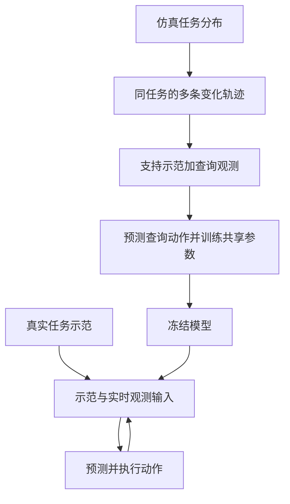

# Machenta：机器人能不能看一遍示范，就开始做新任务？

资料：[Introducing Instant Robot Learning](https://machenta.com/blog/instant-robot-learning)，Machenta，2026 年 10 月 27 日发布。

先想一个场景：你想让机器人把螺丝刀放回工具架。你演示一次，再把螺丝刀换个位置，机器人直接开始做。下一次要换纸卷，就换一段示范。**同一个模型，权重固定，任务通过示范输入。**

这就是这里的 Instant Robot Learning。它把部署新任务的工作，从“收集数据、微调、重新部署”转向“给示范、观察行为、必要时修改示范”。预训练仍然很重，“即时”指新任务适应时不再等待梯度训练。

读这篇时需要始终区分三个对象：2026 年公司的新 VDA 模型、2025 年公开的 Instant Policy，以及我们基于两者提出的研究推断。新模型的完整架构和训练配方没有在这篇博客中披露，不能拿前作细节直接填进去。

## 1. 即时学习，到底改变了什么？

用一个简化表达：

\[
a_t\sim\pi_\theta(a_t\mid o_t,D_\tau).
\]

\(o_t\) 是当前观测，\(D_\tau\) 是任务 \(\tau\) 的示范，\(\theta\) 是预训练参数。模型根据当前场景和示范持续输出动作，执行后再接收新观测。

示范可以概念化为：

\[
D_\tau=\{(o_i,a_i)\}_{i=1}^{T}.
\]

这只是方便理解的记号。真人演示和遥操作不一定直接提供同一种机器人动作标签，具体需要怎样的感知、动作映射或预处理，仍取决于系统实现。

换示范，相当于换条件：

\[
\pi_\theta(\cdot\mid o,D_1)
\longrightarrow
\pi_\theta(\cdot\mid o,D_2),
\qquad \theta\text{不变}.
\]

它发生了行为适应，但没有由此自动获得持久的参数更新。把示范保存下来可以形成可复用资源；若上下文被清空，是否还记得这个任务，要看系统有没有额外记忆机制。

因此，“没有更新权重”与“没有学到当前任务”并不等价。这里的学习体现在输入信息改变了策略，而不是优化器改变了参数。

## 2. VDA 与 VLA，应该怎么比较？

VDA 是 Vision-Demo-Action，VLA 是 Vision-Language-Action。两者的主要区别是任务如何被表达：

| 任务输入 | 容易表达什么 | 仍需解决什么 |
| --- | --- | --- |
| 语言 | 目标、对象、规则、顺序 | 具体抓法、接近方向和接触过程可能不够明确 |
| 示范 | 时序、姿态、相对运动、操作方式 | 哪些细节是任务要求，哪些只是这次示范的偶然性 |
| 语言与示范结合 | 用语言消除歧义，用示范提供动作细节 | 多模态对齐，以及两者冲突时如何判断 |

例如“把杯子放到托盘里”没有指定从哪一侧抓。示范能直接展示抓取方法，但它也可能留下新歧义：是所有杯子都要放进去，还是只放红杯子？

所以我更愿意把它理解为**任务接口和适应方式的改变**。VLA 也可以研究上下文适应，VDA 也可以接语言。博客对 VLA 后训练成本的讨论是这条路线的动机，不能据此得出所有 VLA 都必须为每个任务重新训练。

还有一个容易忽略的比较条件：给 VDA 一段完整操作示范，而只给另一模型一句话，两者拿到的信息量已经不同。评测应该分别讨论任务完成能力和获取这些信息的成本。

## 3. 怎样训练出“会利用示范”的模型？

关键是训练数据如何组织，而不只是网络能不能读取一个额外视频。

设一个任务在不同布局下有多条轨迹：

\[
D_\tau^{(1)},D_\tau^{(2)},\ldots,D_\tau^{(m)}.
\]

取其中一些作为支持示范，另取一条作为查询轨迹。在查询轨迹的当前观测上预测动作：

\[
\mathcal L(\theta)=
\mathbb E_{\tau,D_\tau^{\mathrm{sup}},(o,a)\in D_\tau^{\mathrm{qry}}}
\left[\ell\big(\pi_\theta(\cdot\mid o,D_\tau^{\mathrm{sup}}),a\big)\right].
\]

这是对元训练思想的抽象，不是新 VDA 已公布的具体 loss。若用生成式动作模型，\(\ell\) 可以是相应的去噪训练目标，不必能直接计算动作的对数似然。

训练要同时有两种变化：同一任务内部的布局、对象姿态等变化，以及不同任务之间的目标和操作差异。前者迫使模型迁移示范，后者让示范成为识别当前任务的重要信息。

一个补充的训练例子：同样的杯子和托盘，任务 A 是放进去，任务 B 是拿出来。如果只凭物体种类就能猜到任务，网络可能忽略示范；如果场景类似而要求不同，模型更需要读取示范。

支持轨迹与查询轨迹也应真正分开。若把查询动作本身或紧邻的未来状态偷偷放进上下文，低回归误差未必说明模型学会了跨布局适应。

可以把过程画成：

这里的 meta-learning 是学习一种利用上下文的方法，不要求部署时再运行 MAML 式的内循环梯度更新。

## 4. 前作 Instant Policy 提供了什么技术基础？

这条路线有两项明确前作，作者均为 Vitalis Vosylius 和 Edward Johns：

- [Implicit Graph Alignment，CoRL 2023](https://www.robot-learning.uk/implicit-graph-alignment)：把模仿看成任务相关的物体几何对齐，用图表示和能量模型判断新对齐是否符合示范。
- [Instant Policy，ICLR 2025](https://www.robot-learning.uk/instant-policy)：把示范、当前观测和未来动作放进统一图表示，用扩散生成动作，并通过程序化伪示范训练。

对 2025 年方法，可以从三个层次理解。

**第一层是局部几何。** 物体点云和末端执行器状态都需要有结构化表示，使模型能比较“示范中的夹爪相对物体在哪里”与“当前应该移动到哪里”。

**第二层是跨时间、跨轨迹的信息联系。** 模型需要判断当前状态更接近示范的哪个阶段，然后利用相关部分决定下一步。当前已经抓住物体时，放置阶段通常比接近阶段更相关。

**第三层是动作生成。** 未来动作也是图的一部分。扩散推理从随机动作表示开始，在示范和当前观测条件下逐步修正动作部分，而不是把整段示范直接重播。这里的去噪时间与机器人执行时间是两条不同的轴，可以联系 [Flow Matching 第三讲笔记](<./Flow Matching and Diffusion Models（三）.md>) 来读。

点云、图扩散和这种具体动作表示属于前作。2026 年 VDA 是否保留这些组件、怎样支持颜色和不同机械手，博客没有给出足够细节。

## 5. Pseudo-demonstration 的价值：廉价制造“同任务的变化”

伪示范不是把任意随机轨迹堆起来就行。它需要一组轨迹之间共享可迁移的关系。

例如人为指定：先接近物体 A，完成抓取，再移动到物体 B 的某个相对位置。改变 A、B 的位置和初始姿态，可以生成同一个伪任务的多个版本。模型要从支持示范中恢复关系，再把它应用到查询布局。

这些任务不必都有语言名称。只要关系一致，就可以提供元训练信号。相比为每个现实任务录很多次数据，程序生成特别擅长提供这样的配对变化。

前作使用物体中心的 waypoint、几何模型和虚拟抓取等机制构造数据。其训练信号不要求每条伪轨迹都满足完整的真实机器人动力学；这扩大了数据生成空间，也留下了可执行性与真实接触的缺口。

这和“多生成一些视频”还不一样。普通视频数量增加，未必增加同任务不同布局之间的对应关系。这里需要扩展的是：**可辨识的任务关系，以及这些关系在不同场景下的实现方式。**

对 WAM 的一个研究推断是：若要训练 demonstration-conditioned 的视频／动作模型，数据生成器也应成组输出任务一致、场景不同的轨迹。评测时再检查这种配对是否真的改善迁移，而不是只降低重建误差。

## 6. 仿真训练，为什么有机会直接迁移现实？

博客的解释是：训练时覆盖很多环境，部署时示范与执行观测都来自当前现实域，模型可以通过示范推断适用关系。这是一种合理的适应机制，但不等于现实自动落在训练分布内。

可以将问题分成三层：

| 层次 | 一段示范可能提供的信息 | 仍可能缺失的信息 |
| --- | --- | --- |
| 几何 | 抓取部位、接近方向、对象相对位置 | 遮挡区域、未见姿态下的形状 |
| 任务 | 操作顺序、目标状态、物体角色 | 模糊规则、反事实条件 |
| 动力学 | 运动响应和可见接触过程 | 摩擦、质量、插入力阈值、控制延迟 |

前两层往往能从演示中直接看到；第三层可能需要专门探测。比如一次成功插入，没有告诉机器人偏差多大时会卡住，也没有必然提供接触力。

因而这里真正值得检验的是：在不同域偏移下，示范究竟消除了多少不确定性。可通过固定几何、只改变摩擦，或固定任务、只改变相机的实验分开测量。

“纯仿真预训练”也应限定为作者对新模型的训练声明。当前博客没有完整列出所有上游感知组件的数据来源，仅凭这句话无法审计整个部署栈是否完全不含真实数据预训练组件。

## 7. 2026 年博客展示了哪些能力？

官方声明包括：一次示范适应、不做任务微调、同一模型用于六种机器人，以及多种教学方式。页面还描述了扰动响应、物体交换、示范澄清和拼接。下面按能力类型整理附件内容；视频行为依据作者描述，本笔记未逐帧独立核验。[官方博客](https://machenta.com/blog/instant-robot-learning)

| 展示 | 它主要测试什么 | 判断时应保留的条件 |
| --- | --- | --- |
| 示范后重新摆放物体 | 空间变化下的示范迁移 | 需要知道布局范围和失败比例 |
| 移动物体、撤销已完成阶段 | 闭环反应和阶段恢复 | 演示恢复不等于通用故障诊断 |
| 同一组物体演示不同操作 | 行为是否受示范控制 | 仍需排除训练覆盖及任务捷径 |
| 多段示范澄清含糊规则 | 如何利用额外信息 | 单独统计新增示范预算 |
| 子示范拼接成长任务 | 阶段组合与边界衔接 | 不能按完整任务仅有一段示范计算 |
| 修改双手交接策略 | 人类通过反馈改进输入 | 改进策略的人是示范者 |

最后一个例子很有意思：把鞋子装箱时，需要先调整朝向。人类反复试示范，找到两次交接的办法，模型立即按新输入改变行为。它展示了一个可交互的物理编程接口，但这次策略搜索发生在人与系统的交互中，不能归为模型自主发明并验证新策略。

博客还报告三个自重置任务各约一小时的连续执行：

| 任务 | 成功／尝试 | 样本成功率 |
| --- | ---: | ---: |
| 积木放入碗中 | 74/74 | 100% |
| 螺丝刀往返交接 | 78/78 | 100% |
| 将瓶子竖立 | 97/99 | 约 98.0% |

这些是作者报告的三个特定任务的重复执行结果。连续循环共享环境条件，不能直接当作许多独立的新任务。100% 的样本成功率也不代表长期失败概率为零。[官方测试说明](https://machenta.com/blog/instant-robot-learning)

## 8. 2025 年结果为什么必须单独列？

[Instant Policy 原论文](https://arxiv.org/pdf/2411.12633) 的 Table 1 和 Table 3 提供了两组不同协议的数据：

| 设置 | 训练条件 | 评测范围 | 结果 |
| --- | --- | --- | --- |
| RLBench，PD only | 只用伪示范训练 | 24 个任务，每任务 100 次 rollout | 平均约 71% |
| 真实机器人 | 加入非评测任务的真实示范共同微调 | 16 个任务，每任务 10 次 rollout | 平均 88.75% |

真实实验采用 Sawyer 和平行夹爪。论文明确解释，为处理分割误差和点云噪声，加入来自另外 5 个任务的真实示范。其基础上下文设置使用两段示范；不能把这里的 88.75% 写成新 VDA 的“纯仿真、一次示范成功率”。

这两年的结果既换了系统，也换了任务与协议。它们能说明研究路线的演进，不能直接构成数值上的同比提升。

前作的局限也有实质意义：依赖分割点云，主要针对较短任务，不解决全机械臂配置空间控制和碰撞规避，精密接触能力有限。新博客展示了更多行为，但还没有提供足以逐项判定这些问题已经解决的统一量化协议。

## 9. One-shot 最难的地方，其实是任务有歧义

假设示范把物体放进“小黑盒”。你究竟要机器人学什么？

- 选择黑色盒子。
- 选择小盒子。
- 选择离物体最近的盒子。
- 选择示范中那个特定盒子。

当这些规则在唯一示范中同时成立，它们都能解释观察结果。模型只能借助预训练先验选择解释，单个样本本身没有包含区分规则的证据。

因此，一次示范成功率反映了两方面：模型的任务推断能力，以及评测任务与其先验有多一致。多给一段示范能够消除歧义，是另一项值得测的能力。

我会设计一个小型对照：示范阶段让颜色和大小相关，测试阶段刻意让它们冲突。然后比较语言澄清、第二段示范和失败反馈，各自能减少多少错误。

这样比只问“陌生物体能不能做”更接近任务学习本身。还可以将泛化拆成布局、形状、角色组合、操作顺序、动力学和 embodiment，分别留出测试。

## 10. 对 RUA / Dex-RUA，该怎么把它变成可评测的问题？

以下是研究建议，不是对现有 benchmark 规则的修改。

VDA 适合成为 Agent 的执行组件：Agent 选择或检索示范，再由 demonstration-conditioned policy 闭环执行。它与 Agent 的任务分解、工具调用、程序修改、长期记忆是不同层次，评测时应分开归因。

可以区分三种预算：

\[
B=(B_{\mathrm{demo}},B_{\mathrm{trial}},B_{\mathrm{compute}}).
\]

分别是示范获取预算、真实执行尝试预算、推理预算。示范预算最好同时记录条数、时长和人类修订次数；一条很长且经过多次排练的示范，与一次未经挑选的演示成本不同。

| 评测问题 | 对照方式 | 主要输出 |
| --- | --- | --- |
| 能否第一次就用好示范？ | 固定第一条示范，禁止执行后修改 | 首次 rollout 成功率 |
| 更多示范是否真正有用？ | 同一测试集，固定 1/2/4 段示范 | 成功率随示范预算的曲线 |
| 能否适应布局变化？ | 任务固定，测试布局预先留出 | 跨布局成功率 |
| 谁完成了失败修复？ | 区分人类改示范、Agent 选示范、策略自行恢复 | 各环节贡献和额外成本 |
| 经验能否持续复用？ | 清空当前上下文，允许读取明确记录的记忆 | 后续任务是否受益 |
| 灵巧操作能否迁移？ | 控制几何后改变摩擦、物体质量或接触条件 | 成功率、接触误差和损坏事件 |

单任务不能只保留最好的一次 demonstration。要么固定采集协议，要么把示范者的试错过程计入成本。对比微调方法时，也应保留“同等人类时间”和“同等部署总时间”两个视角。

一个更完整的部署成本可以写成：

\[
T_{\mathrm{deploy}}=
T_{\mathrm{setup}}+T_{\mathrm{demo}}+T_{\mathrm{revision}}
+T_{\mathrm{adapt}}+T_{\mathrm{validation}}.
\]

VDA 主要压低的是新任务的梯度适应时间 \(T_{\mathrm{adapt}}\)。相机与控制器设置、示范采集和可靠性验证仍然需要单独计量。

## 11. 我最想继续追的三个问题

**第一，哪种仿真多样性最有用？** 物体数量、任务关系数量、环境变化和支持—查询配对数量，可能带来很不同的收益。只报告生成了多少轨迹，无法判断模型到底学会了什么。

**第二，如何判断当前示范不够？** 如果模型能识别“小黑盒”这种歧义，并主动请求能区分规则的示范，系统就从被动接收上下文走向主动获取任务信息。这需要新的不确定性估计和交互评测，当前博客还没有给出这样的证据。

**第三，能否把成功示范变成长期技能资源？** 一个可检索、可验证的示范库，可以让固定策略持续获得新的任务输入。但要同时解决检索条件、适用范围和失败记录，不能仅靠存一段视频就假设技能已经可复用。

这与 [ASENA](./ASENA.md) 讨论的持续改进也有区别：当前上下文适应、执行中的策略搜索、跨任务持久改进，需要不同证据。

我对这篇的定位是：**它把“教机器人”变成一个快速交互的接口，并把训练重点放在如何解释新示范。** 技术基础来自已有的上下文模仿学习研究，新模型的纯仿真与跨机器人表现值得关注；下一步最需要的是可复核的任务留出协议、首次示范成绩，以及包含人类交互成本的完整评测。
