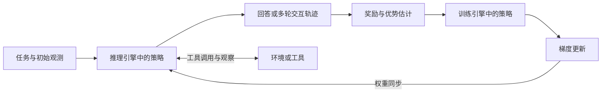
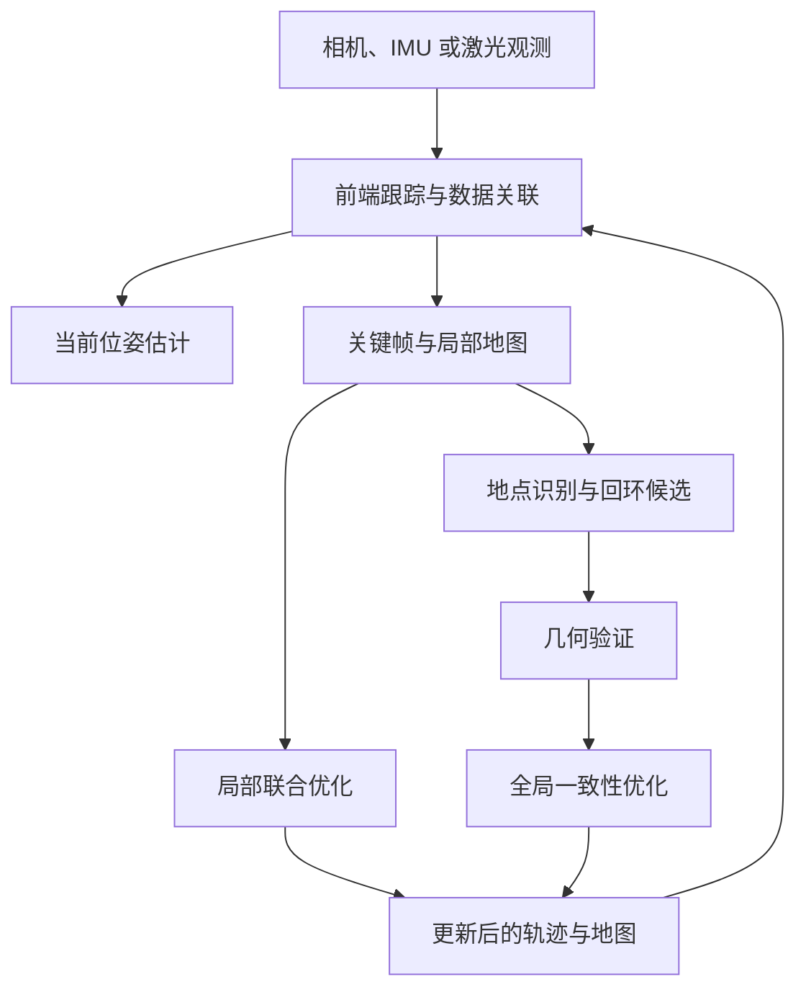

# Miles、veRL、slime 与 SLAM 详解

**Miles、veRL 和 slime 是大模型强化学习后训练框架；SLAM 是机器人同步定位与建图的一类问题和技术。** 如果这些词出现在同一次 LLM RL 讨论中，你听到的第三个名字也可能是 **slime**。下面把两种含义都讲清楚。

| 名称 | 属于哪一层 | 主要解决什么问题 |
|---|---|---|
| veRL，代码通常写作 `verl` | RL 训练框架 | 编排采样、奖励、优势估计、训练和分布式执行 |
| slime | RL 训练框架 | 连接高性能推理与训练，支持自定义轨迹生成 |
| Miles | RL 训练框架 | 大规模后训练中的吞吐、训练一致性和运行可靠性 |
| PPO、GRPO 等 | 优化算法或目标 | 如何依据奖励调整策略参数 |
| SGLang、vLLM | 推理引擎 | 如何高效生成模型输出 |
| Megatron-LM、FSDP | 分布式训练系统或机制 | 如何分摊参数、计算、梯度和优化器状态 |
| SLAM | 状态估计与建图 | 根据传感器观测估计自身位姿和环境地图 |

Miles 官方说明它从 slime 分支发展，两个项目仍共同演进；veRL 则由 ByteDance Seed 发起，来自 HybridFlow 的开源实现。框架定位有重叠，不能简单划成“veRL 只做研究、Miles 才能做生产”。[Miles](https://github.com/radixark/miles) · [veRL](https://github.com/verl-project/verl) · [slime](https://github.com/THUDM/slime)

## 1. 为什么大模型强化学习需要专门的框架

先用一个具体例子：让数学模型更擅长解题。

假设取 256 道题，每道题让当前模型生成 8 个答案，就得到 2,048 条回答。验证器检查最终答案，给每条回答评分。训练器根据奖励更新模型，再用新模型生成下一批回答。

这个循环包含五件事：

1. 准备任务。
2. 用当前策略采样回答或交互轨迹。
3. 计算奖励和训练信号。
4. 对策略做梯度更新。
5. 把新权重交给生成端。

如果模型很小、环境很快，普通 Python 循环就可以表达大部分逻辑。但模型变成几十亿参数后，第二步与第四步可能分别需要不同的 GPU 程序。

### 1.1 生成与训练的计算模式不同

**生成阶段**要逐 token 解码，维护 KV cache，还要把不同长度请求动态组成 batch。推理引擎会围绕这些需求优化。

**训练阶段**已知整条序列，要计算概率、损失、反向传播和优化器更新。它还必须保存或重算激活，分配梯度与优化器状态。

因此，同一个策略模型经常有两种运行形态：



这里的“两份模型”通常指同一策略的运行副本。它们必须在正确的时间使用正确版本的参数。

### 1.2 除了策略，可能还有其他模型

典型 PPO 风格 RLHF 包含以下角色：

| 角色 | 做什么 | 是否每种算法都需要 |
|---|---|---|
| Actor / policy | 生成动作，接受策略更新 | 核心角色 |
| Critic / value | 估计未来回报，帮助计算 advantage | 常规 actor–critic PPO 使用；GRPO 通常省去独立 critic |
| Reference policy | 为 KL 正则提供参考分布 | 取决于训练目标 |
| Reward model / verifier | 给回答或轨迹评分 | 奖励必需，神经奖励模型不必需 |
| Behavior policy | 实际采样这条轨迹的策略 | 必须在概率语义上明确，未必常驻一份完整模型 |

最容易搞混的是 **reference policy 与 behavior policy**。

Reference 常是冻结的 SFT 模型，回答“新策略偏离基准多少”；behavior 是产生当前数据的策略，回答“这些动作当时以什么概率被采样”。它们不能互换。

### 1.3 系统慢在哪里

不只是模型反向传播慢。长回答拖延 batch、工具服务阻塞、环境重置、评分、权重传输、参数重新分片，都可能成为瓶颈。

因此，一个 RL 框架的任务是把算法与这些组件连接好，同时保留足够的可扩展接口。只把 PPO loss 写对，还没有完成一套可运行的大模型 RL 系统。

## 2. 用 PPO 和 GRPO 理解框架运行的是什么

这一节是原理示意，不代表三个框架采用同一套默认损失或归一化方式。

### 2.1 PPO 中的概率比率

设 \(h_t\) 是模型生成 token \(a_t\) 时实际看到的上下文，\(\pi_b\) 是采样行为策略：

\[
r_t(\theta)
=\frac{\pi_\theta(a_t\mid h_t)}{\pi_b(a_t\mid h_t)}
=\exp\!\left(\log\pi_\theta(a_t\mid h_t)-\log\pi_b(a_t\mid h_t)\right).
\]

PPO 的典型 clipped surrogate 为：

\[
J_{\mathrm{clip}}(\theta)
=\mathbb E_t\left[
\min\left(r_t(\theta)\hat A_t,\,
\operatorname{clip}(r_t(\theta),1-\epsilon,1+\epsilon)\hat A_t\right)
\right].
\]

直观上，优势为正的动作应变得更容易发生，优势为负的动作应变得更难发生；裁剪限制局部更新的激进程度。实现时常最小化其负值，并根据配置加入其他项。

这里立刻产生系统要求：必须保存真实生成的动作、实际上下文以及与采样语义一致的概率。否则，代码里的比率可能已经不是想优化的那个比率。

### 2.2 GRPO 如何省去独立 Critic

对同一个问题采样一组回答，比较组内奖励。一种常见的组相对优势写法是：

\[
\hat A_i=\frac{R_i-\overline R}{\operatorname{std}(R_1,\ldots,R_G)+\varepsilon}.
\]

例如四条回答奖励是 \([0,1,0,1]\)，成功的两条获得相对正优势，失败的两条获得相对负优势。组内比较提供基线，从而不必单独训练一个价值网络来估计它。

但若整组奖励全是 0，或者全是 1，这种中心化信号就无法区分组内回答。奖励设计、任务难度和采样多样性仍然重要。不同 GRPO 变体对标准化、长度加权、KL 和裁剪有不同处理。

所以“框架支持 GRPO”只是具备相应执行能力；训练效果仍取决于完整配方。

## 3. veRL 把复杂 RL 流程编排成可扩展的数据流

veRL 的核心设计来自 HybridFlow。一个 RL 工作流可以看作若干计算节点和数据依赖：生成节点输出轨迹，奖励节点输出分数，训练节点消费样本并更新参数。

难点在于，节点内部本身可能就是跨几十张 GPU 的分布式程序。全局流程需要容易修改，节点内部又必须高效执行。

### 3.1 Hybrid Controller 的含义

HybridFlow 将两层控制组合起来：

- **全局单控制器**描述阶段顺序与依赖，例如先生成，再评分，最后更新。
- **模型内部多控制器**协调各 GPU 的计算和通信，采用适合分布式训练的执行方式。

下面只是表达逻辑的伪代码：

```python
# 示意代码，不是可直接调用的 verl API
trajectories = rollout.generate(tasks)
rewards = evaluator.score(trajectories)
advantages = estimator.compute(trajectories, rewards)
trainer.update(trajectories, advantages)
rollout.load_new_weights(trainer.policy)
```

研究者可以在全局层面改 reward、advantage 和数据流，而模型内部仍由训练后端处理参数分片及集合通信。这个分层是 HybridFlow 的关键。[HybridFlow 原论文](https://arxiv.org/html/2409.19256v2)

### 3.2 3D-HybridEngine 中的 3D 指什么

这里的 3D 是三种并行维度：

- **DP，数据并行**：不同 worker 处理不同数据。
- **TP，张量并行**：一个层的张量计算拆给多张卡。
- **PP，流水线并行**：不同层段放到不同卡上。

FSDP 则通过分片参数、梯度和优化器状态等方式组织训练，不能简单与 TP 或 PP 画等号。

生成阶段和训练阶段适合的模型布局可能不同。切换时要重新组织权重，处理内存与通信。3D-HybridEngine 围绕这种切换减少冗余；它优化的是系统执行，不改变 PPO 本身的数学目标。

### 3.3 Agent Loop 如何接上工具和环境

veRL 的 Agent Loop 允许用户定义一个多轮轨迹：

```text
任务 → 模型生成工具调用 → 环境执行 → 返回观察
     → 模型继续决策 → …… → 结束并计算奖励
```

它提供轨迹接口和生成服务抽象。环境如何执行动作、如何 reset、如何判断任务结束，仍要由环境适配和任务逻辑实现。

官方文档中的 `AgentLoopOutput` 包含 `prompt_ids`、`response_ids` 和 `response_mask`。其中 response 可以包含模型输出和工具结果，mask 用来区分它们。[Agent Loop 文档](https://verl.readthedocs.io/en/latest/advance/agent_loop.html)

例如：

```text
模型：open_drawer()          mask = 1
环境：drawer is blocked      mask = 0
模型：move_obstacle()        mask = 1
环境：obstacle moved         mask = 0
```

工具返回的文字是观察，不是策略采样的动作。通常应从策略损失中排除，**但仍保留在后续决策的上下文里**。Loss mask 与 attention mask 的用途不同，不能因为工具 token 不计算策略损失就让模型看不到它们。

### 3.4 使用时留意版本边界

截至本次核对，主仓库说明 2026 年 11 月主线 PPO 已切换到 V1；fully async 和 one-step-off trainer 移入 `verl-recipe`，并关联 verl v0.9.1。

这意味着旧教程的目录和入口不一定适用于当前主分支。复现时应固定仓库版本、recipe 和依赖组合，而不是把不同年代的配置拼在一起。[veRL 更新说明](https://github.com/verl-project/verl#news)

## 4. slime 围绕采样、缓冲与训练组织系统

slime 的主体结构可以概括为三个部分：

| 部分 | 职责 |
|---|---|
| Rollout | 调用 SGLang 等生成服务，运行多轮交互与 verifier |
| Data Buffer | 管理任务与生成样本，连接采样和训练 |
| Training | 用训练后端计算损失、更新参数，再同步给生成端 |

对使用者来说，一个重要接口是自定义生成逻辑。你可以将普通问答替换为搜索、终端操作、环境交互或多 Agent 调用，最后仍返回训练器能消费的轨迹。

这种设计把灵活性放在数据生成路径上。框架负责承接轨迹和更新参数，开发者定义“模型怎样与这个任务交互”。[slime 官方仓库](https://github.com/THUDM/slime)

**Data Buffer 这个名字不代表可以无限复用历史轨迹。** 在 on-policy 或受控 off-policy 训练中，哪些样本可消费、是否保留完整同题分组、允许多旧的数据，都必须符合算法配方。

slime 也具有异步、Agentic rollout、故障恢复和训练—推理一致性相关能力。当前发布说明列有 R2 / R3，以及 fully async 的相关演进。因此，Miles 与 slime 应按具体版本、模型和工作负载比较，不能把 slime 当成停止维护的 Miles 旧版。[slime 发布说明](https://github.com/THUDM/slime/releases)

## 5. Miles 与大规模后训练中的三个一致性问题

Miles 由 RadixArk 开发，从 slime 分支演进。主要架构同样是高性能 rollout、分布式训练和权重同步，重点强调大规模运行中的精度、一致性、吞吐和恢复能力。

它常将 SGLang 与 Megatron-LM 配合使用，也提供其他训练后端。选择框架时仍要核实目标模型在所选后端、精度和并行配置下的支持情况。[Miles 官方仓库](https://github.com/radixark/miles)

理解 Miles 最有帮助的方式，是区分三个不同来源的不一致：

| 问题 | 发生了什么 | 对应处理方向 |
|---|---|---|
| 策略版本滞后 | 样本由旧参数产生，训练器已更新 | 版本追踪、滞后限制、相应校正 |
| Token / 上下文不一致 | 训练器看到的序列与实际采样不同 | TITO、原始 token 与轨迹记录 |
| MoE 路由不一致 | 同一个 token 在两端走了不同 expert | Routing Replay、数值与后端对齐 |

三者可以同时出现。解决其中一项，不会自动消除其他两项。

### 5.1 异步 RL 解决长尾等待，但引入版本管理

假设 100 个任务中，99 个在 20 秒结束，最后一个要 120 秒。在同步批次中，训练器可能被最后一条轨迹拖住。

异步系统让 rollout 持续生成，trainer 消费已经准备好的样本，两侧通过缓冲区解耦。这样可以提高资源利用率，但样本进入训练时，策略可能已经更新数次。

例如，一条轨迹由版本 \(k\) 生成，消费时 trainer 已到 \(k+3\)。此时需要记录其生成版本和概率，并按照算法允许的方式处理偏移。

还要注意，同一个长 episode 内也可能发生权重更新。如果生成服务在不同轮次切换参数，轨迹就不对应单一旧版本。系统应明确是固定整个 episode 的版本，还是逐段记录行为策略；不能只给整条轨迹随便贴一个版本号。

### 5.2 异步不等于每条样本一完成就训练

GRPO 通常需要同题多个样本形成组。若只拿最先完成的回答，可能既破坏组内比较，又偏向较短或较容易的轨迹。

因此，异步调度还要回答：按什么单位组 batch，超时样本怎么处理，样本年龄如何限制，是否存在长度相关筛选。

从系统角度看，吞吐提高很好；从学习角度看，还要确认相同预算下验证集表现是否改善。

### 5.3 TITO 保持采样与训练的 token 身份

TITO 是 Token-In-Token-Out。核心是保存推理端真正处理的 token 序列，使训练端能够重现相应条件。

文字相同并不保证 token 相同。模型可能输出两个 token，解码成一个字符串；将该字符串重新 tokenize 时，分词器可能得到另一个切分。聊天模板还可能改变空白、特殊标记、工具 JSON 的排版，或者移除历史推理内容。

如果后续训练采用重写后的上下文，那么计算的是：

\[
\pi_\theta(a_t\mid \widetilde h_t),
\]

而实际采样来自 \(\pi_b(a_t\mid h_t)\)。即使参数相同，条件不一致也足以产生概率差异。

Miles 团队给出的简单多轮条件是：前一轮的完整 token 序列应成为下一轮输入的精确前缀。对上下文压缩、分支或子 Agent，系统还需保留真实调用树，必要时拆成多个训练样本，不能总是强行拼成一条连续序列。[Miles TITO 技术说明](https://www.lmsys.org/blog/2026-05-13-no-token-left-behind)

一个重要边界是：**保留 token 只是正确性的一个条件。** 多模态输入、位置编号、注意力结构、采样变换和实际参数版本也会影响概率。

### 5.4 R3 重放 MoE 实际使用的 expert 路由

MoE 模型的 router 为 token 选择 expert，例如：

\[
\mathcal E_t=\operatorname{TopK}(g_\theta(h_t)).
\]

推理端与训练端采用不同精度、batch 组织和计算内核时，细小差异可能改变 top-k 边界。例如推理走 expert 2、5，训练却走 expert 2、7。

R3，即 Rollout Routing Replay，记录 rollout 时选中的 expert，并在训练前向中重放。这样可以减少因执行路径不同而产生的训练—推理偏差。[Miles R3 说明](https://github.com/radixark/miles#correctness-and-resilience)

它不会把旧策略数据自动变成新策略数据，也不能消除所有浮点误差。Router 的其他训练信号和具体 replay 方式，仍需按实现核对。

### 5.5 权重同步为什么值得单独优化

训练器与 rollout 引擎的参数布局可能不同，而且模型可能很大。每轮都把完整参数集中到 CPU、重新转换再传回 GPU，会增加开销。

Miles 提供适应不同拓扑的同步路径，包括 P2P 传输。团队的技术文章报告，在其 1T 参数 Kimi-K2 配置中，权重传输约从 53 秒降至 7.2 秒；实现仍使用源端 CPU 引擎分片副本，并非完全消除 CPU 中转。这个结果衡量特定配置的权重更新，不能据此推导整个 RL 训练提速同样倍数，更不能直接推导比 veRL 快多少。[P2P 权重传输技术说明](https://www.lmsys.org/blog/2026-04-29-p2p-update)

其 v0.1 报告给出了 744B-A40B 模型、64 张 GB300 的异步 Agent RL 案例。这说明报告研究了大规模系统运行；它既不是最低硬件门槛，也不是框架之间的统一排名。[Miles v0.1 技术报告](https://arxiv.org/abs/2609.08368)

## 6. 三个 RL 框架怎样比较

它们有共同任务，也有不同的组织方式。下面描述适合从哪里理解，而不是固定的功能排他列表。

| 比较项 | veRL | slime | Miles |
|---|---|---|---|
| 理解架构的入口 | HybridFlow 数据流与 worker 编排 | Rollout、Data Buffer、Training | 采样、训练、同步及一致性机制 |
| 典型推理后端 | vLLM、SGLang 等 | SGLang | SGLang |
| 训练后端 | FSDP、Megatron 等 | Megatron，并有其他后端支持 | Megatron、FSDP2 等 |
| 自定义 Agent | Agent Loop 等接口 | 自定义生成及 Agent 接口 | Agentic rollout、session 与环境连接 |
| 值得深入的方向 | 算法数据流和资源映射 | 简洁的生成—训练集成 | 长轨迹、异步、MoE 一致性和大规模运行 |

不能仅凭 README 的支持列表判断某个实验能否复现。更有价值的比较是：固定同一模型、数据、奖励、采样参数、算法、硬件与验证任务，再看：

- 每小时完成多少有效轨迹，长尾延迟是多少。
- 每轮生成、评分、训练、同步分别耗时多少。
- 训练前两端 log-prob 差异有多大，样本滞后分布如何。
- 相同 token 或 GPU 小时预算下，验证集表现如何。
- 中断后能否恢复 optimizer、数据进度和策略版本。

例如，框架 A 生成更快，但保留下来的轨迹更短、更容易；框架 B 吞吐较低，却使用更多困难样本。只看 samples/s 无法判断训练效果。

### 6.1 具身方向要区分高层 Agent 与连续动作策略

高层 Agent 可能输出 `pick(object)`、`navigate(room)` 或 Python 工具调用。这些动作可由文本 token 表达，比较容易接入 LLM rollout 接口。

VLA 则可能直接生成一段关节位置、末端位姿或动作块。尤其 diffusion / flow matching 策略，不能直接把离散 token 的概率比率套到连续去噪过程上。需要明确优化的是动作分布、生成路径，还是另外定义的代理目标。

当前 `verl-vla` 是建立在 verl 上的独立 VLA 后训练项目，覆盖采集、SFT、评估与 RL；仓库列有 Pi0.5、GR00T N1.6、LIBERO 等集成。应查看具体 model–environment–algorithm recipe，而不是假设支持列表中所有组合都已经验证。[verl-vla](https://github.com/verl-project/verl-vla)

Miles 也有 `miles_diffusion` 分支。扩散模型 RL 工程与生成式动作模型有共同点，但图像生成奖励、机器人动作奖励和环境闭环不同，仍需适配。[Miles diffusion 入口](https://github.com/radixark/miles#what-miles-runs)

## 7. SLAM 联合估计自己在哪里和世界是什么样

SLAM 全称 **Simultaneous Localization and Mapping**，通常译为“同步定位与建图”。

想象你拿着相机走进陌生房间。每一帧只是二维图像，但你希望知道相机走到了哪里、朝向哪里，以及墙壁、桌角等三维结构的位置。

两部分相互依赖：定位需要地图作为参照，建图需要知道观测是从哪里得到的。SLAM 联合估计它们。

相机位姿可以写成：

\[
T_{cw}=
\begin{bmatrix}
R_{cw} & t_{cw}\\
0 & 1
\end{bmatrix}\in SE(3).
\]

本文约定 \(T_{cw}\) 将世界坐标变换到相机坐标；反方向是其逆矩阵。位姿有三个平移、三个旋转自由度，常称 6-DoF。

地图可以是稀疏三维点、稠密表面、占据栅格或其他表示。地图表示选择与定位方法有关，但“SLAM”不限定地图必须长成哪一种格式。

### 7.1 前端先建立观测之间的对应关系

以特征式视觉 SLAM 为例，前端在图像中检测角点等特征，并寻找相邻图像或已有地图中的对应项。

如果已经知道某些三维地图点 \(P_j\)，并在当前图像观测到对应像素 \(u_j\)，就可以通过 PnP 估计相机位姿。简化针孔投影关系为：

\[
\lambda
\begin{bmatrix}u\\v\\1\end{bmatrix}
=K(R_{cw}P_w+t_{cw}),
\]

其中 \(K\) 是内参，\(\lambda\) 是投影尺度。实际系统还需要处理畸变、异常匹配和观测噪声。

开始时地图尚未建立，系统必须先初始化，例如利用多视图几何、双目深度或 RGB-D 观测。不能把“已有 3D 点时的 PnP”误认为完整 SLAM 的全部步骤。

### 7.2 局部建图逐渐增加三维结构

相机移动后，同一个点会从不同角度被看到。具有足够视差时，可以利用多视图三角测量恢复三维点。

系统通常选取关键帧，避免把每一帧都放进昂贵的优化，同时保留有助于几何约束的观察。

纯旋转和极小平移可能没有足够视差，弱纹理墙面也可能缺乏可靠匹配。这些失败来自观测信息本身，不能只靠增加计算量解决。

### 7.3 后端联合修正位姿和地图

Bundle Adjustment，简称 BA，优化相机位姿和三维点，使预测投影尽量符合图像观测：

\[
\min_{\{T_i\},\{P_j\}}
\sum_{(i,j)\in\mathcal O}
\rho\!\left(
\left\|u_{ij}-\operatorname{proj}\bigl(K(R_iP_j+t_i)\bigr)\right\|^2
\right).
\]

其中 \(T_i\) 由 \(R_i,t_i\) 组成，将世界坐标下的点 \(P_j\) 变换到第 \(i\) 个相机坐标系；\(\operatorname{proj}\) 做透视除法，\(\mathcal O\) 是已建立的观测关系，\(\rho\) 是降低异常匹配影响的鲁棒损失。实际求解还需要固定坐标系等约束。

可以把它理解为：如果一个桌角被十张照片看见，那么估计的相机轨迹和桌角位置，应当能够同时解释这十张照片中的像素位置。

这里优化的是当前场景的状态变量。它与在大量任务上更新神经网络权重的 RL 训练是不同层次的优化。

### 7.4 回环让长期轨迹保持一致

你从门口出发，绕桌子一圈回到门口。如果只是逐帧累积运动，起点和终点可能对不上，这叫 drift，漂移。

回环检测寻找“现在可能回到了曾经的位置”。随后还要进行几何验证，再把这个约束加入优化，调整轨迹和地图。



视觉里程计更侧重局部连续运动估计，完整 SLAM 通常还强调地图维护、重定位和全局一致性。回环非常重要，但不能把“没有成功触发回环”直接等同于“不是 SLAM”。

ORB-SLAM3 是理解这套系统的代表：它结合视觉/视觉惯性估计、关键帧、地图优化和多地图管理。跟踪丢失后可以建立新地图，重访已有区域时再尝试合并。[ORB-SLAM3 原论文](https://arxiv.org/abs/2007.11898)

## 8. SLAM 的尺度、学习与能力边界

### 8.1 单目通常不能仅凭几何确定绝对尺度

在缺少已知尺寸、深度或其他尺度约束时，将场景和相机平移同时放大，可以得到相同的透视投影。因此，纯单目几何重建通常只确定到一个整体尺度。

双目可以利用已知基线，RGB-D 和 LiDAR 提供距离观测，视觉惯性系统在适当运动激励、标定与初始化下可以恢复米制尺度。

学习型模型也能提供尺度先验，但先验可能出错。它不等同于传感器直接测得的距离。

这对 Real-to-Sim 很重要：如果桌子大小错了，后续碰撞体和机器人动作空间都会受影响。视觉上像一个房间，并不意味着尺寸已经适合接触仿真。

### 8.2 SLAM 是否也需要训练

要看具体系统。

| 方法 | 主要思路 | 学习和优化的关系 |
|---|---|---|
| ORB-SLAM3 | 特征对应、几何估计、视觉惯性融合和地图优化 | 核心定位建图不是奖励驱动的策略训练 |
| DROID-SLAM | 学习的循环更新结合 Dense BA | 训练网络，运行时迭代更新位姿和深度 |
| MASt3R-SLAM | 复用两视图三维重建先验与 pointmap 匹配 | 学习先验与跟踪、融合、回环和全局优化结合 |

DROID-SLAM 通过 Dense Bundle Adjustment 层迭代估计相机位姿和像素级深度；MASt3R-SLAM 将重建先验融入完整 SLAM 系统。[DROID-SLAM 论文](https://arxiv.org/abs/2108.10869) · [MASt3R-SLAM 项目](https://edexheim.github.io/mast3r-slam/)

所以，“用了深度学习”并没有让 SLAM 变成 veRL 这一类训练框架。前者是具体估计任务与方法，后者是执行后训练的基础设施。

### 8.3 SLAM 地图与可交互仿真场景还有距离

SLAM 可以给出位姿和地图，却不自动给出柜门关节轴、杯子质量、摩擦系数或任务成功判定。

即使得到稠密点云，也可能还需要物体分割、补全、碰撞体生成、关节建模和物理验证。这正好对应 [LiteReality-Agent](LiteReality-Agent.md) 等工作在几何观测之后继续处理的部分。

### 8.4 静态场景定位与动作后果预测不同

经典静态场景 SLAM 倾向利用静止背景估计相机运动。桌上的杯子被机器人拿起来后，如果还把它当成静态地图点，就可能干扰定位。系统需要排除或显式建模动态物体。

世界模型则要进一步预测动作的影响：

\[
p(s_{t+1}\mid s_t,a_t).
\]

它关心杯子是否被抓住、从哪里移到哪里、是否发生碰撞，以及接下来会看到什么。SLAM 提供几何与相机状态的估计，世界模型提供动作条件下的状态演化描述；二者可以组合。

## 9. 放到机器人 Agent 系统中，各自在哪个位置

假设任务是“走到厨房，打开柜门，把杯子放进去”。可以按以下层次拆开：

| 层次 | 一个可能的职责 | 相关技术 |
|---|---|---|
| 感知与状态估计 | 估计机器人位姿、地图、物体状态 | SLAM、检测、跟踪 |
| 高层决策 | 选择子任务，处理阻塞与失败 | LLM Agent、策略程序 |
| 低层动作 | 输出末端或关节动作 | VLA、运动规划、控制器 |
| 交互环境 | 返回执行结果，支持重置与任务验证 | 仿真器、机器人接口、benchmark |
| 学习系统 | 收集轨迹、计算奖励、更新模型 | veRL、slime、Miles 或 VLA 专用训练系统 |

这是一种系统拆分示例，不要求每个机器人都显式包含所有模块。端到端策略也可能将其中一些功能隐式学进模型。

对 RUA / Dex-RUA，有三个实际判断：

**如果只是评测 Agent，先把执行和证据记录做好。** 调用模型、执行工具、记录轨迹和统计成功率，本身不需要完整 RL 训练框架。只有希望更新策略参数时，训练系统才成为必要组件。

**如果训练高层 Agent，重点关注轨迹契约。** 除成功奖励外，应准确保存模型输入、输出、工具观察、动作掩码、生成概率、策略版本和任务终止原因。失败恢复、压缩上下文和子 Agent 会让这个问题更复杂。

**如果训练灵巧操作 VLA，先明确动作与概率定义。** 连续动作块、闭环执行频率、仿真步长和接触奖励，都需要与训练目标对应。不能因为模型里有语言 backbone，就将完整策略当成普通文本 LLM 处理。

## 10. 实际选择和学习顺序

### 10.1 想理解 LLM Agent 的强化学习

可以先从 veRL 的数据流理解 rollout、reward、advantage、update，再看 slime 如何连接生成与训练，最后深入 Miles 的 TITO、R3 和异步一致性。

读代码时沿着“一条样本的生命周期”走，比先阅读全部模块更容易：它从哪里来，怎样生成，哪些 token 计算 loss，如何评分，进入哪个 batch，训练后权重怎样回到生成端。

### 10.2 想做一个可复现的小实验

先固定一个有现成 recipe 的模型和一个容易验证奖励的任务，运行同步、短轨迹版本。确认奖励非退化、生成与训练样本一致、参数确实更新后，再引入多轮工具、异步或 MoE。

使用者通常需要实现或确认五个接口：任务数据、环境交互、轨迹格式、奖励计算、评估集。框架不会替代其中的任务定义。

如果只有一个封闭模型的推理 API，而没有可训练权重或相应训练服务，不能用这些框架直接更新该模型参数。API 可以提供教师输出、评分或数据，但受训练的模型必须有可用的参数更新路径。

### 10.3 想理解三维定位与建图

先掌握相机模型、坐标变换、特征对应、三角测量、PnP 和 BA，再阅读 ORB-SLAM3；之后看 DROID-SLAM 与 MASt3R-SLAM 怎样引入学习先验。

学习时反复区分三个量：相机位姿、物体运动和地图坐标。相机动了与杯子动了，会在图像中产生相似现象，但对机器人决策意味着不同事情。

### 10.4 想选择正式训练框架

先列出模型、算法、动作表示、交互环境、GPU 规模、并行配置和恢复要求，再检查对应版本的维护 recipe。若多个框架都支持，比较小规模端到端实验的正确性、迭代成本与吞吐，而不是按项目口号选择。

截至 2026-11-17，以上说明结合所附材料与官方仓库、论文和文档。框架主分支持续变化，具体部署应以固定版本的配置为准。
