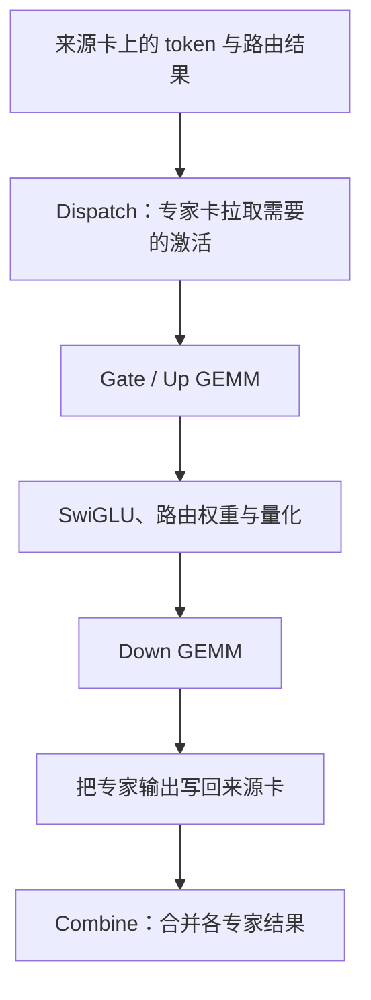

# MoE 的 EP 到底该开多大：从权重复用到 MegaMoE

把两篇文章放在一起，最值得记住的是这件事：**增大 EP，可以让一张卡少放一些专家，让每个专家一次处理更多 token；但当读权重已经不占主要时间，继续加卡的收益就会很小。**

这也是 Prefill 和 Decode 经常采用不同 EP 的原因。Prefill 一次有大量 token，专家本来就能充分复用权重；Decode 的单步 batch 小，需要把更多卡上的 token 汇集到专家那里。不过，汇集本身需要通信，最后还要等最慢的卡完成。

这份笔记结合附件中的两篇文章：

- 是小肖啊：《乱谈kernel之large EP is not all you need》。重点是 NVL72 上 MegaMoE 的测量、流水线和实际系统代价。
- Junxian Ma：《DeepSeek EP 方案的抉择：Prefill 与 Decode 之间的 Insight》，2026 年 11 月 8 日。重点是用算力、显存带宽和通信带宽解释 EP 选择。

附件还混有前一次解读，下面按问题重新组织。官方机制与部署建议核对了 DeepInfer、DeepGEMM 等一手资料；附件作者的测量保留原来的来源和口径，未复现实验。文中数值推导是算例，不是部署跑分。资料

## 1. 先弄清楚：EP 到底分了什么

一个 MoE 层有很多专家，但每个 token 只选择其中几个专家计算。简化表示为：

$$
y(x)=\sum_{e\in\operatorname{TopK}(x)}g_e(x)f_e(x)+f_{\mathrm{shared}}(x).
$$

这里 $g_e$ 是路由权重，$f_e$ 是专家网络，shared expert 则处理所有 token。

**Expert Parallelism，专家并行，是把不同专家放到不同 GPU 上。** 假设有 384 个 routed experts：

| EP 大小 | 每卡持有的 routed experts | 一个直观理解 |
| --- | ---: | --- |
| EP8 | 48 | 每张卡负责很多专家 |
| EP16 | 24 | 专家进一步分散 |
| EP32 | 12 | 每张卡只负责一小部分专家 |
| EP64 | 6 | 更多卡上的 token 汇集到少数本地专家 |

表格假设均匀分配且没有冗余副本。实际 EPLB 可以复制热点专家，因此物理专家数不一定等于逻辑专家数。

DeepSeek V4.1 Flash 的相关配置是 $E=384$、top-$K=6$、hidden size $H=5120$、expert intermediate size $I=2304$，另有一个 shared expert。后文用这一形状做算例。[官方模型配置](https://huggingface.co/deepseek-ai/DeepSeek-V4.1-Flash/blob/main/inference/config.json)

Attention 可以采用数据并行：每张卡处理自己的请求。进入 MoE 时，token 根据专家所在位置跨卡流动，完成后再回到来源卡。这意味着同一张 GPU 有两个身份：

- 作为来源卡，持有自己的 token，要把它们送去对应专家。
- 作为专家卡，接收其他卡发来的 token，运行自己持有的专家。

EP 和 TP 也不同。EP 分的是完整专家；TP 通常切分一个矩阵或算子的计算。两者可以组合，但这里讨论的是 Attention DP 与 MoE EP 配合的路径。

## 2. 最容易误解的地方：加卡后，每张卡是不是少算了

要先说清楚固定的是哪个 batch。

定义：

| 符号 | 含义 |
| --- | --- |
| $W$ | EP 组内 GPU 数 |
| $T$ | 每张来源卡每步进入 MoE 的 token 数，尚未展开 top-$K$ |
| $E$ | 逻辑 routed expert 总数 |
| $K$ | 每个 token 选择的 routed expert 数 |
| $r$ | 每个专家平均接收的 token–expert 行数 |

这里的“一行”是一次 token 与专家的配对。同一个 token 进入 6 个专家，就产生 6 行专家计算。

### 固定每卡 token 数：计算量不会按 EP 缩小

整个 EP 组共有 $WT$ 个 token，展开路由后产生 $WTK$ 行。均匀分到 $W$ 张卡：

$$
\text{每卡 routed rows}=\frac{WTK}{W}=TK.
$$

**$W$ 被约掉了。**

例如每卡 $T=256$、$K=6$，无论 EP8 还是 EP64，每张卡平均都要算 1536 行 routed expert 计算。若 shared expert 在本卡计算，还要加上 256 行 shared expert 计算。

变的是这些行如何分配给专家：

$$
r=\frac{TK}{E/W}=\frac{WTK}{E}.
$$

| 配置 | 每卡 routed rows | 每卡专家数 | 每个专家平均行数 |
| --- | ---: | ---: | ---: |
| EP8，$T=256$ | 1536 | 48 | 32 |
| EP16，$T=256$ | 1536 | 24 | 64 |
| EP32，$T=256$ | 1536 | 12 | 128 |
| EP64，$T=256$ | 1536 | 6 | 256 |

于是，一张卡仍做差不多的有效计算，但需要使用的专家权重变少了，每份权重能服务更多行。

这里保持不变的是**平均有效 FLOPs**。小矩阵效率、tile padding、真实路由不均和量化开销，都会让实际执行时间发生变化。

### 固定全局 token 数：结论就变了

如果固定整个 EP 组的 token 总数 $N$，则 $T=N/W$。此时：

$$
\text{每卡 routed rows}=\frac{NK}{W},\qquad
r=\frac{NK}{E}.
$$

加卡会减少每卡计算，但每个专家的平均行数保持不变。

所以，“增大 EP 不减少每卡计算量”有明确前提：**比较时固定每卡 $T$，并且更多 GPU 带来了更多总请求。** 不能把这一结论用于固定全局 batch 的强扩展实验。

## 3. 为什么少读一些权重，会有这么大影响

GPU 执行专家网络，既需要算矩阵乘，也需要从 HBM 读取权重。HBM 是显卡的大容量高带宽内存；计算单元再快，数据没到也无法继续。

一个采用 SwiGLU 的专家，主要有 gate、up、down 三个矩阵。忽略 bias：

$$
P_e=3HI.
$$

代入 $H=5120,I=2304$：

$$
P_e=35{,}389{,}440\approx35.4\text{M parameters}.
$$

一行经过三次矩阵乘，按一次乘加计 2 FLOPs：

$$
F_{\mathrm{row}}\approx2P_e\approx70.8\text{ MFLOPs}.
$$

按附件的 FP4 存储算例，若每 32 个参数另存 1 字节 scale：

$$
b=\frac12+\frac1{32}=0.53125\text{ byte/parameter},
$$

$$
w_e=bP_e\approx18.8\text{ MB}.
$$

这不是所有 FP4 格式统一的存储成本，换量化格式、对齐方式或 scale 布局需要重算。

读同样一份约 18.8 MB 的专家权重，只服务 32 行，还是服务 256 行，效率显然不同。在理想复用模型里，分摊到每行的权重流量分别约为 0.588 MB 和 0.0734 MB。

**EP 扩大的关键收益，就在于增加每份专家权重的复用次数。**

不过，“一个专家的权重只读一次”只是估算。真实 GEMM 会分块，同一个专家有多个 M tile 时可能重复加载权重，缓存能否复用也影响实际 HBM 流量。因此，下面的 roofline 用于定位瓶颈，最终仍要用 profiler 检查。

## 4. 每个专家到底要有多少行，才算够用

设 GPU 在对应精度下的有效算力为 $P$ FLOP/s，HBM 有效带宽为 $B_H$ byte/s。一个专家处理 $r$ 行：

$$
t_{\mathrm{weight}}\approx\frac{bP_e}{B_H},\qquad
t_{\mathrm{compute}}\approx\frac{2rP_e}{P}.
$$

令两者相等，得到交叉点：

$$
\boxed{r_* = \frac b2\frac{P}{B_H}}.
$$

也可以用算术强度理解：

$$
\mathrm{AI}=\frac{2rP_e}{bP_e}=\frac{2r}{b}\quad\text{FLOP/byte}.
$$

当 AI 小于硬件的算力带宽比 $P/B_H$，权重供给更可能限制速度；超过它后，单纯减少权重流量就不再是主要改进方向。

### 复算第二篇文章的约 150 行

第二篇采用的理论输入是 $P=4.5\times10^{15}$ FLOP/s、$B_H=8\times10^{12}$ byte/s，以及 $b=0.53125$：

$$
r_*=\frac{0.53125}{2}\times562.5\approx149.4.
$$

这就是文中的“约 150 行”。它是按该硬件口径和权重流量模型得到的交叉点，**不是跑到第 150 行突然变快的实测定律**。

公式里专家参数量被约掉了，因为权重流量和计算量都随参数量线性增长。实际 kernel 中，矩阵形状仍会影响算力利用率，激活读写、padding、通信和同步也没有被这个式子覆盖。

反推达到这一交叉点需要的 EP：

$$
W_*\approx\frac{Er_*}{TK}.
$$

$E=384,K=6,T=256$ 时，$W_*\approx37.4$，即位于 EP32 与 EP64 之间。这只能帮助确定该测哪些配置，不能直接宣布 EP64 最优。

更强的 Tensor Core 也未必让这个阈值降低。若计算增长快于 HBM 带宽增长，就需要更多行来“喂饱”计算单元。降低权重字节数会降低阈值，但如果同时换了运算精度，使 $P$ 也变化，就必须一起重算。

## 5. Prefill 与 Decode 为什么会选出相反的 EP

Prefill 处理输入提示，一步通常包含大量 token；Decode 逐步产生输出，一条序列每步参与的 token 少得多。连续批处理和投机解码会扩大 Decode batch，但它仍受请求数量与延迟目标约束。

使用附件中的两组示例：

| 阶段 | 每卡 $T$ | EP | 每专家平均行数 $r=WTK/E$ |
| --- | ---: | ---: | ---: |
| Prefill | 32,768 | 2 | 1024 |
| Prefill | 32,768 | 4 | 2048 |
| Decode | 256 | 8 | 32 |
| Decode | 256 | 32 | 128 |
| Decode | 256 | 64 | 256 |

在这个算例中，Prefill 即使用 EP2，每个专家也已远超上述权重复用交叉点。Decode 的 EP8 则仍明显低于它。

因此，Prefill 更容易从小 EP 的低通信成本和较小调度范围获益；Decode 更容易从大 EP 的权重复用获益。DeepInfer 当前部署问答给出 Prefill EP2–8、Decode EP64–128 的建议，同时要求结合 kernel、负载均衡和离线 benchmark 选择并行策略。这是它的模型与服务条件下的方案。[DeepInfer 部署问答](https://github.com/deepseek-ai/DeepInfer/blob/main/doc/inference_deployment_qa.md)

这里不能省略三个条件：

1. Prefill 也可能是小请求或小 chunk，未必始终有很大的 $T$。
2. Decode 可以通过增加并发提高 $T$，代价是排队、单步延迟、KV Cache 和调度压力。
3. 同一 EP 下，Prefill 与 Decode 的实际通信效率和负载波动未必相同。小消息延迟、大消息带宽、padding 和 overlap 都可能不同。

第二篇所说的“两个阶段差别只在读权重”，应理解为其简化模型中的解释，不能扩展成完整系统的等价关系。

## 6. MegaMoE 把一整层 MoE 放进一个 kernel，为什么还会等

DeepGEMM 官方将 MegaMoE 描述为：在一个 kernel 中融合并重叠 EP dispatch、两层线性计算、SwiGLU 与 EP combine。它把跨卡通信和 Tensor Core 计算组织在同一执行流程中。[DeepGEMM：Mega MoE](https://github.com/deepseek-ai/DeepGEMM#mega-moe)

可以把附件分析的路径画成下面这样：

图画的是数据依赖，实际执行可以交错。例如专家 A 做 down GEMM 时，专家 B 正在做 gate/up，专家 C 还在收数据。实现会将工作拆成 tile，由不同 warp 承担通信、搬运、计算、调度和结果处理。

几个容易混淆的硬件名词：

| 名词 | 在这条路径里的作用 |
| --- | --- |
| HBM | 存储大规模专家权重和激活 |
| NVLink | 在 GPU 之间传输 token 数据及结果 |
| Shared memory | SM 内用于分块计算的片上存储 |
| TMA | 搬运张量块，帮助把数据送到计算所需的位置 |
| Tensor Core / MMA | 执行矩阵乘累加 |
| Epilogue | 矩阵乘之后的激活、缩放、量化、写回等处理 |
| Persistent kernel | 常驻并持续领取任务，减少反复启动和组织工作的开销 |

附件报告的具体配置是 152 个 SM、两个 SM 构成一个 cluster。这些是作者所测实现与设备的细节，不能当成所有 GPU 上 MegaMoE 的固定结构。

融合仍然无法消除数据依赖：某个 tile 的输入没到，计算必须等待；down 的依赖结果没准备好，不能凭空开始；最后合并之前，也需要相关结果完成。

一个有用的资源下界是：

$$
L_{\mathrm{MoE}}\geq
\max(t_{\mathrm{HBM}},t_{\mathrm{compute}},t_{\mathrm{network}}).
$$

但实际延迟还包含无法重叠的同步、流水线启动与收尾、等待和不均衡。不能把三个时间直接相加，也不能把最大值直接当作预测延迟。

**融合让通信更有机会被计算覆盖；覆盖多少，要看时间线。** 峰值带宽无法告诉我们最后一批关键数据什么时候到达。

## 7. 第一篇文章的实测，真正说明了什么

附件给出以下引擎内 MegaMoE 数据。按作者说明，这是 NVL72 上 DeepSeek V4.1 Flash Decode、带冗余专家、rank 0 的 120 次调用中位数，单位为微秒。这里作为附件作者报告引用，未独立复跑。

| 每卡 token 数 $T$ | EP8 | EP16 | EP24 | EP32 | EP64 | EP72 |
| --- | ---: | ---: | ---: | ---: | ---: | ---: |
| 32 | 179 | 113 | 94 | 79 | 66 | 70 |
| 256 | 196 | 137 | 117 | 108 | 105 | 110 |
| 1024 | 266 | 237 | 225 | 223 | 223 | 233 |

这张表要沿两个方向读。

**横向看：同一负载下，加 EP 能省多少时间？**

- $T=32$：EP32→64，从 79 降到 66 μs，延迟约降 16.5%。
- $T=256$：EP32→64，从 108 降到 105 μs，约降 2.8%。
- $T=1024$：EP32→64，同为 223 μs，表中没有收益。

**纵向看：token 多起来后，原先的优势还剩多少？**

EP8 在低 $T$ 下明显慢，但 $T$ 增长时，计算和通信逐渐占据更大比例，各条曲线靠拢。EP72 还可能比 EP64 慢，原因需要结合冗余专家、调度和通信条件分析。

所以这组数据支持的是：**在作者测到的配置和负载下，大 EP 的边际收益明显递减。** 它没有证明任何硬件、模型、SLA 下 EP32 都最好。

### 三段曲线如何理解

第一段是极小 batch。部分专家没有收到 token，因此不一定要读取全部本地专家权重。随着更多专家被激活，耗时可能增长。

第二段是权重读取占主导的平台。更多行暂时没有明显增加延迟，而减少本地专家数可以压低平台。

第三段是计算、通信等随 $T$ 增长，开始主导时间。继续减少权重流量的作用变小。

“平均每专家达到一行，就激活全部专家”只适用于某些刻意均匀的构造。若每个 token 独立、均匀选择 $K$ 个不同专家，一个专家未被选中的概率为：

$$
\left(1-\frac KE\right)^{WT}.
$$

于是，本卡被激活的专家数期望为：

$$
\mathbb E[E_{\mathrm{active,local}}]
=\frac EW\left[1-\left(1-\frac KE\right)^{WT}\right]
\approx\frac EW(1-e^{-r}).
$$

$r=1$ 时大约只有 63% 的专家被激活。真实路由还可能偏斜，曲线左端需要单独分析。

### 测量口径也不能混起来

附件作者自己的 microbenchmark 使用“最慢 rank 的 kernel 跨度减去出发偏差”；上表则是引擎中的 rank 0 中位数。它们不是同一种统计量。

附件还混用了均匀路由、随机路由、真实路由、不同版本与模型预测。其中平台表里的 EP48–72 是模型值，不能整体称为实测。作者报告的 2.5%–6.4% 留出误差，只能说明其拟合在相应样本上的表现，不能直接推广到其他设备或路由分布。

## 8. 通信真的“不随 EP 增大”吗

精确一点说：在固定每卡 $T$、固定专家形状与路由规则的简化模型下，**每卡专家行数不变，远程行比例随 EP 增长并逐渐饱和。**

均匀放置专家时，一个选中的专家在其他卡上的概率是：

$$
1-\frac1W.
$$

若每个 token–expert 配对分别传输，每个 token 的远程份数期望为：

$$
c_{\mathrm{pair}}=K\left(1-\frac1W\right).
$$

$K=6$ 时，EP8 是 5.25 份，EP64 是 5.90625 份。它仍在增长，只是在大 EP 区间接近 6。

附件分析的路径使用 FP8 输入、BF16 输出。按 $H=5120$，不含 scale 等附加信息时，输入约 5.12 KB，输出约 10.24 KB；回传并不比输入便宜。输入经过量化，也不代表两个方向都传相同字节数。

### 按目标 GPU 去重，能省多少

如果同一个 token 的多个专家都在同一张 GPU 上，可以考虑只发送一次输入，再在目标卡展开。近似把 $K$ 个目标视为独立均匀落在 $W$ 张卡上，远程目标卡数的期望是：

$$
c_{\mathrm{card}}\approx
(W-1)\left[1-\left(1-\frac1W\right)^K\right].
$$

| 配置 | 按 token–expert 配对发送 | 按远程目标卡去重，近似 |
| --- | ---: | ---: |
| EP4，$K=6$ | 4.50 | 2.47 |
| EP64，$K=6$ | 5.91 | 5.68 |

小 EP 时，同一个 token 的多个专家较容易落到同一卡，去重更有空间。大 EP 时它们更分散，收益趋小。

若严格考虑从 $E$ 个不同专家中无放回选 $K$ 个，且每卡恰有 $E/W$ 个专家，则输入的远程目标卡数期望为：

$$
c_{\mathrm{card}}=
(W-1)\left[1-
\frac{\binom{E-E/W}{K}}{\binom EK}\right].
$$

这仍假设均匀随机路由，真实模型应统计实际目的地。并且输入去重不等于输出自动等比例减少：输出能否在目标卡局部合并，取决于 combine 实现。

DeepEP 提供不同通信模式，模式间的延迟、吞吐、融合与路由处理方式需要分别比较。[DeepEP 官方仓库](https://github.com/deepseek-ai/DeepEP)

### 为什么“通信占计算的比例与 batch 无关”只是一阶近似

若计算时间和通信时间都严格正比于 $T$，两者相除时 $T$ 会消掉。但实际通信还有固定延迟，实际 GEMM 效率也依赖形状：

$$
t_{\mathrm{net}}\approx a(W)+\frac{T\cdot\mathrm{bytes/row}}{B_{\mathrm{eff}}(T,W)}.
$$

小 batch 与大 batch 的 $B_{\mathrm{eff}}$、启动开销占比及可重叠程度不同。因此，理论比例相同不能推出 Prefill、Decode 的实际通信影响相同。

## 9. 为什么“150 行”和“120 行”并不冲突

第二篇的约 150 行，比较的是权重读取与矩阵计算：

$$
t_{\mathrm{HBM}}=t_{\mathrm{compute}}.
$$

第一篇则在其测量条件下，将权重读取分摊到每个来源 token，得到约：

$$
t_{\mathrm{HBM/token}}\approx\frac{16\ \mu s}{r},
$$

并与约 130–140 ns/token 的通信下界比较。取中间值 135 ns：

$$
r\approx\frac{16\ \mu s}{0.135\ \mu s}\approx118.5.
$$

这个约 120 行的交点，是**权重读取与通信**的比较。

两篇使用的硬件口径、有效带宽和比较对象不同，交叉点自然不同。更有意义的问题是：在目标工作点，继续减少 HBM 流量之后，接替它成为瓶颈的究竟是计算、通信，还是同步与尾部等待？

还要注意硬件名称：NVL72 描述的是 72 GPU 系统形态，不能仅凭这个名称确定单卡显存、SM 数或算力。附件第一篇报告约 280 GB HBM、152 SM；第二篇采用 B200 的理论规格，这两套参数不能直接拼成一台设备。

NVIDIA 的 Wide-EP 文章讨论 GB200 NVL72 与高速互联的配合，提供了另一组系统条件。[NVIDIA Wide-EP 说明](https://developer.nvidia.com/blog/scaling-large-moe-models-with-wide-expert-parallelism-on-nvl72-rack-scale-systems)

**EP128 也不可能完整放进一个只有 72 张 GPU 的 NVL72 域。** 讨论更大 EP 时，必须明确实际跨域互联、链路带宽与通信实现，不能沿用单域的通信假设。

## 10. 显存、不均衡与可靠性，为什么会改变答案

### 多出来的显存，需要真的用得上

按前面的 routed expert 存储算例，40 层共有：

$$
40\times384\times18.8\text{ MB}\approx289\text{ GB}.
$$

EP16→EP64，每卡 routed expert 权重约减少：

$$
289\left(\frac1{16}-\frac1{64}\right)\approx13.5\text{ GB}.
$$

这是 routed expert 部分的估算，不是完整模型显存。实际还包括非专家参数、shared experts、冗余副本、KV Cache、通信 buffer、workspace 与分配开销。

附件引用每 token 全局 KV Cache 约 890 字节，并以每卡 60 条、每条 1M token 的上下文估算：

$$
60\times10^6\times890\approx53.4\text{ GB}.
$$

这里保留附件口径；具体 KV 格式及附加缓存占用仍需对应实现复核。如果实际 batch 已被延迟目标限制，释放 13.5 GB 未必能换来更多有效请求。若上下文更长、并发更高或 KV 更大，它又可能很重要。

由此不能直接得出“EP2 一定放得下完整部署”或“额外显存没有价值”。正确的判断是看实际显存构成与限制 batch 的因素。

### 每卡专家少，热点更难被平均

考虑一个说明性的例子：其他专家各有 1 单位负载，一个热点专家有 10 单位。若每卡放 $n=E/W$ 个专家，热点卡的负载为 $n+9$，普通卡为 $n$：

$$
\frac{\text{热点卡}}{\text{普通卡}}=1+\frac{9W}{E}.
$$

$E=384$ 时，EP8 为 1.1875，EP64 为 2.5。

这个 2.5 是**相对普通卡**，不是严格的 max/mean。对整个 EP 组取平均，正确比值为：

$$
\frac{\text{热点卡}}{\text{全组平均}}
=\frac{E+9W}{E+9}.
$$

EP64 时约为 2.44。它是构造例子，不是生产系统的实测负载倍数。

EPLB 可以复制热点专家、重排映射或调整路由分配，从而缓解这一问题。另一方面，即使平均路由概率均匀，有限 batch 的随机波动也存在，典型相对波动会随样本量增大而减小。因此，“负载不均只取决于 EP、与 $T$ 无关”不是普遍结论。

### 大实例改变故障影响范围和扩缩容单位

如果一个 EP 实例必须整体协同，一张卡故障可能使整个实例停止服务。固定集群总卡数时，扩大 EP 不代表全机房硬件故障次数增加，但一次故障影响的请求范围和恢复单位可能变大。

例如，256 张卡的集群若要预留一个完整实例作为冗余，简化后的可用于服务的卡数比例为：

$$
1-\frac{W}{256}.
$$

EP16 时为 93.75%，EP64 时为 75%。这只对应“整实例预留”的假设，实际系统可能采用弹性重构、共享备用或其他恢复方案。

所以不能简单说 EP 翻倍，服务成本就翻倍。固定每卡 batch 时，总服务容量也在增长；更有意义的是比较每卡有效吞吐、满足 SLA 的容量和故障后的可用容量。

## 11. 单层快了一倍，为什么服务端没有快一倍

假设 MoE 原本占总时间的比例为 $f$，MoE 本身加速 $s$ 倍，其余部分不变。端到端加速为：

$$
S_{\mathrm{e2e}}=\frac1{(1-f)+f/s}.
$$

用附件 $T=256$ 的 EP8→64 数据：

$$
s=\frac{196}{105}\approx1.87.
$$

若假设 MoE 占总时间 40%，则：

$$
S_{\mathrm{e2e}}\approx
\frac1{0.6+0.4/1.87}\approx1.23.
$$

MoE 接近 1.87 倍，整体只有约 1.23 倍。这是解释性的 Amdahl 算例，不是复现官方 benchmark。

对于 EP32→64，MoE 仅从 108 降到 105 μs。仍假设 $f=0.4$，端到端加速约为 1.011 倍。这样的收益是否值得更大的实例，需要结合其他约束决定。

### 投机解码还会改变 token 的统计口径

附件中静态 `nextn=3` 表示正常位置加上 3 个 draft 验证位置。每卡 64 个请求时，验证阶段进入 MoE 的 token 数约为：

$$
T=64\times(1+3)=256.
$$

但这些位置不一定都被接受。应分别记录：

- 每卡并发请求数；
- 每步验证位置数，即 kernel 接收的 $T$；
- 每步最终接受并输出的 token 数；
- 包括 draft、verification 等步骤的端到端耗时。

因此 $T/L_{\mathrm{MoE}}$ 只是局部处理速率，不能直接当成用户看到的输出 token/s。动态 draft 长度、接受率和上下文长度变化，都会改变最佳工作点。

## 12. 把这些分析变成一个实际选择 EP 的流程

先确定服务需要：是更低的首 token 延迟、更快的连续输出，还是更大的总吞吐。TTFT、每 token 延迟的 p50/p99、请求长度分布和接受率，应与平均吞吐一起看。

接着统计真实负载，而不是只选一个整数 batch。尤其要记录每卡 $T$ 的分布、专家负载分布、热点变化、KV 占用，以及是否跨 NVLink 域。

再用两个计算缩小候选范围：

$$
\text{每卡全部权重}+\text{KV}+\text{通信与运行空间}
\leq\text{可用 HBM},
$$

$$
r=\frac{WTK}{E},\qquad
r_*\approx\frac b2\frac P{B_H}.
$$

前者排除装不下的配置，后者提示哪些配置可能仍受权重流量限制。它们不替代 benchmark。

随后分三层测量：

| 层次 | 关注什么 | 回答的问题 |
| --- | --- | --- |
| Kernel | HBM 流量、矩阵效率、通信时间线、最慢 rank | 加 EP 究竟省掉了哪部分时间 |
| Engine | 完整 step、Attention、draft、接受率、各 rank 延迟 | 局部收益能否传到完整模型 |
| Serving | 请求分布、排队、TTFT/ITL 分位数、有效输出吞吐 | 真实用户条件下是否更划算 |

同一个 kernel 测试中要固定权重精度、版本、物理专家数、路由口径与计时方法。端到端比较还要统一模型质量、输入输出分布与投机解码策略。

最后找的是一组可选解：有的配置更低延迟，有的每卡吞吐更高，有的实例更小、更容易恢复。若不同 EP 已处于性能平台，实例规模和运行成本就更值得考虑；若目标是极低延迟，而 HBM 仍在主导，大 EP 仍可能有明显价值。

## 13. 两篇文章放在一起，我会怎样理解

第二篇把最重要的变量抽了出来：

$$
\boxed{\text{每个专家的 batch}=\frac{\text{EP}\times\text{每卡 token}\times\text{top-K}}{\text{专家总数}}}.
$$

这解释了为什么把专家分到更多卡上，有时反而能让单卡运行得更有效率：每张卡的工作变得更集中，每份权重服务更多行。

第一篇继续追问：减少权重读取之后，时间究竟去了哪里？它通过 kernel 的测量指出，实际执行还会被通信、依赖等待、同步和负载尾部限制。因此，知道权重复用阈值，只是找到优化方向的第一步。

这两种视角可以接起来：

**先用 roofline 判断可能的瓶颈，再用时间线找出真实等待，最后用端到端服务指标决定是否值得扩大实例。**

读这类文章时，我最想保留的三个问题是：比较时固定了什么，报告的是哪一层的耗时，以及省下的资源是否能转化成用户需要的能力。只要这三个问题没说清楚，“大 EP 更快”和“EP32 已经够了”都很容易被过度推广。

这与 [RL-Kernel](RL-Kernel.md) 的关注点也有区别：RL-Kernel 笔记主要讨论训练与推理的数值一致性；这里讨论 MoE 推理的资源利用和延迟。二者都要求检查底层执行，但性能变化不能代替正确性证据。

后续如果要验证自己的系统，最有价值的结果会是一张真实负载下的曲线：横轴是 EP，纵轴分别画每卡有效输出吞吐、p99 输出间隔和可用容量；再附一张对应工作点的 kernel 时间线。这样才能看见大 EP 的收益在哪里结束，以及后续的代价在哪里开始。
