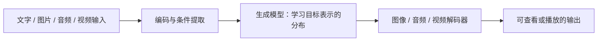
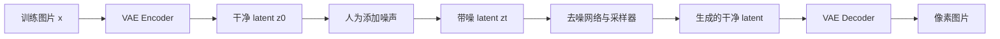
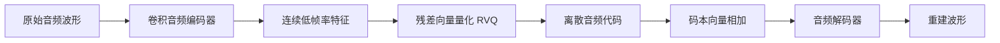
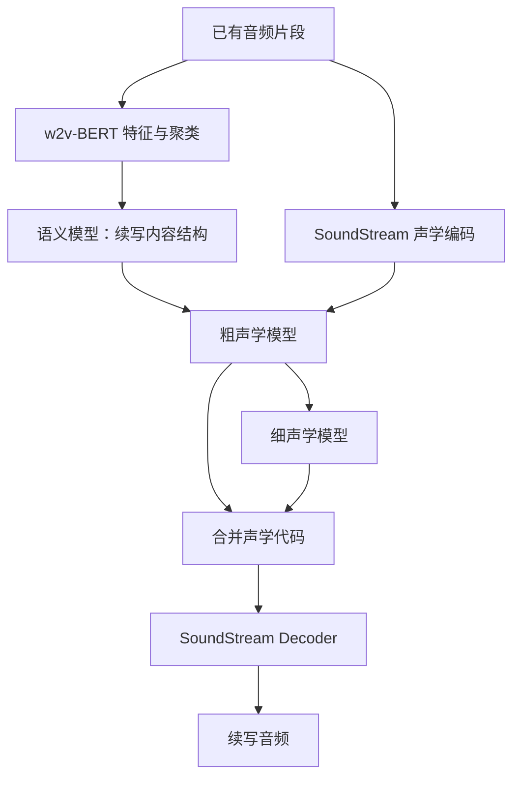
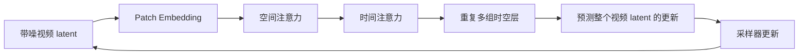
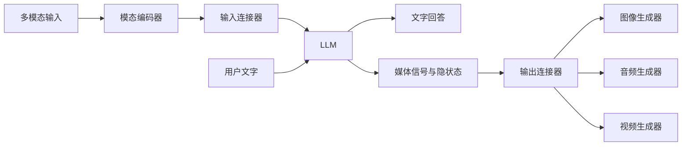
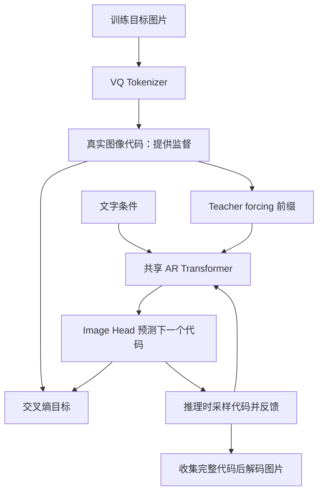

# 多模态生成详解：从扩散模型、音频 Token 到统一多模态 LLM

这篇笔记围绕一个问题展开：**一个原本通过预测下一个 token 来写文字的模型，怎样才能生成图片、声音和视频？**

基础材料是 Maarten Grootendorst 的 [A Visual Guide to Multimodal Generation](https://newsletter.maartengrootendorst.com/p/a-visual-guide-to-multimodal-generation)，发表于 2026 年 10 月 29 日。下面沿着原文的技术主线重新组织讲解，并补充训练目标、推理过程、张量形状、具体例子，以及与 PixelBench、视觉重建和机器人世界模型的联系。

原文中的图没有包含在粘贴材料里。本文流程图为重新绘制的结构示意；数字例子会注明假设，不作为所有模型的默认配置。原文中几处关于 VAE、Latte 和参数冻结的表述，也根据论文或官方实现作了修正。

阅读地图：

| 部分 | 章节 | 主要内容 |
| --- | --- | --- |
| [表示与基本路线](#representations) | 1—3 | 理解与生成，Pixel / Token / Latent，自回归与连续生成 |
| [图像生成](#image-generation) | 4—9 | VAE、Diffusion、U-Net、CFG、DiT、Flow Matching |
| [音频生成](#audio-generation) | 10—12 | Neural codec、RVQ、SoundStream、AudioLM |
| [视频生成](#video-generation) | 13—14 | 视频 latent、时间轴、时空注意力、Latte |
| [接入与统一 LLM](#multimodal-llm) | 15—18 | 四种架构、NExT-GPT、Janus、混合 AR 与扩散 |
| [训练、实例与评测](#training-evaluation) | 19—21 | 数据方向、参数更新、完整请求流程、评测与时延 |
| [与你已有阅读的联系](#research-connections) | 22 | PixelBench、RecA、WAM、动作条件和触觉 |
| [查错与研究讨论](#discussion-reference) | 23—27 | 常见误解、术语、读论文框架、Discussion、资料 |

<a id="representations"></a>

## 1. 先看完整问题：理解一种模态，与生成一种模态有什么区别？

假设给模型看一张照片：一只橘猫坐在窗边，旁边有蓝色杯子。

当你问“猫在哪里”，模型只需要回答“在窗边”。它必须识别猫、窗户和空间关系，但输出仍然是一小段文字。

如果你要求“把这张图重新画出来”，模型需要决定大量原来不必在文字中交代的细节：猫的轮廓、毛发、姿态、杯子的形状、窗户边框、光照、阴影和背景纹理。

两类任务可以写成：

\[
\text{理解：}\quad p(y_{\text{text}}\mid x_{\text{image}},q)
\]

\[
\text{生成：}\quad p(x_{\text{image}}\mid c)
\]

其中，\(q\) 是问题，\(c\) 是生成条件，可以是文字、参考图片、对话历史或它们的组合。

理解任务通常从高维信号中提取与问题有关的信息；生成任务需要为大量没有被条件明确指定的细节赋值。描述“窗边的橘猫”并没有唯一对应的图片，因此生成模型要学的是**条件分布**。

这也解释了为什么一个很会描述图片的模型，未必能准确生成图片。输入端的视觉编码器和输出端的语言模型，可能只训练过“图片 → 回答”，没有训练过“条件 → 可解码的图像表示”。

完整的多模态生成系统可以先拆成三部分：



这里最需要分清的是：**编码器决定用什么表示数据，生成模型决定怎样产生新的表示，解码器把表示变成最终信号。**

## 2. Pixel、Token、Embedding、Latent：先把几个词讲清楚

### 2.1 Pixel 是图像的采样值

一张 RGB 图片可以表示为：

\[
x\in\mathbb R^{H\times W\times 3}.
\]

如果是 8 位图像，每个通道通常对应 0 到 255 的整数。归一化后也可以表示为浮点数。像素是否使用整数存储，与模型是否采用离散 token 建模，是两个层次的问题。

对一张 \(512\times512\) 图片，RGB 通道值共有：

\[
512\times512\times3=786{,}432.
\]

直接逐个预测这些数可以构成生成方法，但序列很长，空间关系也需要额外处理。因此很多模型先压缩图像，再在压缩表示上生成。

### 2.2 Token 是模型处理的一个单位，不必是一个汉字或一个像素

语言模型中的 token 通常是有限词表中的一个 ID。视觉模型里的 token 有两种常见含义：

| 名称 | 实际对象 | 例子 |
| --- | --- | --- |
| 离散视觉 token | 视觉码本中的整数索引 | 第 713 个图像代码 |
| 连续视觉 token | 对一个图像块或潜变量块做投影得到的向量 | 一个 1024 维浮点向量 |

两者都能输入 Transformer。Transformer 的注意力计算接收向量，**并不要求向量必须先来自一个离散词表**。

语言模型先把 token ID 查表变成向量；DiT 可以直接把连续潜变量块线性投影成向量。后者不必执行向量量化。

因此，看到论文写“image tokens”，首先要问：它指离散码本索引，还是连续图像特征？这会直接影响损失函数和采样方式。

### 2.3 Embedding 是把对象表示成向量

例如，把 token ID 713 查表得到：

\[
e_{713}\in\mathbb R^d.
\]

这个向量就是 embedding。文字、图片块、音频片段都可以有 embedding。不同编码器得到的 embedding，即使维度相同，也未必能直接互换，因为它们的统计分布和训练用途可能不同。

### 2.4 Latent 是隐藏表示，常用于压缩原始信号

图像编码器可以把图片变成：

\[
z=E(x),\qquad z\in\mathbb R^{h\times w\times c}.
\]

这里的 latent 仍然可以保留二维布局。它不是“猫、窗户、杯子”三个明确的语义标签，而是一组由训练得到的特征。

如果再把 latent 切块并投影，就得到输入 Transformer 的连续 tokens。可以把这个过程写成：

\[
\text{Pixels}\rightarrow\text{Latent Grid}\rightarrow\text{Patch Tokens}.
\]

Embedding 和 latent 都可以用张量存储。“Tensor”只是多维数组的数学与程序表示，并不是比 embedding 更高级的一类信息。

### 2.5 Codebook 是离散表示与连续向量之间的字典

假设码本为：

\[
\mathcal C=\{e_1,e_2,\ldots,e_K\},\qquad e_k\in\mathbb R^d.
\]

编码器输出一个连续向量 \(h\)，量化器选择最接近的码本向量：

\[
k^*=\arg\min_k\|h-e_k\|_2^2.
\]

保存时可以只保存整数 \(k^*\)；解码前根据索引取出 \(e_{k^*}\)。

因此，“模型生成离散图像 token”通常指生成一串索引，再通过码本和解码器还原图片。一个索引所表达的局部模式由训练决定，不必对应一个可命名的物体。

## 3. 两条主要生成路线：预测下一个代码，或者逐步修改连续变量

理解多模态生成，可以先抓住两种不同的计算过程。

### 3.1 自回归生成：逐个扩展序列

如果把目标表示为离散序列 \(u_1,\ldots,u_N\)，可以分解为：

\[
p_\theta(u_{1:N}\mid c)
=\prod_{i=1}^{N}p_\theta(u_i\mid u_{<i},c).
\]

训练时使用交叉熵：

\[
\mathcal L_{\mathrm{AR}}
=-\sum_i\log p_\theta(u_i\mid u_{<i},c).
\]

这和文字模型的训练形式相同。区别在于 \(u_i\) 可以是词语片段、音频代码，也可以是图像代码。

训练时，把真实前缀送进去预测后续位置，称为 teacher forcing。借助因果注意力掩码，一次前向可以并行计算多个位置的损失。

推理时，未来答案未知，模型通常需要生成一个 token，再把它放回前缀，继续生成下一个。**训练位置可并行计算，不代表普通自回归推理也能一次得到所有输出。**

### 3.2 扩散或流模型：反复更新一整组连续变量

另一条路线是先准备一个随机张量，然后多次更新：

\[
z_{\text{noise}}\rightarrow z^{(1)}\rightarrow z^{(2)}
\rightarrow\cdots\rightarrow z_{\text{data}}.
\]

每次网络调用通常会更新整张图像或整个视频片段的潜变量。它的串行开销主要来自多次求解步骤，而不是必须按光栅顺序逐个生成图像代码。

| 维度 | 常规离散自回归 | 连续扩散 / Flow Matching |
| --- | --- | --- |
| 被生成的对象 | 离散索引序列 | 连续张量 |
| 常见训练目标 | 下一 token 交叉熵 | 噪声、干净数据或向量场回归 |
| 推理中的主要循环 | 生成下一个 token | 更新一次当前潜变量 |
| 单次网络调用 | 预测下一位置的分布 | 预测多个位置的更新信息 |
| 输出还原 | 查码本后解码 | 直接解码最终 latent |

这张表描述常见实现。还有块自回归、离散扩散、连续自回归等变体，不能把所有生成方法都压成二选一。

更重要的是：**Transformer 是网络结构，Autoregression / Diffusion / Flow Matching 是生成建模方式。** 一个 Transformer 可以采用其中不同的训练目标。

<a id="image-generation"></a>

## 4. 图像生成第一步：为什么先训练 VAE / 图像自编码器？

### 4.1 压缩的目的：减少生成模型要处理的数据规模

假设采用一个空间下采样 8 倍、潜变量通道数为 4 的图像编码器。这是一个便于理解的典型示例：

\[
x:512\times512\times3
\quad\longrightarrow\quad
z:64\times64\times4.
\]

原图有 786,432 个标量，latent 有 16,384 个标量，数量相差 48 倍。这个比值不等于磁盘压缩率：两边的数据精度、熵编码方式可能不同。

生成模型在较小的 latent 上工作，能显著降低计算需求。最后再交给解码器恢复到像素空间。这是 [Latent Diffusion Models](https://arxiv.org/abs/2112.10752) 的关键设计。

### 4.2 自编码器怎样训练？

基本结构是：

\[
x\xrightarrow{E}z\xrightarrow{D}\hat x.
\]

训练希望 \(\hat x\) 保留原图的重要内容。可以使用像素重建损失、感知损失，以及适合具体模型的正则项或对抗损失。

VAE 进一步把编码表示建模为分布，例如：

\[
q_\phi(z\mid x)=\mathcal N(\mu_\phi(x),\operatorname{diag}(\sigma_\phi^2(x))).
\]

通过重参数化采样：

\[
z=\mu_\phi(x)+\sigma_\phi(x)\odot\epsilon,
\qquad\epsilon\sim\mathcal N(0,I).
\]

一个简化的 VAE 目标是：

\[
\mathcal L_{\mathrm{VAE}}
=\mathbb E_{q_\phi(z\mid x)}[-\log p_\psi(x\mid z)]
+\beta D_{\mathrm{KL}}(q_\phi(z\mid x)\|p(z)).
\]

第一项让解码结果能够解释输入，第二项约束潜变量分布。实际图像生成系统中的自编码器，常采用更具体的感知与重建目标，不应把上面的简式当成所有实现的完整损失。

### 4.3 VAE 解码与扩散去噪是两个独立过程

完整流程是：



VAE encoder 负责压缩；forward diffusion 负责添加随机噪声。去噪模型负责恢复数据分布；VAE decoder 负责把 latent 还原为图片。

把 VAE encoder 说成“扩散的前向过程”、把 decoder 说成“反向扩散”，会把两个训练问题混在一起。

### 4.4 Codec 决定了生成能力的一个上限

如果一张带小字的图片，经过编码器和解码器重建后，小字已经看不清，那么即使生成模型完全预测对这套 latent，也很难通过同一个解码器恢复那些已经丢失的细节。

因此需要分别检查：

1. 原始图片经过 codec 的重建质量。
2. 生成模型能否产生符合条件的 latent。
3. 采样和后处理是否引入额外误差。

这能区分“表示本身不够好”和“生成模型没学好”。音频压缩器丢失音色细节、视频压缩器损伤快速运动时，也存在同样的问题。

## 5. Diffusion 到底在学什么？

### 5.1 前向过程：给真实样本添加已知噪声

设真实图像的潜变量为 \(z_0\)。一个经典的离散扩散过程是：

\[
q(z_t\mid z_{t-1})
=\mathcal N(\sqrt{1-\beta_t}z_{t-1},\beta_t I).
\]

定义：

\[
\alpha_t=1-\beta_t,
\qquad \bar\alpha_t=\prod_{s=1}^{t}\alpha_s.
\]

就能直接从 \(z_0\) 采样任意噪声等级：

\[
z_t=\sqrt{\bar\alpha_t}z_0
+\sqrt{1-\bar\alpha_t}\epsilon,
\qquad\epsilon\sim\mathcal N(0,I).
\]

当 \(\bar\alpha_t\) 较大，输入保留更多原始图像；当它很小，输入主要由噪声构成。

训练时通常随机采样一个 \(t\)，直接用这个公式生成 \(z_t\)。不需要为每张图片提前保存几百个噪声版本，也不需要每次训练都把完整扩散链运行一遍。

### 5.2 去噪网络：预测这次添加的噪声

一种常见目标是：

\[
\mathcal L_{\epsilon}
=\mathbb E_{z_0,c,t,\epsilon}
\left[\|\epsilon-\epsilon_\theta(z_t,t,c)\|_2^2\right].
\]

网络需要同时知道三个东西：当前带噪 latent、噪声等级，以及生成条件。

如果没有 \(t\)，相同数值范围的输入可能对应不同程度的破坏，网络难以知道应该修正多少。如果没有 \(c\)，它只能学习无条件的数据分布，不能按文字要求生成具体对象。

给定预测噪声，还可以计算一个对干净 latent 的估计：

\[
\hat z_0=
\frac{z_t-\sqrt{1-\bar\alpha_t}\epsilon_\theta(z_t,t,c)}
{\sqrt{\bar\alpha_t}}.
\]

这个式子有助于理解，但真实采样器并不一定每一步直接使用 \(\hat z_0\) 作为下一状态。它还要考虑下一噪声等级，以及选用的随机或确定性更新规则。

### 5.3 为什么预测噪声能学会生成图片？

单看一个训练样本，模型确实在猜噪声。但训练涵盖了大量真实图像、条件和噪声等级。

例如，带噪图中出现两个模糊的尖角，文字条件是“猫”。要预测哪些成分来自噪声、哪些成分应该保留，模型需要学习猫耳朵、头部和身体的统计关系。

在高噪声时，当前输入的确定信息很少，模型更依赖条件和数据先验。在低噪声时，输入已经保留大量结构，模型更多执行局部修正。这个描述是总体直觉，不能理解成每个采样器都严格划分“前几步画结构、后几步画纹理”。

更数学地说，噪声预测可以与带噪数据分布的 score 联系起来：

\[
s_\theta(z_t,t,c)
\approx-\frac{\epsilon_\theta(z_t,t,c)}{\sqrt{1-\bar\alpha_t}}.
\]

Score 描述在当前噪声尺度下，哪些变化方向会让样本更符合条件数据分布。逆向采样利用这个方向信息，逐渐把噪声分布变成数据分布。

### 5.4 一张训练图片不是一个唯一答案

对于同一描述，训练集可能有很多不同的猫、光照和构图。模型学习的是这些可能图片的共同统计结构。推理时的初始随机噪声提供不同的采样起点，所以同一句提示词可以生成不同图片。

这也是生成任务和严格重建任务的区别：生成“符合描述的橘猫”有很多合理答案，重建“这张特定照片”要求保留输入中更多具体信息。

## 6. U-Net 和文本条件：文字怎样影响每一步生成？

### 6.1 U-Net 负责把带噪特征映射成预测量

经典潜空间扩散模型常使用 U-Net。它先逐级降低空间分辨率，提取较大范围的结构，再逐级恢复分辨率。

高分辨率路径保留局部细节，低分辨率路径更容易聚合大范围上下文。连接对应层的 skip connection，让上采样阶段能够利用早期的细粒度特征。

U-Net 最初用于图像分割，但在扩散模型里输出的是噪声、干净样本估计或其他参数化目标。**输出含义由训练目标决定。** 它不会因为叫 U-Net，就自动输出分割掩码。

另外，U-Net 的跨尺度 skip connection，与一个残差块内部的 \(x+f(x)\) 不是同一件事，实际网络可以同时使用两者。

### 6.2 文本编码器把提示词变成条件序列

假设提示词是：

> 一只橘猫坐在窗边，右侧有一个蓝色杯子。

文本编码器输出：

\[
C=T(c)\in\mathbb R^{L\times d_c}.
\]

这里的 \(L\) 是文本 token 数。条件通常保留多个 token 的表示，而不一定压成一个向量。

经典 Stable Diffusion 使用过 CLIP 文本编码器。理解其结构时，需要区分 CLIP 的图文对齐预训练与生成阶段：常规文字生图时，需要的是文本条件，不必再把一张目标图片送入 CLIP 图像编码器。

### 6.3 Cross-attention 如何建立图像位置与文字的联系？

设图像特征为 \(H\)，文本特征为 \(C\)：

\[
Q=HW_Q,\qquad K=CW_K,\qquad V=CW_V.
\]

交叉注意力为：

\[
\operatorname{Attention}(Q,K,V)
=\operatorname{softmax}\left(\frac{QK^\top}{\sqrt d}\right)V.
\]

直观上，不同图像位置可以从文本序列中提取不同信息。某些区域更受“橘猫”影响，另一些区域更受“蓝色杯子”影响。

但注意力权重不能直接当成可靠的对象分割或因果解释。模型也可能把“蓝色”错误绑定到猫身上，或者画对两个对象却画错左右关系。这些都属于条件绑定失败。

### 6.4 噪声不是“与提示词不相关的内容”

训练中的 \(\epsilon\) 是人为采样的随机扰动。它与“画面里不应该出现什么”不是同一个概念。

提示词通过条件网络改变去噪预测，使结果更符合目标分布。不能把扩散描述成“把所有与提示词无关的像素删掉”，否则很难解释为什么模型还能生成提示词未明确提到的合理背景、阴影和纹理。

## 7. 从训练到推理：Stable Diffusion 式流程完整走一遍

### 7.1 训练阶段

下面是机制伪代码，省略了 latent 缩放、条件丢弃和混合精度等实现细节：

```python
image, caption = sample_training_pair()
z0 = image_encoder(image)
condition = text_encoder(caption)
t = sample_noise_level()
eps = randn_like(z0)
zt = sqrt(alpha_bar[t]) * z0 + sqrt(1 - alpha_bar[t]) * eps
eps_pred = denoiser(zt, t, condition)
loss = mean_squared_error(eps_pred, eps)
update_trainable_parameters(loss)
```

哪些参数更新取决于训练方案。很多设置冻结预训练自编码器，文本编码器是否冻结也需看具体实现。不能把某个方案的冻结方式当成扩散模型的定义。

### 7.2 推理阶段

```python
condition = text_encoder(user_prompt)
z = randn(latent_shape)
for t in sampling_schedule:
    prediction = denoiser(z, t, condition)
    z = sampler_step(z, prediction, t)
image = image_decoder(z)
```

训练输入包含真实图片，用来建立监督目标。文字生图推理不需要一张目标图片，只需要条件和随机起点。

循环中的 `sampler_step` 很关键：它根据噪声日程和求解方法，把网络预测转成状态更新。不能直接将每步都写成 `z = z - predicted_noise` 并当作正确算法。

### 7.3 Classifier-Free Guidance：为什么要跑有条件与无条件两条预测？

一种常见形式是：

\[
\hat\epsilon
=\epsilon_\theta(z_t,t,\varnothing)
+w\big[\epsilon_\theta(z_t,t,c)
-\epsilon_\theta(z_t,t,\varnothing)\big].
\]

这里 \(w\) 控制沿条件方向加强多少。按这个定义，\(w=0\) 对应无条件预测，\(w=1\) 对应普通有条件预测；不同文献可能使用不同参数记法。

训练时随机移除部分条件，使同一网络学会这两种情况。推理时组合两条预测，往往能加强条件遵循，但过强的 guidance 可能降低多样性或产生过饱和、失真等问题。

CFG 需要额外计算，实际可以把两条分支合并进一个 batch。加速后的 guidance 蒸馏模型则可能有不同接口。

### 7.4 Image-to-image 为什么可以从一张图片出发？

先把输入图像编码成 \(z_{\mathrm{src}}\)，再加一定程度的噪声：

\[
z_t=\sqrt{\bar\alpha_t}z_{\mathrm{src}}
+\sqrt{1-\bar\alpha_t}\epsilon.
\]

然后从这个噪声等级开始按新条件采样。较弱扰动通常更容易保留原图结构，较强扰动给模型更大修改空间。实际保留程度也受条件注入和训练方式影响。

所以“扩散模型只能理解纯噪声起点”是误解。去噪网络本来就训练在多个噪声等级上；具体输入编辑能力则取决于整个系统设计。

### 7.5 生成步数越多一定越好吗？

步数影响求解误差和运行时间，但最终质量还受模型误差、求解器、guidance 和训练分布影响。

一个专门蒸馏为少步采样的模型，往往需要匹配的采样配置。把它强行运行更多步，不保证提高质量。比较速度时应同时报告分辨率、步数、硬件、batch 和质量指标。

## 8. DiT：把 U-Net 换成 Transformer，究竟换了什么？

[DiT](https://arxiv.org/abs/2212.09748) 的核心，是使用处理 latent patches 的 Transformer 作为扩散模型骨干。原始论文重点研究类别条件图像生成，不能直接把它的类别条件当成自然语言提示词。

### 8.1 Patchify：把 latent 网格变成 token 序列

沿用前面的示例：

\[
z_t\in\mathbb R^{64\times64\times4}.
\]

如果每个 patch 为 \(2\times2\)，则有：

\[
N=(64/2)^2=1024
\]

个 token。每个 patch 包含 \(2\times2\times4=16\) 个标量，再通过线性层映射到 Transformer 的隐藏维度 \(d\)。

\[
64\times64\times4
\rightarrow1024\times16
\rightarrow1024\times d.
\]

这些 token 是连续向量。这里没有“把每块变成某个单词”，也不必查离散视觉码本。

### 8.2 位置、噪声时间与语义条件分别提供什么？

位置编码告诉网络每个 patch 在哪里。噪声时间告诉网络当前处于哪种噪声等级。类别或文本条件告诉网络应该生成什么。

没有位置结构，模型难以区分同一组局部特征怎样排列；没有噪声等级，模型难以确定更新尺度；没有语义条件，模型不能按要求控制内容。

这些信息可以通过不同方式注入：额外 token、cross-attention、joint attention 或条件归一化。具体方式是架构选择，不是 DiT 这个名称自动规定的全部内容。

### 8.3 AdaLN：用条件调整中间特征

简化地说，条件网络生成缩放与偏置：

\[
\gamma,\beta=f(t,c),
\]

再修改归一化后的特征：

\[
\operatorname{AdaLN}(h;t,c)
=(1+\gamma)\odot\operatorname{LN}(h)+\beta.
\]

实际 DiT block 还可以包含残差分支的条件门控。其作用是让相同网络，在不同噪声等级和条件下采用不同的特征变换。

可以理解为：条件不只作为一条输入信息放在开头，还能够持续调节多层计算。

### 8.4 输出为什么还要 unpatchify？

Transformer 得到每个 patch 的输出，再投影回 patch 内部的数值排列，拼回完整 latent 网格：

\[
N\times d\rightarrow N\times(p^2c)\rightarrow h\times w\times c.
\]

这个张量被解释为噪声或其他训练目标。部分扩散实现还预测方差相关参数，但这不等于模型额外给出了经过校准的“我对这张图有多不确定”的置信度。

### 8.5 Transformer 为什么适合扩展？代价又在哪里？

统一的 token 处理方式，方便调整深度、宽度和条件接口，也便于组织跨位置交互。但标准全注意力的关联矩阵规模为 \(N^2\)。

在同样下采样与 patch 大小下，图片边长从 512 增到 1024，token 数从 1024 增到 4096，注意力关联数量约增加 16 倍。这是示例计算，不等于整体延迟必然增加 16 倍。

FlashAttention、窗口化、稀疏注意力、不同 patch 大小和更强压缩，会改变实际资源需求。选择 U-Net 还是 Transformer，仍需要结合任务和计算预算评估。

## 9. 补充：Flow Matching 与 Diffusion、DiT 的关系

后续许多图像、视频和动作模型会出现 Flow Matching。理解它能避免把“Transformer”“扩散”“流”当成互相排斥的模型类别。

### 9.1 用一条连续路径连接噪声与数据

本节约定：\(t=0\) 是噪声端，\(t=1\) 是数据端。令 \(\epsilon\sim\mathcal N(0,I)\)，\(z_{\mathrm{data}}\) 是干净 latent，构造：

\[
z_t=(1-t)\epsilon+t z_{\mathrm{data}}.
\]

对这条线性路径求导：

\[
\frac{d z_t}{dt}=z_{\mathrm{data}}-\epsilon.
\]

于是可以训练一个速度场预测器：

\[
\mathcal L_{\mathrm{FM}}
=\mathbb E\left[
\|v_\theta(z_t,t,c)-(z_{\mathrm{data}}-\epsilon)\|_2^2
\right].
\]

这是常见的线性条件路径示例；Flow Matching 可以使用更一般的概率路径。[Flow Matching 原论文](https://arxiv.org/abs/2210.02747) 给出了更一般的框架。

### 9.2 推理时求解一个微分方程

从随机噪声出发，求解：

\[
\frac{dz}{dt}=v_\theta(z,t,c),\qquad z(0)=\epsilon.
\]

最简单的 Euler 更新为：

\[
z(t+\Delta t)=z(t)+\Delta t\,v_\theta(z(t),t,c).
\]

训练时知道噪声和真实样本，可以直接构造监督，不需要先求解完整生成轨迹。推理时只有初始噪声，需要依靠学到的向量场逐步得到样本。

### 9.3 为什么训练用直线，生成过程却不一定是直线？

不同训练样本的条件路径可能经过同一片区域。网络输入通常不包含那一对完整的噪声和目标端点，它学到的是给定当前状态、时间与条件时的总体方向。

因此，单个训练配对的线性路径，不意味着学习到的全局向量场会让每条采样轨迹保持直线，也不意味着一个大步就足够生成高质量样本。

### 9.4 与 DiT、机器人动作生成的关系

DiT 可以充当 \(v_\theta\) 的网络。图像 latent 可以替换为音频 latent、视频 latent，或者一段连续机器人动作。

但这里的 \(t\) 是**生成算法的时间参数**。如果模型生成未来 16 帧视频，还存在视频帧的时间轴；如果生成未来 20 个动作，还存在机器人执行时间轴。它们不能混为一谈。

<a id="audio-generation"></a>

## 10. 音频生成：为什么需要另一种压缩表示？

### 10.1 音频首先是一条采样序列

单声道音频可以写成：

\[
x\in\mathbb R^S.
\]

假设采样率为 24 kHz，10 秒音频就有 240,000 个采样点。立体声音频还多一个声道维度。

这些点记录的是波形幅值。它们与“说了哪个词”之间没有简单的一一对应：同一句话换个人、换语速、换房间，波形都可能明显不同。

直接对每个波形采样点做自回归建模，需要处理很长的序列。因此常见方案先用神经音频编码器把波形压缩成低帧率表示，再在表示上生成。

### 10.2 文字转录为什么不够？

一句“明天见”可以有许多声音版本：平静、开心、疲惫、疑问、耳语，也可以由不同音色的人说出。

纯文字主要记录内容，无法完整决定音高、节奏、呼吸、停顿、背景声和录音条件。生成自然音频，需要同时处理内容与声学细节。

这里的困难和图像生成相似：提示条件只指定一部分信息，模型要为剩余信息生成合理的实现。

### 10.3 Neural codec 与传统压缩有什么共同点？

两者都希望用较少数据表达可恢复的信号。神经 codec 通过训练学习编码器、量化器和解码器：



生成模型不必直接预测完整波形，可以预测中间的离散代码，再使用同一个解码器恢复音频。

Codec 解决“用什么格式表示声音”；音频语言模型解决“怎样产生一段新的代码序列”。它们可以分别训练。

## 11. SoundStream 与 RVQ：一段声音为什么需要多个码本？

### 11.1 一个码本的容量与误差

设音频编码器在某个时刻输出向量 \(h\)。如果只有一个有限码本，我们只能选取最接近的 \(e_k\)：

\[
\hat h=e_{k^*}.
\]

原始向量与码本向量之间还有残差：

\[
r=h-\hat h.
\]

想减少误差，可以扩大码本，但巨大的单一码本在学习、检索和存储上都有代价。RVQ 采用多个码本逐层逼近残差。

### 11.2 Residual Vector Quantization 的计算

初始化：

\[
r_0=h.
\]

第 \(k\) 层量化器选择一个向量：

\[
q_k=Q_k(r_{k-1}),\qquad r_k=r_{k-1}-q_k.
\]

最终近似为：

\[
\hat h=\sum_{k=1}^{K}q_k.
\]

可以用一个纯数值例子理解：目标数是 3.141，第一层近似为 3，第二层补 0.14，第三层补 0.001。真实 RVQ 处理的是高维向量，但“后一层补前一层误差”的逻辑相同。

因此，每个音频帧对应的不是一个索引，而是多个码本索引：

\[
u_{n,1},u_{n,2},\ldots,u_{n,K}.
\]

前几层往往承载更粗的信息，后几层细化重建。它们不一定分别对应某个可解释因素，不能把某一层固定称为“音色层”或“情绪层”。

### 11.3 码率与生成长度怎么估算？

假设一个示意系统每秒输出 50 个潜变量帧，每帧使用 8 个码本，每个码本有 1024 个条目。

每个索引需要 \(\log_2 1024=10\) bit，原始索引码率为：

\[
50\times8\times10=4000\text{ bit/s}.
\]

这只是解释计算方法的配置，不是 AudioLM 或 SoundStream 的固定参数。

10 秒音频对应 500 个时间帧、4000 个码本索引。如果直接把所有索引展平，就是 4000 个位置；如果分层或并行预测码本，实际串行步数会不同。

这说明“压缩成 50 Hz 音频 token”仍不足以判断推理代价，还要看每帧多少码本，以及模型怎样组织这些代码。

### 11.4 SoundStream 怎样训练？

[SoundStream](https://arxiv.org/html/2107.03312v1) 使用卷积编码器、RVQ 和卷积解码器，并结合重建与对抗训练来改善音质。

重建目标让输出保留输入信号；频谱相关损失关注不同频率结构；判别器区分真实音频与重建音频，其内部特征也可以用于特征匹配。

判别器不是一个直接输出“原音频和重建音频距离是多少”的普通回归器。对抗训练与逐点重建损失提供的是不同监督。

原文提到类似 DiT 的 timestep conditioning，这一点需要修正。SoundStream 中可选的条件机制用于控制背景噪声去除等行为；其中随音频时间变化的控制信号，与扩散采样的噪声等级不是同一回事。

## 12. AudioLM：先组织长程内容，再补齐声音细节

### 12.1 为什么只用声学 token 不够？

声学 token 很适合恢复“这段声音听起来怎样”。但一个表示如果同时承载发音、音色、背景和局部波形细节，模型要从中学习跨越很多秒的内容关系就更困难。

例如，续写一段讲话时，除了保持同一个人的音色，还要维持句法、话题和语句连贯性。局部声音逼真与长期内容连贯是两个不同要求。

AudioLM 因此结合语义 token 和声学 token。原论文主要展示语音与钢琴音频续写，不能把原始系统直接等同于一个以文字为输入的 TTS 模型。[AudioLM 论文](https://arxiv.org/html/2209.03143v1)

### 12.2 语义 token 从哪里来？

原方案使用 w2v-BERT 的中间特征，再通过聚类将它们变成离散索引。

这里“语义”表示这种特征相对更有利于组织内容和长程结构。它们不是直接把识别出的文字做 tokenization，也不等于已经得到准确转录。

w2v-BERT 结合了对比学习和掩码预测的思想。其音频表示能利用上下文，而不仅依赖某一小段孤立波形。原文提到的 Conformer，也是在注意力之外加入卷积，兼顾较长范围依赖与局部音频模式。

### 12.3 第一级：生成语义序列

给定已有音频的语义前缀 \(s_{1:m}\)，语义模型继续生成：

\[
p(s_{m+1:M}\mid s_{1:m}).
\]

它的主要任务是让未来内容在较长范围内保持连贯。

由于输入仍然是音频派生表示，这个阶段并不要求先产生一份人类可读的文字稿。

### 12.4 第二级：生成粗声学代码

粗声学模型使用完整语义序列，以及已有的声学上下文，生成较粗层级的 codec 代码：

\[
p(a^{\mathrm{coarse}}\mid s,a_{\mathrm{prompt}}).
\]

这里的公式省略了各时间位置的自回归展开，重点表达条件关系。

音频前缀有助于保持说话人和录音特征；语义序列有助于维持内容。这是一种经验上的功能分工，不是严格保证两种表示只含各自那一类信息。

### 12.5 第三级：生成细声学代码

细声学模型根据粗声学代码，补充后续 RVQ 层：

\[
p(a^{\mathrm{fine}}\mid a^{\mathrm{coarse}}).
\]

原 AudioLM 的这一阶段不再直接接收语义 token。最终将粗细代码合并，通过 SoundStream 解码器得到波形。



### 12.6 训练与推理的区别

训练时从完整音频提取各种目标 token，分别训练模型预测真实代码。推理时只能利用已提供的前缀和前级生成结果，错误可能沿层级传递。

如果语义序列已经偏离合理内容，后级声学模型可以把它说得很自然，却不一定纠正内容。如果粗声学代码不稳定，细化阶段也未必能恢复一致的音色。

这说明层级生成将难题拆开，同时也引入接口误差。评估时需要分别检查内容连贯性和声音质量。[AudioLM 官方示例与消融](https://google-research.github.io/seanet/audiolm/examples/) 可以帮助理解这种差异。

### 12.7 这是不是所有音频模型的标准答案？

不是。音频还可以使用频谱生成、连续 latent 扩散、Flow Matching、单模型多码本预测等方式。

AudioLM 的教学价值在于展示了一个清晰设计：把音频变成可建模代码，再通过不同层级处理长程结构与声学细节。

“Neural codec decoder”和“vocoder”都可能负责产生波形，但两者的输入表示、训练目标和系统角色并不完全相同，阅读论文时应看实际接口。

<a id="video-generation"></a>

## 13. 视频生成：多了一个时间轴，为什么难度增加这么多？

### 13.1 每一帧好看，还不足以组成好视频

给一段视频的每帧分别生成一只漂亮的猫，结果可能仍然很差：第一帧是短毛，第二帧变成长毛，第三帧杯子突然消失，第四帧背景换了。

视频要求跨帧一致性：对象身份、纹理、位置、遮挡、镜头变化，以及物体运动要相互协调。

尤其在交互场景里，时间关系决定事件是否成立。手应该先接触杯子，再带动杯子移动；不能手还没碰到，杯子已经开始漂浮。

### 13.2 视频 latent 的形状

原视频可以表示为：

\[
x\in\mathbb R^{T\times H\times W\times3}.
\]

经过视频 codec 后：

\[
z\in\mathbb R^{T'\times H'\times W'\times C}.
\]

空间与时间都可以被压缩。有的方案使用逐帧图像编码器，有的使用能联合处理时间信息的 3D 视频自编码器。

如果模型使用逐帧 codec，跨帧关系主要交给生成骨干学习。如果使用时间压缩 codec，它在减少 token 数的同时，也需要保留运动与变化信息。

### 13.3 时间位置与生成时间不是同一个轴

建议用 \(\tau\) 表示视频帧时间，用 \(t\) 表示扩散噪声等级。

在某一个去噪步骤 \(t\)，模型处理的张量可以已经包含 \(\tau=1,\ldots,T'\) 的全部视频位置。

因此，多步去噪生成一段视频，并不意味着每做一次去噪就生成下一帧。很多模型联合更新一个视频窗口，所有帧共同从噪声中逐渐成形。

也有模型在外层逐段续写视频，每一段内部再运行扩散。此时同时存在“视频段之间的自回归”和“段内部的去噪”。

### 13.4 视频生成不只增加了存储量

假设每帧有 \(N\) 个空间 token，视频有 \(T'\) 帧，整个序列共有 \(T'N\) 个 token。

全时空注意力的关联规模约为：

\[
O((T'N)^2).
\]

以 \(T'=16,N=1024\) 为例，共有 16,384 个 token。每层每个注意力头的逻辑关联位置超过 2.68 亿个。实际实现未必显式保存这个矩阵，但计算规模仍说明了长视频的压力。

这就是为什么视频模型会重视压缩、分块、时空分解与高效注意力。

## 14. Latte 与时空注意力：模型怎样同时处理画面和运动？

### 14.1 Spatial attention 看同一时刻的不同位置

空间注意力让同一帧中的不同 patch 交换信息。例如，识别杯子上半部分与下半部分属于同一个物体，或者判断猫与窗户的相对位置。

如果每帧分别计算，复杂度约为：

\[
O(T'N^2).
\]

### 14.2 Temporal attention 看不同时间的信息

一种因子化设计，让对应空间位置的特征沿时间轴交互，复杂度约为：

\[
O(NT'^2).
\]

物体移动时不会一直停留在同一位置，因此不能把这种结构理解为已经显式追踪了每个物体。空间层与时间层交替作用，能让信息通过多个步骤在时空中传播。

组合后的关联规模为：

\[
O(T'N^2+NT'^2).
\]

它比完整的全时空注意力更节省计算，但也对单层可以直接建立的关联作了限制。



### 14.3 Latte 做了什么？

[Latte](https://arxiv.org/abs/2401.03048) 研究潜空间视频生成中的 Transformer 设计，包括时空结构的不同分解、patch embedding、时间位置表示，以及条件注入方式。

原文把它描述为只能从输入视频续写、没有文本条件的 video-to-video 模型，这不准确。Latte 论文明确包含 text-to-video 扩展。训练时把视频编码成 token，也不意味着推理必须提供一段视频。

### 14.4 Frame patch 与 tubelet 有什么差别？

Frame patch 在每一帧内部切空间块；tubelet 把相邻若干帧的一小块区域一起编码。

前者在较早阶段保留更细的时间分辨率，后者可以减少序列长度，并在嵌入阶段混合局部时间信息。但过强压缩可能损伤快速变化。

原文介绍了 Latte 中逐帧 patch 更好的实验观察。它不能推出“所有视频模型都不该压缩时间”。视频 codec、数据、分辨率和骨干一起决定结果。

### 14.5 Text-to-video 与 image-to-video 的条件有什么不同？

文字生视频提供事件描述，但初始人物、物体外观和场景布局仍然存在很多自由度。

图生视频提供一张参考图，固定了一部分视觉状态。模型还要决定后续运动，并尽量保持外观一致。条件可以通过拼接、掩码、专门条件分支等方式注入。

如果要续写已有视频，还需要处理边界连续性：上一段末尾的速度、姿态、镜头和遮挡关系，都应当与下一段开头衔接。

### 14.6 当代视频模型继承了什么，又各自改变了什么？

原文提到 LTX-Video、Wan、HunyuanVideo 等。这些工作可以放在“视频压缩表示 + Transformer 生成骨干 + 条件控制”的大框架里理解。

具体的时间压缩率、注意力结构、噪声或流目标、条件接口和训练数据仍各不相同。例如 [LTX-Video](https://arxiv.org/abs/2501.00103) 强调视频 VAE 与去噪 Transformer 的协同设计。

阅读新模型时，优先画出它的表示、条件与生成路径，再比较这些具体设计，会比只记住一个模型名称更有用。

<a id="multimodal-llm"></a>

## 15. 把生成能力接入 LLM：比 Early / Late Fusion 更清楚的四种情况

原文用 late fusion 和 early fusion 区分外接生成器与统一生成模型。这种分类便于入门，但“早融合”“晚融合”在不同论文中也可能指输入特征、注意力或决策融合，含义并不固定。

这里直接按计算路径分成四类：

| 路线 | LLM 或共享骨干产生什么 | 谁生成媒体表示 | 主要训练连接 |
| --- | --- | --- | --- |
| 文字工具调用 | 提示词、参数、工具请求 | 独立生成器 | 可以没有可微连接 |
| 隐状态连接生成器 | 条件向量或信号 token 的隐状态 | 独立生成器 | 学习输入 / 输出连接器 |
| 统一离散自回归 | 文字 token、图像或音频代码 | 同一个 AR 主干 | 多种 token 的序列预测 |
| 统一混合生成 | 文字分布、连续媒体更新量 | 共享主干中的对应计算路径 | 语言损失与扩散 / 流损失 |

“统一”还可以细分：是否共享主干、是否共享编码器、是否共享输出头、是否共享损失。一个系统可以统一主干，同时保留多个模态编码器和解码器。

### 15.1 文字工具调用：先把用户意图写成生成提示

例如：

```text
用户：给这段故事配一幅图，保持主角穿着蓝色外套。
LLM：分析故事和角色，组织生成请求。
图像工具：根据提示词与参考图生成图片。
LLM：读取结果，必要时提出修改。
```

优点是组件可以独立升级，接口容易检查，也可以充分利用成熟生成器。限制是中间提示词可能丢失视觉细节，而且工具本身可能无法实现 LLM 所要求的关系。

即使输出端使用工具，输入端的 LLM 仍然可以是多模态模型。是否能理解图片，与是否亲自执行图像生成，是两个不同属性。

### 15.2 隐状态连接：传递模型内部的条件表示

LLM 不只输出一段可读文字，还输出一组隐状态：

\[
H_{\mathrm{out}}\in\mathbb R^{M\times d_{\mathrm{LLM}}}.
\]

连接器把它转换为生成器的条件：

\[
C_{\mathrm{gen}}=P_{\mathrm{out}}(H_{\mathrm{out}}).
\]

生成器再建模：

\[
p_\psi(x\mid C_{\mathrm{gen}}).
\]

这种接口可以传递不方便写成自然语言的连续信息。但“连续表示容量更大”不保证它保留了正确细节，连接器必须通过训练学会对应关系。

连接器也不一定只是一个线性层或 MLP。它可能使用 Transformer、可学习查询或重采样结构，改变表示的维度和序列长度。

### 15.3 统一离散自回归：生成图像代码也成为下一 token 预测

模型可以使用分开的文字与媒体输出头，也可以使用覆盖多种 token 的统一词表头。轮到生成图像时，它预测视觉代码的索引，逐步完成整张图的代码网格，然后解码。

这条路线在训练形式上比较统一，但需要合适的离散 codec，还要承担较长视觉序列的生成成本。

### 15.4 统一混合生成：文字用 AR，图像用连续生成

共享 Transformer 可以在文字位置执行语言建模，在图像区域执行连续去噪或向量场预测。模态专用输入输出层负责把不同表示接入共享隐藏空间。

因此，“模型本体支持生成图片”并不要求所有图像都变成离散索引，也不要求图像生成与文字生成使用完全相同的目标函数。

## 16. NExT-GPT：让 LLM 成为多模态输入与生成器之间的协调中心

[NExT-GPT](https://arxiv.org/abs/2309.05519) 是理解连接器路线的代表例子。它连接已有多模态编码器、LLM 和不同模态的扩散生成器，组织文字、图片、音频与视频之间的转换。

### 16.1 输入连接器解决什么问题？

图像或音频编码器输出的特征，不会因为是一个向量就自动成为 LLM 能利用的输入。

例如，编码器输出 \(F\in\mathbb R^{N\times d_v}\)，LLM 期望隐藏维度为 \(d_l\)。最基本需要做维度映射，但实际还需要让投影后的表示能被语言模型解释。

\[
H_{\mathrm{in}}=P_{\mathrm{in}}(F).
\]

训练可以通过“给定媒体，生成其描述或回答相关问题”来调整连接器。监督信号来自模型是否能利用这些输入产生正确语言。

原文强调聚合与 grouping：把大量局部表示整合为更紧凑的条件序列。可以把它理解为减少冗余并聚合相关特征；不能未经检查就认定每个内部组都对应“天空”“云”“天气”等人类概念。

### 16.2 输出连接器解决什么问题？

LLM 隐状态与扩散生成器习惯使用的条件空间也不同。即使两者都表达“猫”，数值分布和序列组织仍未必匹配。

输出连接器需要学习：

\[
\text{LLM 内部表征}
\rightarrow
\text{生成器能够响应的条件表示}.
\]

一种通用对齐思路，是让投影结果接近生成器原有文本编码器的条件表示：

\[
\mathcal L_{\mathrm{align}}
=d(P_{\mathrm{out}}(H),C_{\mathrm{teacher}}).
\]

这里是连接器对齐的概念公式，实际目标、序列组织和是否同时使用生成损失，应以具体训练阶段为准。

### 16.3 特殊 token 负责选择模态，隐状态承载具体条件

原文用 `[IMG]`、`[AUD]`、`[VID]` 表示不同输出信号。它们可以帮助系统判断下一段输出应该走哪个生成器。

但一个字符串 `[IMG]` 本身显然不能表达猫的颜色、位置和背景。内容来自这些信号位置结合上下文计算出的隐状态，以及输出连接器产生的条件序列。

因此应分开看：模态标记负责组织输出类型，连续隐状态负责传递生成条件。



### 16.4 训练是不是只更新连接器？

必须分阶段回答。原文说“只有输入和输出投影被训练，其他模型全部冻结”，过于绝对。

官方仓库明确说明，在 instruction tuning 阶段，同时训练输入连接器、输出连接器，并通过 LoRA 更新 LLM。已有媒体编码器与生成器的复用，仍然是降低训练成本的重要原因。[官方训练说明](https://github.com/NExT-GPT/NExT-GPT)

“只更新少量参数”也不等于训练计算量只剩同等比例：冻结模块仍可能参与前向，梯度也可能需要穿过冻结模块回传给上游可训练参数。

### 16.5 这类系统的主要限制在哪里？

第一是条件传递。LLM 正确理解了要求，连接器仍可能遗漏布局或属性信息。

第二是生成器能力。条件表示再准确，生成器也可能无法稳定画出指定数量、文字或精细关系。

第三是跨模态一致性。生成一张猫图和一段猫叫，分别合理不等于二者在场景、时序和情绪上相互匹配。

第四是反馈闭环。如果系统能够重新读取生成结果，检查错误再修改，最终表现可能提高，但这需要额外的验证机制和计算预算。

## 17. Janus：理解与生成分开编码，仍然共用一个自回归主干

Janus 的关键设计是：**图像理解和图像生成使用不同视觉表示，再把它们接入共享的自回归 Transformer。** 这样可以分别选择更适合任务的编码器。[Janus 架构与训练](https://arxiv.org/html/2410.13848v1)

### 17.1 为什么不强迫两种任务使用同一个视觉编码器？

理解“这是什么动物”，需要对背景、光照变化保持一定稳定性。生成“这张特定图片”，却需要保留颜色、纹理和位置等具体细节。

这两种要求可能产生张力：过强的不变性有助于某些识别任务，却可能丢掉重建细节；过于关注局部像素，也可能让高层语义学习更困难。

这不是说理解只需要语义、完全不需要细节。OCR、计数和空间关系同样需要精细信息。更准确的说法是：不同任务对信息保留和不变性的要求不同，共用一个受限表示可能带来取舍。

### 17.2 理解路径：图片 → SigLIP → LLM → 文字

Janus 的理解路径使用 SigLIP 视觉特征，经 understanding adaptor 映射到 LLM 输入空间：

\[
x\rightarrow E_{\mathrm{understand}}(x)
\rightarrow P_{\mathrm{understand}}
\rightarrow\mathrm{LLM}\rightarrow y_{\mathrm{text}}.
\]

例如输入图片并问“杯子在猫的哪边”，模型根据视觉特征预测文字答案。

这里不必先把图片变成用于图像重建的离散代码。

### 17.3 生成路径：文字 → 图像代码 → 图像解码器

生成时，模型用专门的 image head 预测视觉词表中的索引：

\[
c\rightarrow\mathrm{LLM}
\rightarrow u_1,u_2,\ldots,u_N
\rightarrow D_{\mathrm{image}}
\rightarrow\hat x.
\]

生成出的索引被映射回码本向量，经生成适配器作为后续预测的输入。输出头回答的是“下一个代码应当是哪一个”，不是直接输出 RGB 像素。

### 17.4 训练图里的 Generation Encoder，推理时为什么不需要目标图片？

这是一个很容易看错架构图的地方。

训练时存在真实目标图片，因此先用生成侧 VQ tokenizer 把它转换为目标代码序列。模型随后学习在文字条件下预测这串代码。

推理时没有目标图片。模型自己生成代码，只需要最后的解码器把代码还原成图片。



### 17.5 VQGAN 为什么能同时服务压缩与生成？

VQGAN 式 tokenizer 先训练“编码、量化、重建”的过程，让有限代码仍然可以恢复有质量的图片。

一种概念性目标是：

\[
\mathcal L_{\mathrm{codec}}
=\mathcal L_{\mathrm{recon}}
+\lambda_p\mathcal L_{\mathrm{perceptual}}
+\lambda_q\mathcal L_{\mathrm{quant}}
+\lambda_a\mathcal L_{\mathrm{adv}}.
\]

量化训练需要处理最近邻选择不能直接普通求导的问题，常用 straight-through 估计和相应码本更新方式。重建训练让代码有可解码意义；后续自回归模型再学习代码组合的分布。

这相当于先建立一套可用的视觉表示，再学习怎样根据条件组织这些表示。

### 17.6 三阶段训练分别解决什么？

| 阶段 | 主要目的 | 关键变化 |
| --- | --- | --- |
| 连接器与 image head 训练 | 先建立视觉表示与 LLM 的接口 | 原始 Janus 冻结视觉编码器和 LLM，训练适配器与图像头 |
| 统一预训练 | 学习语言、视觉理解和图像生成 | 解冻 LLM，混合相应数据 |
| 指令微调 | 学会按对话要求执行不同任务 | 混合文字、理解与生成指令，原论文除生成编码器外进行参数微调 |

这些是原始 Janus 的阶段划分。Janus-Pro 或其他后续版本的数据和训练配方，不能直接混入原始方案。

### 17.7 “统一”具体体现在哪里？

统一的是主要自回归处理骨干，以及围绕下一 token 预测组织的训练方式。视觉输入编码、生成代码表示和输出头仍然可以不同。

因此，“共享主干”与“所有模块完全相同”之间有很大区别。Janus 正是通过允许某些模块不同，来缓解任务之间的表示冲突。

### 17.8 这条路线的取舍

离散代码让图像生成容易接入语言建模工具链，但量化会引入信息损失，长图像序列也带来采样延迟。

另外，把二维网格按某种顺序展开，会决定生成时哪些位置已经可见、哪些位置尚未生成。模型需要在这种因果顺序下保持全局空间一致性。

是否优于连续扩散，不能只看接口是否统一，还应固定数据、计算量和评测目标比较。

## 18. 统一模型也可以同时使用 AR 和 Diffusion

### 18.1 为什么值得混合？

文字天然适合用有限词表表示，逐 token 生成也便于流式输出。图像 latent 通常是连续张量，可以通过联合更新空间位置来生成。

如果强迫两者使用完全相同的表示，可能付出不必要的代价。另一种设计是共享部分计算，同时保留适合各模态的目标。

[Transfusion](https://arxiv.org/abs/2408.11039) 给出了这一方向的代表性方案：单个 Transformer 处理多模态序列，文字使用下一 token 预测，图像使用扩散训练。

### 18.2 一个简化的联合目标

\[
\mathcal L
=\lambda_{\mathrm{text}}\mathcal L_{\mathrm{AR}}
+\lambda_{\mathrm{image}}\mathcal L_{\mathrm{diff}}.
\]

文本位置的输出经过词表头，产生离散分布；图像位置的输出经过连续预测头，产生噪声或其他回归目标。

相同的 Transformer hidden state 可以接不同输出头，就像一个共同特征提取器可以同时服务分类与回归。

### 18.3 注意力掩码为什么更复杂？

语言生成通常要求当前位置不能访问未来答案。图像去噪则可能需要同一个带噪图像内部的各位置互相可见。

一种设计允许图像块内部双向交互，同时保持不同模态块之间符合规定的因果关系。训练需要保证模型不能访问推理时不存在的目标信息。

注意力掩码决定信息流，损失掩码决定在哪些位置计分。这两个掩码不能混淆。仅仅不对某个位置计算损失，并不代表它的信息不会泄漏给其他位置。

### 18.4 统一参数能带来什么？不能自动带来什么？

共享参数让不同任务有机会相互帮助。例如，对对象和关系的语言理解可能影响图像生成，视觉生成监督也可能约束内部表示。

但共享也可能造成梯度冲突、语言能力下降，或某一模态因数据量更大而主导训练。

“原生”“统一”“端到端”描述的是某些系统属性，不能替代实验结果。特别是推理、空间一致性和细粒度编辑能力，都需要单独测试。

<a id="training-evaluation"></a>

## 19. 真正训练一个系统时，数据、损失和参数更新怎样配合？

前面把模块逐个拆开。实际训练的难点，是让它们在相同数据流程中稳定工作。本节给出通用分析框架，不作为某个模型未经验证的复现配置。

### 19.1 第一层：表示模型是否已经可用？

先检查图像 VAE、视觉 tokenizer 或音频 codec 的重建质量。

如果重建本身已经失败，就应先定位压缩率、训练分布和损失设计。单纯扩大后续生成器，不能自动恢复 codec 从未保留的信息。

若复用已有 codec，通常要固定其预处理规范：输入归一化、采样率、分辨率、latent 缩放系数、码本版本。编码器和解码器不匹配时，即使生成器输出数值正常，最终媒体也可能严重失真。

### 19.2 第二层：单模态生成器是否学会了基本分布？

文字生图需要图文配对；语音续写需要音频序列；视频生成需要有时间结构的视频数据。不同目标要求不同监督，不能只用“多模态数据”一个词概括。

尤其要区分下面两种图文数据方向：

\[
\text{图片 + 问题}\rightarrow\text{文字回答}
\]

\[
\text{文字描述}\rightarrow\text{图像表示}.
\]

即使使用同一张图片，监督的输出位置和目标函数也不同。第一种训练不能自动代替第二种。

### 19.3 第三层：接口是否对齐？

接入已有 LLM 时，新连接器的输出分布一开始可能不稳定。如果同时大幅修改整个模型，就很难判断错误来自哪里。

因此，先固定主要模块、训练连接器，是一种常见的初始化策略。它让输入特征逐步成为 LLM 能利用的上下文，也让输出表示逐步适配生成器。

对齐不仅是维度匹配，还包括数值尺度、序列长度、语义含义，以及生成器对条件分布的依赖。

### 19.4 第四层：混合训练如何避免一类任务压过其他任务？

一个概念性目标可以写成：

\[
\mathcal L_{\mathrm{total}}
=\lambda_T\mathcal L_{\mathrm{text}}
+\lambda_U\mathcal L_{\mathrm{understand}}
+\lambda_G\mathcal L_{\mathrm{generate}}
+\lambda_A\mathcal L_{\mathrm{align}}.
\]

这些项未必全部出现在同一模型里。实际影响不仅来自 \(\lambda\)，还来自各类样本的抽样概率、每条样本长度，以及 loss 是求和还是按有效位置平均。

例如一条短问答只有几十个回答 token，一张图像有上千个代码。如果直接求和，后者可能产生更大的损失总量。改成平均后，也仍需检查梯度大小和方向。

“文字与图像样本各一半”与“文字和图像的有效 token 各一半”不是同一个配比。

### 19.5 第五层：指令数据训练的是任务切换与使用方式

用户可以说“解释一下这张图”，也可以说“参考这张图画一个新版本”，还可以说“先解释再生成”。系统需要根据上下文选择输出类型。

指令微调因此不只是增加礼貌表达。它还训练任务识别、模态切换、条件利用和对话格式。

但指令数据不能凭空建立 codec 和生成分布。如果基础图像生成能力不足，更多“请画一只猫”的对话模板并不能替代视觉学习。

### 19.6 冻结、LoRA 与全参数训练各影响什么？

| 方式 | 更新范围 | 主要价值 | 需要检查的代价 |
| --- | --- | --- | --- |
| 冻结模块 | 该模块权重不更新 | 保留能力，减少优化器状态 | 仍可能需要前向与中间计算 |
| 只训练连接器 | 更新接口参数 | 较低成本建立模块联系 | 接口容量或信息保留可能不足 |
| LoRA 等参数高效适配 | 更新部分附加参数 | 在较少可训练参数下调整行为 | 不等于推理计算或训练显存同比例减少 |
| 全参数训练 | 更新较广范围参数 | 允许深度适配 | 更高资源需求与能力遗忘风险 |

是否冻结应服务于目标：如果主要问题是接口不兼容，可以先训练连接器；如果底层生成器从未见过目标模态或任务，仅调整连接器可能不够。

### 19.7 一个重要诊断：错误发生在编码、生成还是解码？

可以用三步定位：

1. 将真实媒体编码后立即解码，测试 codec。
2. 使用生成器原生条件接口，测试生成器本身。
3. 换成 LLM 产生的条件，测试连接后的完整系统。

如果第一步失败，优先修表示。第一步好、第二步差，问题更可能位于生成器或条件数据。前两步好、第三步差，则重点检查 LLM 理解和连接器。

这比把所有失败都归因于“模型不够大”更有助于安排实验。

## 20. 用同一个请求，走完三种不同架构

考虑用户请求：

> 画一只坐在窗边的橘猫，猫的右侧有一个蓝色杯子。不要改变这两个物体的左右关系。

### 20.1 路线 A：LLM 调用图像工具

LLM 先解析对象、颜色和关系，生成结构化请求或提示词。图像工具将条件编码后，在 latent 中生成一张图片。

如果画错左右关系，可能有两种原因：LLM 写错了请求，或者生成器没有遵守正确请求。

能够查看中间提示词，是这种架构的一个诊断优势。但提示词正确不能证明最终图片正确。

### 20.2 路线 B：LLM 隐状态连接扩散生成器

LLM 读入请求，在图像输出信号位置形成隐状态。输出连接器将这些隐状态变成生成器条件。扩散模型再从随机 latent 开始采样。

若图像出错，除了 LLM 和生成器，还需检查连接器是否保留了“猫右侧”的关系。

一个有价值的对照，是让生成器分别接受原生文本条件与投影条件。如果前者能完成、后者失败，说明输出条件对齐可能是瓶颈。

### 20.3 路线 C：Janus 式离散自回归

LLM 在文字条件下逐步预测图像代码。代码网格完成后，由视觉解码器得到图片。

此时不需要另一个扩散网络来决定布局，但需要检查视觉代码生成是否形成了正确空间结构。

如果所有猫图都能画好，唯独“杯子在左或右”的切换不稳定，说明生成能力与关系控制仍然有差距。统一主干并没有消除这个评测要求。

### 20.4 三条路线共同缺少的条件

文字没有指定猫有多大、窗口高度、杯子材质、光源方向。模型必须根据数据先验自行补齐。

如果用户实际上想重建一张特定照片，仅凭这段文字无法恢复所有细节。增加参考图、布局约束、掩码或几何条件，才是在输入侧减少歧义。

### 20.5 再要求生成视频和声音，会新增什么问题？

假设要求“猫转头叫一声，杯子保持不动”。视频必须维持猫的身份和杯子位置，音频要在对应时刻出现猫叫。

独立生成一段好看的猫视频和一段好听的猫叫，并不保证同步。完整系统需要共享事件时间、对齐条件，或使用专门训练的联合音视频表示。

这说明 any-to-any 接口的覆盖范围，与跨模态输出之间的一致性，是两个需要分别测试的能力。

## 21. 这些模型应该怎样评测？

### 21.1 先分开五类目标

| 目标 | 具体问题 | 典型失败 |
| --- | --- | --- |
| 信号质量 | 图像、声音、视频本身是否自然 | 模糊、噪声、失真、闪烁 |
| 条件遵循 | 是否满足文字或参考条件 | 画错对象、漏掉动作 |
| 关系与组合 | 数量、属性、位置是否正确绑定 | 蓝猫橘杯、左右颠倒 |
| 一致性 | 跨帧、跨轮、跨模态是否一致 | 主角换脸、音画不同步 |
| 交互有效性 | 编辑或行动是否达到目标 | 改了杯子也把猫改掉 |

一个总体分数很容易掩盖不同失败来源。至少应把生成质量和条件遵循分开。

### 21.2 图像指标能测什么？

FID 等分布距离指标比较真实与生成样本在特征空间中的分布。它们适合描述整体差异，但不直接判断某张图片是否满足特定文字关系。

CLIP 相似度可以衡量图文整体匹配，但对计数、细小文字和复杂关系的敏感性有限。因此还需要针对对象、颜色、空间关系和文字渲染的专项测试。

如果用另一个大模型当评审，也要考虑评审模型自身的视觉错误和偏好。对关键属性，可以结合规则、标注或多种评估方法。

### 21.3 音频指标为什么要分内容与声音？

音频可能听起来非常自然，却说错了词。也可能转录完全正确，但音色断裂、韵律机械。

因此可以分别看语音识别得到的文字错误、说话人相似度、自然度、人类主观听感，以及背景噪声或音乐结构。具体指标应匹配语音、音乐还是环境音任务。

对续写，还需要测试前缀与生成段之间的边界是否平滑，以及长时间内容是否重复或失去结构。

### 21.4 视频指标为什么不能替代物理评测？

FVD 比较视频特征分布。它与样本集、特征提取器和计算协议有关，不是对对象身份、接触事件和力学规律逐项验证。

一个视频整体风格接近真实数据，仍然可能让物体穿透、让抓取过程跳步，或者在遮挡后改变物体身份。

对于机器人场景，应增加接触顺序、状态变化、动作条件响应和执行结果等指标。这些测试针对模型是否能支持任务，而不仅是能否生成自然的视频。

### 21.5 正确的对照应该固定什么？

比较两种架构时，尽量说明训练数据、预训练初始化、参数规模、训练预算、输出分辨率、采样预算以及评测协议。

如果一种模型用了更强的 codec、更好的 caption 和更多生成步数，就不能把全部收益都归因于“统一架构”。

同样，连接器参数少，不代表整个系统小。总推理成本仍包括 LLM、媒体编码器和生成器。

### 21.6 延迟要测哪个时间？

文字系统可以很快输出第一个 token，但最终图片可能要等完整代码或多步去噪完成。音频可以分块播放，视频也可以分段生成。

因此应区分：首次可用输出时间、完整内容生成时间、持续输出速率、峰值显存和总计算成本。

机器人使用时还要看闭环频率：模型是否能够在环境变化前及时产生下一段动作。高质量离线生成和低延迟在线控制可能需要不同设计。

<a id="research-connections"></a>

## 22. 和你前面关心的 PixelBench、RecA、WAM 有什么关系？

### 22.1 PixelBench：为什么要让语言模型写数字网格？

如果目的只是把照片转换成像素画，传统缩放与颜色量化就能完成，没必要让语言模型重新猜每一个位置。

PixelBench 的研究问题在于：当视觉内容必须通过可读文本表示时，语言模型能否保持颜色、位置和整体形状？它使用调色板与网格等接口，把视觉结构变成模型可以读写的文本。[项目页](https://haoquanzhang.github.io/pixelbench/)｜[已有详细笔记](PixelBench.md)

和 Janus 相比，二者最终都可以产生图片，但输出空间不同：

| 路线 | 模型输出 | 怎么变成图片 | 主要观察对象 |
| --- | --- | --- | --- |
| PixelBench 的像素文本表示 | 调色板、索引网格等文本 | 按颜色表直接渲染 | 语言接口中的空间表达能力 |
| Janus 式生成 | 学习型视觉码本索引 | 神经视觉解码器 | 条件视觉生成能力 |
| 连续潜空间扩散 | 连续 latent | VAE 等解码器 | 连续生成过程与条件控制 |

因此，PixelBench 的价值主要在诊断与训练研究：把视觉结构明确放进语言序列，观察模型能否组织它，以及这种监督能否迁移到其他视觉任务。

不过，成绩也受序列长度、格式遵循和数字 tokenization 影响。写错网格不一定意味着完全看不懂图片；写得像也不直接证明掌握了通用空间推理。

它的 PRT 训练还包含额外语言与图像监督，判断收益来源需要消融。**像素文本任务有研究价值，与它是不是实用图像转换工具，可以分别讨论。**

### 22.2 RecA：把理解表征中的信息传给生成过程

普通文字描述可能只说“猫和杯子”，视觉理解特征却可能还包含颜色、位置和局部关系。RecA 利用视觉语义作为条件，训练模型重建输入图像，研究这种训练能否改善生成。[RecA 论文](https://arxiv.org/html/2509.07295v4)｜[已有详细笔记](RecA.md)

可以把它放在这里：

\[
\text{图片}\rightarrow\text{理解表征}
\rightarrow\text{条件生成过程}\rightarrow\text{重建图片}.
\]

它与训练 VAE 的区别在于，重点是让理解与生成接口对齐；原有生成模型仍可使用自己的扩散、离散预测或其他目标。

这种训练的潜在价值，是让生成过程更充分利用已存在的视觉信息。能否迁移到文字生成、空间关系或更广任务，仍需看架构和实验。

### 22.3 三种“重建”为什么不要混为一谈？

| 重建对象与接口 | 主要训练问题 |
| --- | --- |
| 像素 → 压缩 latent → 像素 | Codec 是否保留可恢复信息 |
| 理解特征 → 生成模型 → 图片 | 语义条件能否驱动生成 |
| 图片 → 文本调色板与网格 → 渲染 | 视觉结构能否通过语言接口表达 |

它们都可能使用同一张图片作目标，却对模型施加不同约束。仅看“reconstruction”这个名字，无法判断监督发生在哪里。

### 22.4 从视频生成到 World Model，需要增加动作条件

普通视频生成可以学习：

\[
p(o_{\tau+1:\tau+H}\mid o_{\leq\tau},c).
\]

如果用于评估机器人动作，则更关心：

\[
p(o_{\tau+1:\tau+H}\mid o_{\leq\tau},a_{\tau:\tau+H-1}).
\]

两者的区别是：后者要回答“执行这组动作，会发生什么”。同一初始状态换成不同动作，预测也应该相应变化。

仅根据视频统计续写一个常见未来，可能忽略实际动作。这样的模型可以生成好看的操作视频，却不一定适合规划。

一个基本测试，是固定初始观测，改变动作方向或幅度，观察预测是否产生合理、可区分的结果。训练与测试还需要避免未来观测泄漏。

### 22.5 从预测未来到生成动作，又多了一层问题

WAM 或相关系统可能直接建模动作，也可能联合建模动作与未来观测：

\[
p(a_{\tau:\tau+H-1},o_{\tau+1:\tau+H}\mid o_{\leq\tau},c).
\]

视频能够提供任务过程和状态变化的先验。但机器人执行还涉及动作坐标系、关节限制、接触、力控制和真实环境误差。

视觉上相似的成功过程，可能对应不同的电机命令；相同末端轨迹，也可能因为接触力不同而成功或失败。

所以需要分开验证：视频指令是否跟随正确，动作映射是否可靠，以及闭环执行是否能恢复偏差。这也对应 [WAM 训练参考：VPP2](WAM训练参考VPP2.md) 中对视频能力与动作能力的区分。

### 22.6 触觉与力信号为什么值得加入？

视觉可以看到手已经接触物体，却未必能准确判断滑动、夹持力或局部接触变化。把触觉与力作为条件或预测目标，有机会补充这些状态。

从架构角度，它们也可以被编码成 tokens 或连续 latent，与视觉和动作联合处理。但输入格式统一，不代表时间同步、单位、坐标和接触语义已经统一。

真正需要验证的是：新增信号是否改善了接触状态估计和执行成功率，而不仅是在生成模型里增加了一个输出头。

<a id="discussion-reference"></a>

## 23. 原文中容易误解的表述，集中校正

| 容易形成的理解 | 更准确的说法 |
| --- | --- |
| VAE 编码就是 forward diffusion，解码就是 reverse diffusion | 编码与解码负责表示变换；加噪与逆向采样负责生成分布 |
| Tensor 比 embedding 更复杂，二者属于不同种类 | Embedding 通常就存储为 tensor；后者描述数组结构 |
| Transformer 必须吃离散 token | Transformer 接收向量；连续 latent patch 也可直接投影输入 |
| U-Net 在扩散里输出物体分割 | 它输出训练目标规定的噪声或其他预测量 |
| 与提示词无关的内容会被当成噪声删除 | 噪声是采样的随机扰动；条件改变生成分布 |
| 扩散只能从纯噪声开始 | 标准文字生图常用纯噪声；图生图等可从带噪源图开始 |
| 生成步数越多必然越好 | 需要与模型、采样器和蒸馏设置匹配 |
| DiT 就是另一种与扩散竞争的算法 | DiT 是使用 Transformer 的扩散骨干设计 |
| 原始 DiT 的条件就是文字 caption | 原始研究重点是类别条件，文字条件需要相应接口 |
| 预测方差就是知道生成结果有多可信 | 扩散参数化中的方差不能直接当成校准后的任务置信度 |
| SoundStream 的控制条件是扩散 timestep | 可选条件可控制噪声去除；不是扩散噪声等级 |
| AudioLM 的语义 token 就是识别出的文字 | 原方案使用音频表征的聚类代码 |
| 音频 codec 都属于 VAE | 神经 codec 可以使用 RVQ 等其他设计，不必满足 VAE 结构 |
| Latte 只能续写输入视频 | 论文包含视频生成与文字生视频扩展 |
| 视频模型每一步去噪生成一帧 | 常见方案在一次去噪中联合更新整个视频窗口 |
| 一个 patching 实验说明时间压缩永远不好 | 结论受具体 codec、骨干和数据配置约束 |
| NExT-GPT 始终只训练 projector | 指令微调还通过 LoRA 更新 LLM |
| 使用外部生成器意味着 LLM 没有多模态理解 | 输入理解能力与输出生成路径应分别描述 |
| Janus 生成时先看目标图片 | 目标图片编码提供训练标签；推理时自行生成图像代码 |
| 统一主干意味着只能有一个 encoder、decoder 和 loss | 多个模态接口和损失可以共享同一骨干 |
| Early fusion 一定更准确 | 架构是否有效需要与数据、预算和任务一起比较 |
| 生成逼真的视频就有可靠物理模型 | 还需检验动作响应、接触、因果状态变化和实际任务效果 |

这些修正不会改变原文的主线，但能避免后续阅读新论文时，把表示、网络、训练目标和系统接口混为一谈。

## 24. 术语速查：每个词在系统里具体做什么？

| 术语 | 本文中的含义 | 最容易混淆的地方 |
| --- | --- | --- |
| Encoder | 把原始模态转换为特征或潜变量 | 编码本身不等于生成 |
| Decoder | 把表示还原为信号，或在别处指 Transformer decoder | 看输入输出，不能只看名字 |
| Tokenizer | 把数据转换为可建模单位 | 视觉 token 不一定是离散 ID |
| Latent | 原始信号的隐藏表示 | 不一定是一个全局向量 |
| Codebook | 离散索引对应的向量集合 | 代码不必有可读语义 |
| VQ | 用有限码本近似连续向量 | 与普通线性投影不同 |
| RVQ | 多层量化前一层留下的残差 | 多码本增加质量也增加代码量 |
| VAE | 使用变分目标学习潜变量模型 | 与扩散加噪、去噪过程不同 |
| U-Net | 多尺度编码、解码及跨层连接结构 | 输出由任务目标决定 |
| DiT | 在 latent patches 上运行的扩散 Transformer | Transformer 不等于自回归 |
| Conditioning | 为生成提供上下文与约束 | 条件存在不保证被正确利用 |
| Cross-attention | 一组特征从另一组特征提取信息 | 权重不是自动可靠的解释 |
| AdaLN | 用条件调节归一化后的特征 | 与单纯拼接条件 token 不同 |
| CFG | 组合有条件与无条件预测 | 更强不一定更好 |
| Sampler / Solver | 将网络预测转成多步生成轨迹 | 网络本身不包含全部求解规则 |
| Flow Matching | 通过回归向量场学习连续生成 | 生成时间不同于视频或动作时间 |
| Teacher forcing | 训练时使用真实前缀预测目标 | 推理时前缀通常来自模型自己 |
| Projector / Adaptor | 在表示空间之间建立可用连接 | 维度相同不等于分布对齐 |
| Signal token | 标识输出类型或边界 | 具体内容还来自上下文隐状态 |
| Unified model | 按明确层次共享处理或生成机制 | 需说明到底共享了哪部分 |
| World model | 为任务预测状态及其变化的模型 | 视频逼真只是可能相关的一项能力 |

## 25. 阅读下一篇多模态生成论文，可以按什么顺序看？

先画三个框：**原始数据、模型实际生成的表示、最终解码结果**。确认中间究竟是像素、连续 latent，还是离散代码。

然后找训练目标：它在预测下一个 token、噪声、干净数据，还是速度场？一张架构图上有 Transformer，不能据此判断答案。

接着追条件：文字、参考图片、历史音频、视频首帧或机器人动作，分别从哪里进入网络？哪些信息训练时可见，哪些信息推理时可见？

再看参数更新：复用了什么预训练组件，哪些被冻结，哪些使用 LoRA，哪些联合训练。这样才能理解训练成本与能力来源。

最后看评测是否真正覆盖论文主张。宣称空间理解，需要关系与位置测试；宣称音视频一致，需要同步测试；宣称世界模型，需要动作条件与状态变化测试；宣称用于机器人，需要执行结果。

可以把这些问题整理成一张读论文表：

| 项目 | 应写清的内容 |
| --- | --- |
| 目标 | 模型最终为用户或下游系统完成什么 |
| 表示 | 原始输入、内部表示、输出接口 |
| 骨干 | U-Net、Transformer、混合结构及共享范围 |
| 生成方式 | AR、扩散、流或组合 |
| 条件 | 条件来源、注入位置、是否有信息瓶颈 |
| 训练 | 数据方向、损失、采样配比、参数更新范围 |
| 推理 | 串行步骤、解码方式、是否可流式输出 |
| 证据 | 质量、条件遵循、一致性、任务结果 |
| 局限 | 哪类细节丢失，哪类分布没有验证 |

## 26. Discussion：多模态生成真正统一的是什么？

### 26.1 各种模态共享的是建模框架，不是相同的信息结构

图像有二维空间结构，音频有精细的时间与频率结构，视频同时具有空间和时间结构，动作还带有坐标、单位和执行约束。

它们可以都变成向量，也可以都由 Transformer 处理，但这种形式统一不会自动消除各自的困难。压缩、位置编码、条件设计和解码器仍然决定模型能保留什么。

### 26.2 “理解与生成统一”至少包含三个不同目标

第一个目标是产品接口统一：用户能在同一对话里看图、提问、画图和修改。

第二个目标是计算与参数共享：不同任务复用主干或表示，减少重复模块，或者让训练更有效。

第三个目标是能力互相促进：理解能帮助生成正确关系，生成监督能改善视觉表示。

第一个目标可以通过工具系统实现；第二个目标需要具体架构；第三个目标需要因果更清楚的消融和迁移实验。它们相关，但不能互相代替。

### 26.3 生成能力提供了一种检验内部信息的方法

如果模型能从视觉特征重建颜色和布局，说明这些信息至少能通过当前生成路径被恢复。

但生成失败仍有多种解释：输入表征没有保留信息，连接器丢失信息，生成器能力不足，或者采样过程没有稳定实现条件。

因此，重建是一个有价值的诊断工具，却不是对“模型是否理解”的单一裁决。PixelBench、RecA 和 codec 重建之所以要分开，正因为它们限制了不同接口。

### 26.4 对机器人研究最有用的迁移，是信息与条件设计

图像、音频和视频生成积累的方法，可以提供压缩表示、条件建模、连续动作生成和跨模态对齐的工具。

将这些工具用于机器人时，核心问题会变成：哪些状态信息必须保留？哪些动作条件必须生效？预测的未来是否能指导可执行动作？失败后是否能利用新观测修正？

这一层的可靠性需要任务数据、控制接口和闭环评测共同建立。一个模型能够生成丰富的视觉细节，只说明它解决了其中一部分建模问题。

### 26.5 一个值得做的实验方向

固定一个视觉或视频基座，比较三种辅助监督：文本描述、低分辨率空间重建、动作条件状态预测。控制训练数据规模与更新预算，再分别测视觉关系、生成条件遵循和真实任务表现。

这样的实验能进一步回答：收益来自额外训练，来自显式空间结构，还是来自学习可执行动作与状态变化之间的联系。

这里是基于本文技术框架提出的研究思路，不是原文或上述论文已经验证的结论。

## 27. 资料与进一步阅读

| 资料 | 对应本文的问题 |
| --- | --- |
| [原始教程：A Visual Guide to Multimodal Generation](https://newsletter.maartengrootendorst.com/p/a-visual-guide-to-multimodal-generation) | 图像、音频、视频生成与 LLM 接口的整体主线 |
| [Latent Diffusion Models](https://arxiv.org/abs/2112.10752) | 为什么在压缩潜空间中生成 |
| [DiT：Scalable Diffusion Models with Transformers](https://arxiv.org/abs/2212.09748) | Transformer 怎样替换扩散骨干 |
| [Flow Matching for Generative Modeling](https://arxiv.org/abs/2210.02747) | 如何学习连续生成向量场 |
| [SoundStream](https://arxiv.org/html/2107.03312v1) | 神经音频压缩与残差向量量化 |
| [AudioLM](https://arxiv.org/html/2209.03143v1) | 语义、粗声学与细声学的分层生成 |
| [AudioLM 官方示例](https://google-research.github.io/seanet/audiolm/examples/) | 听取续写结果与不同表示的效果 |
| [Latte](https://arxiv.org/abs/2401.03048) | 视频时空 Transformer 的设计 |
| [LTX-Video](https://arxiv.org/abs/2501.00103) | 视频 VAE 与生成骨干的协同设计 |
| [NExT-GPT 论文](https://arxiv.org/abs/2309.05519) / [官方代码](https://github.com/NExT-GPT/NExT-GPT) | 用连接器组合 LLM 与多模态生成器 |
| [Janus](https://arxiv.org/html/2410.13848v1) | 分开视觉编码，共享自回归骨干 |
| [Transfusion](https://arxiv.org/abs/2408.11039) | 同一 Transformer 上混合语言与扩散目标 |
| [PixelBench](https://haoquanzhang.github.io/pixelbench/) | 用文本表示视觉结构的诊断与训练 |
| [RecA](https://arxiv.org/html/2509.07295v4) | 用重建训练连接理解与生成 |

阅读顺序建议是先掌握第 2—9 节的表示与图像生成，再读第 10—14 节的音频和视频，最后读第 15—18 节的统一架构。若主要关心研究设计，可以直接结合第 19、21、22、26 节看训练、评测与迁移问题。
