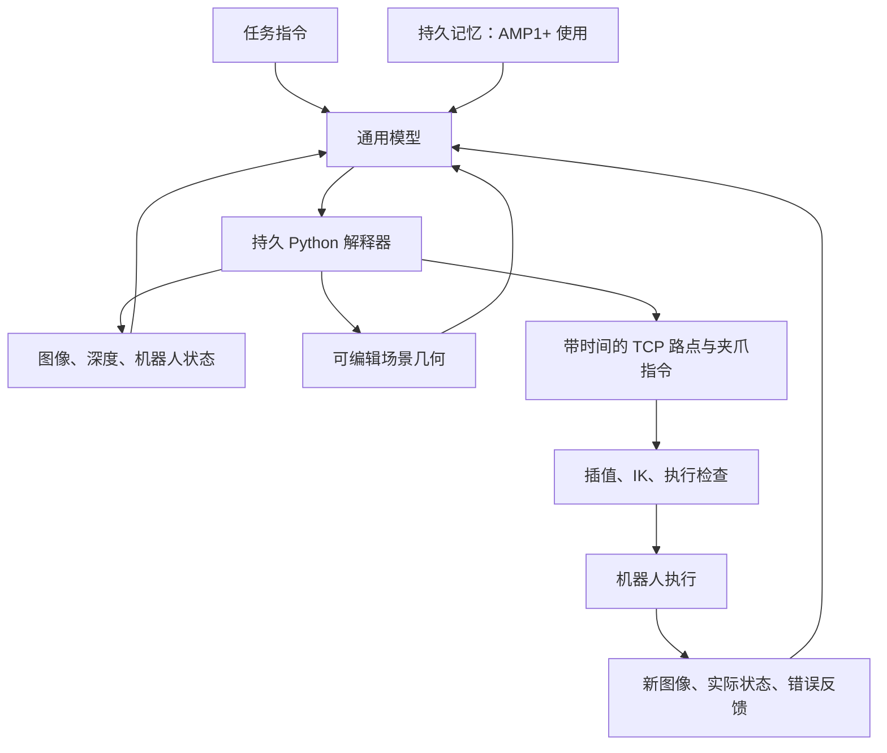

# On Agentic Manipulation Policies：让模型在操作过程中持续观察、写代码和改策略

这篇文章最值得关注的地方，是把机器人策略组织成一个持续运行的 Agent：**模型观察现场，写代码计算几何和生成轨迹，执行后再根据反馈修改下一步。** 操作能力由通用模型、执行接口和交互经验共同构成。

这样理解后，“通用模型直接控制机器人”就具体了：模型决定抓哪里、从什么方向接近、什么时候换办法；运动学求解器和机器人控制器负责把这些决定落实成关节运动。

论文：*On Agentic Manipulation Policies*，Chen Chen、Omid Bagherieh 等，Apple，arXiv:2611.09892，2026 年 11 月 6 日提交。

资料：[论文摘要](https://arxiv.org/abs/2611.09892) · [全文与附录](https://arxiv.org/html/2611.09892v1) · [官方项目页、演示及代码入口](https://apple-aiml-research.github.io/ml-amp/)。最后的实验建议属于个人分析。

## 1. 先把 AMP、AMP1 和 AMP1+ 分清楚

| 名称 | 含义 | 主要变化发生在哪里 |
| --- | --- | --- |
| AMP | Agentic Manipulation Policy，一类操作策略范式 | 通用模型持续参与操作决策 |
| AMP1 | 论文给出的参考实现 | 感知、场景表示、Python 执行、运动接口 |
| AMP1+ | 加入跨 episode 持久记忆的 AMP1 | 保存和更新经验、程序、参数 |

AMP1 没有提出一个新的机器人神经网络骨干。它把已有通用模型接入机器人，研究怎样的接口能让这些模型发挥空间理解、编程和错误诊断能力。

普通 AMP1 在一个 episode 内保留变量和代码，下一次任务重新开始。AMP1+ 则允许把有用内容保存下来，下一次直接读取。**本次任务中的闭环调整，与跨任务的经验学习，是两个不同层次。**

所谓 zero-shot，指的是没有为当前评测任务提供示范、专门训练或预先练习。通用模型自身当然已经经过预训练，系统也包含现成的运动学和感知基础设施。

## 2. 与 VLA、技能编排、离线代码生成的区别

可以把常见路线放在一张表里：

| 路线 | 谁决定具体动作 | 执行出问题后怎样改变策略 |
| --- | --- | --- |
| VLA | 学到的策略根据图像、指令、状态输出动作块 | 下一次策略前向重新输出动作 |
| LLM + 固定技能库 | LLM 选技能，技能负责内部操作 | 改调用顺序或参数，受技能接口限制 |
| 离线生成程序 | 模型先写程序，程序部署后执行 | 程序按预先写好的反馈逻辑调整 |
| AMP | 模型持续观察并生成、修改操作程序 | 新一轮模型调用可以重新判断原因、替换方法 |

VLA 也可以闭环，程序也可以包含反馈。因此 AMP 的特点不能简单说成“以前开环，现在闭环”。更具体的区别是：**执行过程中，通用模型仍然有机会重新解释现场，并修改控制程序和操作策略。**

例如，目标水果太宽，夹爪夹不住。固定 `pick()` 接口可能只允许换抓取点；AMP 可以编写一段新的运动，让水果先抵住另一个物体，再从下方托起。它改变了完成任务的接触方式。

从系统角度可以写成：

$$
u_k=G_\theta(h_k,\mathcal M),\qquad
(o_{k+1},f_{k+1})=\operatorname{Execute}(u_k),
$$

其中 $u_k$ 是本轮生成的程序，$h_k$ 是图像、状态、工具结果和历史代码形成的上下文，$f_{k+1}$ 是执行反馈。普通 AMP1 不使用跨 episode 的 $\mathcal M$；AMP1+ 才有持久记忆。这个式子是对交互过程的概括。

## 3. Harness 提供了哪些能力

Harness 可以理解为模型与机器人之间的执行环境。它决定模型能看到什么、能修改什么、能调用什么动作，以及错误如何返回。

### 感知：先拿到可计算的几何

基础接口提供 RGB、深度、相机参数和机器人状态。模型可以自己决定何时观察、从哪个视角观察，并使用点云和图像检查规划结果。

例如从像素 $(u,v)$ 得到三维点：

$$
p_{\rm cam}=dK^{-1}[u,v,1]^\top,
\qquad
p_{\rm base}=R_{\rm base,cam}p_{\rm cam}+t_{\rm base,cam}.
$$

这里的 $d$ 应与接口的深度定义一致；这个常用反投影式使用沿相机光轴的深度。相机坐标变换错误，会直接变成抓取位置错误。

因此，模型的空间推理有明确的数值依据：它可以测量尺寸、比较夹爪开口、判断目标是否超出工作空间，再决定动作。

### 场景模型：允许 Agent 修正感知结果

Harness 从点云构建对象，提供质心、包围盒、尺寸等信息，并跟踪对象。模型还可以通过 `segment()`、`define_object()` 等接口修正场景表示。

两块积木贴得太近，被分成一个对象时，后续抓取和碰撞检查都会受影响。允许 Agent 修正分割，意味着它可以在发现错误后修改用于行动的几何假设。

这个 Scene Model 主要描述当前场景。它与视频 WAM 里学习到的未来预测模型有不同职责：这里的显式几何用于测量和规划，并不自动给出接触后的动力学结果。

### 代码环境：保留中间计算

Python 解释器在 episode 内持续存在。之前导入的库、拟合的包围盒、写好的轨迹函数可以继续使用。

这让模型能够把一次复杂操作分解成多轮工作：先定位，再计算，再执行，再检查。程序出错也能通过 traceback 返回，让模型修改代码。

这些基础设施本身就是系统能力的一部分。讨论 AMP 的表现时，应同时说明底层模型和 Harness，而不能只报一个模型名字。[方法与接口](https://arxiv.org/html/2611.09892v1#S4)

## 4. “直接控制”的实际粒度：定时 TCP 轨迹

AMP1 的基础动作接口允许模型给出一组路点：

$$
w_i=(T_i,t_i,g_i),\qquad T_i\in SE(3),\quad g_i\in\{0,1\}.
$$

$T_i$ 是工具中心点 TCP 的目标位姿，$t_i$ 是到达时间，$g_i$ 是夹爪指令。模型需要决定抓取点、夹爪朝向、接近和抬升路径，以及每段运动的时间。

Harness 对位姿插值，再用阻尼最小二乘 IK 求关节目标：

$$
q_k=\operatorname{IK}(T(k\Delta t);q_{k-1}).
$$

以前一步关节位置作为初值，有助于保持解的连续性。不可达或数值求解不充分时，求解器仍可能返回一个近似解，因此系统还要检查末端误差和关节速度。

**基础 Harness 会拒绝不可达或过快的轨迹；碰撞检查则是 Agent 可主动调用的能力。** 不能把“存在碰撞检查函数”理解为每次执行都自动完成全面碰撞验证。碰撞几何还依赖感知完整性。

这也说明它保留了控制分层：模型处理策略和几何，IK 与控制器处理运动执行。通用模型没有以电机控制频率逐步输出力矩。

这个粒度比固定抓放技能灵活，同时也把更多责任交给了模型：TCP 坐标系、夹爪方向、运输高度和动作时间都需要正确处理。

## 5. 用“香蕉放进碗”理解一次完整交互

官方演示的一个 episode 使用八次模型调用。核心过程可以整理为：

1. 读取任务、图像和对象几何，找到香蕉与碗。
2. 用香蕉点云拟合几何，判断适合的夹爪方向。
3. 检查抓取位置：弯曲香蕉的质心可能位于空处，于是选取接近质心的表面点。
4. 预览轨迹，根据桌面碰撞等反馈调整高度。
5. 接近、闭合夹爪并抬起，结合图像和夹爪状态判断抓取结果。
6. 重新测量目标容器，计算运输和下降路径。
7. 放下物体，再观察是否满足任务。

这个例子体现了两种互补能力。数值代码负责几何计算，模型负责解释“这个计算结果为什么不能直接用”。质心计算完全正确，也不代表质心就是可抓的位置。

执行反馈又会改变后续动作：如果香蕉在夹爪中旋转了，运输高度需要按当前姿态调整。真正有价值的是观测、计算、动作之间持续相互修正。[官方交互演示](https://apple-aiml-research.github.io/ml-amp/)

## 6. “涌现技能”具体是什么

论文给出的案例主要说明模型能在执行时组合新的操作办法。

| 场景困难 | 模型采取的办法 | 可以怎样理解 |
| --- | --- | --- |
| 目标被遮挡 | 移开可能遮挡它的物体，再观察 | 通过动作获取信息 |
| 物体超出夹爪开口 | 利用环境约束，再从下方托起 | 借助外部接触扩大操作能力 |
| 目标在工作空间之外 | 用工具把目标移到可达区域 | 根据几何选择工具和作用方向 |
| 视觉位置与实际运动不一致 | 诊断并修正标定偏差 | 用执行反馈校正感知 |

这些案例支持“模型能现场构造策略”。它们尚不能单独证明某种操作具有跨物体、跨摩擦条件的稳定成功率。

论文在 1,200 个 RoboLab episode 中还统计了重复出现的程序或推理模式：61% 涉及沿物体轴向调整抓取，40% 涉及修复被拒绝的轨迹，39% 涉及诊断执行失败。这些是行为出现频率，不是相应技能的成功率。

这里的 emergence 也不意味着模型权重在现场发生了学习。普通 AMP1 可以每次重新写出相似程序；真正把程序保留到下一次，需要 AMP1+ 的记忆机制。[行为分析](https://arxiv.org/html/2611.09892v1#S2)

## 7. AMP1+：经验怎样进入下一次任务

记忆可以包含 Markdown 笔记、Python 函数、几何常数和失败经验。模型在后续 episode 开始时读取这些内容。

### Few-shot：同一任务上练习

一轮使用同一份记忆 $\mathcal M_k$，在四个不同布局上尝试。完成后，根据轨迹和二值成功反馈更新记忆：

$$
D_k=\{(\tau_{k,b},r_{k,b})\}_{b=1}^{4},
\qquad
\mathcal M_{k+1}=\operatorname{Reflect}(\mathcal M_k,D_{\leq k}).
$$

每次练习运行最多 48 个 episode，也就是最多 12 轮。最后固定记忆，在未见布局上评测。

参数保持不变：

$$
\theta_{k+1}=\theta_k,\qquad
\mathcal M_{k+1}\ne\mathcal M_k.
$$

它改变的是下一次模型可以读取的信息，以及可以直接调用的程序。

麻将案例很好理解：成功和失败看起来都完成了“竖起麻将”，但文字方向不同。反思过程从二值反馈和画面对比中发现这个差异，把正确方向写进记忆。下一轮就不必再次探索这个约束。

### 84.1% 的完整口径

这里有一个必须与成绩一起读的条件：**每个任务进行了五次独立练习运行，再通过验证集选择其中最好的一次。** 原文划分为 seed 0 收集经验、seed 1 选择运行、seed 2 最终评测。

因此，48 次是单次练习运行的上限；五次运行最多可消耗 240 次练习交互，还不包含验证评估。实际运行可以提前结束，不能把这个上限当成实际平均开销。

这属于有经验收集和验证选择的测试前适应，不能拿 84.1% 当作纯 zero-shot 成绩，也不能解释为“一次最多 48 次练习必然达到的水平”。[经验学习与评测协议](https://arxiv.org/html/2611.09892v1#S4)

### Continual learning：跨任务积累

另一组实验让 Agent 依次尝试 42 个任务，每个任务一次，共享一份记忆。最后成功率从 26.4% 提升到 57.6%。

这个结果回答的是另一个问题：先前任务中积累的坐标知识、通用抓放代码和错误处理经验，能否帮助之后的任务。

它比逐任务专门练习更接近持续部署，但现有结果仍对应有限的任务集合与顺序。要证明长期稳定学习，还需要检查不同顺序、任务冲突、记忆增长和旧技能退化。

## 8. 三组结果应当分开看

| 评测 | 方法与条件 | 成绩 | 主要说明什么 |
| --- | --- | ---: | --- |
| RoboLab-120 | AMP1 + Gemini 4 Argon，zero-shot | 85.6% | 通用模型配合几何和轨迹接口的能力 |
| 真实机器人 | AMP1，开启控制器错误恢复 | 104/108，96.3% | 所测真机任务上的系统可靠性 |
| RoboDojo | AMP1，zero-shot | 26.4% | 经验学习前的起点 |
| RoboDojo | AMP1+，逐任务练习及验证选优 | 84.1% | 任务经验和可复用代码的收益 |
| RoboDojo | AMP1+，跨任务单次遍历 | 57.6% | 共享经验的迁移效果 |

RoboLab 主结果对照中的 VLA、WAM 分别为 49.2% 和 42.9%。这些数字描述论文所测系统与当时列出的基线；模型、训练数据、输入和推理预算并未全部匹配。

真机对照为 $\pi_{0.5}$ 的 30/108 和 FLUX 3 Action 的 49/108，即约 27.8% 与 45.4%。它们与 AMP1 的差距很大，但主表中的控制器错误恢复权限不同。关闭 AMP1 的恢复功能后，成功率为 87.0%。

因此两条结论可以同时成立：AMP1 在这些测试中表现很强；96.3% 也是包含恢复机制在内的完整系统成绩。

RoboDojo 还采用五个类别先各自求平均、再对类别求平均的口径。复现时不能随意改成对全部 episode 直接取平均，否则任务类别数量不同会改变权重。[结果与评测方法](https://arxiv.org/html/2611.09892v1)

## 9. 最有意思的消融：技能接口越多，未必越好

论文比较了基础 Harness 和带辅助抓放例程的 Harness。辅助例程能生成抓取候选、规划运动，并在内部重试。

最强的四个模型接入这些例程后成绩下降，最大下降 7.5 个百分点；较弱模型则能够受益。

这里值得提炼的是：**接口的价值取决于它提供了多少执行能力，又隐藏了多少决策所需的信息。**

例如一个例程内部抓了三次，最后只返回“失败”。模型不知道第一次是位置偏了，第二次是夹爪滑了，还是第三次与桌面碰撞。它就很难根据现场情况改变方法。

不过，这个实验不能推出“高层 API 总是不如底层控制”。可以设计更透明的高层技能：报告中间观测、允许中途停止、暴露失败原因，并允许模型修改轨迹。这样的接口是否还能保留效率、同时改善强模型表现，是一个直接的后续问题。

另一个细节是，辅助 Harness 并未取消基础控制权限。成绩下降也可能涉及模型如何选择工具。因此“黑盒隐藏信息”是作者对结果的解释，尚不能当作唯一被隔离验证的原因。[接口消融](https://arxiv.org/html/2611.09892v1#S2)

## 10. RGB-only 的代价：用更多推理补几何

Opus 5.5 的感知消融如下：

| 输入 | 成功率 | 平均模型调用次数 |
| --- | ---: | ---: |
| RGB-D、标定、感知工具 | 82.8% | 34.8 |
| RGB 和标定，无深度 | 81.1% | 46.3 |
| RGB，无深度和标定 | 75.8% | 53.5 |
| 文本描述替代图像 | 36.8% | — |

模型可以通过多视角、主动移动和几何计算，补回部分缺失的信息。但是从 34.8 次调用增到 53.5 次，约增加 53.7%。这里统计的是调用次数，不能直接推导 token 费用也增加同样比例。

这组实验说明感知和推理存在一定替代关系。高质量深度、标定并没有失去价值：它们仍然节省探索、计算和等待时间。

文本描述的明显下降还说明，提前把图像压缩成语义文字，会丢失操作需要的局部形状、朝向和接触线索。对这类模型，让它自己决定哪些视觉细节重要可能更有效。[感知消融](https://arxiv.org/html/2611.09892v1#S2)

## 11. 闭环成功率高，距离实时操作还有多远

论文报告真机成功试验的平均时间约为：

$$
T_{\rm total}\approx69\text{ s}+211\text{ s}=280\text{ s}.
$$

前者是执行，后者是推理及相关处理。约四分之三的时间花在执行以外。该平均只统计成功试验，不能用来代表所有尝试的平均耗时。

真机五分钟限制只计执行时间；仿真在模型推理时暂停。因此这些结果主要说明：给模型足够思考机会后，它能否找到并执行有效操作。

它尚未充分回答：物体持续运动、抓取正在滑落、外部人手突然进入时，模型能否及时改变动作。论文也明确指出，模型不能在轨迹执行期间重新考虑当前轨迹。

可以把控制闭环分成三个时间尺度：

| 时间尺度 | 主要职责 | AMP1 的现状 |
| --- | --- | --- |
| 电机与关节控制 | 跟踪位置、维持底层控制 | 由机器人控制系统承担 |
| 轨迹执行 | 跟随一段 TCP 路径 | Harness 转换并执行 |
| 策略决策 | 观察、解释异常、重新写程序 | 通用模型多轮调用，延迟较高 |

一个可研究的方向是让快速局部控制器处理滑移、碰撞或跟踪偏差，再通知慢速 Agent。这里需要定义触发条件、抢占权限和状态同步，不能仅靠“两个模块并行运行”解决。

## 12. 和 Metatron、Recova、LaST0.5 怎样联系起来

这几篇文章都涉及高层决策和动作执行，但改变系统的环节不同。

| 工作 | 主要设计位置 | 与 AMP1 的关系 |
| --- | --- | --- |
| [Metatron](Metatron.md) | 稀疏目标到全身动作的通用控制器 | 说明执行接口可以由学习到的控制器承接 |
| [Recova](Recova.md) | 失败诊断、恢复技能及后续学习 | 更关注进入异常状态后怎样恢复 |
| [LaST0.5](LaST0.5.md) | 世界预测、交互 latent 和动作生成 | 更关注通过训练建立世界到动作的映射 |
| AMP1 / AMP1+ | 在线生成操作程序、反馈推理、外部记忆 | 更关注测试时怎样组织推理与交互 |

这个比较依据相关笔记，用于理解研究方向，不是统一协议下的性能排名。

AMP1 可以现场构造新接触策略，但缺少快速接触响应；学到的策略可以响应得快，但可能难以解释陌生失败。两者结合的关键，是定义足够清晰的中间接口，让慢速 Agent 能指导和诊断，让快速控制器能执行和报告异常。

对灵巧手而言，TCP 路点加二值夹爪也不够。还需要表达手指接触、协同姿态、力或柔顺性目标。AMP1 展示的平行夹爪能力，为 Agent 操作提供了证据；多指手内操作仍需要新的执行抽象和实验。

## 13. 对 RUA / Dex-RUA 最值得补的实验

以下是基于论文的研究建议。

**把接口权限写清楚。** 分别记录 RGB、深度、标定、点云、对象表示、IK、碰撞检查、任务反馈和错误恢复。几何工具可以是合理的通用执行基础设施；是否违反某项 benchmark 规则，需要对照其官方协议，不能仅凭工具名字判断。

**把经验来源与最终测试分开。** 记录在哪些任务和布局上练习、是否拿到成功标签、是否进行了验证选优、最终记忆何时冻结。测试时调用已有技能与测试后继续改技能，应作为不同设置报告。

**比较相同预算下的收益。** 同时报告成功率、真实墙钟时间、物理动作步数、模型调用和 token 费用。尤其要把练习、反思、验证选择和最终测试分别计费。

**专门测不允许暂停的交互。** 使用持续移动目标、突发遮挡或滑移等条件，观察异常出现后多久能改变控制，以及这段延迟造成什么后果。

**拆开记忆中的有效成分。** 分别保留文字经验、可执行代码、几何常数，再比较其作用。进一步加入错误记忆和旧版本技能，检查 Agent 能否发现并修正失效假设。

我认为这篇论文提出的核心问题是：**当通用模型已经能够推理和编程，机器人系统应该向它暴露多少几何信息、操作权限和执行反馈，才能把这些能力转化为可靠动作？** AMP1 给出了一个很强的实例；AMP1+ 则表明，交互经验可以通过笔记和程序影响后续行为。下一步最有价值的是把这种灵活性与低延迟执行结合，并在统一权限、时间和经验预算下验证。
