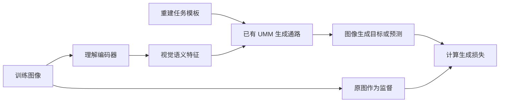

# RecA：让模型更好地生成自己已经能够理解的视觉内容

一个模型可以看图回答“这是一颗黄色西兰花”，但让它画黄色西兰花时，它仍然可能画成绿色。识别了对象、属性和位置关系，并不意味着生成时能把这些信息准确落实到图像中。

**Reconstruction Alignment（RecA）的做法是，把图像经过理解编码器得到的视觉特征作为生成条件，再让模型重建这张图。它希望通过这项自监督任务，改善已有语义表征到图像输出之间的映射。**

论文：**Reconstruction Alignment Improves Unified Multimodal Models**，Ji Xie、Trevor Darrell、Luke Zettlemoyer、XuDong Wang，UC Berkeley、University of Washington、Duke University，ICLR 2026。[论文 v4](https://arxiv.org/html/2509.07295v4)｜[项目主页](https://reconstruction-alignment.github.io/)｜[代码](https://github.com/HorizonWind2004/reconstruction-alignment)｜[作者中文复现指南](https://github.com/HorizonWind2004/reconstruction-alignment/blob/main/REPRODUCE_GUIDE_CN.md)

实验数值以这一版本为准；对视频世界模型和 VLA 的连接是后续研究思考。

## 1. 先分清 UMM 和 RecA

UMM 是 Unified Multimodal Model，指把多模态理解与生成放进统一框架的模型。以图像为例，它可以同时支持：

| 任务 | 输入 | 输出 |
| --- | --- | --- |
| 图像理解 | 图片和问题 | 文字回答 |
| 文本生成图像 | 文本描述 | 图片 |
| 图像编辑 | 原图和编辑指令 | 修改后的图片 |

“统一”不要求所有任务共用同一个 tokenizer、编码器或输出头。不同 UMM 可以共享主要参数，也可以让理解与生成使用相对独立的模块。

**UMM 是模型范式，RecA 是用于这类模型的后训练方法。** RecA 沿用模型已有的理解与生成通路，不要求重新发明一个图像生成架构。

UMM 也不等于 VLA。VLA 通常从视觉、语言等条件输出机器人动作；这里讨论的 UMM 主要理解和生成多模态内容。它们可以组合，但模型输出、训练目标与评估任务不同。

## 2. 为什么“看懂”与“画对”之间还有差距

传统图文训练用 caption 描述图像，再让模型学习根据文字生成图片。但 caption 经常省略信息：物体颜色、具体数量、相对位置、细节形状和背景布局，不一定都被写出来。

例如训练文字只说“一颗西兰花”，图中恰好通常是绿色，模型就可能过度依赖常见搭配。遇到“黄色西兰花”时，即便理解路径能够识别这种组合，生成路径仍可能倾向默认外观。

作者的想法是：视觉理解编码器已经能提取很多 caption 没有表达的内容，能否直接拿这些特征作为更丰富的生成条件？

这里需要区分两件事：

- **条件提供了多少信息**：视觉特征有机会保留文字省略的细节。
- **模型能否利用这些信息**：把特征送进生成器，并不保证生成器已经学会解读它们。

RecA 主要训练第二件事。它不声称视觉编码器保存了原图的所有信息，也没有证明 caption 稀疏是理解—生成差距的唯一原因。[动机与方法](https://arxiv.org/html/2509.07295v4#S2)

## 3. 方法很直接：用视觉语义作为条件重建原图

设原图为 \(x\)，理解编码器为 \(E_v\)，重建任务模板为 \(t_{\mathrm{template}}\)。首先计算：

\[
h_v=E_v(x),
\qquad
c=\operatorname{concat}(t_{\mathrm{template}},h_v).
\]

然后用已有生成通路根据 \(c\) 重建原图：

\[
\mathcal L_{\mathrm{RecA}}
=\mathcal L_{\mathrm{gen}}\bigl(G_\theta(c),x\bigr).
\]

这是任务层面的抽象，省略了扩散噪声、图像 latent 或离散 token 等模型内部细节。损失使用该模型原有的生成训练目标。

训练中，原图同时提供条件来源与监督目标。这属于自监督重建的任务设计。要验证迁移收益，测试时则回到原本的接口：T2I 只提供文本，图像编辑提供源图和编辑指令，不额外提供目标图的视觉 embedding。

所以，训练中的重建成功只能说明模型能够利用视觉条件；真正重要的结果，是没有目标图特征时，文本生成与编辑是否也改善。

## 4. 图像条件训练为什么可能改善文本条件生成

RecA 建立在已经预训练的 UMM 上。该模型原本就具有一定的图文语义对应关系，视觉条件和文本条件经过模型后，会使用部分共享的表示与生成参数。

如果视觉特征比 caption 更充分地表达了对象属性与布局，重建训练就可能迫使生成通路更准确地利用这些语义。随后，文本条件调用相同的生成能力，也可能受益。

可以将两项任务写成：

\[
p_\theta(x\mid E_v(x))
\quad\longrightarrow\quad
p_\theta(x\mid t).
\]

这里的箭头表示希望发生的能力迁移，不是两个分布相等，也不是必然成立的数学推论。

迁移至少依赖三个条件：理解特征保留了有用语义，模型能够将其接入生成通路，训练更新又没有破坏文本条件原本使用的表示。

论文用深层特征可视化，以及重建失败与文本生成失败的对应例子来支持这种解释。但 PCA 接近、失败案例相关，都不足以单独证明严格的因果机制。[机制分析，Appendix D](https://arxiv.org/html/2509.07295v4#A4)

更准确的理解是：**实验表明这项训练任务可以迁移，语义映射改善是作者提出并用分析支持的解释。**

## 5. 关键不是重建得越像越好，而是学到可迁移的条件映射

如果输入与输出是高度一致的图像 token，模型可能直接复制它们。重建损失迅速下降，并不意味着它更会根据文字生成。

作者因此强调语义信息瓶颈：让条件保留对象、属性和布局等信息，同时减少对输出像素或 token 的直接复制通路。

一种实现方式是降低理解编码器的输入分辨率。例如 BAGEL 可以用 224×224 的条件图像特征，重建更高分辨率的目标图像。

论文 Table 7 的 BAGEL 对比如下。GenEval 统一按百分数展示：

| 重建条件 | 条件分辨率 | GenEval | DPG-Bench |
| --- | --- | ---: | ---: |
| 原始模型 | — | 78.8 | 84.03 |
| VAE 生成编码特征 | 256×256 | 78.5 | 83.92 |
| ViT 理解特征 | 224×224 | 82.4 | 85.29 |
| ViT 理解特征 | 512×512 | 79.2 | 84.61 |

这组实验支持：在这个模型与设置下，低分辨率理解特征比另外两种条件更有利于文本生成迁移。[编码器与分辨率消融](https://arxiv.org/html/2509.07295v4#S3.SS5)

它不说明高分辨率特征总是不好，也不说明 VAE 条件在所有指标上都无效。原表中 VAE 条件的部分编辑指标仍有提升，说明不同目标可能受益于不同信息。

“降低分辨率”也要有下限。过度压缩会丢掉对象与布局信息，或让输入偏离模型熟悉的分布。复现时要检查条件与目标之间到底有什么瓶颈，而不是机械地把所有模型都缩到 224×224。

作者指南还提供 360 种重建模板。模板多样性对不同模型的影响不同，它是减少指令形式过拟合的实现选择，不能视为全部架构上固定幅度的收益。[复现指南](https://github.com/HorizonWind2004/reconstruction-alignment/blob/main/REPRODUCE_GUIDE_CN.md)

## 6. Caption-free 的准确范围

RecA 重建目标不需要每张图片的 caption，但完整后训练配方还要考虑理解能力是否被遗忘。

论文将总目标写成：

\[
\mathcal L_{\mathrm{total}}
=\lambda_R\mathcal L_{\mathrm{RecA}}
+\lambda_U\mathcal L_{\mathrm{I2T}}
+\lambda_G\mathcal L_{\mathrm{T2I}}.
\]

RecA 阶段设 \(\lambda_R=1\)、\(\lambda_G=0\)，再根据架构决定是否保留 I2T：

| 架构情况 | 理解侧处理 | RecA 阶段目标 |
| --- | --- | --- |
| 理解与生成共享参数，如 Show-o、Harmon | 保留图像到文字的训练来维持理解能力 | 重建 + I2T，\(\lambda_U=1\) |
| 理解与生成可以解耦，如 OpenUni、BAGEL | 冻结理解组件，更新生成相关参数 | 重建，\(\lambda_U=0\) |

这里的 I2T 可以包含视觉问答等理解任务，不必等同于为重建图片再写一条 caption。[训练目标](https://arxiv.org/html/2509.07295v4#S2.SS2)

冻结一个视觉编码器，也不一定冻结了完整理解能力。如果理解与生成仍共享后面的 Transformer，生成训练就可能改变理解路径使用的参数，因此仍需要检查共享模块和保留训练的作用。

同样，\(\lambda_G=0\) 描述的是 RecA 后训练阶段。基础模型早先的图文训练，以及某些实验额外进行的 SFT，不会因此变成“完全没有文本监督”。

## 7. 重建损失沿用原模型的生成目标

RecA 改变了条件信号与训练任务，不要求所有架构使用同一种像素误差。

例如，对噪声预测扩散模型，目标图像先编码为 \(z_0\)，再加噪：

\[
z_t=\sqrt{\bar\alpha_t}\,z_0
+\sqrt{1-\bar\alpha_t}\,\epsilon.
\]

以视觉特征和模板组成的 \(c\) 为条件，可以使用：

\[
\mathcal L_{\mathrm{RecA}}
=\mathbb E_{x,t,\epsilon}
\left[\|\epsilon-\epsilon_\theta(z_t,t,c)\|_2^2\right].
\]

这只是噪声预测参数化下的示例。Flow Matching 模型继续学习速度场，离散生成模型可继续使用 token 交叉熵。

训练也不一定每一步都完整生成图片，再计算输出图片的逐像素误差。理解这一点，才能看清方法为什么能接入不同的生成架构。

## 8. 实验数字分开看：模型、配方和预算各有范围

论文主要评估 Show-o、Harmon、OpenUni、BAGEL。下面列出与附件对应的关键结果：[项目实验汇总](https://reconstruction-alignment.github.io/#results)

| 模型与配方 | 指标 | 基线 → 后训练 |
| --- | --- | --- |
| Harmon-1.5B + RecA，不使用 GPT-4o-Image 蒸馏数据 | GenEval | 0.73 → 0.86 |
| 同上 | DPG-Bench | 80.93 → 87.21 |
| BAGEL + RecA | ImgEdit overall | 3.38 → 3.75 |
| 同上 | GEdit-Bench-EN overall | 6.94 → 7.27 |
| Harmon，额外蒸馏数据 SFT 后再 RecA | GenEval / DPG-Bench | 最终 0.90 / 88.15 |

最后一行是不同的训练配方，不能归为仅增加无 caption 重建所取得的结果。GEdit 的早期材料有 7.25，本笔记采用论文 v4 和当前项目页的 7.27。

### 8.1 27 GPU-hours 对应 BAGEL

项目页明确将 27 A100 GPU-hours 对应到 BAGEL：6 张 A100、4.5 小时，使用 10,000 张无标注图片、训练 1,000 步。

因此，不应把摘要并列出现的预算与 Harmon 最高分拼成“27 GPU-hours 就把 Harmon 提升到 0.90”。比较成本时，还要区分本次后训练与基础模型早先预训练的投入。[作者对实验范围的说明](https://reconstruction-alignment.github.io/paper.html)

### 8.2 哪些能力改善得更明显

Harmon-1.5B 的 GenEval 子任务结果为：

| 子任务 | 基线 | RecA | 提升 |
| --- | ---: | ---: | ---: |
| Position | 44.9 | 75.7 | 30.8 个百分点 |
| Color Attribution | 51.1 | 76.6 | 25.5 个百分点 |
| Counting | 68.7 | 71.4 | 2.7 个百分点 |

这组结果更支持空间关系与属性绑定改善。计数收益较小，说明更好的语义重建没有自动解决所有组合生成问题。[Table 2](https://arxiv.org/html/2509.07295v4#S3)

### 8.3 理解能力主要是保持，而非全面增强

论文 Table 4 中，Harmon 的 MME 从 1195 到 1223，GQA 则从 58.8 到 58.4，其他指标也有小幅升降。它们不支持“所有理解能力一起提升”的结论。RecA 的主要证据集中在生成和编辑。

还要考虑评估口径：生成一致性基准、视觉问答和编辑评分衡量的能力不同。某个基准超过更大模型，不能直接转化为整体能力排名。

## 9. 和 REPA、Autoencoder 到底差在哪里

| 方法 | 训练时要求什么 | 主要关注的映射 |
| --- | --- | --- |
| Autoencoder | 从编码重建输入 | 输入 → 压缩表示 → 输入 |
| REPA | 生成网络的中间特征接近预训练视觉表征 | 生成侧隐藏状态 → 外部语义特征 |
| RecA | 根据模型已有的理解特征生成原图 | 理解特征 → 图像输出，并迁移到原有生成任务 |

REPA 可以概念性表示为：

\[
\mathcal L_{\mathrm{align}}
=d\bigl(P(h_{\mathrm{denoiser}}),E_{\mathrm{teacher}}(x)\bigr),
\]

其中 \(P\) 为投影，\(d\) 为表示对齐目标。这是通用示意，不把具体实现限定成像素 MSE。REPA 利用外部视觉编码器指导生成网络的内部表示。[REPA 原论文](https://arxiv.org/abs/2410.06940)

RecA 则把视觉特征作为输入条件，用原本的生成目标训练输出。它不需要为这个任务额外设计一套表示匹配投影头。

RecA 与 autoencoder 确实共享重建结构，差别主要在用途与评估：RecA 使用已有 UMM 的语义接口做后训练，并以文本生成、编辑等原有任务是否获益来判断成功。只把输入重建得很好，还不足以完成它的目标。

## 10. 哪些情况可能无效，甚至退化

**输入条件可以直接复制。** 同构、高保真的输入输出 token 可能形成捷径。此时重建损失很好看，语义到图像的映射却没有获得有效训练。

**共享理解能力被破坏。** 如果生成更新改变了理解路径，却没有对应的冻结或保留训练，原本可以被生成器利用的语义接口也会漂移。

**训练图像与基座分布不合适。** 不需要 caption，不代表任意图像集合都同样适用。图像质量、内容分布和基座原本的训练范围仍然影响后训练。

**基座已经具备很强的重建能力。** 论文报告，BLIP-3o 上额外 RecA 没有带来预期收益，重建还出现退化。作者将其与已有重建训练联系起来，但这一解释仍属于机制推断。[局限，Appendix G](https://arxiv.org/html/2509.07295v4#A7)

**基准分布与训练数据重叠。** 论文专门分析了部分蒸馏数据与 GenEval 模板的重合。因此，判断迁移能力时，应看清洗后的数据、其他基准以及训练配方，不能只比较一个最高分。[模板重合分析](https://arxiv.org/html/2509.07295v4#A6.SS1)

这些边界也说明，“让模型画出已经理解的概念”是方法动机，不是已经证明内部知识完全不变、只提高利用效率。实际参数更新可能同时改变表示与解码行为，需要更细的实验来区分。

## 11. 对视频世界模型和 VLA 的启发

以下是研究建议，原论文没有验证机器人控制或视频 rollout 的收益。

### 11.1 重建状态与预测状态转移要分开

RecA 主要学习当前图像的语义到图像映射。视频世界模型还需要根据动作预测未来：

\[
\hat o_{t+1:t+H}
=G_\theta\bigl(E_v(o_{\leq t}),a_{t:t+H-1}\bigr).
\]

历史特征告诉模型当前发生了什么，动作条件告诉它接下来施加什么干预。仅凭静态重建，没有足够监督来学习碰撞、摩擦或运动响应。

一种可测的组合是：保留动作条件未来预测，再增加当前状态的语义重建辅助目标。重建负责改善状态信息向视觉输出的表达，未来预测负责学习转移。

特别要防止把未来目标帧的理解特征送进本应预测未来的条件通路。它可以作为独立训练任务或监督，但如果未来信息在部署时不可获得，不能混入动力学预测的输入。

### 11.2 信息瓶颈应当保留任务需要的细节

图像生成中的低分辨率瓶颈可能帮助去除复制捷径；机器人任务却可能依赖细小孔位、物体边缘和微弱接触变化。直接照搬压缩强度，可能损伤控制需要的精度。

因此，应该同时测试对象身份、空间关系与精细几何，而不只看重建视觉上是否自然。与 [WAM 训练参考：VPP2](WAM训练参考VPP2.md) 的讨论相连，视频质量还必须服务于指令和动作目标。

### 11.3 用对照实验验证真正的控制价值

可以在相同视频数据与训练预算下比较：仅未来预测、加入高保真重建、加入带瓶颈的语义重建。

评估分为三个层次：

- **表征与图像层**：对象身份、颜色绑定、相对位置是否更稳定。
- **动态层**：不同动作是否产生正确的未来差异，多步误差是否减少。
- **控制层**：规划选择和实际任务成功率是否改善，精细操作是否受损。

只有第一层提高，说明视觉表达更好；要声称世界模型或 VLA 更有效，还需要后两层证据。

RecA 最值得借鉴的研究思路，是把已有理解表征变成一种低标注成本的后训练条件，再检验它能否改善其他生成任务。关键在于条件设计、信息瓶颈和能力保持，而不只是多加一个 reconstruction loss。
