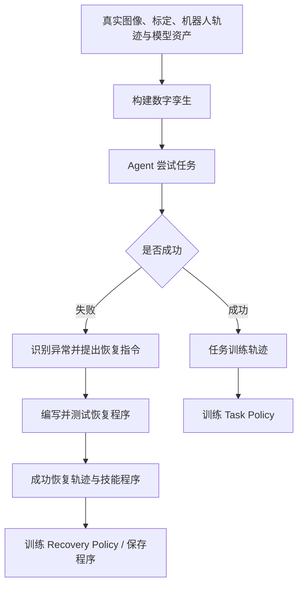

# Recova：让机器人把失败变成可复用的恢复技能

Recova 最值得关注的是这条学习流程：**机器人先暴露失败，Agent 决定怎样恢复，成功的恢复过程再成为技能或训练数据，让下一轮机器人少依赖一次人工接管。**

例如，套环任务中，一个圆环斜着卡在柱子顶部。任务策略可能继续尝试放下一个圆环，但真正需要的动作是先处理卡住的圆环。这个动作可能暂时偏离原任务，却是继续完成任务的前提。Recova 将这种能力单独组织成 Recovery Skill，再把它接到任务执行与数据收集流程里。

论文：*Recova: Agent-Guided Failure Recovery for Autonomous Robotic Manipulation*，Isabella Liu 等，NVIDIA、UC San Diego、UT Austin，2026 年 10 月 1 日提交。

资料：[论文摘要](https://arxiv.org/abs/2610.01178) · [论文全文](https://arxiv.org/html/2610.01178v1) · [项目与演示](https://www.liuisabella.com/Recova/)。下面的研究建议单独标出。

## 1. 为什么已经会做任务的机器人，还需要恢复策略

模仿学习通常让机器人学习正常示范中的动作：抓住物体、移动到目标位置、放下，再执行下一步。训练数据中的状态大多位于成功轨迹附近。

部署时，一个小错误就可能把机器人带到训练数据很少覆盖的位置：物体掉到桌边，圆环卡住，麻将牌倒下，铅笔横在盒口。此时继续执行原动作，可能重复失败，甚至让场景更难处理。

用一个概念性的表达：

$$
(o_t,a_t)\sim d_{\mathrm{demo}},\qquad
o'_t\sim d_{\mathrm{failure}}.
$$

任务策略在 $d_{\mathrm{demo}}$ 上表现好，不代表在 $d_{\mathrm{failure}}$ 上也有合适的动作。更麻烦的是，恢复有时需要撤销已有进度：先取下放错的圆环，再重新堆叠；先把抽出来的牌放回去，再调整抓取。

因此，恢复需要回答一个不同的问题：**当前哪个异常阻止了任务继续？先改变什么，任务策略才有机会重新成功？**

这里有三个层次：发现失败、知道恢复目标、实际执行恢复。VLM 能说出“圆环卡住了”，只完成了第一层；能提出“向下推”，也还需要可执行、能处理接触的控制器。

## 2. 系统怎样分工：Agent 管流程，两个 Policy 管动作

Recova 区分任务指令 $g$ 与恢复指令 $z$：

$$
a_t\sim\pi_\theta(\cdot\mid o_t,g),
$$

$$
a_t\sim\rho_\phi(\cdot\mid o_t,z).
$$

其中 $o_t$ 包含视觉观测和机器人状态。任务策略 $\pi_\theta$ 负责完成原目标；恢复策略 $\rho_\phi$ 负责处理当前异常。

| 模块 | 接收什么 | 负责什么 |
| --- | --- | --- |
| Task Policy | 当前观测与任务指令 $g$ | 执行正常任务 |
| Recovery Policy | 当前观测与恢复指令 $z$ | 扶正、重抓、解除卡住等纠正动作 |
| Coding Agent | 场景、执行反馈与工具 | 在仿真中开发、测试恢复程序 |
| VLM Monitor | 多视角图像、任务条件与历史信息 | 检查完成、判断介入、选择恢复、验证结果 |
| 人类操作员 | 无法自主完成的任务或恢复请求 | 提供任务示范或恢复示范 |
| 数据与训练流程 | 分好类型的执行轨迹 | 分轮更新对应策略 |

为什么恢复要用单独的指令？因为“把倒下的物体扶正”可以服务于多种后续任务。恢复技能更适合按异常及纠正目标组织，而不是每次都与完整任务绑定。

这个接口有跨任务复用的潜力，但语言指令相同，并不保证接触几何和动作分布也相同。扶正一张麻将牌与扶正一个杯子，仍需要不同的物理能力和适用条件。

## 3. 从真实场景到数字孪生：Agent 在哪里学会恢复

Recova 的前期探索放在 MuJoCo 数字孪生里。真实相机观测、标定和机器人轨迹帮助建立对应场景；已有机器人与物体模型提供几何资产，Agent 调整物体位姿和接触参数，使轨迹重放尽量对应真实观察。

这个过程主要解决“能否在仿真里重现这个工作台上的操作”。模型资产、可辨识的接触参数和仿真工具都属于它依赖的基础设施。

接下来，Agent 在仿真中尝试任务。成功尝试提供任务轨迹；失败则触发诊断与恢复开发：

同一次成功恢复可以留下两种成果：

- **程序**：把场景查询和运动原语组合起来，以后按条件调用。
- **动作轨迹**：记录观测、恢复指令和动作，用于训练视觉运动策略。

程序便于表达顺序、条件和几何规则；策略可以从示范中学习连续动作。论文框架容纳两种执行方式，但实验配置要分开理解：**仿真 benchmark 使用恢复程序，真机实验的自主恢复由学习到的 Recovery Policy 执行。** [方法 §3 与实验 §4](https://arxiv.org/html/2610.01178v1#S3)

## 4. Recovery 不只意味着“回到原位”

论文将恢复分为三类，同一个技能可以承担多种作用：

| 类型 | 目的 | 直观例子 |
| --- | --- | --- |
| Restorative | 恢复可工作状态 | 扶正倒下的物体 |
| Enabling | 创造后续操作条件 | 把物体移到可达位置 |
| Adaptive | 改变失败的操作方式 | 换抓取姿态或换操作方向 |

这三类共同说明：恢复关注的是继续执行的条件。把全部物体精确复位，只是其中一种可能。

真机 Restoration Query 以初始图像作为参照，但原文明确允许等价、可继续操作的布局，不要求物体位置和朝向完全相同。附件里“相对偏向 Scene Restoration”的判断可以保留，但不能理解成严格还原初始像素或位姿。

另一个区别是，恢复本身也可能直接完成剩余任务。比如把卡住的最后一个圆环推到底，恢复完成时任务也完成了。评测时应说明成功究竟来自任务策略继续执行，还是纠正动作直接解决了目标。

## 5. 真机如何决定什么时候停、什么时候恢复

Monitor 使用四类查询，各自回答一个明确问题：

| 查询 | 核心问题 | 对应决策 |
| --- | --- | --- |
| Requirement | 这次任务怎样才算完成？ | 生成完成条件 $C_g$ |
| Completion | 当前是否满足 $C_g$？ | 结束并保存成功轨迹 |
| Intervention | 是否卡住或破坏了场景？ | 决定是否介入并给出 $z$ |
| Restoration | 恢复后能否重新尝试任务？ | 接受恢复或请求人工接管 |

真机分支可以概括为：

1. Task Policy 执行，Monitor 周期性检查。
2. 若任务完成，保存成功轨迹。
3. 若任务停滞、场景仍完整，收集人工任务示范。
4. 若场景需要纠正，检查是否有已训练的对应恢复技能。
5. 有技能则尝试自主恢复并验证；没有技能或恢复失败，则收集人工恢复示范。
6. 恢复确认后，机器人回到 Home Pose，启动新的 Task Policy attempt。

因此，“继续任务”在真机实现中主要指恢复后的新一轮尝试，尚不能视为在任意 action chunk 中断位置精确续接。

### 已知技能和可自主执行技能，也有区别

Agent 能提出一个恢复指令，不代表 Recovery Policy 已经学会它。原文区分已知恢复指令集合与训练完成的技能注册表，后者决定真机是否允许自主调用。

如果这次失败需要新行为，人工示范提供初始数据；经过后续训练、登记，才成为可调用能力。这个区别很重要：**命名一个技能、保存一段程序和得到可靠执行能力，是不同阶段。**

### Monitor 与控制器工作在不同时间尺度

附件中的参数与原文一致：

| 项目 | 设置或报告值 |
| --- | --- |
| 机器人控制频率 | 30 Hz |
| Intervention 检查间隔 | 10 秒 |
| Completion 检查间隔 | 20 秒 |
| 单次自主恢复预算 | 50 秒，按控制步数计 |
| Intervention 查询中位延迟 | 约 4.5 秒 |
| Monitor | Gemini 3.8 Flash，读取四路相机 |
| Intervention 执行方式 | 异步，任务策略可继续执行 |
| Completion / Restoration | 检查时机器人暂停 |

这些设置适合处理已经形成的卡住、掉落和布局异常。30 Hz 是机器人控制频率，并不意味着 VLM 每 1/30 秒作一次判断。恢复步数预算也不能直接当作包含全部模型查询的墙钟时间。

对动态接触而言，10 秒级的检查与数秒推理已经很慢。可把它理解成高层纠错管理器；滑移与快速接触失稳仍需要更快的局部反馈。[附录 A–C](https://arxiv.org/html/2610.01178v1#A1)

## 6. DAgger 如何让下一轮少失败一次

Recova 采用分轮的数据聚合与监督微调。每轮执行期间，两个策略的权重保持固定；收集结束后再训练。

每轮 $k$ 的数据有四类：

| 集合 | 来源 | 训练对象 |
| --- | --- | --- |
| $\mathcal S_k$ | 自主完成的任务轨迹 | Task Policy |
| $\mathcal E_k$ | 人工任务示范 | Task Policy |
| $\mathcal R_k$ | 人工恢复示范 | Recovery Policy |
| $\mathcal A_k$ | 通过验证的自主恢复轨迹 | Recovery Policy |

数据更新为：

$$
\mathcal D_{\mathrm{task}}^{k+1}
=\mathcal D_{\mathrm{task}}^k\cup\mathcal S_k\cup\mathcal E_k,
$$

$$
\mathcal D_{\mathrm{rec}}^{k+1}
=\mathcal D_{\mathrm{rec}}^k\cup\mathcal R_k\cup\mathcal A_k.
$$

这里用 DAgger-style 更准确：它利用当前策略实际访问到的状态收集纠正行为，并聚合数据，而非只依赖训练前固定的一批专家示范。成功自主轨迹也会进入数据集。

举一个完整过程：第一次把牌碰倒，Agent 没有可用恢复能力，人工演示如何扶正；该轨迹以恢复指令为标签保存。训练后，下一轮遇到类似情况，Recovery Policy 自己扶正；通过验证的自主恢复又能补充训练数据。

“从失败学习”的有效监督主要是**失败之后怎样做对**。原文说明失败片段保留在日志中，排除在示范训练数据之外。这有别于给所有失败动作附一个负 reward 再做 RL。

将任务与恢复数据分开也有实际作用：同一个视觉状态下，“继续完成任务”与“先撤销错误”可能要求不同动作，明确的指令和数据归属有助于避免把两种目标混在一起。

但这种设计也留下一个研究问题：同等数据与容量下，独立策略是否优于一个同时学习任务和恢复的统一策略？展示系统有效，尚不足以独立证明策略拆分始终最优。

## 7. 实验结果怎么读：先拆开训练收益和部署收益

### 真机：平均 23.8% → 77.5% → 87.5%

真机采用双臂 YAM 平台，Task/Recovery Policies 基于 $\pi_{0.5}$ 微调。四项任务为铅笔盒整理装配、按大小套环、麻将摸牌和麻将弃牌。每项任务、每种配置测试 20 次。

| 配置 | 四项任务平均成功率 | 与上一配置相比 |
| --- | ---: | ---: |
| Base task policy | 23.8% | — |
| 加入 DAgger 微调 | 77.5% | 约 +53.7 个百分点 |
| 再启用恢复技能 | 87.5% | +10.0 个百分点 |

最关键的解释是：**大部分提升来自迭代收集数据后的策略改善；恢复机制在此基础上进一步提高成功率。** 不能把 23.8% 到 87.5% 的全部增幅归给部署时的 Recovery 调用。

这里也应把论文中的 Base task policy 保留为实验基线名称，避免直接等同于未经任何任务适配的通用 $\pi_{0.5}$。

由于每项只有 20 次试验，单任务 5 个百分点对应一次成功。平均结果有价值，但还需要更大规模和多次训练重复，才能分析稳定性与置信区间。论文真机最终试验由操作员按任务条件判定，和在线 VLM 的自动完成判定要区分。[真机实验 §4.2 与附录 C.4](https://arxiv.org/html/2610.01178v1#S4.SS2)

### 仿真：测试的是 MolmoAct2 与恢复程序的组合

| Benchmark | Recova | 表中平均最强基线 | 平均差值 |
| --- | ---: | ---: | ---: |
| LIBERO-Pro，六种设置 | 78.8% | ASPIRE：71.7% | +7.1 个百分点 |
| MolmoSpaces，四类任务 | 64.9% | RATs：38.0% | +26.9 个百分点 |

这两组实验使用 MolmoAct2 Task Policy 加 Agent 开发的 Recovery Programs。真机则用学习到的恢复策略。两者一起支持恢复框架的价值，但并非同一个完整实现从仿真原样搬到真机。

基线行引用既有论文结果，也需要与统一底座、统一预算下的控制变量实验区别开。尤其当 Recovery 可以增加执行步骤时，最终成功率还应配合总动作数、执行时间与 Agent 成本理解。[仿真实验 §4.1](https://arxiv.org/html/2610.01178v1#S4.SS1)

### 人工介入从 87.5% 到 0%，说明了多大范围

论文在麻将摸牌任务的四轮收集中观察到，人工介入比例从 87.5% 降至 0%。每轮只有约 7–8 个 episode，体现的是有限任务、有限采样下的自主性改善。

这个结果支持“相似失败可以通过数据回流逐步减少人工处理”。它尚不足以说明面对新物体、新布局或未见异常，也能持续零接管。

此外，恢复结束和下一次任务尝试可能被记为不同 episode。评估人力成本时，除了接管 episode 比例，还应该记录每小时接管次数、人工操作时长、等待时间和最终完成任务数。

## 8. 25 个技能，是怎样一种能力规模

正文报告四个真机任务对应的数字孪生中共开发 25 个恢复技能。附录 D 的图例说明展示了其中 24 个，因此应区分“报告总数”和“图中展示数”。

这个数字可以说明系统确实开发了多种纠正行为，但不能单凭技能数量判断覆盖面。一个技能是否有价值，还取决于：

- 它是否解决了经常发生、原策略无法处理的失败。
- 是否能容忍物体位置、姿态与接触状态变化。
- 是否会破坏任务已经取得的进度。
- 是否能被正确选择，并在不适用时拒绝调用。
- 经过训练后，是否能在新的部署轮次稳定复用。

同一恢复指令拆成多个程序，可以增加“技能数量”；一个更通用的策略也可能用一个指令覆盖多种情况。因此，覆盖的失败分布和条件成功率，比单纯数量更能反映能力。

## 9. 它的 Self-Evolution 发生在哪一层

Recova 中至少有三种变化，应分别观察：

| 层次 | 发生什么变化 | 怎样验证 |
| --- | --- | --- |
| 程序技能 | Agent 开发、测试并保留恢复程序 | 留出失败状态上的程序执行表现 |
| 策略参数 | 新数据进入 Task/Recovery Policy 微调 | 固定评测集上的前后变化 |
| 运行流程 | Monitor 分派任务、恢复和人工接管 | 检测准确率、切换正确率与接管成本 |

一次任务中 Agent 说出了更好的恢复指令，只能说明本次决策改善。要说经验形成了可复用能力，还应在后续任务中冻结新版本，检验它是否稳定提升，并且没有损害原能力。

论文已经展示技能开发、数据收集和策略更新之间的联系；新技能自动注册和跨任务共享仍是进一步完善的方向。所以它可以理解成带人工支持的持续能力积累系统。

它与纯推理阶段重试的区别也在这里：重试可以救回当前 episode，但如果没有留下可用数据或技能，下次相同错误仍可能重新付出同样的探索成本。

## 10. 我更关心的四个局限

### Monitor 的判断会同时影响执行和数据质量

错误地宣布任务完成，会把尚未成功的轨迹存成成功示范；错误地宣布恢复完成，会让 Task Policy 在仍然异常的状态下重启；误触发恢复则可能破坏已经正确完成的部分。

因此，恢复控制器之外，还需要测完成误判、恢复误判与介入误判。特别是自动把轨迹送回训练时，验证器质量会影响下一轮策略学到什么。

### 仿真中成功，不代表真实接触已经解决

数字孪生可以复制布局、测试动作顺序，但摩擦、柔顺性、细小几何误差与遮挡会改变接触过程。真机 DAgger 在这里承担了修正仿真偏差的作用。

因此，评估“仿真带来的收益”还需要匹配真实数据预算：同样数量的人工恢复示范，有无仿真初始化分别能达到什么效果。

### 恢复后的目标可以更直接地面向可继续性

作为研究扩展，可以把恢复目标写成：

$$
\mathcal R_g=\{s:\Pr(\text{Task Policy 从 }s\text{ 完成 }g)\geq\tau\}.
$$

恢复策略将异常状态带入 $\mathcal R_g$，同时尽量少花时间、少破坏已有进度。这里的概率定义是分析建议，**不是 Recova 实际训练的价值函数**。

这能区分“看起来回到了正常布局”与“原策略确实有能力从这里继续”。两者可能相符，也可能不相符。

### 精细接触需要更快的反馈

对灵巧手而言，滑移、局部卡死、夹持力不足可能在很短时间内恶化。高层 Agent 适合决定重抓、退出插入或换方向，局部控制器则需要快速视觉、触觉或力反馈。

Recova 提供的是高层恢复组织方式。把它扩展到 Dex-RUA，需要另外验证异常检测速度、接触信息与恢复控制能力。

## 11. 对 RUA / Dex-RUA 的直接启发：把恢复拆开测

以下是基于 Recova 的评测建议，不是论文已经完成的实验。

只看最终任务成功率，无法区分系统在哪一步变强。可以把任务划成三个独立评测层次：

| 评测层次 | 固定什么 | 要回答的问题 |
| --- | --- | --- |
| 正常执行 | 标准初始状态与任务 | 原策略本身有多强 |
| 条件恢复 | 指定异常状态与预算 | 面对同一种失败，恢复机制能否救回 |
| 跨轮学习 | 学习预算与冻结测试集 | 一次经验是否提升后续独立测试 |

条件恢复还应分两个设置：一个提供正确恢复指令，主要测执行器；另一个要求 Agent 自行诊断、选技能和验证，测完整流程。前者可以帮助定位瓶颈，但不能包装成全自主恢复成绩。

可以同时记录：

$$
P(\text{恢复成功}\mid\text{给定失败状态}),
$$

$$
P(\text{任务最终成功}\mid\text{恢复已成功}).
$$

第一项高、第二项低，说明纠正动作虽然完成，交接状态仍不适合任务策略，或后续策略还有其他缺口。

对照组至少可以包括原策略直接继续、原策略重新开始、已知恢复指令加执行器，以及完整 Agent 恢复。给各组相同的总动作与时间预算，才能区分恢复策略收益与额外重试机会。

对于 Dex-RUA，可以进一步设计接触未建立、插入角度偏差、局部卡死、抓取滑移和重抓失败等异常。逐类报告效果，比把视觉复位与精细接触混成一个均值更有解释力。

学习评测则要区分训练中遇过的失败、同类失败的新布局，以及新的失败类别。冻结测试集上的表现，才有助于判断技能库是在记住已知场景，还是学到了可以迁移的恢复方式。

## 12. 最值得留下的研究判断

Recova 把恢复组织成了一种独立、可收集数据、可验证、可继续训练的能力。它提供了一个清楚的系统接口：原任务遇到障碍时，Agent 把障碍翻译成恢复目标，交给已有程序或策略执行；能力不足的地方通过人工示范进入后续学习。

对机器人长期运行而言，这个接口的价值在于减少反复支付同一种失败的代价。接下来最值得验证的，是恢复经验能否在固定预算下跨布局、跨任务复用，以及自动验证是否足够可靠，能够支撑持续的数据回流。

我的判断是：这篇工作适合作为 **Agent 管理恢复、Policy 执行恢复、数据支持持续学习** 的系统参考。做下一步研究时，应把新增收益落到明确的失败集合与接管成本上，而不是仅用技能数量或一次成功演示说明系统已经实现自主进化。
