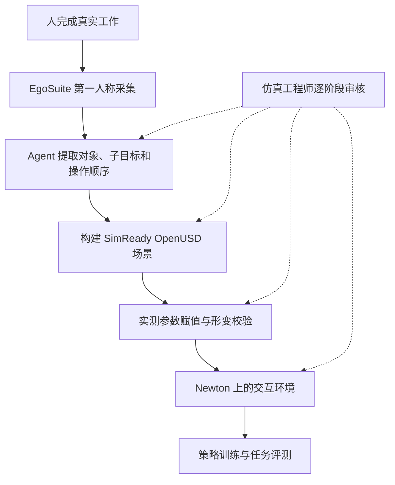

# RoboFinals RL-Env：把真实工作做成机器人能反复练习的环境

**RoboFinals RL-Env 关注的是机器人训练的上游：怎样把一个人真实完成的工作，转成机器人可以交互、失败、重试，并得到任务反馈的仿真环境。**

它把 EgoSuite 人类操作采集、Agent 场景构建、SimReady 资产、物理校准和 Newton 求解器连起来。首个发布环境是汽车维修，重点包含长时程、灵巧手和可变形物体交互。

[官方项目页](https://lightwheel.ai/robofinals-rl-env) · [早期访问入口](https://lightwheel.ai/robofinals-rl-env/early-access) · [RoboFinals 评测平台](https://lightwheel.ai/robofinals)

以下把官网明确描述的流程，与为了理解训练而补充的技术分析分开。当前材料是一份产品与技术介绍，尚不足以复现某个汽车维修策略的完整 RL 实验。

## 1. 为什么值得单独研究“环境怎么来”？

写出 PPO 或接入一个现成策略，往往只解决训练的一部分。对于接触复杂的任务，首先要有一个能够稳定运行的世界。

例如拆卸软管，环境需要表达的不只是“有一根软管和一只手”，还包括软管如何弯曲、连接处是否锁紧、抓取时会不会滑、沿什么方向才能脱离，以及什么时候算真正拆卸成功。

如果连接约束没有建模，机器人可能直接把软管穿过接头。如果材料太软，机器人可能通过现实中不会发生的形变完成任务。如果成功判据只看某个点移动了多远，机器人可能弯一下软管就拿到奖励。

这些问题都会改变训练目标：策略优化得越充分，越可能找到仿真中容易获胜、现实中却无效的行为。

RoboFinals RL-Env 的主线因此有两个部分：**任务来自实际工作，物理参数尽量来自实测。** 官网把这作为设计原则；是否落实到每个资产、每类接触，还需要具体的校准记录与测试来判断。[来源：项目页](https://lightwheel.ai/robofinals-rl-env)。

## 2. 先把几个名字分清楚

| 名称 | 在这套流程中的角色 | 阅读时要注意 |
| --- | --- | --- |
| EgoSuite | 采集人类真实操作，为任务构建提供来源 | 人类视频需要进一步处理才能用于机器人动作监督 |
| SimReady / OpenUSD | 组织可用于仿真的资产与场景 | 场景格式不能代替材料标定和任务逻辑 |
| Newton | 执行物理状态转移，承载求解器 | 引擎能力与具体环境实现是两个层次 |
| RoboFinals RL-Env | 提供可训练的交互环境 | 当前汽车维修环境的详细训练配置尚未在项目页披露 |
| RoboFinals | 定义任务评测与比较方式 | 需要辨明任务版本、测试分布和开放范围 |
| LW-BenchHub | 已公开的相关训练与评测代码基础设施 | 仓库中的任务不能直接等同于这次汽车维修环境 |

本次项目页明确说，RL-Env 与 RoboFinals 共享任务定义；页面同时提供 early-access/waitlist 入口，并把更完整的 benchmark 与公共排行榜列为之后开放的内容。这里的“Available Now”不能直接读成“所有资产与训练代码已经公开下载”。[来源：项目页](https://lightwheel.ai/robofinals-rl-env)。

## 3. 环境构建的完整流程



### 第一步：先记录一个人在完成什么工作

EgoSuite 采集的是人使用自己的手和工具完成真实任务的第一人称记录。其价值首先是给出实际任务结构：涉及哪些零件、先做什么、后做什么、操作受到哪些空间限制。

例如“先松开固定件，再拔出软管”，包含一个重要依赖：固定件没有解除，拔出的动作就不应该成功。这个例子用于解释依赖关系，不是官网公布的完整汽车维修步骤。

视频能帮助观察动作顺序，但视频中的位移不能直接说明施力大小；人的手部轨迹也不能直接作为某个机械手的关节命令。采集、任务理解、物理识别和动作重定向是不同工作。

### 第二步：Agent 提取任务结构

官网明确提到 sub-goals、objects 和 ordering，即子目标、对象和先后顺序。可以把它理解成一张任务依赖图：

```text
解除固定 → 获得可操作空间 → 握住目标 → 完成分离 → 检查结果
```

真正要进入仿真的，是可以判断的状态。例如“固定件已解锁”需要对应关节、约束或连接状态，“分离成功”需要对应物体之间的实际关系。

任务图只是便于理解的表示。官网没有说明内部使用 DAG、行为树、PDDL，还是自定义状态机，也没有公开 Agent 的模型、提示词、工具集与自动构建成功率。[来源：项目页，Sim Env from the Real World](https://lightwheel.ai/robofinals-rl-env)。

### 第三步：把场景补成可交互资产

官网说 Agent 重建零件、工具和灵巧手，并组织为 SimReady OpenUSD 资产。对训练而言，一个物体至少需要区分以下信息：

| 信息 | 解决的问题 | 缺失时可能发生什么 |
| --- | --- | --- |
| 外观和几何 | 看起来是什么、表面在哪里 | 视觉和真实对象不匹配 |
| 碰撞形状 | 接触发生在哪里 | 穿透、悬空、抓取边界错误 |
| 关节和连接 | 哪些部分能相对运动 | 锁扣、铰链或装配关系失真 |
| 质量、惯量、材料 | 受力后怎样运动和形变 | 策略学到错误的力学响应 |
| 任务语义 | 什么状态算完成 | 奖励与实际工作脱节 |

这张表是通用的环境设计分解，不代表所有字段都直接存储在该项目的 USD 文件里。成功判定、reset 和奖励通常还需要环境代码来实现。

### 第四步：校准，再审核发布

官网描述了实测摩擦、刚度、阻尼，以及使用工业级 CAE 校验软管、线缆和密封圈的形变响应。每个阶段都有仿真工程师审核：确认任务结构、检查场景、认可物理表现，再决定环境是否可以发布。

所以这条生产流程是 **Agent 承担构建、专家决定哪些结果通过**。自动化的具体收益，还要看每个环境需要多少人工修订、耗时多久，以及不同任务类型的通过率；项目页没有给出这些统计。[来源：项目页，Agent-Driven, Human Expert on the Loop](https://lightwheel.ai/robofinals-rl-env)。

## 4. 为什么特别强调灵巧手、软管和长任务？

这三件事会互相放大难度。

灵巧手与物体有多个接触点。一个手指位置改变，其他手指可能需要重新分配力。软管受到接触后又会变形，接触位置和法向随之变化。于是，之前能稳定握住的姿态，下一刻可能开始滑动。

长任务进一步引入历史依赖。某一阶段留下的弯曲、缠绕或装配偏差，会改变后续动作的可行性。把每个子任务单独做成功，并不能保证把它们按顺序连起来仍然成功。

以插接为例，策略可能必须同时处理：

- 末端位置与方向是否对齐。
- 握持位置能否传递足够推力。
- 推进时软管是进入接头，还是在中间弯曲。
- 接触已经建立后，是否需要调整姿态再推进。
- 完成后连接是否保持稳定。

这些是解释复杂操作所需的控制变量。官网展示了对应的任务方向，但没有提供上述各项的独立能力评测。

## 5. Newton-native 应该怎样理解？

Newton 是基于 NVIDIA Warp 的 GPU 物理仿真框架，提供多种求解器与扩展机制。RoboFinals RL-Env 声称其环境在 Newton 上原生构建，并在单个时间步内耦合刚体、可变形体和颗粒之间的接触作用。[Newton 官方仓库](https://github.com/newton-physics/newton)；[RL-Env 项目页](https://lightwheel.ai/robofinals-rl-env)。

理解“耦合”，可以看一只机械手压住软管的过程：

```text
手指位置改变
  → 软管受到接触力并变形
  → 接触点和表面方向变化
  → 手指受到新的反作用力
  → 下一步运动重新计算
```

如果双方分别计算、只在很粗的时间间隔交换结果，容易出现接触不稳定、穿透或不合理的能量变化。耦合求解的目的，是让这些相互依赖的作用更一致。

但“同一步内交换接触力”还不足以确定具体算法：是整体联合求解，还是分区迭代？迭代多少次？采用什么接触模型？误差阈值是什么？这些信息项目页没有展开。

因此，Newton-native 表达了技术基础，尚不能直接推出某个任务的物理精度、可并行环境数或 sim-to-real 成功率。对可微仿真也一样：框架支持可微能力，不代表这套环境中的所有求解路径都可微，更不代表策略训练实际通过物理求解器反传。

## 6. 实测参数与 CAE 校验，分别能说明什么？

### 实测参数：让模型受到现实约束

刚度和摩擦会改变动作是否有效。参数来自测量，可以减少仅凭观察调到“看起来差不多”的自由度。

但参数总有适用条件。摩擦可能随表面状态、滑动速度与压力变化；材料可能存在非线性、迟滞或磨损。将某个测量数值放进仿真，还需要检查所用模型能否表达这些效应。

### CAE：检查工程响应是否合理

CAE 可以作为更高精度的工程参考，检验某个简化求解方案在弯曲、压缩等条件下是否接近参考响应。这对实时仿真很有用，因为训练环境经常需要在精度和速度间取舍。

但两个仿真模型接近，并不能替代与实物的比较。它们可能共同使用了错误的材料假设。更完整的验证应把“实物测量—工程模型—实时求解器”三个环节分别交代清楚。

### 官网的软管图确实提供了动态响应

项目页 Figure 4 的[内嵌校准页面](https://lightwheel.ai/robofinals-rl-env-assets/calibration/index.html)展示了三组标为 V1、V2、V3 的响应，分别标注 2.24、4.7、10 MPa，并显示：

- 最大偏差，单位 mm。
- 总弯曲角，单位度。
- 峰值分段速度，单位 m/s。

这里有一个阅读细节：HTML 初始显示的“3.0 mm maximum deviation”是动态标签，页面脚本会根据当前帧的误差数组更新它。**不能拿初始标签当成整个项目“最大误差只有 3 mm”的结论。**

本次还检查了该图的公开脚本与数据结构：它使用一组 reference 轨迹和三组响应数据，包含 1,978 帧、30 Hz、每帧 25 个二维绘图点。二维点用于前端显示，不能据此推断底层物理模型只有二维，也不能把它们直接当成完整的三维测量数据。[图表脚本](https://lightwheel.ai/robofinals-rl-env-assets/calibration/calibration.js)；[图表数据](https://lightwheel.ai/robofinals-rl-env-assets/calibration/trajectory-data.js)。

这些内容比单纯的视频演示提供了更多可检查信息。不过，图表仍未完整交代测量仪器、坐标配准、重复试验、参数拟合集与独立验证集，以及多种接触条件的误差统计。

比较准确的结论是：**官网给出了一个软管动态校准示例；整个任务库的物理精度和迁移效果，仍需要更系统的证据。**

## 7. 这套东西到底怎么用于 RL？

官网主要说明了环境生产流程。它没有公开汽车维修任务使用 PPO、SAC 或其他算法，也没有给出 reward 代码、观测/动作 schema、训练曲线和 checkpoint。因此不能替作者补出一套已经完成的训练方法。

不过，可以从接口角度看，真正训练起来还需要什么。

| 环节 | 必须确定的内容 |
| --- | --- |
| 状态 | 机器人关节、对象姿态、形变、连接状态及任务阶段 |
| 观测 | 策略实际收到的图像、本体状态、力或触觉信号 |
| 动作 | 关节命令、末端位姿增量、力控制或其他接口 |
| 状态转移 | 控制器与物理求解器如何执行一次动作 |
| 奖励 | 哪些进展获得反馈，何种完成状态算成功 |
| 初始化 | 标准起点、随机布局、中间状态或失败状态 |
| 终止 | 成功、不可恢复失败、超时与数值异常如何区分 |

对于视觉机器人，仿真内部完整状态与策略观测需要分开。环境可以知道软管每个节点的位置，但策略未必能从相机或传感器直接获得这些量。

用一个一般形式表示：

$$
s_{t+1}=F_\phi(s_t,a_t),\qquad
o_t=H(s_t),\qquad
a_t\sim\pi_\theta(\cdot\mid o_{\le t},a_{<t}).
$$

这里 \(\phi\) 表示环境及物理参数，\(\theta\) 表示策略参数。RoboFinals RL-Env 的公开介绍主要在解释怎样构建和校验 \(F_\phi\) 及任务；怎样优化 \(\theta\)，仍取决于采用的策略和训练算法。这个公式是解释性抽象，不是官网的网络定义。

## 8. 长任务的奖励，为什么比“拆成几个步骤”更难？

下面用软管操作举例，讨论一种可能的环境设计，**不代表官方已经采用**。

任务可以包含“解除固定—建立握持—分离—重新插接—检查连接”等阶段。但子目标名称本身不能直接用于奖励，需要转换成可靠的状态谓词。

例如“重新插接完成”，可能需要同时满足插入深度、方向、连接状态和短时间内保持稳定。仅满足末端位置接近目标，无法证明连接已完成。

一个说明性的阶段奖励可以写成：

$$
r_t=\sum_k w_k\mathbf 1[\text{子目标 }k\text{ 首次有效完成于 }t]
+w_s\mathbf 1[\text{完整任务首次成功于 }t]
-\lambda c_t.
$$

“首次”用于减少反复完成同一阶段刷奖励的问题；“有效”要求前置条件成立；\(c_t\) 可以记录违反任务约束的行为。但这仍然不是通用正确答案：一次完成过的阶段可能又被后续动作破坏，环境必须跟踪真实状态，而不能只维护一个永远递增的进度条。

所以最好分开记录三个量：训练回报、阶段完成情况、最终有效成功率。它们能帮助辨别模型究竟在进步，还是只找到更容易获得 shaping reward 的动作。

官方的 Agent 能提取子目标，不代表它已经自动生成并验证了所有成功谓词和 dense reward。要确认这一点，需要任务代码和专门测试。

## 9. 可考虑的训练路线，以及各自的前提

环境建立以后，可以尝试多种训练方式。下面是技术分析，不是 RoboFinals RL-Env 已披露的实验。

### 路线 A：已有策略继续 RL

如果一个预训练策略已经能偶尔完成子任务，就可以利用环境反馈继续优化。难点是确保动作接口匹配，并让模型获得足够多有区别的成功与失败样本。

刚读过的 [PEAR](PEAR.md) 属于策略后训练层面的参考：利用已有推理模型的起点能力，通过仿真交互获得更新信号。RoboFinals RL-Env 则主要提供潜在的任务和物理基础。二者可以在架构上互补，但没有证据表明项目已经接入 PEAR；接触控制频率和动作粒度也需要重新适配。

### 路线 B：演示初始化，再做 RL

对于几乎探索不到成功的任务，可以先用机器人可执行示范进行行为克隆，再进行交互优化。这里的关键是“机器人可执行”：EgoSuite 人类视频仍需重定向、标注或另行遥操作，才能成为相应策略的动作监督。

不能因为环境从人类视频生成，就默认它同时附带高质量机器人 demonstrations。

### 路线 C：分阶段训练，再连接完整任务

先练插接、握持和工具操作等局部能力，再扩展完整流程。中间状态 reset 能减少反复执行前置步骤的成本，但必须检查连接处的状态分布。

例如单独练插接时，软管总是笔直、握持总是正确；完整任务前一阶段交付的软管却可能弯曲、偏移。局部策略就可能在独立测试中很好，连接后失败。

### 中间状态 reset 还要保存什么？

刚体任务可以先考虑位姿与速度。对于可变形任务，还可能涉及节点位置与速度、连接/约束状态、控制器内部状态，以及特定材料模型需要的历史变量。恢复这些量之后还应检查是否引入穿透或非物理冲量。

所以“支持 reset 到中间阶段”本身就是需要验证的系统能力，不能仅靠把物体摆到某个位置实现。

## 10. 训练和评测共享环境，有什么好处与限制？

好处是定义一致。训练中的“连接成功”与评测中的“连接成功”可以遵循同样的规则，资产和接口也容易复用。

但评测问题需要进一步说清楚：

| 想测的能力 | 应控制或留出的变量 |
| --- | --- |
| 已知任务完成能力 | 任务固定，明确初始状态采样与重复次数 |
| 物体泛化 | 留出不同几何和具体物体实例 |
| 材料鲁棒性 | 留出摩擦、刚度或接触条件 |
| 长程组合 | 留出子任务组合与顺序 |
| 失败恢复 | 固定一组可复现的失败状态 |
| 跨机器人迁移 | 明确本体与控制接口的变化 |

共享任务定义不会自动造成评测无效，也不会自动保证泛化。关键在于训练可见范围、测试划分和结论是否一致。项目页没有完整披露这些划分，因此当前适合讨论平台设计，尚不能据此给出通用策略的泛化排名。

## 11. 其他公开数字不要混进本次 RL-Env

Lightwheel 此前的 Newton-native benchmark 介绍涵盖 **22 个家庭、医院和工厂任务**，并描述了遥操作数据、策略训练和标准化评测流程。该介绍明确指出：训练与评测都在仿真中完成，并不能单独证明硬件端一致性；真实相关性是后续验证内容。[官方 Newton benchmark 介绍](https://lightwheel.ai/media/lightwheel-launches-robofinals-full-stack-robot-evaluation-benchmark-newton)。

此外，公开的 LW-BenchHub README 列出 **268 个任务**，包括 130 个 Lightwheel-LIBERO 与 138 个 Lightwheel-RoboCasa 任务，仓库也包含 RL 相关配置与脚本。这证明相关生态已有可阅读的训练基础设施，不代表新的汽车维修任务就已包含在这些公开配置中。[LW-BenchHub 仓库](https://github.com/LightwheelAI/LW-BenchHub)。

可以把这些数字放在同一张表里辨别：

| 来源 | 描述的范围 | 不能直接推导的结论 |
| --- | --- | --- |
| 本次 RL-Env 项目页 | 首个汽车维修环境及环境生产流程 | 已开放多少独立任务、训练成功率是多少 |
| 此前 Newton benchmark | 22 任务的评测与训练流程介绍 | 22 个任务都是这次新增的维修 RL 环境 |
| LW-BenchHub README | 268 个相关任务及代码生态 | 新维修环境的资产、求解器和 reward 全部已开源 |

目前在本次项目页及关联入口中，没有找到可直接复现汽车维修 RL 训练的完整资产、安装说明、观测/动作定义、奖励配置与训练日志。这个结论限定于本次检查的公开入口，不等于断言公司内部没有这些实现。

## 12. 如果用于 RUA / Dex-RUA，最值得加的是什么？

### 让 Agent 得到与真实机器人对应的反馈

仿真可以知道“连接已锁定”“手指接触力是多少”“目标精确三维位置在哪”。是否把这些信息给 Agent，取决于具体任务规则和传感器设定。

一种清楚的分工是：评分器读取内部状态作判定，策略只读取实验允许的观测。若研究假设允许力传感或特定几何信息，就明确标注并对所有方法保持一致。

### 单独建立失败恢复分布

从标准起点完成任务，与从意外状态恢复，考查的能力不同。可以固定一组状态：握持偏移、部分插入后卡滞、工具掉落、物体遮挡、前序动作造成形变。

评价时记录恢复成功率、额外动作数、时间、受力异常与造成的新损伤。这比只看“最后有没有完成”更容易解释不同 Agent 的决策差异。

### 分开三种改进

| 改进对象 | 典型变化 | 应怎样验证 |
| --- | --- | --- |
| 策略参数 | RL 更新网络权重 | 冻结评测集上重新 rollout |
| 技能代码/记忆 | Agent 修改执行程序或积累经验 | 固定基础模型与接口，比较修改前后 |
| 环境/评分器 | 校准物理、修正成功谓词 | 固定策略回放并审计环境版本差异 |

RoboFinals RL-Env 的 Agent 主要参与环境生产。把它扩展为执行 Agent 的技能改进平台，是研究设想，不能把“Agent 自动搭环境”直接称为“机器人已经自主进化”。

## 13. 怎样判断它是否真的帮到了训练？

我会优先看四类实验，而不是只看场景视频。

**第一，环境构建效率。** 每个任务需要多少人时，Agent 自动完成哪些部分，专家改了多少次，最终有多少任务通过审核。这样才能判断可扩展性来自哪里。

**第二，物理响应验证。** 在独立于参数拟合的数据上，比较受力、形变、滑动、插拔峰值与连接状态。模型对一个示例拟合得好，与跨工况有效，需要不同的证据。

**第三，固定预算训练。** 对照默认参数、测量校准、校准加合理随机化，比较相同策略、任务和算力预算下的学习曲线。分别记录仿真步吞吐、渲染、推理和重置耗时。

**第四，真实任务迁移。** 用相同部署协议检验真实成功率，并看仿真排名是否与真实排名一致。单个策略迁移成功，与 benchmark 能可靠排序多种策略，是不同问题。

这些实验才能把“构建了更可信的环境”进一步连到“提升了训练效率和真实任务能力”。当前公开页面主要展示了前者的技术路线与示例，后者仍需完整实验支持。

## 14. 我的判断

RoboFinals RL-Env 最值得借鉴的是：**把人类真实工作作为任务来源，再把对象、连接、材料、接触和完成条件一起做成训练资产。** 对软体、灵巧操作和工业装配，这些工作可能直接决定策略能学到什么。

它也把环境生产中的人工角色说得比较清楚：Agent 扩大构建能力，工程师负责审核。接下来需要量化的，是每增加一种任务要付出多少成本，以及这一流程能否持续产出物理可信、可重置、可评测的环境。

对于 RUA / Dex-RUA，这条路线提供了有价值的物理基础。更值得继续做的部分，是在明确的观测与动作接口上研究长程执行、接触反馈、失败恢复和经验复用，并用独立测试状态验证改进。
