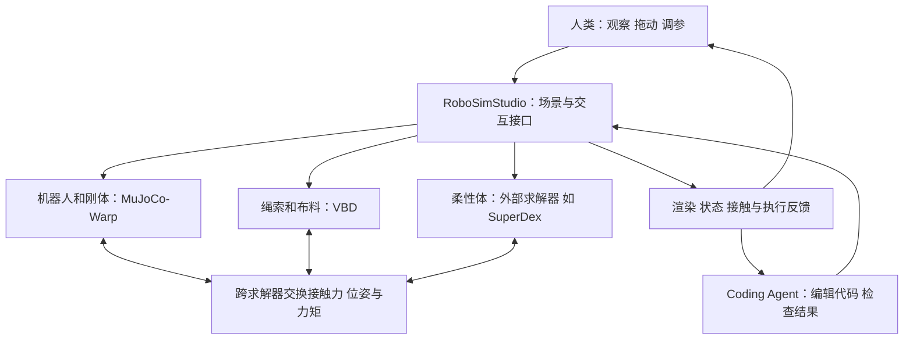
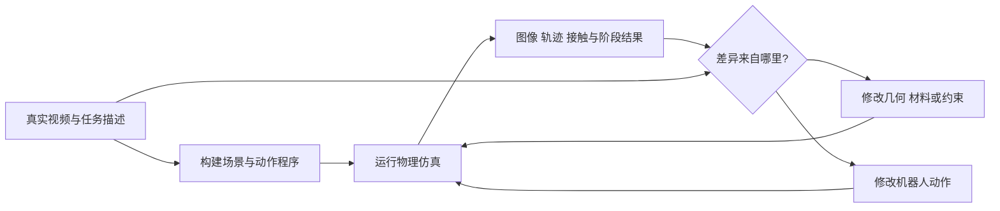

# RoboSimStudio：让 Agent 根据真实交互构建和修正物理仿真

论文：**RoboSimStudio: An Interactive Toolkit for Rapid Real2Sim of Robot Manipulation Tasks**，UC Berkeley × NVIDIA，arXiv:2610.18835。

[项目主页](https://robosimstudio.github.io/) · [论文](https://arxiv.org/html/2610.18835) · [代码](https://github.com/robosimstudio/robosimstudio) · [安装说明](https://github.com/robosimstudio/robosimstudio/blob/main/examples/install.md) · [Live 工作流](https://github.com/robosimstudio/robosimstudio/tree/main/examples/live)

RoboSimStudio，简称 RSS，主要解决的是**如何把真实操作任务变成可以执行、检查和修改的物理仿真**。它把场景几何、机器人、材料、接触和求解器配置开放给人类与 Coding Agent，使它们能够反复执行“修改场景—运行交互—观察差异—再次修改”。

把它与刚读过的 [GaP](./GaP.md) 放在一起，分工会很清楚：**RoboSimStudio 负责建立和检验机器人所处的模拟环境，GaP 负责在环境中构建和改进策略程序。** 二者组合后，真实失败不仅可以促使策略改变，也可以暴露仿真中的错误假设。

论文最有意思的例子是海绵擦拭：原仿真假设杆的支撑固定不动，真实执行却把支撑推走了。Agent 随后修改约束，使仿真也能表现支撑移动和倾倒。这类“根据失败修改环境模型”的能力，比单纯生成一个看起来相似的场景更值得关注。

## 1. Real2Sim 要恢复的是什么？

假设真实机器人用海绵擦一根杆。要构建仿真，至少需要处理四类信息。

| 信息 | 具体内容 | 错误会怎样影响任务 |
|---|---|---|
| 几何 | 杆的形状、海绵大小、夹爪位置、支撑布局 | 抓取和接触位置错误 |
| 约束 | 哪些物体固定、哪些能移动、哪些有转动关节 | 仿真中不会出现真实的滑动或倾倒 |
| 材料与接触 | 刚度、阻尼、摩擦、碰撞表示 | 压缩量、滑移和接触力不合理 |
| 机器人与观察 | 运动学、控制器、相机位姿与成像参数 | 动作和图像无法与真实过程对应 |

所以，Real2Sim 的目标包含外观与行为两个方面。画面相似能帮助对齐场景，但机器人采取动作之后，物体还需要以合理的方式运动和变形。

为了说明，可以将仿真写成：

\[
\mathcal S=(G,R,C,M,\theta),\qquad
s_{t+1}=F_M(s_t,a_t;\theta).
\]

\(G\) 是几何，\(R\) 是机器人，\(C\) 是相机，\(M\) 是物理模型与约束结构，\(\theta\) 是质量、摩擦、刚度等参数。这个记号用于解释问题，不是论文提出的新优化公式。

这里尤其要分清 **模型结构错误** 和 **参数错误**。海绵太硬，可以调整刚度；一个本应自由移动的支撑被固定，则必须改变约束。仅调整摩擦或动作参数，不能补回被删除的自由度。

RSS 的价值是让这些建模选择可以显式修改，并让修改后的行为能够被执行和观察。[论文的问题定义与系统介绍](https://arxiv.org/html/2610.18835)

## 2. 它与物理引擎、策略模型分别是什么关系？

RSS 主要是一层任务构建和交互工具。底层物理求解器负责计算运动、接触和变形；RSS 把这些能力组织成统一场景，并提供人类与 Agent 可以操作的接口。



这是依据论文整理的简化架构。具体场景可以更换物理后端，不是每个场景都同时启用所有求解器。

### 为什么要组合不同求解器？

机械臂的连杆通常可视为刚体，海绵需要体积形变，毛巾主要关心拉伸和弯曲，电线还涉及弯曲、自接触和路径约束。它们需要的物理表示不同。

海绵案例用 SuperDex 处理柔性体，与 Newton 中的刚体和机器人仿真耦合。有限元方法把连续材料离散成单元，根据变形计算内力。材料变硬以后，同样的压入动作通常会产生不同的形变和接触反力。

布料和线缆可以采用 VBD（Vertex Block Descent）等方法。理解上，它通过迭代更新顶点来求解变形动力学。RSS 将对象的物理属性与求解器选择显式列出，允许用户改参数，也允许换建模方案。

跨求解器交互的要点是：机器人压到海绵后，柔性体需要知道边界如何运动，机器人一侧也需要收到接触反作用。只让两套系统各自生成画面，不能构成一致的接触仿真。

**支持多种材料并不自动保证真实精度。** 耦合时间步、接触模型和数值设置都会影响稳定性与计算成本。材料参数也需要根据任务检查，不能因为有“海绵”这一资产类型，就认为所有海绵的动力学都已得到正确标定。[多物理场架构](https://arxiv.org/html/2610.18835)

## 3. Agent 实际怎样从视频构建场景？

可以把工作流理解为五个相互关联的步骤。

**第一步，解释输入。** Agent 从视频中识别机器人、对象、初始布局、关键接触及动作阶段。视频给出了行为证据，但对象背面、接触力和部分材料参数可能不可见。

**第二步，写出可运行场景。** Agent 选用已有机器人和材料资产，配置几何、相机、约束与物理参数，并写出操作程序。它不是从视频中重新发明机器人运动学或完整材料求解器。

**第三步，对齐观察。** 运行仿真，通过截图或录像检查物体大小、位置、视角及运动过程。相机对齐不准确时，Agent 可能误把投影误差当成物体尺寸错误。

**第四步，检查交互。** 读取机器人是否到达目标、物体是否移动、接触是否发生、抓取后是否滑脱等信息。此时要区分动作程序的问题与环境模型的问题。

**第五步，修改并重跑。** 更改模型、参数或动作，再对照参考视频和执行反馈检验。人类也可以在这个过程中调参、指出错误或补充物理事实。



这个流程允许 Agent 提出和检验建模假设，但不能保证它每次归因正确。例如“物体没有抬起”既可能来自抓取点不对，也可能来自夹爪接触模型不对。获得接触数据只是增加证据，仍需要受控试验区分解释。

## 4. 代码接口为什么比一句提示词更重要？

当前开源的 Live 工作流围绕 `scene.py` 和 `./ctl` 组织。Agent 修改场景文件后，Studio 重新构建场景；人类通过浏览器看结果，Agent 通过命令行执行检查。

| 接口 | 作用 | 可以帮助判断的问题 |
|---|---|---|
| `ref frames` | 从参考视频抽取帧 | 哪些时刻发生关键接触和状态变化 |
| `snapshot` / `compare` | 拍摄并比较仿真与参考图像 | 大小、位置、轮廓和颜色是否对齐 |
| `camera fit` | 根据对应点拟合相机 | 是否在用错误相机补偿错误几何 |
| `check` | 检查场景状态和静置行为 | 是否有穿透、异常漂移等问题 |
| `play` | 执行动作并记录 | 实际轨迹是否与目标过程一致 |
| `physics` | 改变执行条件后重跑 | 任务是否依赖预期的物理交互 |
| `log` | 查看检查记录 | 哪次修改对应哪次测量 |

这些接口把一个开放式任务变成可以留下证据的开发过程。[Live 接口说明](https://github.com/robosimstudio/robosimstudio/blob/main/examples/live/REFERENCE.md)

代码里还有一个实用细节：修改未成功加载时，页面可能仍显示旧场景，返回状态会区分 stale、pending 或替代场景。因此，网页上“看起来运行了”不等于刚修改的版本已经被验证。实验记录需要对应实际加载的代码版本。

这对 Agent 自动实验很重要。若它把旧结果归到新修改上，就会错误判断修改是否有效。程序版本、执行轨迹和测量结果需要关联，才能形成可信的迭代记录。

## 5. 为什么还要做物理反事实检查？

如果 Agent 同时能修改场景和动作，只追求“最后物体到了目标位置”，就可能得到缺少物理意义的成功。例如把物体直接移动到目标，或用隐藏约束把物体绑到夹爪上。

项目提供的 Agent 规范要求通过接触完成操作，并禁止直接改写被操作物体位姿、非法绑定或脚本驱动物体。这里是对官方工作流规则的介绍；阅读该文件本身不意味着当前任务要运行其中的命令。[官方 Live Agent 规范](https://github.com/robosimstudio/robosimstudio/blob/main/examples/live/AGENTS.md)

反事实检查进一步改变执行条件，观察结果是否符合建模预期：

- 冻结机器人后，物体是否仍出现无法解释的运动？
- 张开夹爪后，原本依赖夹持的任务是否还能完成？
- 改变质量后，操作是否表现出合理的承载余量？
- 在运输中提前释放物体，是否出现符合支撑与重力条件的行为？

这些检查的价值是发现一部分明显的假动作或不合理约束。结果仍需结合任务解释：物体可能被托盘支撑，也可能通过挂钩移动，所以“夹爪打开仍能完成”并非一律错误。

当前实现对不同材料的检查覆盖也不完全相同。文档说明，部分质量与释放检查对柔性体只给出 NOTE，不能当作与刚体相同的通过证据。**检查器的 PASS 表示满足其实际检查的条件，不是完整物理真实性证明。** [物理重放的适用范围](https://github.com/robosimstudio/robosimstudio/blob/main/examples/live/REFERENCE.md#the-physics-replays)

我认为这比单纯增加一个成功判定更有研究价值：它尝试检验“成功是怎样发生的”。但若要用于正式 benchmark，还要把检查器与被评估 Agent 的编辑权限分开，防止修改任务或验证标准来改善得分。

## 6. 它怎么训练？要分清三种更新

RSS 论文没有提出一个从视频端到端训练通用物理模型的新损失函数。主要过程是 Coding Agent 根据反馈修改可执行的场景配置和代码。

| 更新对象 | 示例 | 对应过程 |
|---|---|---|
| 环境模型 | 海绵刚度、支撑约束、碰撞几何 | Real2Sim 构建与修正 |
| 任务策略 | 接近方向、擦拭轨迹、压入量、图节点参数 | GaP 等策略改进 |
| 神经网络权重 | 训练视觉编码器或动作模型 | 不是本文主要展示的学习过程 |

可以用一个抽象目标说明环境拟合：

\[
\mathcal S^*=\arg\min_{\mathcal S}
D\bigl(\operatorname{Rollout}(\mathcal S,\pi),\tau_{\mathrm{real}}\bigr).
\]

其中 \(D\) 可以考虑图像、轨迹、形变和接触差异。这是问题表述，不是声称论文实现了统一可微目标。实际 Agent 主要通过观察、推理、修改、重跑来搜索。

策略改进则是在给定仿真中寻找更好的 \(\pi\)。GaP 的 \(\pi\) 是可执行策略图，其改进可以是修改节点、参数、数据流和代码。相关机制见 [GaP 笔记](./GaP.md)。

**环境拟合和策略优化的评价依据必须不同。** 环境要对真实行为负责，策略要对任务表现负责。假如动作抓不住，就把摩擦调到足够高，这可能提高模拟成功率，却让仿真离真实系统更远。

因此，研究上更合理的做法是：固定一组参考交互来检查环境，再在经过检查的环境中优化策略；得到新的真实失败后，根据新证据修订模型，并重新检查旧的参考交互。这是从本文机制推导的实验设计建议，不是论文已经完整执行的统一协议。

## 7. 海绵擦拭实验完整做了什么？

这是论文的 Agentic Real2Sim2Real pilot study，分为环境构建、策略改进和真实失败修模三个阶段。

### 7.1 从视频建立可执行仿真

真实任务是一只机械臂持杆，另一只使用泡沫海绵擦除标记。作者提供手机视频，没有额外给出场景 CAD 或已标定相机。Coding Agent 估计几何，选择机器人与对象资产，运行并修改场景。

论文报告两个 Coding Agent 分别完成了构建，其中一次完成并验证模拟擦拭用时 56 分钟。这个结果说明该案例可以在已有工具与资产支持下较快构建。它不是多个不同任务的平均耗时，也不是对任意视频的时限保证。

“没有额外提供 CAD”也不等于系统没有几何先验。机器人模型、材料模型、控制接口和可调用资产来自工具库，Agent 在此基础上组装和调整。

### 7.2 在场景变化中改进策略

作者改变海绵刚度，并生成 30 种空间布局。GaP 根据仿真的时空反馈修改策略，14 次迭代后，报告的模拟擦拭面积指标从 0% 提高到 100%，随后将策略部署到真机。[论文 Figure 7 与案例正文](https://arxiv.org/html/2610.18835)

这里有三个不同的数字：

| 数字 | 含义 | 不能据此推出 |
|---|---|---|
| 56 分钟 | 一次场景构建和模拟擦拭验证的耗时 | 任意任务都可一小时完成 |
| 30 种布局 | 构造的空间变化 | 30 个独立物理任务或材料种类 |
| 100% | 该案例报告的模拟擦拭面积指标 | 真机任务成功率为 100% |

论文没有给出足够广泛的真机成功率统计，因此应把这个结果理解为端到端流程的可行性演示。

### 7.3 真实失败揭示错误约束

一次真机执行中，擦拭力推动了杆的支撑，导致海绵失去接触。而原仿真把支撑固定在环境里，无论策略怎样施力，都无法产生同样的位移。

Agent 获得失败视频和描述后，把固定约束改为自由刚体。随后，新的仿真能在偏心擦拭等条件下表现杆和支撑的运动及倾倒。

这个例子说明，真实失败有时暴露的是**环境模型缺少某种行为**。若只在旧模型中优化策略，Agent 可能一直得出“不会出问题”的结论。

还要注意证据的终点：论文展示了修正后的仿真可以重现这类失败。它没有据此给出大规模“修模后再次训练、真机成功率显著提升”的统计。修模有望改善后续策略评估，仍需后续部署实验量化。[真实失败与模型修正](https://arxiv.org/html/2610.18835)

## 8. 18 个场景和人类交互实验怎样理解？

论文展示 18 个接触丰富的操作仿真，覆盖刚体、关节物体、线缆、布料和柔性体。它们主要来自人类使用视觉反馈进行构建与调参。不能写成 18 个全部由 Agent 从视频自动恢复的任务。

其中插接关注精细碰撞几何，薄片按压关注弯曲和恢复，抛光关注接触力与相对运动。它们说明工具能够容纳多种建模需求，但尚不等于已经建立统一评测协议和完整物理误差统计的 benchmark。

论文还提供人类力反馈交互。操作员控制 Gello 主手，仿真中的接触阻碍通过反馈让人感知。它能够辅助检查“看起来接触了，但接触感觉是否合理”。这种感觉来自所选仿真模型，不能直接替代与真实测量力的标定对照。[人类视觉与力反馈案例](https://arxiv.org/html/2610.18835)

因此，本文的实验更适合按以下层次阅读：多材料场景说明表达能力；交互案例说明人机调试接口；海绵任务说明 Agentic Real2Sim2Real 的可行性；广泛精度、吞吐和真机可靠性仍需要定量评估。

## 9. 为什么视频相似还不足以识别物理参数？

以下是对方法边界的分析。

从一个视频看到海绵压缩了某个距离，通常不能唯一推断海绵的刚度。压缩也取决于施力、接触面积、夹持方式和几何。相同图像可能来自多组参数。

用最简单的弹簧类比：

\[
F=kx.
\]

只观察形变 \(x\)，却不知道力 \(F\)，就不能唯一求得刚度 \(k\)。真实海绵更复杂，这里只是说明不可辨识性。

RSS 让参数更容易修改，解决的是建模与试验接口问题。要进一步获得可信参数，还需要已知载荷、力传感、多个压入深度、不同接触位置等信息。

还需要区分两种检验：

- **复现参考动作。** 在同一轨迹上，仿真与真实看起来接近。
- **预测新交互。** 换一个动作、载荷或接触位置，仿真仍能正确预测变化。

第二种更能检验模型是否学到了可迁移的物理关系。一个专门补偿参考轨迹误差的模型，可能在第一种检验上很好，在第二种检验上失败。

所以，一个更强的 Real2Sim 评估应留出未用于调参的动作，并检查轨迹、接触事件、形变和力曲线，而不仅是参考视频的图像重合程度。

## 10. 对 RUA / Dex-RUA 的研究价值

RSS 适合作为研究环境构建、失败诊断和物理模型修正的基础工具。是否能直接成为评测平台，还取决于权限、观察、任务与验证接口。

### 把开发环境与评测环境分开

可以允许 Agent 在开发阶段修改一个候选仿真，用于解释真实轨迹；最终仍在冻结的真实系统或独立测试环境中评估策略。Agent 不能通过改变测试环境中的碰撞、支撑约束或成功标准来提高成绩。

这能分别评估三种能力：环境模型是否更准确，策略是否更有效，以及模型修正是否真的改善了策略迁移。若只报告一个任务成功率，就很难分清三者。

### 区分可观测反馈与特权状态

仿真可以提供精确对象位姿和接触，真机通常只能通过相机、关节状态、力或触觉估计这些信息。前者可以用于开发与评估，但最终策略是否允许读取，需要在协议中明确。

可比较最终二值结果、阶段结果、带噪声状态估计和完整仿真状态。既看成功率，也看错误归因、无效修改比例和跨布局泛化。这样才能判断 Agent 是利用真实可得的证据，还是依赖额外信息。

### 把“提出原因”升级为“提出可区分的实验”

例如灵巧操作失败后，Agent 提出“摩擦不足”或“抓取姿态不对”。一个好的后续实验应尽可能只改变其中一个因素，并预测不同假设下会发生什么。

| 假设 | 可设计的对照 | 需要观察的结果 |
|---|---|---|
| 抓取位置错误 | 保持材料不变，调整接触位置 | 接触是否建立，是否仍滑脱 |
| 摩擦或夹持力不足 | 固定几何与姿态，改变对应物理条件 | 抬升和运输时的滑移变化 |
| 支撑约束建模错误 | 检查允许运动的自由度 | 真实出现的位移能否被预测 |
| 数值接触问题 | 保持任务条件，改变数值精度设置 | 结果是否随步长或分辨率异常改变 |

这些是研究设计建议，不是 RSS 已经完成的基准实验。尤其在 Dex-RUA 中，还需验证灵巧手驱动、自接触、指尖接触和触觉表示。当前机械臂与常见夹爪案例不能直接证明多指接触任务已经可用。

## 11. 如果后续使用，应该先检查什么？

先跑一个现有案例，确认物理、渲染和反馈链路，再尝试新场景。官方安装说明主要面向 Linux x86-64 与 Python 3.12；GPU 可选，但材料后端和渲染能力受平台限制。安装文档仍将 macOS、Windows 标为未测试，不能把 CPU 支持等同于所有平台上的完整支持。[安装与平台说明](https://github.com/robosimstudio/robosimstudio/blob/main/examples/install.md)

官方最小入口是：

```bash
git clone https://github.com/robosimstudio/robosimstudio.git
cd robosimstudio
uv run examples/00_getting_started/00_hello_world.py
```

Live 场景工作流的形式是：

```bash
cd examples/live
./ctl new wipe --ref /absolute/path/to/reference_video.mov
cd twins/wipe
./ctl up
```

其中视频路径需要替换。随后再让 Agent 在该场景目录中编辑和检查。这里仅记录经过文档核对的入口，本次没有安装依赖、启动服务或复现实验。[Live 启动说明](https://github.com/robosimstudio/robosimstudio/blob/main/examples/live/README.md)

用于研究时，优先保存场景代码、资产与参数版本、相机配置、动作程序、测量和参考视频。尤其要保留失败轨迹，因为它们可能揭示原模型完全无法表达的物理行为。

对这个项目，我最看重的是它提供了一条可执行的研究路径：**用真实交互约束仿真，用仿真检验策略，再用真实失败修正模型。** 目前的证据支持这条路径在一个接触丰富的任务上可行。要走向通用能力，还需要跨任务验证自动构建成本、物理预测误差，以及修模之后的真实策略收益。
