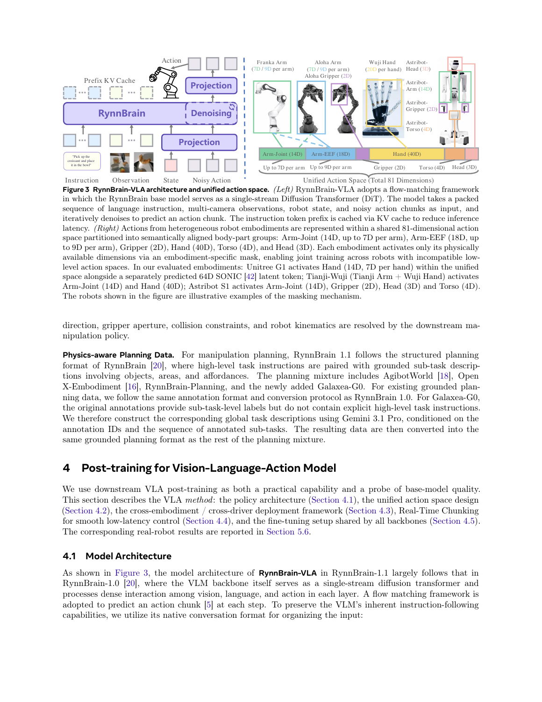
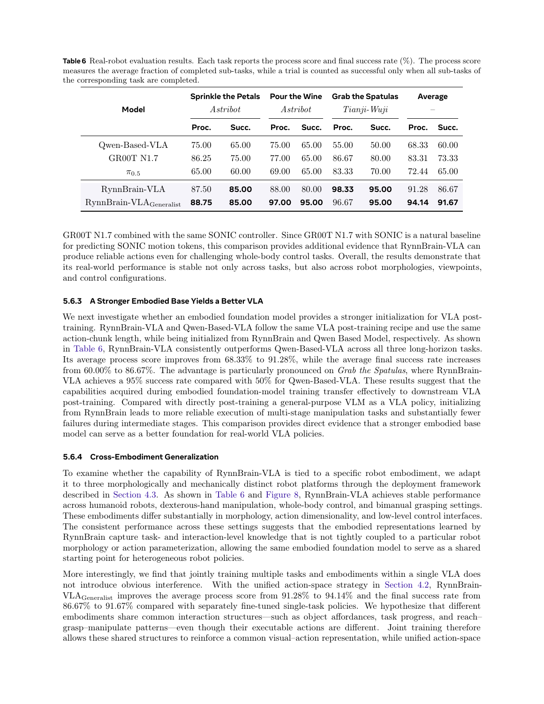

# RynnBrain 1.1：先把空间和交互知识学进 VLM，再训练机器人动作

RynnBrain 1.1 可以沿着一个问题来读：**同样用机器人示范训练 VLA，如果起点已经更懂物体、空间和操作，最后的控制策略会不会更好？**

作者从 Qwen3.5 出发，先通过多种具身任务继续预训练，让模型学会输出位置、空间关系、轨迹和抓取姿态；再把这个主干用于连续动作生成，在真实机器人示范上训练 VLA。主表里，相同动作训练配方下，RynnBrain 初始化的平均任务成功率为 86.67%，Qwen 初始化为 60.00%。这是整篇文章最值得抓住的证据。

这篇工作的重点是具身预训练的数据组织、空间输出接口，以及这些能力如何迁移到动作学习。把它理解成“一个模型终于真正懂物理了”会太宽。论文展示的是特定空间任务和机器人任务上的进步。

论文：**RynnBrain 1.1: Towards More Capable and Generalizable Embodied Foundation Model**，DAMO Academy / Alibaba Group、Hupan Lab，arXiv:2607.17977，2026 年 7 月 20 日提交。

[论文 HTML](https://arxiv.org/html/2607.17977v1) · [本地论文 PDF](media/assets/RynnBrain-1.1/RynnBrain-1.1.pdf) · [项目主页](https://alibaba-damo-academy.github.io/RynnBrain/) · [官方代码](https://github.com/alibaba-damo-academy/RynnBrain)

公式中的标准 Flow Matching 展开、示意输入，以及研究建议会单独说明；它们不作为论文未公开的实现细节。

## 1. 先把两个模型、两种训练分清楚

| 阶段 | 输入 | 输出 | 核心训练目标 |
| --- | --- | --- | --- |
| RynnBrain 1.1 具身基础模型 | 图像或视频、指令；3D 任务还包括相机内参 | 语言、物体框、点、轨迹、3D 框等序列 | 自回归交叉熵 |
| RynnBrain-VLA 动作后训练 | 多相机图像、任务指令、机器人状态、带噪动作块 | 连续机器人动作块 | Flow Matching，按本体屏蔽无效动作维度 |

第一阶段把空间和操作知识学进多模态主干。第二阶段让主干利用这些知识生成具体机器人的动作。

**这里需要修正附件开头的一处描述：RynnBrain-VLA 并非另接一个独立 Action Expert。** 论文 §4.1 和 Figure 3 明确写的是：VLM backbone 本身充当 single-stream diffusion transformer，每层处理视觉、语言和动作之间的交互。它有动作投影模块，但投影层不等于一个独立的动作专家网络。

另一个容易混淆的地方是“先理解，再动作”：这是训练阶段的分工，不代表部署时一定先输出一段思维链，再预测物体框，然后把框交给动作模块。论文的 VLA 可以直接利用主干表征生成动作，没有要求每次都把中间空间判断打印出来。

整体可以写成：

```text
Qwen3.5 多模态初始化
    ↓ 图文、视频、空间定位、抓取、规划等混合监督
RynnBrain 1.1：自回归具身基础模型
    ↓ 同步的机器人图像、状态、动作、任务指令
RynnBrain-VLA：主干参与 Flow Matching，预测 32 步动作块
    ↓ RTC 衔接动作块 + 本体驱动与底层控制器
真实机器人执行
```

这是监督预训练加示范驱动的动作学习。论文没有把在线 RL 作为这条训练主线。

## 2. 为什么不能直接拿通用 Qwen 训练动作？

当然可以，作者就做了这个基线。问题在于，通用 VLM 的图文能力与控制需要的信息并不完全重合。

比如“把杯子放到盘子左侧”，至少涉及几个层次：识别杯子和盘子；理解指令中的左右关系；判断哪些位置可以放置；结合机器人当前姿态选择运动；接触后维持稳定。能回答“图中有一个杯子”，只覆盖了很小一部分。

如果动作示范有限，模型要同时从这些数据里补空间知识、学机器人动作映射、记任务阶段，训练负担就很重。RynnBrain 的思路是先利用更广泛的视觉和具身数据，把可迁移的部分补起来，再用机器人示范学习本体相关的执行方式。

可以把它理解成：**动作数据负责教机器人怎么动，具身预训练尽量先教模型看什么、在哪里、与任务有什么关系。** 两者仍有重叠，并非互相隔离的技能清单。

这里的“物理”主要落在空间几何、可操作区域和操作过程上。论文没有让模型求解接触动力学方程，也没有通过力、摩擦或触觉监督来完整学习操作物理。

## 3. 第一阶段：怎么把空间任务放进一个语言模型？

### 3.1 从已有 Qwen3.5 继续训练

模型由视觉编码器、视觉语言投影模块和语言模型主干组成。论文提供 2B、9B、122B-A10B 三个规模；前两个是 Dense，后者是 MoE。122B-A10B 的总参数规模与每次激活参数规模需要分开理解，不能把它等同于普通 10B Dense。

视觉输入统一表示为有序帧序列。单张图像是只有一帧的情况，视频则均匀采样多帧，并加入时序位置信息。DeepStack 和 Interleaved MRoPE 沿用基座的多模态机制，分别支持视觉信息融合和时空位置表达。

这样模型可以利用前后帧判断物体运动、任务进度和遮挡前后的对象关联。不过这里的记忆来自输入上下文，不能直接理解成一个持续运行、无限保存经验的外部记忆系统。

### 3.2 空间坐标也成为自回归预测目标

对于二维框、点和轨迹，连续图像坐标映射到整数区间 `[0, 1000]`，再和语言一起序列化输出。

例如一张宽 1000、高 800 的图，某个点位于像素 `(250, 400)`，归一化后可以用 `(250, 500)` 表示。这个例子只说明坐标变换，不是论文中的实际训练样本。

这样做有两个直接作用。不同分辨率的图像可以共享输出范围；语言任务与空间任务可以使用同一套序列预测接口，不必为每种定位目标都单独设计一个回归头。

这里的整数是输出表示，不意味着每一个坐标值必然有一个专属词表 token。具体分词和编码实现仍要看 tokenizer 与数据处理代码。

训练目标就是：

$$
\mathcal L_{\mathrm{AR}}
= -\sum_{j=1}^{M}\log p_\theta(y_j\mid y_{<j},V,l),
$$

其中 $V$ 是视觉输入，$l$ 是指令，$y$ 可以包含语言和空间数值。训练时，模型在已知前面正确目标 token 的条件下预测下一个 token；推理时再自行生成后续序列。

这并不是因为换了一个特殊的“空间损失”，而是因为监督目标从普通文字回答扩展到了空间和操作相关输出。模型需要定位正确，才能把目标序列预测对。

论文把这一过程称作具身预训练，但数据采用 instruction-following 格式，目标也有明确标签。理解训练时，应看实际输入、标签和损失，不能仅凭“pretraining”一词把它想成从零无监督学习。

### 3.3 哪些参数参与训练？

论文说明基础模型采用端到端优化，并单列视觉编码器学习率。至少在这一阶段，不能把它描述成冻结视觉编码器、只训练语言侧适配器。

| 配置 | 2B | 9B | 122B-A10B |
| --- | --- | --- | --- |
| 初始化 | Qwen3.5-2B | Qwen3.5-9B | Qwen3.5-122B-A10B |
| 优化器 | AdamW | AdamW | AdamW |
| 主学习率 | 5e-6 | 2e-6 | 2e-6 |
| 视觉学习率 | 1e-6 | 2e-6 | 2e-6 |
| Global batch size | 512 | 1024 | 1024 |
| Warmup ratio | 0.03 | 0.03 | 0.03 |

来源为论文 Table 1。基础模型的总训练步数、完整数据混合权重和总训练算力，不能由这个表反推出来。

系统实现还使用变长序列负载均衡、按样本归约损失、ZeRO 和梯度检查点；MoE 使用专家并行和 token 分发。按样本归约尤其值得注意：长输出样本与短输出样本如何分配权重，会影响空间坐标、长推理和普通问答之间的实际训练比例。

## 4. 数据究竟在教什么？

论文的数据可以按能力整理成六组，而不必先记住一长串数据集名称。

| 数据组 | 主要教什么 | 代表性数据 |
| --- | --- | --- |
| 通用多模态 | 图文理解、视频理解、指令跟随 | LLaVA-Video、FineVideo、CinePile、LLaVA-SFT、RynnBrain-Thinking |
| 具身认知 | 物体理解、空间关系、计数、第一人称任务理解 | SenseNova-SI-800K、VSI-590K、EgoRe-5M、RoboVQA、Robo2VLM |
| 时空定位 | 目标、区域、可操作部位、轨迹 | RefSpatial、RoboAfford、RoboRefer、MolmoAct、RynnBrain 系列数据 |
| 3D Grounding | 物体在相机坐标系中的位置、尺寸和朝向 | WildDet3D、FoundationPose 来源的合成数据 |
| 抓取相关感知 | 当前视角下的抓取中心和方向 | Grasp-Anything-Visible、Jacquard V2、GraspFactory、GraspNet-1B、GraspClutter6D |
| 操作规划 | 高层任务如何分成落在具体对象和区域上的子任务 | AgibotWorld、Open X-Embodiment、RynnBrain-Planning、Galaxea-G0 |

这张表的意义是解释数据分工，不代表六类数据等量采样。

通用数据帮助维持宽泛的多模态能力，具身数据把监督集中到行动需要的内容。比如知道“这是抽屉”与指出“可以拉动的把手在这里”，监督的精细程度不同；知道“收拾桌面”与给出“先拿起杯子，再放进收纳区域”，时序组织也不同。

Galaxea-G0 原有子任务标签，但缺少完整高层指令。作者使用 Gemini 3.1 Pro，根据 annotation IDs 和已有子任务序列补充整体任务描述，然后转为统一的 grounded planning 格式。这是标注加工，不能理解成大模型自动生成了物理正确的机器人动作。

## 5. 3D Grounding：从“图上哪里”走到“空间里哪里”

### 5.1 输入和目标

这一任务使用图像、自然语言指令和相机内参，预测相机坐标系中的 9 维物体框：

$$
b=(c_x,c_y,c_z,w,l,h,\mathrm{pitch},\mathrm{yaw},\mathrm{roll}).
$$

前三维是中心位置，中间三维是尺寸，后三维是朝向。位置与尺寸对应米，朝向对应弧度；训练时再把这些连续量离散化为固定范围内的整数输出。

需要区分二维和三维的编码细节：论文明确给出二维坐标范围 `[0, 1000]`，但三维量只说明采用固定范围的离散化，没有在正文完整公开每个量的范围、分辨率和解码规则。不能直接把二维规则套在所有三维量上。

### 5.2 相机内参有什么用？

同一个像素位移，在不同焦距下对应不同的空间射线；相机内参让模型知道图像是怎样投影形成的。它因此比只看 RGB 更有条件预测米制几何。

但给出内参并不会自动消除单目尺度歧义。模型仍需要利用物体尺寸先验和训练数据中的几何规律推断深度。一个外观相似的小盒子和大盒子，在不同距离上可以形成相近图像。

此外，输出是在相机坐标系中。如果要驱动机械臂，还需要相机到机器人基座的外参、坐标变换，以及可达性和碰撞处理。3D 框本身不是可执行控制命令。

### 5.3 训练数据怎么得到？

WildDet3D 从 COCO、LVIS、Objects365、V3Det 等图像数据出发，通过多模型生成候选几何并筛选，形成带 3D 标注的数据。论文列出两部分：

- Essential：102,979 张图像、约 374k 个人工核验标注，覆盖 12,064 类。
- Synthetic：896,004 张图像、约 888k 个自动筛选标注，覆盖 11,896 类。

这里图像数、框标注数和类别数是不同单位。“Synthetic”这个分支名称也不能直接理解成所有图片都是渲染器生成的场景，它包含自动生成、筛选的几何标注。

作者还加入 FoundationPose 来源的合成数据：约 1,849k 张图像、928 个物体实例。渲染场景可提供由设定变换得到的几何标签，适合补充明确的 3D 监督；这种准确性成立在合成世界中，并不意味着真实图像上的预测天然准确。

Qwen-VL 用于结合类别和二维框生成带外观属性的指代表达，使任务接近“定位这个被语言描述的物体”，而不仅仅是输出某个固定类别的框。

**2B 和 9B 接受了这部分显式 3D 训练；122B-A10B 没有采用同样配置。** 因此不能把三种模型放在一起，就把所有能力差异解释成参数量增长的结果。

## 6. Contact Point：具体训练的是哪一种接触信息？

名称容易让人想到触觉和接触力，但论文这一部分主要是**视觉条件下的二维抓取姿态预测**。

1.0 用带方向的抓取矩形及其角点表示；1.1 简化为抓取中心 $p=(x,y)$ 和夹爪两指连线的平面角度 $\theta$：

```text
<grasp_pose> (x, y), θ </grasp_pose>
```

直观上，它让模型回答“从当前图像看，夹爪应该对准哪里、转成什么方向”。对于平行夹爪，中心是两指之间的中点，并不必然是物体表面上某个真实受力接触点。

作者构建了约 2.6M 个训练样本，并围绕当前视角做筛选：抓取区域是否在画面内、尺度是否合适、是否被遮挡、中心和方向是否可观察。这个步骤很重要，因为一个在完整 3D 场景中有效的抓取，投影到某个相机视角后未必仍能从图像判断。

如果监督把被遮住的抓取位置也当成唯一正确答案，模型可能只能学数据集偏差。视角筛选是在提高视觉输入与标签之间的一致性。

但这还不是完整 6D 抓取方案。深度、接近方向、夹爪开口、运动路径、碰撞和逆运动学，仍需后续策略或控制系统处理。它也没有提供触觉、摩擦系数、抓取力或滑移的直接监督。

论文 §5.5 主要展示抓取预测的定性结果，没有提供一套标准定量抓取 benchmark 来单独验证这项能力。因此可以说“加入了抓取相关监督”，不能说“已经定量证明掌握了复杂接触动力学”。

## 7. 第二阶段：从自回归 VLM 到连续动作生成

### 7.1 主干自己参与动作去噪

VLA 的输入仍使用原生对话结构，包含任务、各相机观测和机器人状态，动作放在序列末尾。下面是结构示意：

```text
user:
  INSTRUCTION: 把杯子放在指定位置
  OBSERVATION: <camera_1> <camera_2> <camera_3>
  STATE: <robot_state>
  What action should the robot take?
assistant:
  <action>
```

这里的动作槽位不能理解成“继续逐字生成关节数字”。VLA 会投影带噪的连续动作块，让 RynnBrain 主干参与 Flow Matching，最后通过动作投影得到连续动作输出。基础模型的自回归能力提供初始化和多模态表征，动作训练的目标已经改变。

动作放在末尾有利于推理时复用条件前缀的 KV cache。论文 Figure 3 明确标出 instruction prefix cache；具体哪些视觉或状态计算能缓存、掩码如何设置，应以实现为准。



图来自论文 Figure 3，保留整页以便同时阅读图注。关键是左侧的 RynnBrain 主干承担去噪，右侧按身体部位与控制模式划分动作槽位。

### 7.2 Flow Matching 在这里学什么？

可以用标准直线概率路径解释这个过程。**以下公式用于理解，不是声称论文公开了完全相同的采样器和损失实现。**

设真实示范动作块为 $A_1\in\mathbb R^{H\times d}$，随机噪声为 $A_0$，则：

$$
A_t=(1-t)A_0+tA_1,\qquad v^*=A_1-A_0.
$$

模型根据带噪动作、时间和条件 $c$，预测速度场：

$$
\mathcal L_{\mathrm{FM}}
=\mathbb E\left[\|v_\theta(A_t,t,c)-v^*\|^2\right].
$$

条件 $c$ 包含图像、语言和机器人状态。训练给出动作块应该从噪声走向示范的方向；推理从噪声出发，用学到的场迭代生成动作块。

论文的动作块长度是 **32 步**。这表示一次预测未来一段动作，不表示去噪执行 32 次，也不表示接下来必须不看新观测地执行完整 32 步。

这类目标可以学习同一任务的多种动作方式，但能否实际覆盖多模态行为，仍取决于数据和训练。不能仅凭使用 Flow Matching 就断言策略具有可靠的多方案规划能力。

### 7.3 动作训练的数据和超参数

作者在 G1、Astribot-S1、Tianji-Wuji 三个平台采集遥操作示范。每条示范包含同步的相机观测、本体状态、动作序列和任务指令。

| 项目 | 论文披露的配置 |
| --- | --- |
| 动作块长度 | 32 |
| 训练步数 | 60,000 |
| 学习率 | 2e-5 |
| Batch size | 32 |
| 图像处理 | 保持宽高比，短边缩放至 384 |
| Qwen 与 RynnBrain 受控对比 | 相同示范数据、后训练流程和优化设置 |

这说明作者希望隔离“初始化基座不同”的影响。它不是让 Qwen 少看示范、RynnBrain 多看示范之后再比较。

不过，这些信息还不足以原样复现 VLA：每个平台的完整示范数量、具体基座规模、动作归一化细节、全部参数冻结设置、去噪步数及时间采样等，不能从这张超参数表确定。基础模型端到端训练，也不能自动推出 VLA 阶段所有模块都按同一方式更新。

## 8. 81 维统一动作空间：解决混合训练的接口问题

不同机器人动作维度不同，直接把它们拼进同一个 batch 会遇到输出含义不一致的问题。作者预先分配动作槽位：

| 分组 | 维度 | 含义 |
| --- | --- | --- |
| Arm-Joint | 14 | 左右臂关节控制，各最多 7 维 |
| Arm-EEF | 18 | 左右末端控制，各最多 9 维 |
| Gripper | 2 | 两侧平行夹爪 |
| Hand | 40 | 两侧灵巧手，各最多 20 维 |
| Torso | 4 | 躯干 |
| Head | 3 | 头部 |
| 合计 | **81** | 统一动作接口 |

81 维不是 81 个关节。其中包含不同控制模式的槽位，例如关节控制与末端控制，不能当作每个机器人都同时执行的 81 个自由度。正文也不足以支持把 Arm-EEF 的每一维都指定为某种固定旋转编码。

每个机器人只激活实际存在、被使用的维度，损失也只在这些维度计算。以 $m_e\in\{0,1\}^{81}$ 表示本体 $e$ 的掩码，可以把这一思想写成：

$$
\mathcal L_e
\propto \sum_{h=1}^{H}\sum_{k=1}^{81}
 m_{e,k}\big(\hat v_{h,k}-v^*_{h,k}\big)^2.
$$

这是损失屏蔽的概念表达，实际归约与归一化方式需查实现。被屏蔽的维度不是以零动作作为正确标签训练；它们不提供直接监督，但网络的共享参数仍会被其他有效维度更新。

### 三个平台分别怎样接入？

**Tianji-Wuji：** 激活 14 维手臂关节和 40 维灵巧手，共 54 维。

**Astribot：** 激活 14 维手臂、2 维夹爪、4 维躯干和 3 维头部，共 23 维。

**G1 是一个重要例外：** 在 81 维空间里只使用 Hand 分组中的 14 维，左右手各 7 维；另外预测一个独立的 **64 维 SONIC latent**。这 64 维不属于上述 81 维。两部分拼成 78 维表示，再交给 SONIC 全身控制器计算目标关节位置。

因此，不能把 G1 写成“81 维统一空间直接控制全身”，也不能把 SONIC latent 塞进 81 维表里凑数。

### 统一接口为什么可能有帮助？

各机器人数据可以进入同一个训练流程，主干共享对物体、任务阶段和交互过程的表征，输出再落在各自有效槽位。比如“接近目标—抓住—搬运”在不同本体上有共同任务结构。

但槽位相同不意味着关节意义、运动学和动力学完全相同。统一接口降低的是数据与输出组织的障碍，剩下的本体差异仍需要示范、状态条件和执行层处理。

因此，“只实现新的本体驱动就能接入部署框架”说的是软件扩展方式，不足以证明策略无需新数据就能零样本控制任意机器人。

## 9. 动作块怎么接起来：RTC 的实际作用

一次预测 32 步可以提高效率，但机器人在执行时环境仍会变化。等整块跑完再更新，反馈会慢；每次完全重采样，又容易在块边界产生突然跳变。

作者采用 Real-Time Chunking：旧动作块执行期间，每 5 步触发一次新推理，并把旧块剩余部分作为新块去噪时的引导。

约束强度按时间位置变化：即将执行、来不及修改的前缀应保持一致；中间过渡区域逐渐放松；更远的尾部可以依据新观测重新生成。论文使用引导强度 $\beta=10$，根据过去十次推理耗时的滑动平均估计本次推理期间会消耗多少动作。

这相当于告诉模型：**马上要执行的动作要衔接好，远一点的动作可以重新考虑。** 它是动作块的推理与执行机制，不是又训练了一个奖励模型。

部署框架还区分两条循环：

- 30 Hz 低频循环：协调推理时机、界面和动作源切换。
- 200 Hz 高频循环：对动作块进行插值并向机器人发送指令。

200 Hz 是底层执行频率，不能写成 VLM 每秒前向推理 200 次；30 Hz 也不是实测每秒完成 30 次完整动作块生成。

论文提到单张 RTX 4090 部署，但不能据此推出 122B-A10B 模型在这张卡上运行。不同模型规模、VLA 配置和运行频率必须分别核对。

## 10. 实验最能说明什么？

### 10.1 同样后训练，具身基座是否更有用？

主表的三个任务分别是 Astribot 撒花瓣、Astribot 倒酒、Tianji-Wuji 抓锅铲。每个任务进行 20 次测试，随机化物体初始摆放。

| 模型 | 撒花瓣成功率 | 倒酒成功率 | 抓锅铲成功率 | 平均成功率 | 平均过程得分 |
| --- | ---: | ---: | ---: | ---: | ---: |
| Qwen-Based-VLA | 65.00% | 65.00% | 50.00% | 60.00% | 68.33% |
| GR00T N1.7 | 75.00% | 65.00% | 80.00% | 73.33% | 83.31% |
| π0.5 | 60.00% | 65.00% | 70.00% | 65.00% | 72.44% |
| RynnBrain-VLA | 85.00% | 80.00% | 95.00% | 86.67% | 91.28% |
| RynnBrain-VLA Generalist | 85.00% | 95.00% | 95.00% | 91.67% | 94.14% |

来源：论文 Table 6。过程得分是完成子任务的比例；成功率要求完整完成任务，两者不能替换。

最有解释力的是 Qwen 与 RynnBrain 的比较，因为两者共享动作训练配方、示范和 32 步动作块。平均成功率提升 **26.67 个百分点**，对应三项任务合计从 36/60 次成功变为 52/60 次成功。

这支持“这套具身预训练得到的初始化更适合当前动作学习任务”。但它还没有把 3D 数据、抓取监督、普通空间数据和规划数据逐一消融，所以不能把提升全部归功于某一组监督。

与其他 VLA 的比较更接近完整系统比较：GR00T 使用 40 步动作块，π0.5 使用 50 步，RynnBrain/Qwen 使用 32 步，不能把所有差异都归为 backbone 的优劣。

### 10.2 Generalist 的提升怎么看？

多任务、多本体联合训练后，主表平均成功率进一步从 86.67% 提升到 91.67%，也就是从 52/60 到 55/60。

这说明这组实验没有出现明显的多本体混训退化，并出现正向收益。但总共多成功 3 次，主要差异来自倒酒任务，不能据此断言所有跨本体组合都能稳定互相促进。

每个任务只有 20 次测试，一次成功与否就对应 5 个百分点。还需要更多重复实验、独立随机种子，以及控制总数据量的消融，才能判断收益有多稳、是否确实来自跨本体知识迁移。

论文另有 G1 全身控制结果，例如 Pull the Chair 为 90%，使用同一 SONIC 控制器的 GR00T N1.7 基线为 75%。这部分不在上述三任务主表中，不能混入主表平均值。



### 10.3 空间分数提升与真实控制还隔着一层

3D 评测中，2B/9B 在 SUN RGB-D 上分别报告 34.28/41.12 的 AP@15，在 WildDet3D 上分别报告 17.36/23.44 的 AP3D。这些是三维定位评测指标，不是厘米级位置误差，也不是抓取成功率。

空间 benchmark 与动作成功率同时提高，是有意义的组合证据。但要建立更强的机制解释，还应验证：同一批任务里，3D 误差下降是否对应动作失败减少；遮挡和新视角下的收益是否保持；去掉相应监督后，哪些能力具体下降。

同样，三个模型规模的若干认知评测改善可以展示扩展潜力，但数据混合与架构也有变化，不能直接当成控制变量充分的 scaling law。特别是最大模型缺少同样的显式 3D 训练配置。

## 11. 当前公开材料能支持什么程度的复现？

截至本次核对（2026-11-15），官方仓库列出了三个规模的 checkpoint 和推理示例，包括 contact point prediction 与 3D grounding cookbook；训练入口指向 RynnScale。

[2B 权重](https://huggingface.co/Alibaba-DAMO-Academy/RynnBrain1.1-2B) · [9B 权重](https://huggingface.co/Alibaba-DAMO-Academy/RynnBrain1.1-9B) · [122B-A10B 权重](https://huggingface.co/Alibaba-DAMO-Academy/RynnBrain1.1-122B-A10B) · [RynnScale 训练说明](https://github.com/alibaba-damo-academy/RynnScale/tree/main/projects/rynn_brain)

但是，训练项目 README 的 VLA 部分仍写着 `TBD...`。现有通用数据示例还保留旧版抓取格式，与 1.1 的中心加角度表示不完全一致。仓库里也有 1.0 的资料和链接，阅读时要区分版本。

因此可以先用公开权重检查空间输出、运行 cookbook、研究数据格式；不能仅凭有 checkpoint 和训练框架，就声称完整 1.1 VLA 训练已经具备一键复现条件。

如果要复现，我会优先核对三件事：使用的确切模型和版本；3D/抓取输出的量化与反量化规则；动作训练的本体映射、归一化、冻结方式和 RTC 实现。它们分别决定输出能否解释、动作监督是否正确、真机执行是否连续。

## 12. 对 VLA、WAM 和机器人 Agent 的启发

我觉得这篇文章最值得借鉴的是：**在动作数据之外，提前设计与行动有关的监督。** 图像描述不需要精确落点，机器人抓取却需要；普通问答可以忽略任务阶段，连续操作却不行。训练目标应该让这些信息有机会进入主干表征。

这与 [WAM 训练参考：VPP2](WAM训练参考VPP2.md) 有共同的问题意识：先建立可迁移的操作知识，再研究怎样把它接到动作上。区别在于，VPP2 依靠视频预测学习过程；RynnBrain 主要依靠语言与显式空间目标学习具身表征。本文没有把未来视频生成作为核心训练目标，不能直接归入视频 WAM。

与 [RAFT](RAFT.md) 相比，二者都关注任务相关的中间监督。RAFT 更强调动作微调时如何保留对理解有帮助的适配器；RynnBrain 更强调通过广泛具身预训练形成一个更好的初始化。RynnBrain 的动作结果不能顺带证明动作后训练之后，原来的问答和 3D 能力完全保留，这需要另测。

对机器人 Agent，可以把 RynnBrain 看成提供空间输出和操作语义的候选基础模块，也可以把它作为 VLA 初始化。但规划、调用工具、失败诊断、经验积累与技能自更新，是另外一层系统问题，论文没有建立一个完整的自进化闭环。

### 如果沿着它继续研究，我会优先做哪些实验？

1. **分清哪种监督真正帮助控制。** 固定动作示范和训练预算，分别加入二维定位、3D 框、抓取姿态、规划数据，避免把混合配方的收益全部归因于“空间理解”。
2. **让中间指标与失败原因对应。** 除任务成功率，记录目标选错、落点偏差、抓取朝向误差、任务阶段混淆和接触失败。这样才知道应该补哪种数据。
3. **单独测后训练后的能力保留。** 比较 VLA 训练前后的空间问答、3D 定位和抓取输出，检查动作收益是否伴随已有能力退化。
4. **控制多本体联合训练的数据量。** 保持总示范和更新次数可比，才能区分“多看了数据”与“不同本体提供了互补经验”。
5. **面向灵巧操作补真正的接触监督。** 二维中心与角度适合提供视觉先验；多指接触配置、接触状态、力方向和滑移还需要新的标注、传感器或仿真验证。

我的判断是：RynnBrain 1.1 给出了一个比较清楚的训练连接——把具身监督加入现有 VLM，再用相同动作后训练检验初始化的价值。当前结果支持这条连接值得继续做。下一步最有价值的工作，是找出哪些空间与交互监督能够稳定改善哪些真实动作，而不仅仅继续增加一批混合数据后报告一个更高的总分。

## 资料与核对位置

- [论文 §2–3](https://arxiv.org/html/2607.17977v1)：基础架构、自回归训练、Table 1 超参数、Table 2 数据组成，以及 3D/抓取监督。
- [论文 §4 / Figure 3](https://arxiv.org/html/2607.17977v1)：单流 VLA、81 维动作空间、G1 的独立 SONIC latent、RTC 与动作训练配置。
- [论文 §5 / Table 6](https://arxiv.org/html/2607.17977v1)：空间评测、抓取定性结果、真实机器人结果与 Generalist 对照。
- [官方 RynnBrain 仓库](https://github.com/alibaba-damo-academy/RynnBrain)：权重和推理示例；注意 1.0 与 1.1 资料并存。
- [RynnScale 的 RynnBrain 训练说明](https://github.com/alibaba-damo-academy/RynnScale/tree/main/projects/rynn_brain)：公开训练入口，VLA 配方的完整度仍需按版本检查。

论文 PDF 和文中的两张论文整页图已保存在本笔记的 `assets/RynnBrain-1.1/` 下，不依赖临时目录。
