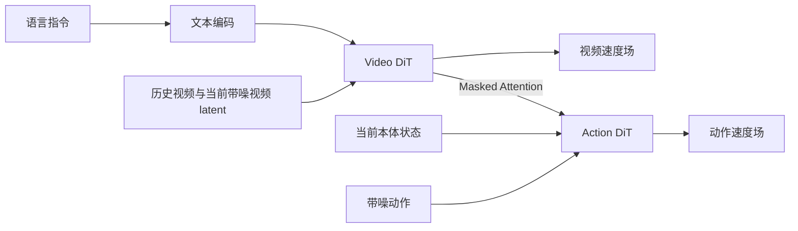

# SWAM：视频模型怎样学会控制机器人，又不丢掉原有能力

SWAM 最值得看的，是它把 WAM 的训练问题拆得很具体：**视频预训练提供了语言与视觉动态之间的联系，但把动作分支接进来以后，还需要靠合适的数据、标注和信息交互方式，才能把这些能力转化成机器人控制。**

一段视频可以告诉模型“杯子被拿起来了”，机器人动作还必须说明哪只手移动、朝哪个方向、怎样旋转、何时闭合夹爪。两者相关，但监督内容不同。SWAM 围绕这层联系，研究语言描述、动作标签、多源数据配比和模型结构，再验证增加预训练投入有没有继续带来收益。

论文：*SWAM: Scaling World Action Models with Cross-Modal Alignment*，Yu Zhou、Xinyuan Xia 等，上海交通大学、Shanghai Innovation Institute、Noematrix、西湖大学、同济大学等机构，2026 年 11 月 9 日提交。

资料：[论文](https://arxiv.org/abs/2611.12870) · [全文与附录](https://arxiv.org/html/2611.12870v1) · [项目与演示](https://char-lotte-xia.github.io/swam-official/) · [代码](https://github.com/shaaaaron/SWAM) · [数据](https://huggingface.co/datasets/FreDERicia/SWAM-Pretrain)。下面讨论的是 Scaling World Action Models 这篇 SWAM。

## 1. 三种模型分别学什么

先把视频预测、动作预测和二者的联合建模分开。

| 模型视角 | 条件 | 预测目标 | 需要解决的问题 |
| --- | --- | --- | --- |
| 视频模型 | 历史视觉、语言 | 未来视频 | 接下来场景怎样变化 |
| VLA | 视觉、语言、本体状态 | 机器人动作 | 机器人接下来怎样动 |
| SWAM 采用的 WAM | 历史视觉、语言、本体状态 | 未来视频与对应动作 | 把视觉变化连接到控制输出 |

概念上，可以分别写成：

$$
p(V_f\mid V_h,L),\qquad
\pi(A_f\mid V_h,L,S),\qquad
p(V_f,A_f\mid V_h,L,S).
$$

其中 $V_h$ 是已观测视觉历史，$V_f$ 是未来视觉，$A_f$ 是未来动作，$L$ 是语言，$S$ 是当前本体状态。

这不是说所有 VLA 都完全没有动态知识，也不是说联合预测视频就自动得到了可靠物理模型。它区分的是训练目标与部署接口。

SWAM 的出发点是：视频模型已在大量数据上学习过对象、运动、场景和语言之间的关系。机器人数据相对有限，最好让动作学习利用这份已有能力，同时继续约束视频分支，避免只适应少量下游场景。

## 2. 跨模态对齐，具体对齐了什么

论文讨论的 Alignment 可以拆成三层：

**语言与视频内容对应。** “右手抓起蓝色包装”应该对应正确对象、执行手和操作过程，不能只是一句泛泛的任务名称。

**语言与视频时间对应。** 当前片段正在抓取，文本就不应描述后续放置。即使整条轨迹的文字都写对了，错配时间也会使监督变差。

**视频与动作对应。** 视频中的夹爪移动，需要与同一时间段内的位姿、旋转和夹爪开合记录对应。动作坐标、时间戳或有效性出错，会让模型学到互相矛盾的关系。

因此，这里的对齐主要通过配对数据、时间组织、注意力交互和联合训练实现。论文并没有另外设置一个核心的 CLIP 式对比损失，把“对齐”变成一个单独分数。

这也是文章的研究价值：把“更多视频能帮助机器人”具体化成了可改变、可消融的训练因素。

## 3. 两个 DiT 怎样协作

SWAM 使用 Mixture of Transformers（MoT）双分支：

- Video DiT 从 Wan2.2-TI2V-5B 初始化，沿用视频生成先验。
- Action DiT 随机初始化，包含动作和状态编码、Transformer 及动作输出模块。
- 两个分支保留各自的 residual stream，通过 shared masked attention 交互。
- 语言直接进入视频分支，动作分支通过视频特征间接获得语言信息。

这张图省略了 flow time 等输入，强调的是语义信息路径。语言先进入已经学过语言–视频关系的模块，再传给新动作分支。

作者的解释是，如果给动作分支再加独立的文本 cross-attention，这条新路径也需要学会如何解释语言。有限的动作训练数据未必足以把它训练好。让动作分支使用视频分支已有的语义特征，可以减少重新建立语义映射的负担。

对应架构消融中，普通 Dual-stream 的 Hard 成功率是 52.48%，采用论文方案后为 57.36%，提高 4.88 个百分点。这支持该路径在这组实验中的价值，但没有证明任意 WAM 都应该删除动作侧语言输入。[模型结构 §3.1 与架构消融 §4.3](https://arxiv.org/html/2611.12870v1#S3.SS1)

### 单向注意力，不等于单向梯度

前向计算中，视频 token 不读取动作 token；动作 token 可以读取视频特征。因而动作不会作为输入改变视频分支的预测。

但训练时，动作输出依赖视频特征。若没有 stop-gradient，动作损失仍然可以沿这条依赖更新视频分支。论文明确说明模型参数参与训练，不能把这个结构解释成“冻结视频基座，所以原能力一定不会被破坏”。

这是两个问题：**Attention mask 决定模型能读取什么；梯度设置决定哪些参数会被损失更新。** 保留视频目标和多源视频数据，正是持续约束这部分能力的重要手段。

## 4. 输入、时间块与动作表示

SWAM 使用头部、左腕和右腕三路相机，将其组织成 $256\times320$ 的画面，经 Video VAE 编码成 latent。三视角帮助同时观察整体任务和局部交互，但拼接画面本身不等于建立了显式三维场景模型。

双臂动作采用 16 维末端表示：

$$
a_t=[p_L,q_L,g_L,p_R,q_R,g_R]\in\mathbb R^{16}.
$$

每只手包含 3 维位置、4 维四元数和 1 维夹爪值。视频、状态与动作要覆盖对应的物理时间段；不同模态的采样频率可以不同。

每个预测 chunk 对应 **2 个视频 latent 时间帧和 48 个动作时间步**。这里的 latent 帧经过视频 VAE 的时间压缩，不能直接理解成两张原始 RGB 图片。

注意力大致遵循：

| Query 来自哪里 | 可以读取什么 |
| --- | --- |
| 视频分支 | 当前及历史视频，遵守时间因果约束 |
| 动作分支 | 历史和当前 chunk 的视频特征，以及当前 chunk 的状态、动作 token |

“因果”主要约束跨时间块的信息使用，并不意味着当前动作序列内只能逐个标量自回归生成。SWAM 是分块联合生成视频与动作，不需要先输出一整段完整视频，再独立调用另一个 inverse dynamics 模型。

## 5. 联合 Flow Matching 怎么训练

设当前 chunk 的干净视频 latent 为 $x$，动作序列为 $A$，两路独立高斯噪声为 $\epsilon_v,\epsilon_a$。论文采用数据到噪声的时间方向：

$$
x^\tau=(1-\tau)x+\tau\epsilon_v,
$$

$$
A^\tau=(1-\tau)A+\tau\epsilon_a.
$$

同一 chunk 的视频和动作共享 $\tau$，但噪声独立。两路预测各自的速度场：

$$
\mathcal L_v=\mathbb E\left[\|u^v_\theta-(\epsilon_v-x)\|^2\right],
$$

$$
\mathcal L_a=\mathbb E\left[\|u^a_\theta-(\epsilon_a-A)\|^2\right].
$$

对有效的配对样本，论文等权组合两项：

$$
\mathcal L=\mathcal L_v+\mathcal L_a.
$$

直观理解：模型看到一个被噪声扰动的未来片段与动作块，学习怎样将它们沿生成路径还原。按上述时间约定，生成从高噪声端走向数据端，积分方向与训练路径的数据到噪声方向相反。

### 没有动作标签的视频，也能使用

普通视频和多数 Ego 视频缺少可执行动作标签，仍可计算视频损失；UMI 和机器人样本中有效的动作标签才参与动作损失。可概念性写成：

$$
\mathcal L_i=\mathcal L_{v,i}+m_i\mathcal L_{a,i},
$$

其中 $m_i$ 表示动作监督是否有效，实际实现也可以对无效时间步或维度屏蔽。**缺失动作不是“零动作”**，不能用随意补零的控制目标代替监督缺失。

训练采用 teacher forcing，历史上下文使用干净视频；当前待预测 chunk 仍然带噪。推理时没有真实未来可以读取，动作依赖的是模型生成过程中的视频特征。

同时预测两个模态，并不自动保证动作执行后的真实画面等于预测画面。联合监督学习了关联，物理执行一致性仍要单独验证。[训练目标 §3.1.3](https://arxiv.org/html/2611.12870v1#S3.SS1.SSS3)

## 6. 四类数据，提供了不同的训练信号

| 数据来源 | 整理后规模，约 | 主要作用 |
| --- | ---: | --- |
| General Video | 10,910 小时 | 通用语言–视觉动态经验 |
| Egocentric Video | 10,986 小时 | 多样场景中的人类操作过程 |
| UMI Demonstrations | 15,285 小时 | 操作视频与夹爪运动、开合标签 |
| Robot Demonstrations | 9,836 小时 | 机器人观测、本体状态与执行动作 |

完整数据池约 47,017 小时、441 万条 episode。小时数表达的是源视频时长，不意味着每小时都提供同等质量或同等密度的动作监督。

UMI 数据通过 RoboPocket 采集。手持夹爪和手机视觉惯性跟踪提供位姿轨迹，夹爪传感器记录开合，再与相机建立时空对应。它比普通人手 RGB 视频更接近机器人末端控制接口。

但统一成 16 维格式之后，坐标系、可达性、接触方式和执行器限制依然可能不同。数据格式统一是迁移的前提之一，不能消除所有 embodiment gap。

### 一个容易忽略的阶段：先适应视频计算方式

WAM 会改变原视频模型的输入时长、分辨率和因果注意力设置。论文先用 General Video 做过渡训练，让视频分支在相近内容分布下适应这些计算变化，再引入具身数据。

可以把训练逻辑概括为：

**视频基座 → 通用视频过渡适配 → Ego/UMI 多源学习 → 机器人数据继续预训练 → 下游任务后训练。**

这是理解各阶段作用的主线。论文的不同消融会省略或改变部分阶段，不能把所有表格当作同一个 checkpoint 依次加模块后的结果。

## 7. 哪些消融最值得借鉴

### 语言标注：要写清操作，也要对应正确时间

同一段视频可以有不同粒度的描述：

- 简短任务：“抓起零食。”
- 补充对象：“抓起浅蓝色包装的零食。”
- 描述过程：“右手接触并抓住零食，随后提起；左手不参与。”

对应消融中：

| 标注条件 | RoboTwin Hard SR |
| --- | ---: |
| Subtask Brief | 47.20% |
| Subtask Detailed | 53.52% |
| Detailed 加场景与光照 | 55.04% |
| Detailed 在轨迹内打乱时间对应 | 52.00% |

详细标注相比简短标注提高 6.32 个百分点；对齐描述与打乱描述相差 1.52 个百分点。它支持内容与时间对应的重要性，但“文本越长越好”不是结论。凭空添加不可见细节可能增加错误监督。

场景描述帮助泛化，也不等于背景一定被模型当成任务必要条件。更值得检验的是，在目标不变、背景改变时，模型能否保留正确对象和动作关系。

### UMI 动作标签：保持视频不变，检查动作监督

论文保留所有 UMI 视频，仅改变有效动作标签覆盖率：从 0% 增加到 100%，Hard SR 从 46.72% 增至 51.28%，提高 4.56 个百分点。

这个实验较清楚地隔离了动作监督的作用。额外收益不能简单归因于“又多看了一批视频”，因为视频已经保留。

对数据采集的启发是：除了增加视频数量，提升可用动作标签比例、时间同步和位姿质量，也可能带来控制收益。

### 数据配比：视觉多样性与动作监督可以互补

在固定 20k steps 的配比实验中：

| Ego : UMI 采样比例 | Hard SR |
| --- | ---: |
| 1 : 0 | 42.56% |
| 1 : 1 | 53.84% |
| 0 : 1 | 51.28% |

这里的 1:1 是采样概率比例，不是源数据时长比例。该结果说明在当前预算与数据池下，混入 Ego 经验能够补充 UMI；不能推导成永远固定各一半。

数据配比也改变了每步有效动作监督的密度。因此，分析视频数据是否“更有用”时，还要记录动作损失实际看到多少有效样本。

### 加入强视觉特征，并不必然更好

额外图像特征实验中，Native Hard SR 为 49.52%，加入 DINOv2 后为 39.76%；其他图像 encoder 也有下降。

作者认为，新融合通路缺少与视频分支同等规模的预训练，可能增加对训练场景外观的依赖。这是合理解释，但结果本身证明的是特定接入方式与训练配方的表现，尚不能唯一确定退化机制。

这组 Native 的 49.52% 与架构表的 57.36% 来自不同实验设置，不能相减后声称“删掉图像 encoder 提高了 17.6 个百分点”。[消融 §4.2–4.3](https://arxiv.org/html/2611.12870v1#S4.SS2)

## 8. 标题里的 Scaling，到底扩了什么

论文主要增加的是**预训练步骤和在固定数据池上的累计曝光**，不是建立参数量、数据量、算力三者的通用幂律。

RoboTwin 的阶段实验如下，采用相同的下游后训练设置：

| Ego/UMI 预训练 | 后续 Robot 预训练 | Hard SR |
| --- | --- | ---: |
| 0 | 0 | 34.56% |
| 20k steps | 0 | 53.84% |
| 75k steps | 0 | 59.60% |
| 75k steps | 25k steps | 61.52% |

这里的“0”仍从已有 Wan 视频模型初始化。它表示没有额外的这轮 WAM 多源预训练，不能理解为整个系统从随机权重开始。

真机 scaling 实验中，累计采样视频时长从 22,500 小时增加到 90,000 小时，Hard 平均 SR 从 33.33% 提高到 48.89%。

三个规模量要分开：

| 数量 | 表示什么 |
| --- | --- |
| 约 47,000 小时 | 整理后的原始数据池总时长 |
| 90,000 小时 | 训练中累计采样的视频曝光，可重复使用数据 |
| 训练 steps | 更新次数，还需要结合 batch 与采样配比理解 |

因此，实验支持“在测试范围内继续投入预训练有收益”，尚未给出最优模型大小、最优数据比或收益永不饱和的结论。

另外，**61.52% 是阶段 scaling 表的结果，61.56% 是最终主对比表结果；48.89% 是真机 scaling 实验结果，40.00% 是真机主对比结果。** 它们属于不同实验记录，应分别保留。仅凭汇总数字，不能自行补出差异的全部原因，更不能挑最高值替代主表成绩。[Scaling §4.4 与主比较 §4.5](https://arxiv.org/html/2611.12870v1#S4.SS4)

## 9. 最终结果强在哪里，边界在哪里

### RoboTwin：优势主要体现在随机场景

| 模型 | Easy / C2C | Hard / C2R |
| --- | ---: | ---: |
| $\pi_{0.5}$ | 70.66% | 46.00% |
| OpenWAM | 89.30% | 48.70% |
| SWAM | 88.10% | 61.56% |

模型在 Clean 示范上后训练，再在 Hard 的背景、杂物、光照、桌面高度和相机变化下评估。SWAM 的 Hard 比 OpenWAM 高 12.86 个百分点，Easy 则低 1.20 个百分点。

这更适合解释成当前设置下跨场景泛化更好。任务本身已经在后训练中出现，不能把 Clean-to-Random 写成完全未见任务的零样本学习。

### 真机：40% 包含具体后训练和重试协议

Flexiv Rizon 4 双臂上的三个任务是叠杯、叠毛巾、物品入盒。主表 Hard 平均 SR 为：

| 模型 | Hard SR |
| --- | ---: |
| $\pi_{0.5}$ | 20.00% |
| OpenWAM | 23.33% |
| SWAM | 40.00% |

每个任务使用约 2,700–4,400 条示范分别后训练。每项任务、每种条件测试 30 次，三个任务等权平均。

协议允许首次失败后最多再进行 **5 次自主重规划尝试**，保留当前环境状态和执行历史。所有模型使用相同规则，但这个 SR 仍是包含重试预算的 trial 成功率，不是首次尝试成功率，也不是六次独立重置后的成功概率。

30 Hz 表示动作执行频率，不能直接当作完整视频–动作生成模型每秒运行 30 次。对实际部署，还需要报告一次 chunk 的生成耗时、等待和整个任务完成时间。

这组结果体现了方法在一定变化下的优势，也说明仍有大量 trial 未能完整完成任务。进一步研究应同时观察子任务进度、失败类型与每次重规划的收益。[真机评测附录 C](https://arxiv.org/html/2611.12870v1#A3)

## 10. SWAM 的世界模型，能不能用来测试候选动作

论文采用的分解为：

$$
p(V_f,A_f\mid V_h,L,S)
=p(V_f\mid V_h,L)\,
 p(A_f\mid V_h,V_f,L,S).
$$

视频分支预测语言条件下的未来；动作分支读取视频信息和本体状态，产生对应动作。视频分支没有直接以候选动作作为条件，本体状态也不直接进入其预测项。

因此，它支持“给任务，联合生成视觉未来与动作”，但没有直接提供标准的：

$$
p(V_f\mid V_h,A_{\mathrm{candidate}})
$$

接口来回答“如果我执行这一组指定动作，会出现什么结果”。

这关系到模型能做什么：若要比较向左拉与向右拉的后果，再依据结果选择动作，就需要动作条件动力学或另外的预测、评估机制。不能仅凭 WAM 名称推断它已经支持可靠的反事实规划。

联合生成也留下一个一致性问题：视频可能预测夹爪已经抓住物体，但实际动作因接触误差没有抓住。后续必须依赖真实新观测纠正，不能把模型想象的成功直接当作执行成功。

## 11. 怎样更直接地验证 Alignment

论文最充分的证据是控制成功率：改善描述、动作监督和信息路径后，下游泛化提高。对“内部对齐是否保留”的机制解释，还可以增加更直接的测量。

以下是研究建议：

| 要检验的能力 | 可设计的对照 |
| --- | --- |
| 语言是否真正改变行为 | 同一初始场景，更换目标物体或左右手指令 |
| 视频先验是否保留 | 比较接入动作训练前后的视频语义正确率与动态质量 |
| 视频与动作是否一致 | 执行生成动作，比较真实状态变化与预测变化 |
| 背景是否成为捷径 | 保留任务关系，系统改变背景、纹理、光照 |
| 长期记忆是否可靠 | 遮挡后重新出现、多阶段状态改变与重复访问 |
| 重规划是否有效 | 记录每次额外尝试的状态、耗时和新增成功 |

视频–动作一致性不宜只用像素误差。纹理不同可能仍完成了正确抓取，画面很像也可能漏掉接触失败。可以同时检查对象位姿、目标关系、夹爪接触和任务进度。

这些评测也有助于区分两个现象：模型的视频预测改善了，但动作映射仍差；或者动作成功率提高了，却没有证据说明视频分支的动态理解同步改善。

## 12. 和 VPP2 笔记放在一起，能得到什么训练判断

此前的 [WAM 训练参考：VPP2](WAM训练参考VPP2.md) 强调：操作过程与语言要对应，接入动作时要保留视频基座能力。SWAM 用多组数据和结构消融继续研究这些因素。

两份笔记的共同启发是：**训练数据里究竟包含什么操作信息，往往比“是否加了动作分支”更值得先弄清楚。**

但局部 subtask 描述与完整事件描述不必被理解成互相排斥。前者提高当前片段的监督精度，后者有助于表达完整目标与阶段关系。对长程操作，一个值得研究的方案是同时保留完整任务条件和当前阶段说明，再检验短期执行与长期一致性。

如果把 SWAM 思路用于自己的 WAM 实验，可以优先做三个控制变量实验：

1. **固定视频与计算预算，改变动作标签覆盖率。** 看动作监督是否带来独立收益。
2. **固定数据与后训练流程，比较语言进入动作分支的路径。** 同时测控制和视频能力。
3. **固定测试集，分开测首次执行与追加重规划。** 将策略泛化、恢复能力与额外计算收益分开。

每一步都记录训练曝光、有效动作标签量、后训练数据和真实推理耗时，避免只用一个“总小时数”解释所有提升。

## 13. 公开资源能支持到哪一步

截至 2026 年 11 月 11 日，官方代码仓库提供训练与 RoboTwin 评测入口，安装说明也提示数据、权重和仿真资产需要另外准备。本文没有运行训练或复现性能。[SWAM 代码仓库](https://github.com/shaaaaron/SWAM)

数据页明确说明其发布范围小于论文完整数据池：

- OpenVid、EgoVerse 及可分发机器人数据按计划发布。
- Panda70M、Ego4D、EgoSuite 需要从上游官方渠道获取。
- 内部 UMI 数据仍待 Noematrix 后续发布。

因此，论文中的约 47,000 小时不能等同于当前仓库已完整提供的可下载数据。特别是 UMI 既占较大规模，又承担关键动作监督，缺少它会影响完整配方复现。[官方数据范围说明](https://huggingface.co/datasets/FreDERicia/SWAM-Pretrain#data-scope)

我对 SWAM 的定位是：**一套围绕视频先验迁移到控制的、经过系统消融的训练配方。** 它表明详细且准确的语言监督、有效动作标签、合适的数据混合和语义信息路径，都能影响控制泛化。下一步更值得追问的是，这些收益能否转化为动作可验证、接触可判断、长期状态可维护的机器人能力。
