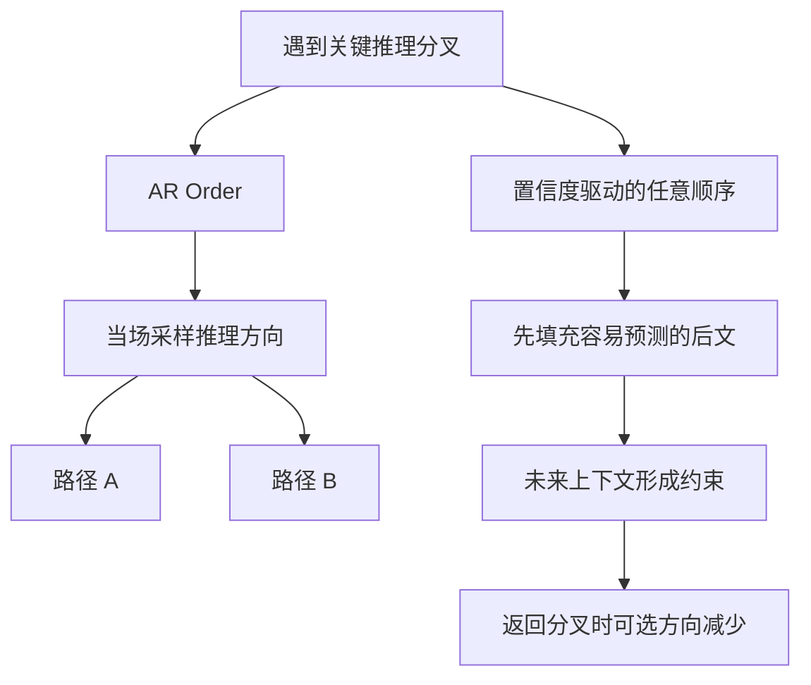

# The Flexibility Trap 论文解读：生成顺序怎样改变推理探索

**论文：** The Flexibility Trap: Rethinking the Value of Arbitrary Order in Diffusion Language Models  
**arXiv 早期标题：** The Flexibility Trap: Why Arbitrary Order Limits Reasoning Potential in Diffusion Language Models  
**作者与团队：** 倪赞林（Zanlin Ni）、王慎执（Shenzhi Wang）、乐洋（Yang Yue）等，清华 LeapLab 等  
**发表：** ICML 2026；[Outstanding Paper](https://blog.icml.cc/category/icml-2026/)  
**资源：** [论文](https://arxiv.org/abs/2601.15165) · [PDF](https://arxiv.org/pdf/2601.15165) · [项目主页](https://nzl-thu.github.io/the-flexibility-trap/) · [代码：JustGRPO](https://github.com/LeapLabTHU/JustGRPO)

**一句话概括：任意顺序生成提供了更多形式上的选择，但常用的置信度优先解码可能绕开关键推理分叉；作者通过在 RL 训练中采用自回归顺序，使 DLM 获得更有效的探索与可精确计算的策略概率。**

JustGRPO 是这篇论文提出的方法和开源实现名称，与论文属于同一项工作。[来源：项目主页](https://nzl-thu.github.io/the-flexibility-trap/)

## 一、DLM 为什么拥有更自由的生成顺序

传统 Autoregressive（AR）模型按从左到右的顺序生成：

$$
p_{\theta}(y\mid x)
=\prod_{t=1}^{T}p_{\theta}(y_t\mid x,y_{<t}).
$$

Masked Diffusion Language Model 可以从全 `[MASK]` 序列开始，反复选择位置进行填充。下面是省略重掩码等细节后的示意：

```text
AR：从左到右
[MASK] [MASK] [MASK] [MASK]
A      [MASK] [MASK] [MASK]
A      B      [MASK] [MASK]
A      B      C      D

DLM：允许选择不同位置
[MASK] [MASK] [MASK] [MASK]
[MASK] [MASK] C      [MASK]
[MASK] B      C      D
A      B      C      D
```

任意顺序包含从左到右这一种顺序，因此容易形成“顺序更自由，就能探索更多推理路径”的直觉。论文把**可选择的生成顺序**与**实际采样器能够覆盖的解**区分开来。

## 二、实验发现：形式自由度与可解题覆盖可能相背

作者在 LLaDA-Instruct、Dream-Instruct 和 LLaDA 1.5 上，对比从左到右的 AR Order 与常用置信度驱动的 Arbitrary Order，测试 GSM8K、MATH-500、HumanEval 和 MBPP。

任意顺序在 pass@1 上具有竞争力，但随着采样次数增加，其 pass@k 曲线增长更平缓。LLaDA-Instruct 的 HumanEval 实验中，在每题最多 1,024 次采样时：

| 可解题集合 | 占全部题目的比例 |
| --- | ---: |
| 只有 AR Order 能解出 | 21.3% |
| 只有 Arbitrary Order 能解出 | 0.6% |

作者还调整 block size $B$：$B=1$ 对应严格 AR 顺序，增大 $B$ 则给予块内更大的位置选择自由。实验中，更大的块内自由度对应更低的大 k 覆盖率。[来源：论文第 3.1 节](https://arxiv.org/html/2601.15165)

这里比较的是同一个 DLM 的具体采样方式。结论范围应保留在所研究的模型、任务和解码策略内。

## 三、机制解释：Entropy Degradation

置信度驱动解码倾向于先生成容易预测的位置，把高不确定性位置留到后面。然而，某些高熵位置恰好决定后续推理方向。



AR Order 必须处理当前最左侧未生成的位置，因此会在分叉仍开放时采样方向。置信度驱动的任意顺序则可能先确定后文，再回来填补分叉，使原先的选择受到未来内容约束。

可以用两个条件分布的熵帮助理解：

$$
H(Y_t\mid Y_{<t},Y_{>t}=c)
\quad\text{与}\quad
H(Y_t\mid Y_{<t}).
$$

当未来上下文 $c$ 已经固定时，某些原本开放的选择可能变得高度确定。论文发现，全局平均 token entropy 未必明显下降，但逻辑连接等关键位置的熵出现明显下降，称为 **Entropy Degradation**。[来源：论文第 3.2 节](https://arxiv.org/html/2601.15165)

这里要区分总体期望上的条件熵性质与某个具体上下文中的熵变化。对特定的 $c$，并不存在无条件保证其熵一定下降的逐例结论；论文的机制证据来自关键位置的实测变化。

## 四、为什么不能直接“高熵位置优先”

高熵至少可能来自两类不同原因：当前位置存在多个有效推理方向，或者必要上下文尚未形成。

例如，还没有开始推导，就要求模型补出证明末尾的符号，也会产生很高的不确定性，但它未必代表有价值的策略分叉。随机生成顺序同样可能破坏必要的上下文依赖。

因此，有效探索需要同时考虑不确定性和上下文是否充分。[来源：论文附加解码分析](https://arxiv.org/html/2601.15165)

## 五、JustGRPO：训练时建立一个精确的 AR Policy

作者在 RL 训练时让 DLM 使用 AR 顺序 rollout，再直接应用标准 GRPO。

计算位置 $t$ 的概率时，给定左侧 token，把当前与未来位置全部设为 mask：

$$
\widetilde{y}^{(t)}
= [y_1,\ldots,y_{t-1},\underbrace{\mathrm{MASK},\ldots,\mathrm{MASK}}_{\text{当前位置及未来位置}}].
$$

从模型在位置 $t$ 的输出读取分布：

$$
\pi_{\theta}^{\mathrm{AR}}(y_t\mid y_{<t},x)
=\operatorname{Softmax}(f_{\theta}(x,\widetilde{y}^{(t)}))_t[y_t].
$$

由此定义完整策略：

$$
\pi_{\theta}^{\mathrm{AR}}(y\mid x)
=\prod_{t=1}^{T}\pi_{\theta}^{\mathrm{AR}}(y_t\mid y_{<t},x).
$$

训练中的 token 概率比可以直接计算：

$$
\rho_{i,t}
=\frac{\pi_{\theta}^{\mathrm{AR}}(y_{i,t}\mid y_{i,<t},x)}
{\pi_{\theta_{\mathrm{old}}}^{\mathrm{AR}}(y_{i,t}\mid y_{i,<t},x)}.
$$

这一设计避免为任意顺序的组合轨迹求和，也减少了近似 likelihood 与采样器不一致带来的问题。AR 是训练策略采用的生成形式，模型架构和双向建模结构得以保留；推理时仍可使用并行采样器。[来源：论文第 4 节](https://arxiv.org/html/2601.15165)

## 六、实验结果与效率

基于 LLaDA-8B-Instruct，在生成长度为 256 时：

| 数据集 | JustGRPO 准确率 |
| --- | ---: |
| GSM8K | 89.1% |
| MATH-500 | 45.1% |
| HumanEval | 49.4% |
| MBPP | 52.4% |

这些是任务准确率，不能解释为相对 Base Model 的提升幅度。论文的系统级表格包含训练配置不同的既有方法，因此作者另做了统一全参数微调、每步生成一个 token、长度 256 的受控复现，对比仍支持 JustGRPO 的有效性。[来源：论文 Table 1、Table 2](https://arxiv.org/html/2601.15165)

主表评测使用块大小 32 的半自回归解码和 low-confidence remasking，但**每步只揭示一个 token**。因此，上面的准确率不能直接当作一次生成多个 token 时的准确率。论文另用 EB-Sampler 实验检验并行解码能力，支持模型仍可从并行采样中获得加速。[来源：论文第 5 节](https://arxiv.org/html/2601.15165)

### JustGRPO-Fast：把昂贵计算集中到高熵位置

DLM 无法像标准因果模型那样在一次 causal forward 中同时得到所有前缀条件概率，精确计算逐位置策略概率带来额外开销。

JustGRPO-Fast 因此只对 Top 25% 高熵位置计算昂贵的概率比，减少 75% 的此类前向评估。这借鉴了 [高熵少数 token](High-Entropy-Minority-Tokens.md) 的思想，但 75% 指这一类评估次数，不能直接解释为总训练时间减少 75%。[来源：论文第 5.3 节](https://arxiv.org/html/2601.15165)

## 七、这项工作对 Agent 研究意味着什么

以下属于应用推论。

Agent 拥有更多工具、更多可修改组件和更多执行顺序，也不意味着实际探索一定更充分。如果系统总是优先选择容易获得局部正反馈的动作，关键策略分叉可能持续被回避。

可检验的问题包括：恢复分支是否真正被尝试；改变计划顺序后，新增的成功实例来自哪里；在相同总预算下，系统是否保留更多有效策略，而不是只生成更多表面不同的轨迹。

这篇论文的核心价值，是把生成顺序当作影响探索和信用分配的机制，并用一个简洁的训练策略验证：**更有结构的探索，可以把模型已有的生成自由度转化为更有效的推理。**
