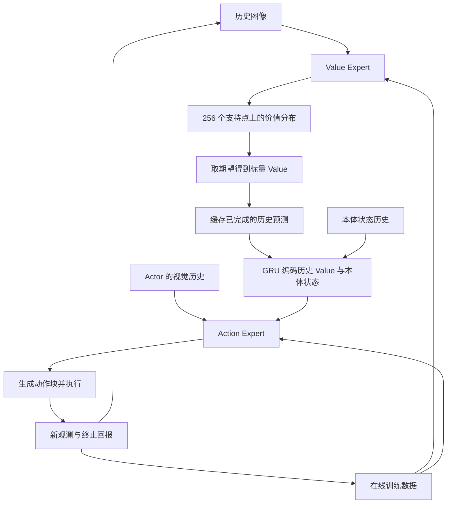

# VaM：把 Value Function 变成机器人执行时的进度记忆

机器人在桌上抓一块布，图像看起来差不多，实际却可能处于两种状态：刚刚抓稳，应该继续折叠；或者已经滑脱，需要张开夹爪重新抓取。只看当前画面，甚至看一小段视觉历史，策略也可能分不清。

VaM 的办法是：**把最近几次 Value 预测保存下来，让动作策略一起读取。** 策略不仅看到物体现在在哪里，还得到一个与任务目标有关的历史信号：此前是否在推进、是否停滞、是否出现退步。同时，系统利用最新执行数据更新 Value 和动作策略，使这份进度记忆能够适应当前策略的实际能力。

论文：**Value as Memory: Online Value-Guided Post-training for General Robot Policies**，Wenye Yu、Yijin Chen、Kaiyi Xiong 等，上海交通大学、上海创智学院与 Noematrix，2026 年 10 月 15 日。[项目主页](https://virlus.github.io/vam/)｜[论文](https://arxiv.org/html/2610.22368v1)

## 1. 先把两项贡献分开

这篇工作同时改变了策略的输入和后训练的组织方式。

| 部分 | 改了什么 | 希望解决什么问题 |
| --- | --- | --- |
| Value Caching | 将过去的价值预测加入动作策略输入 | 视觉相近，但实际阶段和应采取动作不同 |
| Online RL | 反复使用当前策略收集的数据更新两个专家，并并行组织采集与训练 | 离线更新反馈慢，模型与当前执行分布脱节 |

Value Cache 是推理时使用的记忆。Advantage 是训练动作策略时使用的质量标签来源。两者都由 Value Expert 提供，但用途不同。

论文报告的两个主要数字也对应不同对照：

- **29.4 个百分点**：完整 VaM 相比无 Value Cache 版本，在三个任务最后三个 checkpoint 上的平均成功率优势。
- **32.8 个百分点**：Online RL 相比匹配训练与数据采集预算的 Offline RL，在 LfE 后的平均成功率优势。

它们不能相加成一个“总提升”，也不能写成相对提升百分比。[实验与比较口径](https://arxiv.org/html/2610.22368v1#S4)

## 2. Value 为什么能作为 Memory？

### 2.1 普通 Value 的作用

在强化学习中，状态价值通常表达从当前状态出发、按某种策略继续执行时的未来折扣回报：

\[
V^\pi(s_t)=\mathbb E_\pi\left[\sum_{j=0}^{\infty}\gamma^j r_{t+j}\mid s_t\right].
\]

传统用法是拿它计算优势、训练策略，或者评估和筛选动作。完成训练后，Actor 推理时未必再读取 Critic。

VaM 多做了一件事：把 Critic 对过去观测的预测保存下来，直接作为 Actor 的输入。因此 Value 同时参与学习和部署决策。

### 2.2 为什么一段数值历史可能比当前分数更有用？

设有两段示意历史：

| 时刻 | 正常推进 | 抓取后滑脱 |
| --- | --- | --- |
| 较早时刻 | 0.30 | 0.50 |
| 下一时刻 | 0.40 | 0.50 |
| 下一时刻 | 0.50 | 0.50 |
| 最近时刻 | 0.70 | 0.20 |

这是用于解释机制的自拟数字，不是论文记录。

第一段显示持续改善，第二段显示停滞后下降。即使最近画面相近，两段历史也能给动作选择提供不同背景。

策略实际接收的是数值序列，不一定显式计算“上升”“下降”或某个阈值。识别这些模式并选择动作，是通过训练学到的。论文没有规定“Value 一下降就必须重新抓取”的控制规则。

### 2.3 它保存了什么，没有保存什么？

它保存的是**经过任务目标压缩的历史观测信息**。Value Expert 根据过去所见形成判断，Actor 接收这些判断的短序列。

这种表示很紧凑，但信息损失也大。同一个价值可能对应“杯子没抓住”“抽屉被卡住”或“物体位置不对”。仅靠一个标量，无法完整解释失败原因。

还要注意一个信息层面的边界：如果 Value 是从某组观测确定性计算出来的，它不会凭空增加传感器信息。它可能让有限容量的策略更容易利用任务相关信息；缓存也可能间接保留当前有限观测窗口之外的历史。收益不等于新增了真实世界的观测通道。

## 3. 两个专家分别做什么？

VaM 包含 Action Expert 和 Value Expert。

Action Expert 沿用 \(\pi_{0.5}\) 的结构，包括 PaliGemma-2B 视觉语言骨干和约 300M 参数的动作生成 Transformer。Value Expert 则改造原有的约 300M 动作 Transformer，用于价值预测，不能把它直接理解为又复制了一整个同规模 VLA。

两者分别处理自己的视觉历史。Actor 还使用本体状态历史和 Value Cache；价值模型的输出是一个离散分布，再取期望得到缓存的标量。[架构细节](https://arxiv.org/html/2610.22368v1#S3.SS4)

图中同时画出了推理与学习的数据关系；真正的执行还受到固定模型快照和异步调度约束。

## 4. Value Expert 怎样从进度估计变成回报估计？

### 4.1 分布预测与标量预测

论文在 \([0,1]\) 上设置 \(K=256\) 个等间距支持点：

\[
z_k=\frac{k-1}{K-1},\qquad k=1,\ldots,K.
\]

模型输出各支持点的概率：

\[
p_\psi(z_k\mid h_t^V),
\qquad
\hat V_t=\sum_{k=1}^{K}z_kp_\psi(z_k\mid h_t^V).
\]

其中 \(h_t^V\) 是价值模型可见的视觉历史。正文有时用 \(s_t\) 简写状态输入，实际实现应结合它的观测接口理解。

缓存中使用的是期望 \(\hat V_t\)，而不是整个 256 维分布。两个不同分布可能有相同期望，所以分布模型内部的信息并不会全部传给 Actor。

### 4.2 示范初始化：先学习成功轨迹中的相对位置

对一条长度为 \(T\) 的成功示范，在时刻 \(t\) 使用 \(t/T\) 作为进度中心，在支持点上构造归一化软标签，再用交叉熵训练 Value Expert。

直观上，模型先学会区分任务早期、中期和完成前的状态。

这只是初始化。假如示范中前半段移动很慢、后半段执行很快，\(t/T\) 仍然是时间位置，并不精确等于物理子任务完成比例。模型也不能只靠成功示范学会所有失败和恢复状态。

### 4.3 TD 训练：根据真实执行结果调整价值

在线阶段主要使用稀疏终止奖励：成功终止为 1，其余为 0。

定义一个动作块内的折扣回报：

\[
R_{t:t+H}=\sum_{j=0}^{H-1}\gamma^j r_{t+j}.
\]

标量形式的 TD 目标可以写成：

\[
y_t=R_{t:t+H}+\gamma^H(1-d_t)V_{\bar\psi}(s_{t+H}),
\]

其中 \(d_t\) 表示这段转移是否终止。实际训练对价值分布作对应变换并投影回固定支持点，再计算交叉熵，而不只是对标量 \(y_t\) 做均方误差回归。[价值学习定义](https://arxiv.org/html/2610.22368v1#S2.SS2)

### 4.4 为什么不能把 0.7 直接读成“已经完成 70%”？

TD 更新之后，价值更接近当前数据、策略和奖励定义下的未来折扣回报。它受到剩余执行长度、成功可能性、人工接管数据，以及失败前缀构造的影响。

即使最终都会成功，距离成功更远也可能因折扣得到较低价值。一个任务完成很多步骤，但已经进入难以挽救的状态，也可能得到低价值。

因此，论文把它用作 task-progress signal 是功能性描述。严格解读时，应称为**与成功和推进有关的学习信号**，不能未经校准当作完成百分比或原始任务成功概率。

## 5. Value Cache 怎样进入动作策略？

设 Actor 的观测历史长度为 \(H_\pi\)，缓存为：

\[
c_t=(\hat V_{t-H_\pi},\ldots,\hat V_{t-1}).
\]

完整策略输入为：

\[
x_t^\pi=(h_t^\pi,s_t,c_t),
\]

动作块从以下条件分布产生：

\[
a_{t:t+H-1}\sim\pi_\theta(\cdot\mid x_t^\pi,o_t).
\]

这里 \(o_t\) 是后面介绍的优势条件，与 Value Cache 本身不同。实验使用 \(H_\pi=4\)，通过 GRU 编码历史价值和本体状态，并把得到的表示加入动作模型的条件序列。

### 为什么不使用当前时刻的 Value？

价值预测与动作生成异步运行。生成当前动作时，\(\hat V_t\) 可能尚未计算完成，所以 Actor 读取已经完成的历史预测。

这样，动作生成不必等待当前 Critic 推理结束。但它仍需要运行价值模型，缓存也仍然存在时间滞后。不能将其描述为零额外推理成本。

### 为什么部署时使用固定快照？

论文在一轮部署中固定上一轮训练得到的 Value Expert。这样，同一轮缓存的分数来自相对一致的估计器。

否则，分数从 0.4 变成 0.6，可能只是 Critic 权重改变，而不是机器人真的取得了进展。固定快照可以减少这类混淆，但跨轮训练后，策略仍需适应变化后的价值分布。

缓存的采样频率、有效历史范围和部署控制频率也要区分。四个缓存值不自动意味着“四个控制步”或“四秒”，应根据实际调度和采样间隔解释。[Value Caching](https://arxiv.org/html/2610.22368v1#S3.SS2)

## 6. RL 信号如何训练 Flow Policy？

VaM 沿用优势条件化的策略学习思路。它不需要将 Actor 更新写成 PPO 的 clipping loss。

### 6.1 先计算动作块的 TD Advantage

\[
\hat A_t=R_{t:t+H}+\gamma^H(1-d_t)V_\psi(s_{t+H})-V_\psi(s_t).
\]

它比较执行动作块之后的回报与未来价值，和执行前的价值基准。价值误差会直接影响优势估计，所以一个不可靠的 Critic 会同时影响动作学习和缓存记忆。

注意，较高的终点 Value 不一定等于较高 Advantage。一个本来就容易成功的状态，与一个通过纠正动作明显改善局面的状态，需要相对于各自起点比较。

### 6.2 用分位数生成二值条件

对本轮在线数据的优势分布取分位数阈值：

\[
\xi_m=Q_{0.70}(\{\hat A_i\}_{i\in\mathcal D_{\mathrm{online}}^m}),
\qquad o_t=\mathbb I[\hat A_t\geq\xi_m].
\]

这大致将优势较高的 30% 样本标为 1。若有较多相同值，实际比例可能不同。

这个标签是当前数据中的相对质量划分，不是“成功动作 / 失败动作”的真实标签。即使整体数据质量低，也会产生相对较高优势的一组。

### 6.3 仍用 Flow Matching 学动作分布

设目标动作块为 \(a\)，采样高斯噪声 \(\epsilon\) 和生成时间 \(\lambda\)：

\[
a_\lambda=(1-\lambda)\epsilon+\lambda a.
\]

训练速度场：

\[
\mathcal L_{\mathrm{FM}}
=\mathbb E\left[
\|v_\theta(a_\lambda,\lambda,x_t^\pi,o_t)-(a-\epsilon)\|_2^2
\right].
\]

网络既看到带噪动作，也看到观测、价值历史和动作质量条件。训练时随机丢弃优势条件，以支持无条件分支。

推理时设 \(o_t=1\)，请求高优势条件下的动作。可进一步使用 classifier-free guidance 组合有条件与无条件速度场。

整体路径是：

**执行结果 → TD Value → Advantage 标签 → 条件化 Flow Matching → 偏向高优势动作的采样。**

这里的 \(\lambda\) 是 Flow Matching 的生成时间，与机器人执行时间 \(t\) 不同。更基础的解释见 [多模态生成详解](Multimodal-Generation.md)。

## 7. 四阶段训练：从成功示范到自主经验

| 阶段 | 主要数据 | Value Expert | Action Expert |
| --- | --- | --- | --- |
| 示范初始化 | 人类成功示范 | 学习归一化轨迹进度 | Behavior Cloning |
| Offline RL warmup | 示范、初始策略 rollout、人工干预 | TD 学习，加入失败前缀 | 优势条件化 Flow Matching |
| Online DAgger | 最新执行与人工纠正，混合历史数据 | 适应当前部署分布 | 学习纠正与当前高优势行为 |
| Learn from Experience | 自主 rollout，复用历史示范与干预 | 稀疏终止回报下继续 TD 更新 | 利用新优势标签继续改进 |

### 7.1 Warmup 为什么重要？

成功示范中的状态分布通常比较理想。初始策略真正执行后，会遇到偏移、滑脱、卡住和反复尝试。

Warmup 将这些部署状态带入价值和动作训练，避免直接拿只见过成功过程的价值模型指导后续自主学习。

### 7.2 Failed-prefix augmentation 怎样处理人工接管？

假设机器人执行到一半失败，人类接管纠正，最后任务成功。

如果只记录完整成功轨迹，Critic 可能将需要人类救援的状态也评得较高。VaM 从轨迹开始到人工接管点截取前缀，构造一个终止且奖励为零的失败样本；完整轨迹仍保留最终结果和跨接管的恢复信息。

这样，同一段经历提供两种监督：当前自主尝试走到了需要干预的位置，以及在后续纠正后仍然存在成功路径。

人工接管不等于环境在数学意义上已不可恢复。它是一种人为定义的失败监督，所以训练出的 Value 也受接管策略影响。接管早晚、频率和操作员判断可能改变模型学到的含义。

### 7.3 Online DAgger 与普通 DAgger 有什么关系？

它保留了“在当前策略会遇到的状态上提供专家纠正”的核心思想，但这里还同时训练价值模型，并用优势条件化方式更新动作模型。

所以不能把这部分概括为只收集纠正样本后再次做纯 BC。

### 7.4 LfE 的自主性到哪一步？

LfE 不再收集新的人工纠正，机器人用自主 rollout 的终止结果继续学习。此前积累的示范和人工干预片段仍参与训练。

因此，“后续无需新的动作纠正”与“完全没有人类数据”是不同判断。论文也不能据此被解释为解决了自动复位、所有奖励判定和无人值守部署问题。

## 8. Online 与异步，分别指什么？

这里存在三个容易混淆的时间尺度。

**动作级异步**：Value 推理与 Action 生成并行，当前动作读取历史缓存。

**系统级并行**：机器人采集、Value 训练、Action 训练可以重叠执行，降低整体等待。

**轮次级更新**：使用明确模型版本组织部署、数据标注与训练，论文仍定义了成对专家的轮次更新。

因此，“异步系统”不意味着每个动作都读取正在训练、不断变化的权重。复现时应记录策略版本、价值版本、观测时间戳和缓存时间戳，否则缓存变化与真实进度变化可能混在一起。

Online RL 的收益也有两层：计算流程重叠可以缩短墙钟时间；更频繁地根据最新策略经验更新，可以改变后续采集的数据分布。这两层不应都称为“反向传播加速”。

## 9. 实验效果：成功率与恢复率分开看

### 9.1 任务成功率

下表是最后三个在线 checkpoint 的平均成功率；不是单次最好结果。

| 方法 | 纸盒组装 | 衣物折叠 | 磁力巴士组装 |
| --- | --- | --- | --- |
| VaM | 96.7% | 88.9% | 76.7% |
| 无 Value Cache | 81.7% | 48.9% | 43.3% |
| RECAP | 71.7% | 64.4% | 43.3% |
| VaM 对无缓存的差值 | +15.0 个百分点 | +40.0 个百分点 | +33.4 个百分点 |

最后一行由展示的一位小数计算，平均值与论文报告的 29.4 个百分点存在舍入关系。论文误差条描述 checkpoint 间样本标准差，不能当成独立训练随机种子之间的置信区间。[Table 1](https://arxiv.org/html/2610.22368v1#S4.T1)

衣物折叠的收益最大，符合可变形物体接触状态容易混淆的动机。不过仅凭三个任务不能推出所有长时程操作都有类似收益。

### 9.2 恢复率

恢复率的分母是需要恢复的事件数，分子是完成受影响阶段的成功纠正事件数。一条 episode 可能包含多个事件，恢复某个阶段也不等于整条任务最终成功。

| 任务 | VaM | 无 Value Cache |
| --- | --- | --- |
| 纸盒组装 | 54.5% | 50.0% |
| 衣物折叠 | 86.4% | 58.8% |
| 磁力巴士组装 | 33.3% | 7.4% |

论文使用不知道方法身份的标注员评阅 LfE rollout。附录给出的磁力巴士恢复事件仅为 VaM 的 5/15、无缓存的 2/27，因而应同时关注样本量和事件难度分布。[恢复事件定义与计数](https://arxiv.org/html/2610.22368v1#A2.SS3)

这类自然执行中的恢复事件不是预先配对的同一组故障。不同策略会遇到不同数量和类型的问题，因此结果支持恢复能力改善，但不能视为对完全相同故障集的严格配对实验。

### 9.3 替换 Value Expert 的实验说明什么？

作者固定最后几个 checkpoint 的 Action Expert，保留缓存机制，只把 Value Expert 换成示范初始化或 warmup 后的旧快照。整体成功率下降，说明缓存值的来源和适应程度有影响。

项目还展示了固定观测、只替换价值历史后的动作预测变化。这比单看 PCA 图更直接地说明策略确实利用了这条条件通道。[价值来源实验](https://virlus.github.io/vam/)

但旧价值源的退化同时可能包含“估计不准确”和“Actor 收到了不熟悉的条件分布”。它还不能唯一证明模型学到了某种人类可解释的进度语义。

## 10. Online RL 的效率数字怎样解读？

在匹配数据采集与梯度步预算的比较中，Online RL 在 LfE 后平均高出 32.8 个百分点。它还通过重叠采集、价值训练和动作训练，将平均实验时间 / 梯度步降低 57.8%。

以纸盒组装为例，报告的实验总时间约为 Offline RL 6.51 小时、Online RL 2.52 小时。这描述比较协议内的实验墙钟时间，不是整个基础模型预训练成本，也不是单个 GPU kernel 或 backward 的速度。[在线与离线比较](https://arxiv.org/html/2610.22368v1#S4.SS4)

匹配采集数量也不等于收集了相同数据。Online RL 中策略更新更频繁，下一轮遇到的状态和错误会随之改变，这正是闭环学习可能有收益的原因之一。

这些结果说明在论文的任务和调度下，并行训练与更及时的数据反馈有效；它们没有直接证明多机器人集群下仍有相同吞吐收益。

## 11. 理论分析实际证明了什么？

论文考虑 soft aliasing：两个观测表示很近，但高优势动作分布相差很大。

记原观测距离为：

\[
\varepsilon_{\mathrm{obs}}=\|z_1^{\mathrm{obs}}-z_2^{\mathrm{obs}}\|_2.
\]

拼接价值缓存后：

\[
\varepsilon_\pi=
\sqrt{\varepsilon_{\mathrm{obs}}^2+\|c_1-c_2\|_2^2}.
\]

如果两份缓存有区别，输入空间里两种状态可以被拉开。对局部 \(L\)-Lipschitz 策略，设目标动作分布之间的 Wasserstein 距离为 \(\Delta_a\)，论文得到预测误差的下界：

\[
\max_i W_2(\pi_\theta(\cdot\mid z_i),\mu_i)
\geq\frac12(\Delta_a-L\varepsilon)_+.
\]

直观上，如果输入几乎一样，但正确动作很不一样，一个输出变化受限的模型很难同时拟合两者。新增可区分的历史特征，可以放宽这个限制。

**下界变小不代表实际误差一定变小。** 理论没有保证 Critic 必然产生有用缓存，也没有保证训练会学到正确动作，更没有证明任意部分可观测任务都因此恢复 Markov 性。[理论与证明](https://arxiv.org/html/2610.22368v1#S3.SS2)

此外，表示尺度和局部 Lipschitz 常数也影响这个论证。不能通过随意放大数值，便宣称获得了更多状态信息。

## 12. 最值得继续验证的几个问题

### 12.1 比普通历史编码好在哪里？

No-cache 消融支持这条价值条件通道有帮助，但要判断 Value 的独特价值，还需要同等预算的历史 GRU、阶段预测、学习型 latent memory 等对照。

尤其应控制可见历史范围。若缓存间接涵盖了更早观测，而对照只看短窗口，那么收益可能同时来自更长历史和价值监督。

### 12.2 单标量是否足够？

多个不同子任务可能拥有相似价值。若下一动作取决于“刚刚完成哪一个步骤”，而不只是“整体离成功多近”，缓存可能无法消除歧义。

可以进一步比较标量期望、完整分布、阶段向量和价值模型隐状态。更多维度未必更好，但可以测试瓶颈发生在哪里。

### 12.3 Critic 错了，会怎样？

这里 Critic 同时决定训练标签与推理条件。错误可能在两个通道中共同影响策略，而不只是让训练损失有噪声。

值得测试人为偏置、延迟、缺失缓存，以及更换任务后的价值校准。它们能回答 Actor 是稳健利用趋势，还是过度依赖特定数值尺度。

### 12.4 下降是否一定意味着应该恢复？

未必。有些有效动作需要暂时离开目标、松开物体或重新定位。价值变化还可能来自视角和遮挡。

因此，固定“下降就重试”的规则不等于 VaM 的学习方法。应评测模型能否结合观测区分必要的暂时退让与真正失败。

### 12.5 缓存与在线学习怎样相互影响？

Online RL 会改变 Actor，也会改变 Critic。新 Actor 可能具备旧 Critic 未见过的恢复能力，新 Critic 又会改变 Actor 的输入分布。

目前的固定快照和轮次更新提供了组织方式，但长期部署中的版本兼容、价值漂移和数据再标注仍值得单独研究。

## 13. 对 Robot-Use Agent / RUA 的启发

VaM 工作在低层策略：根据观测与缓存生成动作块。Robot-Use Agent 还需要决定调用哪个技能、何时重试、哪些子任务已完成，以及失败后采用什么策略。

可以区分三类记忆：

| 记忆 | 表达什么 | 适合支持什么决策 |
| --- | --- | --- |
| Value history | 最近执行是否更有希望成功 | 检测停滞、辅助局部恢复 |
| 结构化执行记录 | 调用了什么、返回什么、重试几次 | 工具调度、避免重复失败 |
| 任务状态与事件记忆 | 哪些对象和子目标已改变 | 长程规划、顺序约束、终止判断 |

三者可以互补。一个分数下降不能告诉 Agent 到底是哪只手滑了，也不能代替对对象身份和操作历史的记录。

一个可检验的研究方案，是固定基础策略与任务集合，比较 raw observation、等长观测历史、value history、结构化执行记忆，以及二者组合。分别报告最终成功率、失败检测延迟、无效重试、恢复成功率和误终止率。

如果存在 benchmark 的官方输入约束，新增进度信号需要符合该协议。基于允许观测训练的预测值与仿真器内部成功状态是不同信息来源；后者若用于诊断，应作为明确的 oracle 对照，不能混入普通方法成绩。

这个扩展是研究建议，不是 VaM 已经完成的 Agent-level 实验。

## 14. Discussion：这篇工作最有价值的地方

VaM 把同一个 Value Expert 用在两个位置：训练时帮助辨别动作质量，执行时为策略提供任务相关的历史条件。这个连接使 Critic 从后台训练组件变成了实际决策接口。

它提供的记忆短、低维、依赖任务，因此适合表达推进与退步，却难以承担完整事件记忆。实验支持它在三个长时程真实操作任务中提高成功与恢复表现；理论解释了额外可区分特征可能带来的好处，但没有保证这种特征总是正确。

对后续研究，更值得追问的是：**什么样的进度表示能在策略不断更新后仍然可靠，并让下游决策真正用好执行反馈？** 这个问题同时连接低层动作策略、在线学习和高层技能调用，比简单地给策略多加一列分数更有意义。
